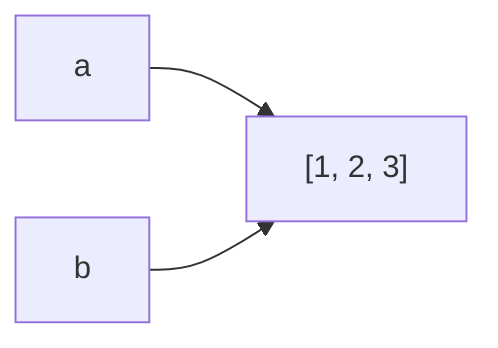

# Rédiger une leçon de l'Atelier NSI

Une leçon = un fichier Markdown `src/content/lecons/<module>/<NN>-<slug>.md`.
`<module>` et `<slug>` doivent correspondre au plan de `src/data/modules.ts` (NN = place dans le plan).
Après chaque modification : `npm run check` (exécute les corrigés), puis `npm run dev` pour voir la page.

## 1. L'en-tête

```yaml
---
titre: Boucles et traces d'exécution
resume: Répéter des instructions avec for et while, et suivre leur exécution pas à pas.
duree: 60                     # minutes, lecture + exercices
objectifs:                    # 3 à 5 verbes observables (« écrire », « tracer », « justifier »…)
  - Écrire une boucle `for` sur un `range` ou sur une liste
  - Tracer une boucle dans un tableau d'état
prerequis: [python/conditions]          # clés module/slug
programme: [lp-python, nsi1-langages]   # identifiants de src/data/programme.ts
cartes:                       # 6 à 10 cartes de révision, réponses courtes
  - q: Que contient `list(range(2, 9, 3))` ?
    r: "`[2, 5, 8]` : la borne de fin est exclue."
---
```

**Guillemets** : une valeur qui contient « : » (deux-points suivi d'une espace), un « # » ou des caractères spéciaux en tête doit être
écrite entre guillemets doubles, sinon YAML la lit comme une structure (`npm run check` le signale) : `- "Écrire un tri : insertion et sélection"`.

## 2. Le plan (toujours le même, vérifié par `npm run check`)

1. **Accroche** (avant le premier titre) : un problème concret, pourquoi la notion existe. 3 à 5 phrases.
2. **Sections de cours** `## 1. …`, `## 2. …` : une idée par section, du simple au précis.
   Chaque section contient au moins **un schéma ou un bout de code** (de préférence exécutable).
3. `## Exemple guidé` : un problème résolu pas à pas, au niveau des épreuves (démarche, code, justification).
4. `## L'essentiel` : la fiche mémo, 5 à 10 puces.
5. `## Exercices` : **en dernier**, 6 à 10 exercices du niveau 1 au niveau 4.

## 3. Les briques

```markdown
:::definition            :::retenir            :::attention
Une **variable** …       Ce qu'il faut savoir. Le piège classique.
:::                      :::                   :::

:::methode[Tracer une boucle]     ← titre personnalisé entre crochets
1. …
:::

:::prof
Côté enseignant : comment on l'enseigne au lycée, erreurs fréquentes des élèves.
:::

:::question[Que vaut `x` à la fin ?]
Réponse cachée, l'élève clique pour la voir.
:::
```

Schémas (Mermaid : graphes, arbres, automates, diagrammes de classes, séquences) :

````markdown

````

Code exécutable dans la page (le lecteur peut le modifier) :

````markdown
```python exec
print(7 // 2)
```

```python exec erreur          ← l'exemple DOIT lever une erreur (vérifié)
int("douze")
```

```sql exec base=lycee
SELECT nom FROM eleve;
```

```javascript exec            ← exécuté dans un bac à sable (console.log = affichage)
console.log([1, 2, 3].map((x) => x * 2));
```
````

Chaque bloc exécutable est **indépendant** : il ne voit pas les variables des blocs précédents (le vérificateur le signale).

Formules : `$O(n \log n)$` en ligne, `$$ … $$` en bloc. Tableaux Markdown pour les traces.

## 4. Les exercices

Niveaux : **1** Découverte · **2** Entraînement · **3** Approfondissement · **4** Type concours.
Le type est déduit du contenu :

````markdown
::::exercice[Titre de l'exercice]{niveau=1}
Énoncé (Markdown).

- [ ] mauvaise réponse            ← une liste à cocher = QCM
- [x] bonne réponse               ← plusieurs [x] = plusieurs bonnes réponses

:::corrige
Explication.
:::
::::

::::exercice[Écrire une fonction]{niveau=2}
Énoncé.

```python depart
def f(x):
    ...
```

```python tests
assert f(2) == 4, "cas simple"        ← une ligne assert par test ; le message sert d'intitulé
assert f(0) == 0, "zéro"
```

:::indice
Un coup de pouce (on peut en mettre plusieurs).
:::

:::corrige
```python solution
def f(x):
    return 2 * x
```
Explication, coût, variantes.
:::
::::

::::exercice[Une requête]{niveau=2 base=lycee}
Énoncé.

:::corrige
```sql solution
SELECT … ;
```
:::
::::

::::exercice[Question de rédaction]{niveau=4 duree=20}
Énoncé (preuve, trace, analyse, conception…).

:::criteres
- Critère de réussite 1 (ce qu'un correcteur attend) ;
- Critère 2 …
:::

:::corrige
Corrigé rédigé comme une copie modèle.
:::
::::
````

Règles :
- `npm run check` exécute **chaque** `python solution` contre ses tests et **chaque** `sql solution` sur sa base :
  un corrigé faux bloque la vérification.
- Les critères (`:::criteres`) sont le barème : ils servent à l'auto-évaluation aujourd'hui, et à la correction
  par IA plus tard (voir `docs/correction-ia.md`). Écris-les comme des points vérifiables.
- Pas de `input()` dans le code exécuté : mettre les valeurs dans des variables.
- Bases SQL : `public/bases/<nom>.sql` (création des tables + données).

## 5. Le ton

- Tutoiement, phrases courtes, un exemple concret avant chaque définition.
- Vocabulaire exact du programme (on prépare un concours) : on le définit, puis on l'utilise.
- Chaque affirmation technique est vraie et vérifiable ; chaque code est exécuté.
- Pas de remplissage : si une phrase n'apprend rien, on l'enlève.
