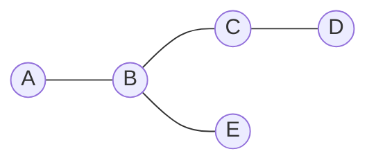

Comment représenter les relations entre des millions de personnes ? Par un **graphe** : chaque personne est un **sommet**, et chaque lien d'amitié est une **arête** entre deux sommets.

## 1. La distance entre deux personnes

La **distance** entre deux sommets est le **plus petit nombre d'arêtes** à parcourir pour aller de l'un à l'autre. Si Ali est ami avec Bea, et Bea avec Cleo, la distance entre Ali et Cleo vaut 2 : Cleo est une amie d'amie.

## 2. L'excentricité

L'**excentricité** d'un sommet est sa distance au sommet **le plus éloigné** de lui. Elle mesure à quel point une personne est loin de tout le réseau.

Prenons ce graphe : A–B, B–C, C–D et B–E.



Calculons l'excentricité de A : B est à distance 1, C et E à distance 2, D à distance 3. Le plus éloigné est D : l'excentricité de A vaut **3**.

De la même façon pour chaque sommet :

| Sommet | Distances aux autres | Excentricité |
| --- | --- | --- |
| A | B : 1, C : 2, D : 3, E : 2 | 3 |
| B | A : 1, C : 1, D : 2, E : 1 | 2 |
| C | A : 2, B : 1, D : 1, E : 2 | 2 |
| D | A : 3, B : 2, C : 1, E : 3 | 3 |
| E | A : 2, B : 1, C : 2, D : 3 | 3 |

## 3. Diamètre, rayon et centre

| Mesure | Définition | Ici |
| --- | --- | --- |
| **Diamètre** | la plus grande excentricité | 3 |
| **Rayon** | la plus petite excentricité | 2 |
| **Centre** | les sommets dont l'excentricité est égale au rayon | B et C |

Le diamètre est la plus grande distance entre deux personnes du réseau. Le centre regroupe les personnes les mieux placées pour atteindre tout le monde rapidement.

## 4. Un petit monde

En 1967, le chercheur Stanley **Milgram** demande à des personnes de faire parvenir une lettre à un inconnu, en la transmettant seulement à des connaissances. Les lettres arrivées ont fait en moyenne environ **six** intermédiaires.

Cette expérience suggère que, même dans un réseau immense, deux personnes sont reliées par une chaîne courte. Un tel graphe est appelé un **petit monde**.

## 5. Ce que tu vois dépend de tes amis

Tu vois surtout ce que partagent tes contacts, et ce que l'algorithme te recommande à partir de tes choix. Si tous tes amis pensent pareil, tu ne vois qu'un seul point de vue.

- Le **bonding** renforce les liens à l'intérieur d'un même groupe.
- Le **bridging** crée des liens vers d'autres groupes.

Un réseau fait seulement de bonding peut enfermer dans une **bulle**, et appauvrir l'esprit critique. Les liens de bridging font circuler des idées nouvelles.

## L'essentiel

- Distance : le plus petit nombre d'arêtes entre deux sommets.
- Excentricité : la distance au sommet le plus éloigné.
- Diamètre : la plus grande excentricité. Rayon : la plus petite. Centre : les sommets d'excentricité égale au rayon.
- Petit monde : de courtes distances, même dans un immense réseau, comme l'a suggéré Milgram.

## Exercices

::::exercice[Vocabulaire]{niveau=1 type=associer}
Associe chaque définition à son nom.

| Définition | Nom |
| --- | --- |
| Une personne du réseau | sommet |
| Un lien entre deux personnes | arête |
| La plus grande excentricité | diamètre |
| La plus petite excentricité | rayon |
::::

::::exercice[Lire des distances]{niveau=1 type=reponses}
Graphe : Ali–Bea, Bea–Cleo, Cleo–Dan.

1. Quelle est la distance entre Ali et Cleo ?

   - 2

1. Quelle est la distance entre Ali et Dan ?

   - 3

1. Quelle est l'excentricité de Bea ?

   - 2

   > Dan est à distance 2.
::::

::::exercice[Calculer un diamètre]{niveau=2 type=completer}
Graphe : Ana–Bo, Bo–Cy, Cy–Di, Di–Eva, Cy–Fay. Complète les excentricités, puis les mesures.

```python calcul
g = {"Ana": ["Bo"], "Bo": ["Ana", "Cy"], "Cy": ["Bo", "Di", "Fay"], "Di": ["Cy", "Eva"], "Eva": ["Di"], "Fay": ["Cy"]}
def ex(s):
    d = {s: 0}
    f = [s]
    while f:
        x = f.pop(0)
        for v in g[x]:
            if v not in d:
                d[v] = d[x] + 1
                f.append(v)
    return max(d.values())
e = [ex(s) for s in g]
for v in e:
    print(v)
print(max(e))
print(min(e))
print("Cy")
```

| Sommet | Ana | Bo | Cy | Di | Eva | Fay |
| --- | --- | --- | --- | --- | --- | --- |
| Excentricité | [[4]] | [[3]] | [[2]] | [[3]] | [[4]] | [[3]] |

Le diamètre vaut [[4]], le rayon vaut [[2]], et le centre est [[Cy]].
::::

::::exercice[Deux communautés]{niveau=3}
Un graphe contient deux groupes d'amis très soudés. Dans le groupe 1, A, B et C sont tous reliés entre eux. Dans le groupe 2, D, E et F sont tous reliés entre eux. Seule l'arête C–D relie les deux groupes.

1. Quel est le diamètre de ce graphe ? Donne deux sommets qui le réalisent.
2. Quel est son rayon ? Quel est son centre ?
3. L'arête C–D disparaît. Peut-on encore calculer un diamètre ? Justifie.
4. Une information circule seulement dans le groupe 1. Pourquoi les membres du groupe 2 risquent-ils de ne pas la recevoir ? Cet exemple relève-t-il du bonding ou du bridging ? Quel est le rôle de l'arête C–D ?

:::criteres
- Diamètre 3, par exemple entre A et E.
- Rayon 2, centre C et D.
- Non : certains sommets ne sont plus reliés.
- Les liens internes relèvent du bonding, C–D du bridging.
:::

:::corrige
1. Le diamètre vaut **3**, par exemple A → C → D → E.
2. C et D sont à distance au plus 2 de tous les sommets : le rayon vaut **2**, et le centre est formé de **C et D**.
3. Non : il n'existe plus de chemin entre les deux groupes. Certaines distances ne sont donc plus définies.
4. Tant que l'information reste dans le groupe 1, elle ne passe pas par C–D. Les liens très denses dans chaque groupe relèvent du **bonding**. L'arête C–D est un lien de **bridging** : c'est le pont qui permet à l'information de changer de groupe.
:::
::::
