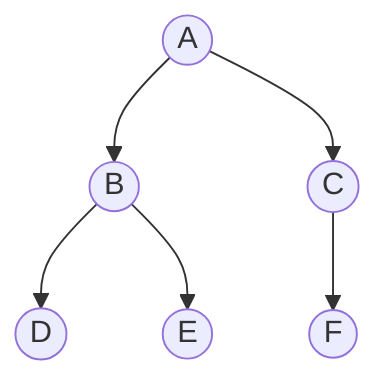

Un arbre binaire se définit lui-même de façon récursive : c'est soit un arbre vide, soit un nœud qui a un sous-arbre gauche et un sous-arbre droit, qui sont eux-mêmes des arbres. C'est pourquoi les algorithmes sur les arbres sont naturellement **récursifs** : on traite le nœud, et on confie les sous-arbres au même algorithme.

Dans toute la leçon, on utilise cet arbre :



A a pour enfants B et C, B a pour enfants D et E, et C a un seul enfant, F, à droite.

## 1. La taille

Comment compter les nœuds d'un arbre ? On raisonne ainsi : **la taille d'un arbre, c'est 1 pour la racine, plus la taille du sous-arbre gauche, plus la taille du sous-arbre droit**. Un arbre vide a une taille 0 : c'est le cas de base.

Pour notre arbre : le sous-arbre de B a 3 nœuds, celui de C en a 2, donc la taille vaut 1 + 3 + 2 = **6**.

## 2. La hauteur

Même raisonnement : **la hauteur, c'est 1 pour la racine, plus la plus grande des hauteurs des deux sous-arbres**. Un arbre vide a une hauteur 0.

Le sous-arbre de B a une hauteur 2, celui de C aussi : la hauteur vaut 1 + 2 = **3**.

```python exec
class Noeud:
    def __init__(self, valeur, gauche=None, droit=None):
        self.valeur = valeur
        self.gauche = gauche
        self.droit = droit

def taille(a):
    if a is None:
        return 0
    return 1 + taille(a.gauche) + taille(a.droit)

def hauteur(a):
    if a is None:
        return 0
    return 1 + max(hauteur(a.gauche), hauteur(a.droit))

arbre = Noeud("A", Noeud("B", Noeud("D"), Noeud("E")), Noeud("C", None, Noeud("F")))
print(taille(arbre), hauteur(arbre))
```

Le cas de base `if a is None` est indispensable : c'est lui qui arrête la récursion en bas de l'arbre.

## 3. Les parcours en profondeur

**Parcourir** un arbre, c'est visiter tous ses nœuds dans un certain ordre. Les trois parcours en profondeur se distinguent par le moment où l'on visite la racine.

| Parcours | Ordre | Sur notre arbre |
| --- | --- | --- |
| **préfixe** | racine, puis gauche, puis droit | A B D E C F |
| **infixe** | gauche, puis racine, puis droit | D B E A C F |
| **suffixe** | gauche, puis droit, puis racine | D E B F C A |

Le nom indique la place de la racine : **pré**fixe, **avant** ; **in**fixe, **au milieu** ; **suf**fixe, **après**.

:::methode[Trouver un parcours à la main]
Fais le tour de l'arbre avec ton crayon, en partant à gauche de la racine et en longeant chaque nœud. En **préfixe**, note un nœud la première fois que tu passes à côté de lui. En **infixe**, note-le quand tu passes en dessous. En **suffixe**, note-le quand tu le quittes pour la dernière fois.
:::

Le code suit exactement la définition :

```python exec
class Noeud:
    def __init__(self, valeur, gauche=None, droit=None):
        self.valeur = valeur
        self.gauche = gauche
        self.droit = droit

def prefixe(a):
    if a is None:
        return []
    return [a.valeur] + prefixe(a.gauche) + prefixe(a.droit)

arbre = Noeud("A", Noeud("B", Noeud("D"), Noeud("E")), Noeud("C", None, Noeud("F")))
print(prefixe(arbre))
```

Pour l'infixe ou le suffixe, il suffit de déplacer `[a.valeur]` au milieu ou à la fin.

## 4. Le parcours en largeur

On visite l'arbre **niveau par niveau**, de gauche à droite : A, puis B et C, puis D, E et F.

Pour cela, on utilise une **file** : premier entré, premier sorti. On y met la racine. Puis, tant que la file n'est pas vide, on retire le premier nœud, on le visite, et on ajoute ses enfants à la fin.

| Étape | On visite | On ajoute | File après |
| --- | --- | --- | --- |
| départ | | A | A |
| 1 | A | B, C | B C |
| 2 | B | D, E | C D E |
| 3 | C | F | D E F |
| 4 | D | | E F |
| 5 | E | | F |
| 6 | F | | vide |

```python exec
class Noeud:
    def __init__(self, valeur, gauche=None, droit=None):
        self.valeur = valeur
        self.gauche = gauche
        self.droit = droit

def largeur(a):
    resultat = []
    file = [a]
    while file != []:
        n = file.pop(0)
        if n is not None:
            resultat.append(n.valeur)
            file.append(n.gauche)
            file.append(n.droit)
    return resultat

arbre = Noeud("A", Noeud("B", Noeud("D"), Noeud("E")), Noeud("C", None, Noeud("F")))
print(largeur(arbre))
```

La file garantit que tous les nœuds d'un niveau sortent avant ceux du niveau suivant, puisqu'ils y sont entrés avant.

## L'essentiel

- Taille : 1 + taille(gauche) + taille(droit). Hauteur : 1 + le maximum des hauteurs. Arbre vide : 0.
- Préfixe : racine, gauche, droit. Infixe : gauche, racine, droit. Suffixe : gauche, droit, racine.
- Largeur : niveau par niveau, avec une file.

## Exercices

::::exercice[QCM : parcours d'arbres]{niveau=1 type=quiz}
On reprend l'arbre du cours : A a pour enfants B et C, B a pour enfants D et E, C a pour seul enfant F, à droite.

1. Quel est le parcours préfixe ?

   - [x] A B D E C F
   - [ ] D B E A C F
   - [ ] D E B F C A
   - [ ] A B C D E F

   > Racine, puis sous-arbre gauche, puis droit.

1. Quel est le parcours infixe ?

   - [ ] A B D E C F
   - [x] D B E A C F
   - [ ] D E B F C A
   - [ ] A B C D E F

   > Gauche, racine, droit.

1. Quel est le parcours suffixe ?

   - [ ] A B D E C F
   - [ ] D B E A C F
   - [x] D E B F C A
   - [ ] F E D C B A

   > Gauche, droit, racine : la racine est toujours en dernier.

1. Quel est le parcours en largeur ?

   - [ ] A B D E C F
   - [x] A B C D E F
   - [ ] D E F B C A
   - [ ] A C B F E D

   > Niveau par niveau, de gauche à droite.

1. Quelle structure utilise le parcours en largeur ?

   - [ ] une pile
   - [x] une file
   - [ ] un dictionnaire
   - [ ] un tableau trié

   > Les nœuds sont traités dans l'ordre où on les découvre.
::::

::::exercice[Écrire les parcours]{niveau=1 type=completer}
L'arbre a pour racine 1. Le sous-arbre gauche a pour racine 2, avec une feuille 4 à gauche. Le sous-arbre droit a pour racine 3, avec deux feuilles 5 et 6. Écris les valeurs séparées par un espace.

```python calcul
class N:
    def __init__(s, v, g=None, d=None):
        s.v, s.g, s.d = v, g, d
def pre(a): return [] if a is None else [a.v] + pre(a.g) + pre(a.d)
def inf(a): return [] if a is None else inf(a.g) + [a.v] + inf(a.d)
def suf(a): return [] if a is None else suf(a.g) + suf(a.d) + [a.v]
a = N(1, N(2, N(4)), N(3, N(5), N(6)))
print(" ".join(map(str, pre(a))))
print(" ".join(map(str, inf(a))))
print(" ".join(map(str, suf(a))))
print("1 2 3 4 5 6")
```

| Parcours | Résultat |
| --- | --- |
| Préfixe | [[1 2 4 3 5 6]] |
| Infixe | [[4 2 1 5 3 6]] |
| Suffixe | [[4 2 5 6 3 1]] |
| Largeur | [[1 2 3 4 5 6]] |
::::

::::exercice[Mesures d'un arbre]{niveau=2}
Avec la classe `Noeud` fournie, écris `taille(a)`, `hauteur(a)` (arbre vide : 0, racine seule : 1) et `somme(a)`, la somme des valeurs (des
nombres) de l'arbre.

```python depart
class Noeud:
    def __init__(self, valeur, gauche=None, droit=None):
        self.valeur = valeur
        self.gauche = gauche
        self.droit = droit

def taille(a):
    ...

def hauteur(a):
    ...

def somme(a):
    ...
```

```python tests
a = Noeud(5, Noeud(3, Noeud(1), Noeud(4)), Noeud(8, None, Noeud(9)))
assert taille(a) == 6, "taille"
assert hauteur(a) == 3, "hauteur"
assert somme(a) == 30, "somme"
assert taille(None) == 0 and hauteur(None) == 0 and somme(None) == 0, "arbre vide"
filiforme = Noeud(1, Noeud(2, Noeud(3, Noeud(4))))
assert hauteur(filiforme) == 4 and taille(filiforme) == 4, "arbre filiforme"
```

:::corrige
```python solution
class Noeud:
    def __init__(self, valeur, gauche=None, droit=None):
        self.valeur = valeur
        self.gauche = gauche
        self.droit = droit

def taille(a):
    if a is None:
        return 0
    return 1 + taille(a.gauche) + taille(a.droit)

def hauteur(a):
    if a is None:
        return 0
    return 1 + max(hauteur(a.gauche), hauteur(a.droit))

def somme(a):
    if a is None:
        return 0
    return a.valeur + somme(a.gauche) + somme(a.droit)
```

Trois fonctions, un seul schéma : cas de base `None`, puis combinaison des résultats des deux sous-arbres.
:::
::::

::::exercice[Les trois parcours]{niveau=2}
Écris `prefixe(a)`, `infixe(a)` et `suffixe(a)` qui renvoient la liste des valeurs dans l'ordre de chaque parcours.

```python depart
class Noeud:
    def __init__(self, valeur, gauche=None, droit=None):
        self.valeur = valeur
        self.gauche = gauche
        self.droit = droit

def prefixe(a):
    ...

def infixe(a):
    ...

def suffixe(a):
    ...
```

```python tests
a = Noeud("A", Noeud("B", Noeud("D"), Noeud("E")), Noeud("C", None, Noeud("F")))
assert prefixe(a) == ["A", "B", "D", "E", "C", "F"], "préfixe"
assert infixe(a) == ["D", "B", "E", "A", "C", "F"], "infixe"
assert suffixe(a) == ["D", "E", "B", "F", "C", "A"], "suffixe"
assert prefixe(None) == [] and infixe(None) == [] and suffixe(None) == [], "vide"
```

:::corrige
```python solution
class Noeud:
    def __init__(self, valeur, gauche=None, droit=None):
        self.valeur = valeur
        self.gauche = gauche
        self.droit = droit

def prefixe(a):
    if a is None:
        return []
    return [a.valeur] + prefixe(a.gauche) + prefixe(a.droit)

def infixe(a):
    if a is None:
        return []
    return infixe(a.gauche) + [a.valeur] + infixe(a.droit)

def suffixe(a):
    if a is None:
        return []
    return suffixe(a.gauche) + suffixe(a.droit) + [a.valeur]
```

Seule la **place** de `[a.valeur]` change d'un parcours à l'autre.
:::
::::

::::exercice[Parcours en largeur]{niveau=2}
Écris `par_niveaux(a)` qui renvoie la liste des niveaux de l'arbre, chaque niveau étant la liste de ses valeurs de gauche à droite. Par
exemple, pour l'arbre du cours : `[["A"], ["B", "C"], ["D", "E", "F"]]`.

```python depart
class Noeud:
    def __init__(self, valeur, gauche=None, droit=None):
        self.valeur = valeur
        self.gauche = gauche
        self.droit = droit

def par_niveaux(a):
    ...
```

```python tests
a = Noeud("A", Noeud("B", Noeud("D"), Noeud("E")), Noeud("C", None, Noeud("F")))
assert par_niveaux(a) == [["A"], ["B", "C"], ["D", "E", "F"]], "trois niveaux"
assert par_niveaux(None) == [], "vide"
assert par_niveaux(Noeud(1, None, Noeud(2))) == [[1], [2]], "deux niveaux"
```

:::corrige
```python solution
class Noeud:
    def __init__(self, valeur, gauche=None, droit=None):
        self.valeur = valeur
        self.gauche = gauche
        self.droit = droit

def par_niveaux(a):
    niveaux = []
    courant = []
    if a is not None:
        courant.append(a)
    while len(courant) > 0:
        niveaux.append([n.valeur for n in courant])
        suivant = []
        for n in courant:
            if n.gauche is not None:
                suivant.append(n.gauche)
            if n.droit is not None:
                suivant.append(n.droit)
        courant = suivant
    return niveaux
```

On traite les nœuds niveau par niveau : la liste `courant` joue le rôle de la file, en traitant tout un niveau à la fois.
:::
::::

::::exercice[Une expression arithmétique]{niveau=3}
L'expression `(3 + 4) * 2` peut se représenter par un arbre binaire : la racine est `"*"`, son enfant gauche est un nœud `"+"` dont les enfants sont 3 et 4, et son enfant droit est la feuille 2. Les feuilles contiennent des nombres, les autres nœuds un opérateur : `"+"`, `"-"` ou `"*"`.

1. Affecte à `expr` l'arbre de l'expression `(3 + 4) * 2`.
2. Écris `evaluer(a)`, qui renvoie la valeur de l'expression.
3. Écris `nb_operations(a)`, qui renvoie le nombre d'opérateurs.
4. Écris `ecrire(a)`, qui renvoie l'expression sous forme de texte, entièrement parenthésée : `"((3 + 4) * 2)"`. Une feuille s'écrit sans parenthèses.
5. À l'écrit : quel parcours `ecrire` réalise-t-il ? Quel parcours donne `* + 3 4 2` ?

```python depart
class Noeud:
    def __init__(self, valeur, gauche=None, droit=None):
        self.valeur = valeur
        self.gauche = gauche
        self.droit = droit

expr = ...

def evaluer(a):
    ...

def nb_operations(a):
    ...

def ecrire(a):
    ...
```

```python tests
assert expr.valeur == "*" and expr.gauche.valeur == "+" and expr.droit.valeur == 2, "arbre construit"
assert evaluer(expr) == 14, "valeur"
assert evaluer(Noeud(5)) == 5, "une feuille"
autre = Noeud("-", Noeud(10), Noeud("*", Noeud(2), Noeud(3)))
assert evaluer(autre) == 4, "soustraction"
assert nb_operations(expr) == 2, "deux opérateurs"
assert nb_operations(Noeud(5)) == 0, "aucun opérateur"
assert ecrire(expr) == "((3 + 4) * 2)", "texte"
assert ecrire(Noeud(5)) == "5", "feuille sans parenthèses"
```

:::corrige
```python solution
class Noeud:
    def __init__(self, valeur, gauche=None, droit=None):
        self.valeur = valeur
        self.gauche = gauche
        self.droit = droit

expr = Noeud("*", Noeud("+", Noeud(3), Noeud(4)), Noeud(2))

def evaluer(a):
    if a.gauche is None:
        return a.valeur
    g = evaluer(a.gauche)
    d = evaluer(a.droit)
    if a.valeur == "+":
        return g + d
    if a.valeur == "-":
        return g - d
    return g * d

def nb_operations(a):
    if a.gauche is None:
        return 0
    return 1 + nb_operations(a.gauche) + nb_operations(a.droit)

def ecrire(a):
    if a.gauche is None:
        return str(a.valeur)
    return "(" + ecrire(a.gauche) + " " + a.valeur + " " + ecrire(a.droit) + ")"
```

**Question 5.** `ecrire` réalise un parcours **infixe** : gauche, racine, droit. `* + 3 4 2` correspond au parcours **préfixe**.
:::
::::
