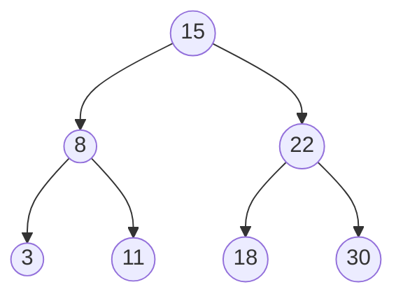

Dans un dictionnaire papier, tu ne lis pas tous les mots : tu ouvres au hasard, et tu sais immédiatement si ton mot est avant ou après. Un **arbre binaire de recherche** (ABR) permet le même genre de recherche rapide.

## 1. La règle

Un ABR est un arbre binaire où, **pour chaque nœud** :

- toutes les clés du sous-arbre **gauche** sont **plus petites** que la clé du nœud ;
- toutes les clés du sous-arbre **droit** sont **plus grandes**.



Vérifie sur cet exemple : à gauche de 15, on trouve 8, 3 et 11, tous plus petits que 15 ; à droite, 22, 18 et 30, tous plus grands. Et la règle est vraie aussi pour 8 et pour 22.

:::attention
La règle porte sur **tout** le sous-arbre, pas seulement sur les enfants directs. Si 11 était remplacé par 17, chaque nœud serait bien rangé par rapport à son parent, mais 17 se trouverait à gauche de 15 : ce ne serait plus un ABR.
:::

## 2. Rechercher une clé

À chaque nœud, une comparaison suffit pour savoir de quel côté continuer. On ne visite donc qu'**une seule branche**.

On cherche 11 :

| Nœud | Comparaison | Décision |
| --- | --- | --- |
| 15 | 11 < 15 | on va à gauche |
| 8 | 11 > 8 | on va à droite |
| 11 | égalité | trouvé, en 3 comparaisons |

On cherche 20 : 20 > 15, on va à droite ; 20 < 22, on va à gauche ; 20 > 18, on va à droite… et il n'y a rien. 20 n'est pas dans l'arbre.

```python exec
class Noeud:
    def __init__(self, cle, gauche=None, droit=None):
        self.cle = cle
        self.gauche = gauche
        self.droit = droit

def rechercher(a, x):
    if a is None:
        return False
    if x == a.cle:
        return True
    if x < a.cle:
        return rechercher(a.gauche, x)
    return rechercher(a.droit, x)

abr = Noeud(15, Noeud(8, Noeud(3), Noeud(11)), Noeud(22, Noeud(18), Noeud(30)))
print(rechercher(abr, 11), rechercher(abr, 20))
```

## 3. Insérer une clé

On descend exactement comme pour une recherche. Quand on arrive sur une place vide, on y crée une nouvelle **feuille**. Pour insérer 20, on descend jusqu'à la droite de 18 : 20 devient l'enfant droit de 18.

```python exec
class Noeud:
    def __init__(self, cle, gauche=None, droit=None):
        self.cle = cle
        self.gauche = gauche
        self.droit = droit

def inserer(a, x):
    if a is None:
        return Noeud(x)
    if x < a.cle:
        a.gauche = inserer(a.gauche, x)
    elif x > a.cle:
        a.droit = inserer(a.droit, x)
    return a

abr = None
for x in [15, 8, 22, 3, 11]:
    abr = inserer(abr, x)
print(abr.cle, abr.gauche.cle, abr.gauche.droit.cle)
```

- Si l'arbre est vide, l'insertion crée un nœud, qu'on renvoie.
- Sinon, on insère dans le bon sous-arbre, et on **raccroche** le résultat : `a.gauche = inserer(a.gauche, x)`. Sans cette affectation, la nouvelle feuille créée en bas ne serait reliée à rien.
- Si `x` est déjà présent, on ne fait rien.

## 4. Les clés triées

Le parcours **infixe** visite le sous-arbre gauche, puis la racine, puis le sous-arbre droit. Dans un ABR, cela donne les clés **dans l'ordre croissant** : 3, 8, 11, 15, 18, 22, 30.

## 5. Le coût

Une recherche suit une seule branche : elle fait au plus autant de comparaisons que la **hauteur** de l'arbre.

- Si l'arbre est **équilibré**, bien rempli, sa hauteur est d'environ log₂(n). Pour un million de clés, une vingtaine de comparaisons suffit.
- Si on insère les clés **dans l'ordre**, par exemple 1, 2, 3, 4, 5, chaque clé part à droite de la précédente. L'arbre devient **filiforme**, une seule branche, et sa hauteur vaut n. La recherche devient aussi lente qu'un parcours de tableau.

## L'essentiel

- ABR : pour chaque nœud, tout le sous-arbre gauche est plus petit, tout le sous-arbre droit plus grand.
- Rechercher et insérer : une comparaison par nœud, une seule branche suivie.
- Le parcours infixe donne les clés triées.
- Coût : la hauteur de l'arbre ; environ log₂(n) si l'arbre est équilibré, jusqu'à n s'il est filiforme.

## Exercices

::::exercice[QCM : arbres binaires de recherche]{niveau=1 type=quiz}
Une question à la fois : la correction s'affiche aussitôt.

1. Dans un ABR, où se trouvent les clés plus petites que la racine ?

   - [x] dans le sous-arbre gauche
   - [ ] dans le sous-arbre droit
   - [ ] n'importe où
   - [ ] dans les feuilles seulement

   > Par définition, à gauche plus petit, à droite plus grand.

1. Où se trouve le minimum d'un ABR ?

   - [ ] à la racine
   - [x] au nœud le plus à gauche
   - [ ] dans la feuille la plus à droite
   - [ ] n'importe où

   > On descend à gauche tant que possible.

1. On insère 1, 2, 3, 4, 5 dans cet ordre dans un ABR vide. Quelle est sa hauteur ?

   - [ ] 2
   - [ ] 3
   - [x] 5
   - [ ] 1

   > Chaque clé va à droite de la précédente : arbre filiforme.

1. Quel est le coût d'une recherche dans un ABR de hauteur h ?

   - [ ] toujours log₂(n)
   - [x] au plus h comparaisons
   - [ ] toujours n comparaisons
   - [ ] constant

   > On suit une seule branche.

1. L'arbre de racine 10, d'enfant gauche 5 et dont 5 a pour enfant droit 12, est-il un ABR ?

   - [ ] oui, car 12 > 5
   - [x] non, car 12 est dans le sous-arbre gauche de 10 et 12 > 10
   - [ ] oui, car il est binaire
   - [ ] impossible à dire

   > La propriété porte sur tout le sous-arbre.
::::

::::exercice[Dérouler une insertion]{niveau=1 type=reponses}
On insère dans cet ordre, dans un ABR vide : 40, 20, 60, 10, 30.

1. Quelle clé est à la racine ?

   - 40

1. Quel est l'enfant gauche de 20 ?

   - 10

1. Quel est l'enfant droit de 20 ?

   - 30

1. Combien de comparaisons faut-il pour trouver 30 ?

   - 3

1. Quel est le résultat du parcours infixe ? Écris les valeurs séparées par un espace.

   ```python calcul
   print(" ".join(map(str, sorted([40, 20, 60, 10, 30]))))
   ```

   - 10 20 30 40 60
::::

::::exercice[Compléter la recherche]{niveau=1 type=completer}
Complète la version itérative.

```python trous
def rechercher(a, x):
    while a is not [[None]]:
        if x == a.cle:
            return [[True]]
        elif x < a.cle:
            a = a.[[gauche]]
        else:
            a = a.[[droit]]
    return [[False]]
```
::::

::::exercice[Rechercher et insérer]{niveau=2}
Écris `rechercher(a, x)` et `inserer(a, x)` pour un ABR représenté avec la classe `Noeud` fournie. `inserer` renvoie l'arbre et ne fait rien si
x est déjà présent.

```python depart
class Noeud:
    def __init__(self, cle, gauche=None, droit=None):
        self.cle = cle
        self.gauche = gauche
        self.droit = droit

def rechercher(a, x):
    ...

def inserer(a, x):
    ...
```

```python tests
abr = None
for x in [15, 8, 22, 4, 11, 19, 30]:
    abr = inserer(abr, x)
assert abr.cle == 15 and abr.gauche.cle == 8 and abr.droit.droit.cle == 30, "forme"
assert rechercher(abr, 19) and rechercher(abr, 4), "présents"
assert not rechercher(abr, 12) and not rechercher(None, 3), "absents"
abr = inserer(abr, 12)
assert abr.gauche.droit.droit.cle == 12, "12 enfant droit de 11"
abr = inserer(abr, 15)
assert abr.droit.cle == 22 and abr.gauche.cle == 8, "doublon ignoré"
```

:::corrige
```python solution
class Noeud:
    def __init__(self, cle, gauche=None, droit=None):
        self.cle = cle
        self.gauche = gauche
        self.droit = droit

def rechercher(a, x):
    while a is not None:
        if x == a.cle:
            return True
        elif x < a.cle:
            a = a.gauche
        else:
            a = a.droit
    return False

def inserer(a, x):
    if a is None:
        return Noeud(x)
    if x < a.cle:
        a.gauche = inserer(a.gauche, x)
    elif x > a.cle:
        a.droit = inserer(a.droit, x)
    return a
```

La recherche est écrite en itératif, l'insertion en récursif : les deux versions sont attendues à l'écrit.
:::
::::

::::exercice[Est-ce un ABR ?]{niveau=2}
Écris `est_abr(a)` qui renvoie `True` si l'arbre binaire `a` est un arbre binaire de recherche (clés distinctes). Indication : un arbre est un
ABR si et seulement si son parcours infixe est **strictement croissant**.

```python depart
class Noeud:
    def __init__(self, cle, gauche=None, droit=None):
        self.cle = cle
        self.gauche = gauche
        self.droit = droit

def est_abr(a):
    ...
```

```python tests
bon = Noeud(15, Noeud(8, Noeud(4), Noeud(11)), Noeud(22, Noeud(19), Noeud(30)))
assert est_abr(bon), "ABR du cours"
piege = Noeud(10, Noeud(5, None, Noeud(12)), Noeud(20))
assert not est_abr(piege), "12 est à gauche de 10"
assert est_abr(None) and est_abr(Noeud(3)), "cas limites"
assert not est_abr(Noeud(5, Noeud(7))), "enfant gauche plus grand"
```

:::corrige
```python solution
class Noeud:
    def __init__(self, cle, gauche=None, droit=None):
        self.cle = cle
        self.gauche = gauche
        self.droit = droit

def infixe(a):
    if a is None:
        return []
    return infixe(a.gauche) + [a.cle] + infixe(a.droit)

def est_abr(a):
    t = infixe(a)
    for i in range(len(t) - 1):
        if t[i] >= t[i + 1]:
            return False
    return True
```

Comparer chaque nœud à ses seuls enfants ne suffirait pas : l'arbre `piege` passerait ce test (12 > 5) alors que ce n'est pas un ABR.
:::
::::

::::exercice[Le classement d'un jeu]{niveau=3}
Un jeu range les joueurs dans un ABR selon leur score. Chaque nœud contient un `score` (tous différents) et un `pseudo`.

1. Écris `meilleur(a)`, qui renvoie le pseudo du meilleur score, ou `None` si l'arbre est vide. Ta fonction doit suivre une seule branche.
2. Écris `classement(a)`, qui renvoie la liste des pseudos, du score le plus **élevé** au plus faible.
3. Écris `nb_superieurs(a, x)`, qui renvoie le nombre de scores strictement supérieurs à `x`.
4. À l'écrit : les joueurs sont insérés par scores croissants. Quelle est la forme de l'arbre ? Quel est le coût de `meilleur` ?

```python depart
class Noeud:
    def __init__(self, score, pseudo, gauche=None, droit=None):
        self.score = score
        self.pseudo = pseudo
        self.gauche = gauche
        self.droit = droit

def meilleur(a):
    ...

def classement(a):
    ...

def nb_superieurs(a, x):
    ...
```

```python tests
a = Noeud(50, "Ana", Noeud(20, "Bo", None, Noeud(30, "Cy")), Noeud(80, "Di"))
assert meilleur(a) == "Di", "le plus à droite"
assert meilleur(None) is None, "arbre vide"
assert classement(a) == ["Di", "Ana", "Cy", "Bo"], "ordre décroissant"
assert classement(None) == [], "classement vide"
assert nb_superieurs(a, 25) == 3, "trois scores"
assert nb_superieurs(a, 80) == 0, "aucun"
assert nb_superieurs(None, 1) == 0, "arbre vide"
```

:::corrige
```python solution
class Noeud:
    def __init__(self, score, pseudo, gauche=None, droit=None):
        self.score = score
        self.pseudo = pseudo
        self.gauche = gauche
        self.droit = droit

def meilleur(a):
    if a is None:
        return None
    while a.droit is not None:
        a = a.droit
    return a.pseudo

def classement(a):
    if a is None:
        return []
    return classement(a.droit) + [a.pseudo] + classement(a.gauche)

def nb_superieurs(a, x):
    if a is None:
        return 0
    if a.score <= x:
        return nb_superieurs(a.droit, x)
    return 1 + nb_superieurs(a.gauche, x) + nb_superieurs(a.droit, x)
```

**Question 4.** Chaque nouvelle clé part à droite : l'arbre est **filiforme**. Sa hauteur est n, et `meilleur` a un coût **linéaire**.
:::
::::
