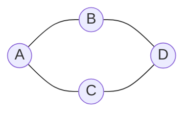

Peut-on aller de A à D en suivant les routes ? Combien de routes faut-il emprunter au minimum ? Pour répondre, on **parcourt** le graphe. Il existe deux grandes façons de le faire.

Dans toute la leçon, on utilise ce graphe, représenté par ses listes de voisins :

```python
g = {"A": ["B", "C"], "B": ["A", "D"], "C": ["A", "D"], "D": ["B", "C"]}
```



## 1. Marquer les sommets visités

Contrairement à un arbre, un graphe peut contenir des **cycles** : A, B, D, C, puis de nouveau A. Si on ne retenait pas les sommets déjà vus, on tournerait en rond sans fin. Tout parcours **marque** donc les sommets visités.

## 2. Le parcours en largeur

L'idée : on visite d'abord les voisins du départ, puis les voisins de ces voisins, et ainsi de suite, comme une onde qui s'élargit. On utilise une **file**.

| Étape | On retire de la file | Nouveaux voisins découverts | File après | Visités |
| --- | --- | --- | --- | --- |
| départ | | | A | A |
| 1 | A | B, C | B C | A B C |
| 2 | B | D (A est déjà vu) | C D | A B C D |
| 3 | C | aucun (A et D déjà vus) | D | A B C D |
| 4 | D | aucun | vide | A B C D |

```python exec
def largeur(g, depart):
    visites = [depart]
    file = [depart]
    while file != []:
        s = file.pop(0)
        for v in g[s]:
            if v not in visites:
                visites.append(v)
                file.append(v)
    return visites

g = {"A": ["B", "C"], "B": ["A", "D"], "C": ["A", "D"], "D": ["B", "C"]}
print(largeur(g, "A"))
```

Le parcours en largeur découvre les sommets **par distance croissante** au départ : d'abord ceux à 1 arête, puis ceux à 2 arêtes. Il donne donc le **plus court chemin en nombre d'arêtes**.

## 3. Le parcours en profondeur

L'idée : on avance le plus loin possible, et quand on est bloqué, on revient en arrière au dernier embranchement, comme dans un labyrinthe. La version récursive est très courte :

```python exec
def profondeur(g, s, visites):
    visites.append(s)
    for v in g[s]:
        if v not in visites:
            profondeur(g, v, visites)
    return visites

g = {"A": ["B", "C"], "B": ["A", "D"], "C": ["A", "D"], "D": ["B", "C"]}
print(profondeur(g, "A", []))
```

Déroulé : on part de A, on va vers son premier voisin B ; de B, A est déjà vu, on va vers D ; de D, B est déjà vu, on va vers C ; de C, tout est vu. On revient en arrière jusqu'à A. Ordre : **A, B, D, C**.

Une version sans récursion utilise une **pile** à la place de la file.

## 4. Chercher un chemin

Pour retrouver le chemin, et pas seulement savoir qu'il existe, on retient pendant un parcours en largeur **d'où vient** chaque sommet découvert : son **prédécesseur**.

| Sommet | Découvert depuis |
| --- | --- |
| B | A |
| C | A |
| D | B |

Pour le chemin de A à D, on remonte à l'envers : D vient de B, B vient de A. Le chemin est **A, B, D**.

## 5. Repérer un cycle

Dans un graphe **non orienté**, on fait un parcours en profondeur en retenant le sommet d'où l'on arrive. Si l'on rencontre un voisin **déjà visité** qui n'est **pas** celui d'où l'on vient, on a trouvé un autre chemin vers lui : il y a un cycle.

:::exemple
Dans notre graphe, en profondeur depuis A : A, B, D, puis C. Depuis C, le voisin A est déjà visité, et on vient de D, pas de A : il y a un cycle, A, B, D, C, A.
:::

## L'essentiel

- On marque toujours les sommets visités, pour ne pas tourner en rond.
- Largeur : avec une file ; donne le plus court chemin en nombre d'arêtes.
- Profondeur : récursive, ou avec une pile ; on va le plus loin possible, puis on revient en arrière.
- Chemin : on retient le prédécesseur de chaque sommet. Cycle : un voisin déjà visité qui n'est pas le parent.

## Exercices

::::exercice[QCM : parcours de graphes]{niveau=1 type=quiz}
Une question à la fois : la correction s'affiche aussitôt.

1. Quelle structure utilise le parcours en largeur ?

   - [x] une file
   - [ ] une pile
   - [ ] un arbre
   - [ ] un dictionnaire trié

   > Les premiers sommets découverts sont traités en premier.

1. Quelle structure remplace la récursivité dans un parcours en profondeur ?

   - [ ] une file
   - [x] une pile
   - [ ] une matrice
   - [ ] un tri

   > On repart du dernier sommet découvert.

1. Quel parcours donne le plus court chemin en nombre d'arêtes ?

   - [x] le parcours en largeur
   - [ ] le parcours en profondeur
   - [ ] les deux, toujours
   - [ ] aucun

   > Il découvre les sommets par distance croissante.

1. Pourquoi marquer les sommets visités ?

   - [ ] pour trier les sommets
   - [x] pour ne pas les traiter deux fois, et éviter une boucle infinie
   - [ ] pour économiser des arêtes
   - [ ] pour rendre le graphe orienté

   > Sans marquage, un cycle ferait tourner le parcours sans fin.
::::

::::exercice[Dérouler les parcours]{niveau=1 type=completer}
Graphe : `g = {"A": ["B", "D"], "B": ["A", "C"], "C": ["B", "E"], "D": ["A", "E"], "E": ["C", "D"]}`. Les voisins sont pris dans l'ordre des listes. Écris les sommets séparés par un espace.

```python calcul
g = {"A": ["B", "D"], "B": ["A", "C"], "C": ["B", "E"], "D": ["A", "E"], "E": ["C", "D"]}
vus, f = ["A"], ["A"]
while f:
    s = f.pop(0)
    for v in g[s]:
        if v not in vus:
            vus.append(v); f.append(v)
print(" ".join(vus))
def p(s, v):
    v.append(s)
    for x in g[s]:
        if x not in v:
            p(x, v)
    return v
print(" ".join(p("A", [])))
```

| Parcours depuis A | Ordre de visite |
| --- | --- |
| En largeur | [[A B D C E]] |
| En profondeur | [[A B C E D]] |
::::

::::exercice[Les deux parcours]{niveau=2}
Écris `largeur(g, depart)` et `profondeur(g, depart)` qui renvoient la liste des sommets dans l'ordre où ils sont visités. Pour la profondeur,
utilise la version récursive (avec une fonction auxiliaire ou un paramètre). Les voisins sont parcourus dans l'ordre des listes.

```python depart
def largeur(g, depart):
    ...

def profondeur(g, depart):
    ...
```

```python tests
g = {"A": ["B", "C"], "B": ["A", "D"], "C": ["A", "D"], "D": ["B", "C", "E"], "E": ["D"], "F": []}
assert largeur(g, "A") == ["A", "B", "C", "D", "E"], "largeur depuis A"
assert profondeur(g, "A") == ["A", "B", "D", "C", "E"], "profondeur depuis A"
assert largeur(g, "F") == ["F"] and profondeur(g, "F") == ["F"], "sommet isolé"
assert largeur(g, "E") == ["E", "D", "B", "C", "A"], "largeur depuis E"
```

:::corrige
```python solution
def largeur(g, depart):
    visites = [depart]
    file = [depart]
    while len(file) > 0:
        s = file.pop(0)
        for v in g[s]:
            if v not in visites:
                visites.append(v)
                file.append(v)
    return visites

def profondeur(g, depart):
    visites = []

    def explorer(s):
        visites.append(s)
        for v in g[s]:
            if v not in visites:
                explorer(v)

    explorer(depart)
    return visites
```

Dans le parcours en largeur, on marque un sommet **dès qu'on l'enfile**, pour ne pas l'enfiler deux fois.
:::
::::

::::exercice[Plus court chemin en nombre d'arêtes]{niveau=2}
Écris `distances(g, depart)` qui renvoie un dictionnaire associant à chaque sommet atteignable sa distance (nombre d'arêtes) au départ, puis
`chemin(g, a, b)` qui renvoie un plus court chemin de a à b sous forme de liste de sommets, ou `None` s'il n'y en a pas. Utilise un parcours en
largeur en retenant le **prédécesseur** de chaque sommet.

```python depart
def distances(g, depart):
    ...

def chemin(g, a, b):
    ...
```

```python tests
g = {"A": ["B", "C"], "B": ["A", "D"], "C": ["A", "D"], "D": ["B", "C", "E"], "E": ["D"], "F": []}
assert distances(g, "A") == {"A": 0, "B": 1, "C": 1, "D": 2, "E": 3}, "distances"
assert chemin(g, "A", "E") == ["A", "B", "D", "E"], "chemin A vers E"
assert chemin(g, "A", "F") is None, "pas de chemin"
assert chemin(g, "C", "C") == ["C"], "chemin trivial"
```

:::corrige
```python solution
def distances(g, depart):
    dist = {depart: 0}
    file = [depart]
    while len(file) > 0:
        s = file.pop(0)
        for v in g[s]:
            if v not in dist:
                dist[v] = dist[s] + 1
                file.append(v)
    return dist

def chemin(g, a, b):
    pred = {a: None}
    file = [a]
    while len(file) > 0:
        s = file.pop(0)
        for v in g[s]:
            if v not in pred:
                pred[v] = s
                file.append(v)
    if b not in pred:
        return None
    resultat = []
    s = b
    while s is not None:
        resultat.append(s)
        s = pred[s]
    resultat.reverse()
    return resultat
```

Les dictionnaires `dist` et `pred` servent aussi de marquage : un sommet y figure dès qu'il est découvert. On reconstruit le chemin **à
l'envers**, de b vers a, en suivant les prédécesseurs.
:::
::::

::::exercice[Repérer un cycle]{niveau=2}
Écris `a_un_cycle(g)` qui renvoie `True` si le graphe **non orienté** `g` contient un cycle. Utilise un parcours en profondeur qui retient le
sommet d'où l'on vient : un voisin déjà visité **différent du parent** signale un cycle. Pense aux graphes non connexes.

```python depart
def a_un_cycle(g):
    ...
```

```python tests
g1 = {"A": ["B", "C"], "B": ["A", "D"], "C": ["A", "D"], "D": ["B", "C", "E"], "E": ["D"], "F": []}
assert a_un_cycle(g1), "cycle A-B-D-C"
arbre = {"A": ["B", "C"], "B": ["A", "D"], "C": ["A"], "D": ["B"]}
assert not a_un_cycle(arbre), "un arbre n'a pas de cycle"
deux = {"A": ["B"], "B": ["A"], "C": ["D", "E"], "D": ["C", "E"], "E": ["C", "D"]}
assert a_un_cycle(deux), "cycle dans la deuxième composante"
assert not a_un_cycle({"X": []}), "sommet seul"
```

:::corrige
```python solution
def a_un_cycle(g):
    visites = []

    def explorer(s, parent):
        visites.append(s)
        for v in g[s]:
            if v not in visites:
                if explorer(v, s):
                    return True
            elif v != parent:
                return True
        return False

    for s in g:
        if s not in visites:
            if explorer(s, None):
                return True
    return False
```

Le voisin `parent` est toujours déjà visité (c'est l'arête par laquelle on est arrivé) : il ne compte pas. La boucle finale relance le
parcours depuis chaque sommet non visité, pour couvrir toutes les composantes.
:::
::::

::::exercice[Sortir d'un labyrinthe]{niveau=3}
Un labyrinthe est un tableau de chaînes : `#` désigne un mur et `.` une case libre. Une case est un couple `(ligne, colonne)`. On peut aller en haut, en bas, à gauche ou à droite.

1. Écris `est_libre(l, c)`, qui renvoie `True` si la case existe et n'est pas un mur.
2. Écris `voisins(l, c)`, qui renvoie la liste des cases libres voisines, dans l'ordre haut, bas, gauche, droite.
3. Écris `nb_etapes(depart, arrivee)`, qui renvoie le nombre minimal de déplacements entre deux cases, ou -1 si l'arrivée est inaccessible.
4. À l'écrit : pourquoi choisir un parcours en largeur plutôt qu'en profondeur ? Quel graphe ce labyrinthe définit-il ?

```python depart
class Labyrinthe:
    def __init__(self, grille):
        self.grille = grille

    def est_libre(self, l, c):
        ...

    def voisins(self, l, c):
        ...

    def nb_etapes(self, depart, arrivee):
        ...
```

```python tests
lab = Labyrinthe(["..#", ".##", "..."])
assert lab.est_libre(0, 0), "case libre"
assert not lab.est_libre(0, 2), "mur"
assert not lab.est_libre(-1, 0) and not lab.est_libre(0, 3) and not lab.est_libre(3, 0), "hors de la grille"
assert lab.voisins(1, 0) == [(0, 0), (2, 0)], "voisins"
assert lab.nb_etapes((0, 0), (2, 2)) == 4, "plus court chemin"
assert lab.nb_etapes((0, 0), (0, 0)) == 0, "déjà arrivé"
assert Labyrinthe([".#."]).nb_etapes((0, 0), (0, 2)) == -1, "inaccessible"
```

:::corrige
```python solution
class Labyrinthe:
    def __init__(self, grille):
        self.grille = grille

    def est_libre(self, l, c):
        if l < 0 or l >= len(self.grille):
            return False
        if c < 0 or c >= len(self.grille[0]):
            return False
        return self.grille[l][c] == "."

    def voisins(self, l, c):
        cases = [(l - 1, c), (l + 1, c), (l, c - 1), (l, c + 1)]
        return [p for p in cases if self.est_libre(p[0], p[1])]

    def nb_etapes(self, depart, arrivee):
        distances = {depart: 0}
        file = [depart]
        while file != []:
            s = file.pop(0)
            if s == arrivee:
                return distances[s]
            for v in self.voisins(s[0], s[1]):
                if v not in distances:
                    distances[v] = distances[s] + 1
                    file.append(v)
        return -1
```

**Question 4.** Le parcours en largeur découvre les cases par distance croissante : la première fois qu'il atteint l'arrivée, le chemin est le plus court. Les sommets du graphe sont les cases libres, et une arête relie deux cases voisines.
:::
::::
