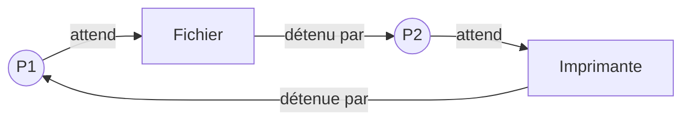

Des processus se partagent des ressources : fichiers, imprimante. Parfois, ils se bloquent mutuellement.

## 1. La situation

- P1 obtient l'imprimante, puis demande le fichier.
- P2 obtient le fichier, puis demande l'imprimante.

Chacun attend ce que l'autre ne libérera jamais : c'est un **interblocage** (*deadlock*).

On reconnaît un interblocage à un **cycle** dans ce schéma d'attente.

## 2. L'éviter

Une méthode simple : imposer à tous le **même ordre** de demande. Si tout le monde demande l'imprimante **avant** le fichier, le cycle ne peut plus se former.

## L'essentiel

- Interblocage : des processus s'attendent mutuellement.
- Il se repère à un cycle d'attente.
- Imposer un ordre de demande des ressources l'évite.

## Exercices

::::exercice[Interblocage ou non ?]{niveau=1 type=reponses}
Réponds par oui ou par non : y a-t-il un interblocage ?

1. P1 détient A et attend B ; P2 détient B et attend A.

   - oui

1. P1 détient A et attend B ; P2 détient B et n'attend rien.

   - non

   > P2 finira et libérera B.

1. P1 détient A et attend B ; P2 détient B et attend C ; P3 détient C et attend A.

   - oui

1. P1 détient A et attend B ; B est libre.

   - non
::::

::::exercice[Le scénario]{niveau=1 type=ordre}
Remets dans l'ordre la situation qui mène à un interblocage.

1. P1 obtient la ressource A.
1. P2 obtient la ressource B.
1. P1 demande la ressource B et se bloque.
1. P2 demande la ressource A et se bloque.
1. Plus aucun des deux ne peut avancer.
::::

::::exercice[Éviter le blocage]{niveau=2}
Deux processus ont besoin d'un fichier et d'une imprimante. Propose une règle qui évite l'interblocage et explique pourquoi elle fonctionne.

:::criteres
- La règle impose à tous le même ordre de demande.
- Il ne peut alors plus se former de cycle d'attente.
:::

:::corrige
Les deux processus doivent demander les ressources dans le même ordre, par exemple toujours l'imprimante avant le fichier. Celui qui obtient l'imprimante peut ensuite obtenir le fichier, pendant que l'autre attend l'imprimante sans rien détenir. Il n'y a plus d'attente circulaire.
:::
::::
