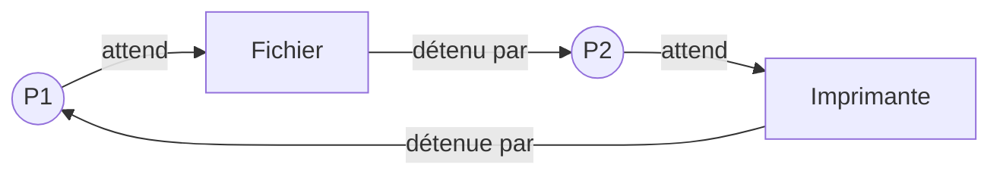

Quatre voitures arrivent en même temps à un carrefour sans feu. Chacune laisse passer celle de droite… et aucune ne bouge plus jamais. Des processus peuvent se retrouver dans la même situation : c'est un **interblocage**.

## 1. Comment cela arrive

Deux processus ont besoin de deux ressources qu'on ne peut pas partager : une imprimante et un fichier. Chacun garde ce qu'il a obtenu pendant qu'il attend le reste.

| Étape | P1 | P2 |
| --- | --- | --- |
| 1 | obtient l'imprimante | |
| 2 | | obtient le fichier |
| 3 | demande le fichier : il est pris, P1 attend | |
| 4 | | demande l'imprimante : elle est prise, P2 attend |

P1 attend le fichier, que P2 ne libérera qu'après avoir imprimé. P2 attend l'imprimante, que P1 ne libérera qu'après avoir lu le fichier. Aucun des deux n'avancera plus jamais : c'est un **interblocage** (*deadlock*).

## 2. Le repérer : un cycle d'attente

On dessine qui attend quoi, et qui détient quoi :

En suivant les flèches, on revient au point de départ : il y a un **cycle**. Un interblocage se reconnaît toujours à un cycle dans ce schéma d'attente. Sans cycle, la chaîne d'attente finit par un processus qui n'attend rien : il termine, libère ses ressources, et les autres repartent.

:::exemple
P1 détient A et attend B. P2 détient B et n'attend rien. Il n'y a pas de cycle : P2 termine, libère B, et P1 peut continuer.
:::

## 3. L'éviter

Une méthode simple : imposer à **tous** les processus de demander les ressources **dans le même ordre**, par exemple toujours l'imprimante avant le fichier.

Pourquoi cela marche ? Reprenons l'exemple. Si P2 doit lui aussi demander l'imprimante en premier, il attend que P1 ait fini avec elle **avant** de prendre le fichier. Il ne peut donc plus garder le fichier pendant que P1 l'attend : le cycle ne peut plus se former.

## L'essentiel

- Interblocage : des processus s'attendent mutuellement, et aucun ne peut avancer.
- Il se repère à un **cycle** dans le schéma « attend » et « détient ».
- Imposer à tous le même ordre de demande des ressources l'empêche.

## Exercices

::::exercice[Interblocage ou non ?]{niveau=1 type=reponses}
Réponds par oui ou par non : y a-t-il un interblocage ?

1. P1 détient A et attend B ; P2 détient B et attend A.

   - oui

1. P1 détient A et attend B ; P2 détient B et n'attend rien.

   - non

   > P2 finira et libérera B.

1. P1 détient A et attend B ; P2 détient B et attend C ; P3 détient C et attend A.

   - oui

1. P1 détient A et attend B ; B est libre.

   - non
::::

::::exercice[Le scénario]{niveau=1 type=ordre}
Remets dans l'ordre la situation qui mène à un interblocage.

1. P1 obtient la ressource A.
1. P2 obtient la ressource B.
1. P1 demande la ressource B et se bloque.
1. P2 demande la ressource A et se bloque.
1. Plus aucun des deux ne peut avancer.
::::

::::exercice[Éviter le blocage]{niveau=2}
Deux processus ont besoin d'un fichier et d'une imprimante. Propose une règle qui évite l'interblocage et explique pourquoi elle fonctionne.

:::criteres
- La règle impose à tous le même ordre de demande.
- Il ne peut alors plus se former de cycle d'attente.
:::

:::corrige
Les deux processus doivent demander les ressources dans le même ordre, par exemple toujours l'imprimante avant le fichier. Celui qui obtient l'imprimante peut ensuite obtenir le fichier, pendant que l'autre attend l'imprimante sans rien détenir. Il n'y a plus d'attente circulaire.
:::
::::

::::exercice[Trois processus, trois ressources]{niveau=3}
Trois processus utilisent des ressources A, B et C. Chacun garde la première ressource pendant qu'il demande la seconde.

- P1 demande A, puis B.
- P2 demande B, puis C.
- P3 demande C, puis A.

1. Décris une suite d'événements qui mène à un interblocage.
2. Écris le cycle d'attente correspondant.
3. On impose à tous de demander les ressources dans l'ordre A, B, C. Que devient la demande de P3 ?
4. Explique pourquoi aucun cycle d'attente ne peut alors se former.
5. Le schéma d'attente est un graphe orienté. Quelle propriété de ce graphe faut-il rechercher pour détecter un interblocage ?

:::criteres
- P1 tient A, P2 tient B, P3 tient C, puis chacun demande la suivante.
- P1 attend P2, P2 attend P3, P3 attend P1.
- P3 demande A, puis C.
- Chacun n'attend qu'une ressource plus loin dans l'ordre : la chaîne d'attente ne peut pas revenir en arrière.
- La présence d'un cycle.
:::

:::corrige
1. P1 obtient A, P2 obtient B, P3 obtient C. Ensuite, P1 demande B, P2 demande C et P3 demande A : tous sont bloqués.
2. P1 attend P2, qui attend P3, qui attend P1.
3. P3 doit demander **A, puis C**.
4. Un processus qui attend une ressource détient seulement des ressources situées avant elle dans l'ordre. Les attentes vont donc toujours vers une ressource plus loin : on ne peut pas revenir au point de départ.
5. Il faut rechercher un **cycle** dans ce graphe.
:::
::::
