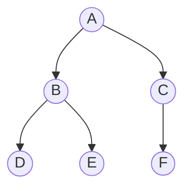

Arborescence de fichiers, page HTML, arbre généalogique : un **arbre** représente des données **hiérarchiques**.

## 1. Vocabulaire



- **A** est la **racine**.
- **D, E, F** sont des **feuilles** : elles n'ont pas d'enfant.
- Le **sous-arbre gauche** de A a pour racine B.
- La **taille** est le nombre de nœuds : ici 6.
- La **hauteur** est le nombre de nœuds de la plus longue branche : ici 3.

:::attention
Certains sujets comptent les arêtes pour la hauteur (une racine seule a alors une hauteur 0). Lis toujours la définition donnée.
:::

## 2. Arbre binaire

Dans un **arbre binaire**, chaque nœud a **au plus deux** enfants.

```python exec
class Noeud:
    def __init__(self, valeur, gauche=None, droit=None):
        self.valeur = valeur
        self.gauche = gauche
        self.droit = droit

a = Noeud("A", Noeud("B"), Noeud("C"))
print(a.gauche.valeur)
```

## 3. Encadrer la hauteur

Pour un arbre binaire de hauteur h (en comptant les nœuds), le nombre de nœuds n vérifie : **h ≤ n ≤ 2ʰ − 1**.

- Arbre **filiforme** (une seule branche) : n = h.
- Arbre **complet** (tous les niveaux remplis) : n = 2ʰ − 1.

## L'essentiel

- Racine, nœud, feuille, sous-arbre gauche et droit.
- Taille : nombre de nœuds. Hauteur : longueur de la plus longue branche.
- h ≤ n ≤ 2ʰ − 1.

## Exercices

::::exercice[QCM : arbres]{niveau=1 type=quiz}
Une question à la fois : la correction s'affiche aussitôt.
enfant droit F.

1. Quelle est la racine de l'arbre ?

   - [x] A
   - [ ] B
   - [ ] F
   - [ ] il n'y en a pas

   > Le seul nœud sans parent.

1. Quelles sont les feuilles ?

   - [ ] A, B, C
   - [x] D, E, F
   - [ ] B et C
   - [ ] seulement F

   > Les nœuds sans enfant.

1. Quelle est la taille de l'arbre ?

   - [ ] 3
   - [ ] 5
   - [x] 6
   - [ ] 7

   > Six nœuds.

1. Quelle est sa hauteur (en comptant les nœuds, racine seule = 1) ?

   - [ ] 2
   - [x] 3
   - [ ] 4
   - [ ] 6

   > Le chemin le plus long est A, B, D (ou A, C, F).

1. Combien de nœuds au plus dans un arbre binaire de hauteur 4 ?

   - [ ] 4
   - [ ] 8
   - [x] 15
   - [ ] 16

   > 2⁴ − 1 = 1 + 2 + 4 + 8.

1. Que vaut `taille(None)` avec la fonction du cours ?

   - [x] 0
   - [ ] 1
   - [ ] `None`
   - [ ] une erreur

   > C'est le cas de base.

1. Dans un arbre binaire, chaque nœud a :

   - [ ] exactement deux enfants
   - [x] au plus deux enfants
   - [ ] au moins un enfant
   - [ ] un nombre quelconque d'enfants

   > Un ou deux sous-arbres peuvent être vides.
::::

::::exercice[Mesurer un arbre]{niveau=1 type=reponses}
Un arbre a pour racine R. R a deux enfants S et T. S a un enfant U. T a deux enfants V et W. V a un enfant X. La hauteur compte les nœuds.

1. Quelle est sa taille ?

   - 7

1. Quelle est sa hauteur ?

   - 4

   > R, T, V, X.

1. Combien a-t-il de feuilles ?

   - 3

   > U, W et X.

1. Quels sont les enfants de T ? Écris-les séparés par une virgule.

   - V, W
   - V,W
::::

::::exercice[Encadrer]{niveau=2 type=reponses}
La hauteur compte les nœuds.

1. Combien de nœuds au maximum pour un arbre binaire de hauteur 5 ?

   ```python calcul
   print(2 ** 5 - 1)
   ```

   - 31

1. Combien de nœuds au minimum pour un arbre binaire de hauteur 5 ?

   - 5

1. Quelle est la hauteur maximale d'un arbre binaire à 10 nœuds ?

   - 10

1. Quelle est la hauteur minimale d'un arbre binaire à 15 nœuds ?

   ```python calcul
   print(4)
   ```

   - 4

   > 2⁴ − 1 = 15.
::::

::::exercice[Arbre ou pas ?]{niveau=2}
Pour chaque situation, dis si un arbre convient, et justifie : (a) les dossiers d'un ordinateur ; (b) les amitiés sur un réseau social ; (c) un tournoi à élimination directe.

:::criteres
- (a) et (c) : hiérarchie, chaque élément a un seul parent.
- (b) : un graphe convient mieux, car il peut y avoir des cycles.
:::

:::corrige
(a) Oui : chaque dossier est contenu dans un seul dossier parent. (b) Non : plusieurs amis peuvent former un cycle, il faut un graphe. (c) Oui : chaque match envoie son vainqueur vers un seul match suivant.
:::
::::
