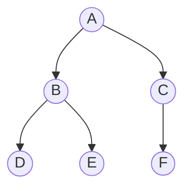

Les dossiers de ton ordinateur, l'organisation d'une page HTML, un arbre généalogique ou un tournoi : tous ces exemples ont une forme **hiérarchique**. Chaque élément dépend d'un seul élément au-dessus de lui. On les représente par un **arbre**.

## 1. Le vocabulaire

Voici un arbre. En informatique, on le dessine la racine en haut.



| Mot | Sens | Dans l'exemple |
| --- | --- | --- |
| **nœud** | un élément de l'arbre | A, B, C, D, E, F |
| **racine** | le seul nœud sans parent | A |
| **enfants** | les nœuds juste en dessous | les enfants de B sont D et E |
| **feuille** | un nœud sans enfant | D, E, F |
| **sous-arbre** | un nœud et tout ce qui est en dessous | le sous-arbre gauche de A a pour racine B |

## 2. Taille et hauteur

- La **taille** est le nombre de nœuds : ici **6**.
- La **hauteur** est le nombre de nœuds sur la plus longue branche, de la racine à une feuille. La branche A, B, D compte 3 nœuds, comme A, C, F : la hauteur vaut **3**.

:::attention
Certains sujets comptent les **arêtes** au lieu des nœuds. Une racine seule a alors une hauteur 0, et notre arbre une hauteur 2. Lis toujours la définition donnée dans l'énoncé.
:::

## 3. L'arbre binaire

Dans un **arbre binaire**, chaque nœud a **au plus deux** enfants : un enfant gauche et un enfant droit. L'un ou l'autre peut manquer : dans notre exemple, C n'a qu'un enfant, à droite.

En Python, on représente chaque nœud par un objet qui contient sa valeur et ses deux sous-arbres :

```python exec
class Noeud:
    def __init__(self, valeur, gauche=None, droit=None):
        self.valeur = valeur
        self.gauche = gauche
        self.droit = droit

arbre = Noeud("A", Noeud("B", Noeud("D"), Noeud("E")), Noeud("C", None, Noeud("F")))
print(arbre.gauche.valeur, arbre.droit.droit.valeur)
```

`None` représente un arbre vide : C n'a pas d'enfant gauche, donc son attribut `gauche` vaut `None`.

## 4. Encadrer la hauteur

Pour une hauteur h donnée, combien de nœuds un arbre binaire peut-il avoir ?

- **Au minimum h** : une seule branche, chaque nœud n'a qu'un enfant. On dit que l'arbre est **filiforme**.
- **Au maximum 2ʰ − 1** : tous les niveaux sont remplis. Le niveau 1 a 1 nœud, le niveau 2 en a 2, le niveau 3 en a 4… On obtient 1 + 2 + 4 + … + 2ʰ⁻¹ = 2ʰ − 1. On dit que l'arbre est **complet**.

| Hauteur h | Nœuds au minimum | Nœuds au maximum |
| --- | --- | --- |
| 1 | 1 | 1 |
| 2 | 2 | 3 |
| 3 | 3 | 7 |
| 10 | 10 | 1 023 |

On retient : **h ≤ n ≤ 2ʰ − 1**.

Conséquence importante : un arbre bien rempli est très peu haut. 1 000 nœuds tiennent en 10 niveaux. On dit que sa hauteur est de l'ordre de **log₂(n)**. C'est ce qui rendra les recherches dans les arbres très rapides.

## L'essentiel

- Racine, nœuds, enfants, feuilles, sous-arbres gauche et droit.
- Taille : le nombre de nœuds. Hauteur : le nombre de nœuds de la plus longue branche.
- Arbre binaire : au plus deux enfants par nœud ; `None` représente un arbre vide.
- h ≤ n ≤ 2ʰ − 1 : filiforme si n = h, complet si n = 2ʰ − 1.

## Exercices

::::exercice[QCM : arbres]{niveau=1 type=quiz}
On reprend l'arbre du cours : A a pour enfants B et C, B a pour enfants D et E, C a pour seul enfant F.

1. Quelles sont les feuilles ?

   - [ ] A, B, C
   - [x] D, E, F
   - [ ] B et C
   - [ ] seulement F

   > Les nœuds sans enfant.

1. Quelle est la taille de l'arbre ?

   - [ ] 3
   - [ ] 5
   - [x] 6
   - [ ] 7

   > Six nœuds.

1. Quelle est sa hauteur (en comptant les nœuds, racine seule = 1) ?

   - [ ] 2
   - [x] 3
   - [ ] 4
   - [ ] 6

   > Le chemin le plus long est A, B, D (ou A, C, F).

1. Combien de nœuds au plus dans un arbre binaire de hauteur 4 ?

   - [ ] 4
   - [ ] 8
   - [x] 15
   - [ ] 16

   > 2⁴ − 1 = 1 + 2 + 4 + 8.

1. Dans un arbre binaire, chaque nœud a :

   - [ ] exactement deux enfants
   - [x] au plus deux enfants
   - [ ] au moins un enfant
   - [ ] un nombre quelconque d'enfants

   > Un ou deux sous-arbres peuvent être vides.
::::

::::exercice[Mesurer un arbre]{niveau=1 type=reponses}
Un arbre a pour racine R. R a deux enfants S et T. S a un enfant U. T a deux enfants V et W. V a un enfant X. La hauteur compte les nœuds.

1. Quelle est sa taille ?

   - 7

1. Quelle est sa hauteur ?

   - 4

   > R, T, V, X.

1. Combien a-t-il de feuilles ?

   - 3

   > U, W et X.

1. Quels sont les enfants de T ? Écris-les séparés par une virgule.

   - V, W
   - V,W
::::

::::exercice[Encadrer]{niveau=2 type=reponses}
La hauteur compte les nœuds.

1. Combien de nœuds au maximum pour un arbre binaire de hauteur 5 ?

   ```python calcul
   print(2 ** 5 - 1)
   ```

   - 31

1. Combien de nœuds au minimum pour un arbre binaire de hauteur 5 ?

   - 5

1. Quelle est la hauteur maximale d'un arbre binaire à 10 nœuds ?

   - 10

1. Quelle est la hauteur minimale d'un arbre binaire à 15 nœuds ?

   ```python calcul
   print(4)
   ```

   - 4

   > 2⁴ − 1 = 15.
::::

::::exercice[Arbre ou pas ?]{niveau=2}
Pour chaque situation, dis si un arbre convient, et justifie : (a) les dossiers d'un ordinateur ; (b) les amitiés sur un réseau social ; (c) un tournoi à élimination directe.

:::criteres
- (a) et (c) : hiérarchie, chaque élément a un seul parent.
- (b) : un graphe convient mieux, car il peut y avoir des cycles.
:::

:::corrige
(a) Oui : chaque dossier est contenu dans un seul dossier parent. (b) Non : plusieurs amis peuvent former un cycle, il faut un graphe. (c) Oui : chaque match envoie son vainqueur vers un seul match suivant.
:::
::::

::::exercice[Un tournoi]{niveau=3}
Un tournoi à élimination directe oppose 16 équipes. On le représente par un arbre binaire : les feuilles sont les équipes, chaque autre nœud est un match, et la racine est la finale. La hauteur compte les nœuds.

1. Combien l'arbre a-t-il de feuilles ? Combien de matchs faut-il jouer ? Justifie à partir du nombre d'équipes éliminées.
2. Quelle est la taille de l'arbre ? Quelle est sa hauteur ?
3. Montre que cet arbre atteint la borne maximale de l'encadrement du cours.
4. On organise maintenant un tournoi de 1 000 équipes, en donnant un match de moins à certaines. Quel est le nombre minimal de tours ? Justifie.

:::criteres
- 16 feuilles et 15 matchs, car chaque match élimine une équipe et il faut en éliminer 15.
- Taille 31, hauteur 5.
- 31 = 2⁵ − 1, donc n atteint 2ʰ − 1.
- 10 tours, car 2⁹ = 512 est insuffisant et 2¹⁰ = 1 024 suffit.
:::

:::corrige
1. Il y a **16 feuilles**. Chaque match élimine exactement une équipe, et il doit rester un seul vainqueur : il faut **15 matchs**.
2. La taille vaut 16 + 15 = **31**. Les niveaux contiennent 16, 8, 4, 2 et 1 nœuds : la hauteur vaut **5**.
3. Pour h = 5, on a 2ʰ − 1 = 31, ce qui est exactement la taille : l'arbre est complet.
4. En t tours, on peut départager au plus 2ᵗ équipes. Comme 2⁹ = 512 < 1 000 ≤ 1 024 = 2¹⁰, il faut au moins **10 tours**.
:::
::::
