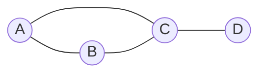

Un réseau routier relie des villes. Internet relie des machines. Un réseau social relie des personnes. Dès qu'on représente des **relations** entre des éléments, on obtient un **graphe**.

## 1. Le vocabulaire

Prenons quatre villes : A, B, C, D, avec des routes A–B, A–C, B–C et C–D.



| Mot | Sens | Dans l'exemple |
| --- | --- | --- |
| **sommet** | un élément | les villes A, B, C, D |
| **arête** | un lien entre deux sommets | la route A–B |
| **voisins** | deux sommets reliés | A et C |
| **degré** | le nombre de voisins | C a pour degré 3 |
| **chemin** | une suite de sommets reliés | A, C, D |
| **cycle** | un chemin qui revient à son départ sans réutiliser d'arête | A, B, C, A |

Autres notions :

- Un graphe est **orienté** si les liens ont un sens, comme les rues à sens unique. Les liens s'appellent alors des **arcs**.
- Un graphe est **pondéré** si chaque lien porte une valeur : distance, durée, coût.
- Un graphe est **connexe** si l'on peut aller de n'importe quel sommet à n'importe quel autre.

## 2. Représenter un graphe par une matrice

On numérote les sommets : A = 0, B = 1, C = 2, D = 3. La **matrice d'adjacence** est un tableau de tableaux : la case `m[i][j]` vaut 1 s'il y a un lien entre i et j, et 0 sinon.

```python
#     A  B  C  D
m = [[0, 1, 1, 0],   # A
     [1, 0, 1, 0],   # B
     [1, 1, 0, 1],   # C
     [0, 0, 1, 0]]   # D
```

Pour savoir si A et C sont reliés, on lit `m[0][2]` : il vaut 1. Pour les voisins de C, on lit la ligne de C : B, A et D.

Dans un graphe **non orienté**, si A est relié à C, alors C est relié à A : la matrice est **symétrique**, `m[i][j]` est toujours égal à `m[j][i]`.

## 3. Représenter un graphe par des listes

On associe à chaque sommet la liste de ses voisins, dans un dictionnaire :

```python
g = {"A": ["B", "C"], "B": ["A", "C"], "C": ["A", "B", "D"], "D": ["C"]}
```

Pour les voisins de C, on lit directement `g["C"]`.

Dans un graphe **orienté**, on distingue :

- les **successeurs** d'un sommet : ceux vers lesquels partent ses arcs ;
- ses **prédécesseurs** : ceux d'où viennent les arcs qui arrivent à lui.

Dans une matrice, la **ligne** d'un sommet donne ses successeurs, et sa **colonne** ses prédécesseurs.

## 4. Choisir une représentation

| Besoin | Matrice | Listes |
| --- | --- | --- |
| savoir si i et j sont reliés | immédiat : on lit une case | il faut parcourir la liste de i |
| obtenir les voisins d'un sommet | il faut lire toute une ligne | immédiat |
| mémoire utilisée | n² cases, même s'il y a peu de liens | seulement les liens existants |

Pour un réseau social d'un million de personnes, avec environ 200 amis chacune, la matrice aurait 10¹² cases presque toutes à 0. Les listes conviennent bien mieux.

## L'essentiel

- Sommets, arêtes (arcs si orienté), voisins, degré, chemin, cycle.
- Matrice d'adjacence : `m[i][j]` vaut 1 si i et j sont reliés ; symétrique si le graphe est non orienté.
- Listes de successeurs (ou de prédécesseurs) dans un dictionnaire.
- Le choix dépend du traitement et de la taille du graphe.

## Exercices

::::exercice[QCM : graphes]{niveau=1 type=quiz}
Graphe non orienté de sommets A, B, C, D, E, F, avec les arêtes A–B, A–C, B–D, C–D et D–E. Le sommet F est isolé.

1. Quel est le degré du sommet D ?

   - [ ] 1
   - [ ] 2
   - [x] 3
   - [ ] 5

   > D est relié à B, C et E.

1. Lequel est un cycle ?

   - [ ] A, B, D, E
   - [x] A, B, D, C, A
   - [ ] A, B, A
   - [ ] D, E, D

   > A, B, A réutilise la même arête : ce n'est pas un cycle.

1. Dans la matrice d'adjacence d'un graphe **non orienté**, on a toujours :

   - [x] `m[i][j] == m[j][i]`
   - [ ] `m[i][i] == 1`
   - [ ] une seule case à 1 par ligne
   - [ ] des valeurs différentes de 0 et 1

   > La matrice est symétrique.

1. Dans un graphe orienté avec l'arc A → B, peut-on aller directement de B à A ?

   - [ ] oui
   - [x] non, sauf s'il existe aussi un arc B → A
   - [ ] seulement si le graphe est pondéré
   - [ ] seulement si A et B ont le même degré

   > Un arc a un sens.

1. Quelle représentation occupe n² cases de mémoire, quel que soit le nombre d'arêtes ?

   - [x] la matrice d'adjacence
   - [ ] les listes d'adjacence
   - [ ] les deux
   - [ ] aucune

   > Les listes n'occupent de la place que pour les arêtes existantes.
::::

::::exercice[Lire une matrice]{niveau=1 type=reponses}
Graphe **orienté** de sommets 0, 1, 2 : `m = [[0, 1, 1], [0, 0, 1], [1, 0, 0]]`.

1. Y a-t-il un arc de 0 vers 2 ? Réponds par oui ou par non.

   - oui

1. Y a-t-il un arc de 2 vers 1 ? Réponds par oui ou par non.

   - non

1. Combien d'arcs compte ce graphe ?

   ```python calcul
   print(sum(map(sum, [[0, 1, 1], [0, 0, 1], [1, 0, 0]])))
   ```

   - 4

1. Quels sont les successeurs du sommet 1 ?

   - 2

1. Quels sont les prédécesseurs du sommet 2 ? Écris-les séparés par une virgule.

   - 0, 1
   - 0,1
::::

::::exercice[D'une représentation à l'autre]{niveau=2}
Écris `vers_dico(m, noms)` qui transforme une matrice d'adjacence en dictionnaire de listes d'adjacence (les sommets d'indice i s'appellent
`noms[i]`, voisins dans l'ordre des indices), et `vers_matrice(g, noms)` qui fait l'inverse.

```python depart
def vers_dico(m, noms):
    ...

def vers_matrice(g, noms):
    ...
```

```python tests
m = [[0, 1, 1], [1, 0, 0], [1, 0, 0]]
noms = ["A", "B", "C"]
assert vers_dico(m, noms) == {"A": ["B", "C"], "B": ["A"], "C": ["A"]}, "matrice vers dictionnaire"
assert vers_matrice({"A": ["B", "C"], "B": ["A"], "C": ["A"]}, noms) == m, "dictionnaire vers matrice"
assert vers_dico([[0]], ["X"]) == {"X": []}, "un sommet isolé"
```

:::corrige
```python solution
def vers_dico(m, noms):
    g = {}
    for i in range(len(m)):
        g[noms[i]] = [noms[j] for j in range(len(m)) if m[i][j] == 1]
    return g

def vers_matrice(g, noms):
    n = len(noms)
    m = [[0] * n for i in range(n)]
    for i in range(n):
        for v in g[noms[i]]:
            j = noms.index(v)
            m[i][j] = 1
    return m
```

`noms.index(v)` retrouve le numéro d'un sommet ; pour un grand graphe, on construirait plutôt un dictionnaire nom → indice.
:::
::::

::::exercice[Modéliser par un graphe]{niveau=2}
Pour chaque situation, dis quels sont les sommets et les arêtes, si le graphe est orienté et/ou pondéré, et quelle question se ramène à un
parcours : (a) le réseau des amis d'un réseau social ; (b) les abonnements sur un réseau où l'on suit des comptes sans réciprocité ; (c) un plan
de métro avec les temps de trajet ; (d) les prérequis entre les chapitres d'un cours.

:::criteres
- (a) sommets = personnes, arêtes = amitié, non orienté, non pondéré ; question : « ami d'ami » (largeur, distance 2).
- (b) orienté (A suit B) ; question : qui peut voir passer un message (parcours depuis un compte).
- (c) sommets = stations, arêtes = tronçons, pondéré par le temps ; question : plus court trajet (pondéré : Dijkstra).
- (d) orienté (prérequis → chapitre) ; un cycle serait une incohérence ; ordre possible des chapitres.
:::

:::corrige
(a) **Sommets** : les personnes ; **arêtes** : « est ami avec ». **Non orienté** (l'amitié est réciproque), non pondéré. « Qui sont les amis de
mes amis ? » : parcours en largeur, sommets à distance 2. (b) **Orienté** : un arc A → B si A suit B. « Jusqu'où un message republié peut-il se
diffuser ? » : parcours depuis l'auteur. (c) **Sommets** : les stations ; **arêtes** : les tronçons entre deux stations ; **pondéré** par le
temps de trajet. Le plus court trajet **en temps** demande l'algorithme de **Dijkstra** ; le parcours en largeur donne le trajet avec le moins
de stations. (d) **Orienté** : un arc du prérequis vers le chapitre. Un **cycle** serait absurde (A exige B qui exige A) ; un parcours en
profondeur permet de le détecter et de trouver un ordre valide des chapitres.
:::
::::

::::exercice[Un réseau d'abonnements]{niveau=3}
Sur un réseau social, on peut suivre un compte sans être suivi en retour. On représente ces liens par un dictionnaire : `g[a]` est la liste des comptes suivis par `a`.

1. Quel type de graphe faut-il ? Justifie.
2. Écris `nb_abonnes(g, s)`, qui renvoie le nombre de comptes qui suivent `s`.
3. Écris `predecesseurs(g)`, qui renvoie le dictionnaire associant à chaque compte la liste de ses abonnés, dans l'ordre des clés de `g`.
4. Écris `reciproques(g, s)`, qui renvoie la liste des comptes que `s` suit et qui le suivent aussi.
5. À l'écrit : le réseau compte un million de comptes, et chacun en suit environ 200. Pourquoi ne pas utiliser une matrice d'adjacence ?

```python depart
def nb_abonnes(g, s):
    ...

def predecesseurs(g):
    ...

def reciproques(g, s):
    ...
```

```python tests
g = {"ana": ["bo", "cy"], "bo": ["ana"], "cy": [], "di": ["ana", "cy"]}
assert nb_abonnes(g, "ana") == 2, "bo et di"
assert nb_abonnes(g, "di") == 0, "personne"
assert predecesseurs(g) == {"ana": ["bo", "di"], "bo": ["ana"], "cy": ["ana", "di"], "di": []}, "abonnés"
assert reciproques(g, "ana") == ["bo"], "réciproque"
assert reciproques(g, "cy") == [], "ne suit personne"
```

:::corrige
```python solution
def nb_abonnes(g, s):
    n = 0
    for a in g:
        if s in g[a]:
            n = n + 1
    return n

def predecesseurs(g):
    p = {}
    for a in g:
        p[a] = []
    for a in g:
        for b in g[a]:
            p[b].append(a)
    return p

def reciproques(g, s):
    return [v for v in g[s] if s in g[v]]
```

**Question 1.** Un graphe **orienté**, car « a suit b » n'implique pas « b suit a ».

**Question 5.** La matrice compte 10⁶ × 10⁶ = 10¹² cases, presque toutes à 0. Les listes ne stockent que les liens existants : environ 10⁶ × 200 = 2 × 10⁸ valeurs.
:::
::::
