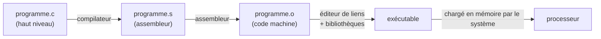

Un processeur ne comprend ni `for` ni `if` ni les listes : il exécute des **instructions élémentaires** — charger un nombre depuis la
mémoire, additionner deux registres, comparer, sauter à une autre instruction. Écrire directement ces instructions, c'est programmer en
**assembleur**. On ne le fait plus guère que pour des morceaux critiques (noyaux de systèmes, pilotes, microcontrôleurs), mais le lire
permet de comprendre ce que fait vraiment une machine, ce que produit un compilateur et pourquoi certains programmes sont rapides.

## 1. Un jeu d'instructions simple

Chaque processeur a son propre **jeu d'instructions** (x86 pour les PC, ARM pour les téléphones, RISC-V…). On utilise ici un assembleur
simplifié, proche de celui du simulateur en ligne de Peter Higginson très utilisé en NSI : 13 registres `R0` à `R12`, une mémoire dont les
cases sont désignées par leur adresse.

| Instruction | Effet | Catégorie |
|---|---|---|
| `LDR Rd, adr` | Rd ← mémoire[adr] | transfert |
| `STR Rd, adr` | mémoire[adr] ← Rd | transfert |
| `MOV Rd, op` | Rd ← op | transfert |
| `ADD Rd, Rn, op` | Rd ← Rn + op | calcul |
| `SUB Rd, Rn, op` | Rd ← Rn − op | calcul |
| `AND`, `ORR`, `EOR Rd, Rn, op` | et, ou, ou exclusif bit à bit | logique |
| `LSL`, `LSR Rd, Rn, op` | décalage à gauche, à droite de op bits | logique |
| `CMP Rn, op` | compare Rn et op (mémorise le résultat) | comparaison |
| `B etiq` | saut à `etiq` | saut |
| `BEQ`, `BNE`, `BGT`, `BLT etiq` | saut si égal, différent, plus grand, plus petit (d'après le dernier `CMP`) | saut conditionnel |
| `OUT Rd` | affiche Rd (pour nos essais) | sortie |
| `HALT` | arrêt | |

`op` est soit un registre (`R3`), soit une **valeur immédiate** (`#5`). Une **étiquette** (`boucle:`) nomme l'adresse d'une instruction.

```text
        MOV R0, #0        // R0 : somme
        MOV R1, #1        // R1 : compteur i
boucle: CMP R1, #10
        BGT fin           // si i > 10, on sort
        ADD R0, R0, R1    // somme += i
        ADD R1, R1, #1    // i += 1
        B boucle
fin:    STR R0, 100       // range le résultat à l'adresse 100
        OUT R0
        HALT
```

## 2. Un simulateur en Python

Pour essayer ces programmes ici, voici un interpréteur de cet assembleur (environ quarante lignes). Il reproduit le cycle de von
Neumann : chargement de l'instruction désignée par le compteur ordinal, décodage, exécution.

```python exec
def executer(source, memoire=None, max_etapes=100_000):
    # 1. Lecture du programme : instructions et étiquettes
    instructions, etiquettes = [], {}
    for ligne in source.splitlines():
        ligne = ligne.split("//")[0].strip()          # retire les commentaires
        if ":" in ligne:
            etiquette, ligne = ligne.split(":", 1)
            etiquettes[etiquette.strip()] = len(instructions)
            ligne = ligne.strip()
        if ligne:
            op, _, reste = ligne.partition(" ")
            instructions.append((op.upper(), [a.strip() for a in reste.split(",") if a.strip()]))

    memoire = dict(memoire or {})
    R = [0] * 13
    sorties = []
    def val(x):                                        # opérande : #n ou Rn
        return int(x[1:]) if x.startswith("#") else R[int(x[1:])]
    calculs = {"ADD": lambda a, b: a + b, "SUB": lambda a, b: a - b, "AND": lambda a, b: a & b,
               "ORR": lambda a, b: a | b, "EOR": lambda a, b: a ^ b,
               "LSL": lambda a, b: a << b, "LSR": lambda a, b: a >> b}
    sauts = {"B": lambda c: True, "BEQ": lambda c: c == 0, "BNE": lambda c: c != 0,
             "BGT": lambda c: c > 0, "BLT": lambda c: c < 0}

    # 2. Le cycle chargement – décodage – exécution
    pc, comparaison = 0, 0
    for _ in range(max_etapes):
        op, args = instructions[pc]                    # chargement
        pc += 1
        if op == "HALT":
            return R, memoire, sorties
        elif op == "LDR":
            R[int(args[0][1:])] = memoire.get(int(args[1]), 0)
        elif op == "STR":
            memoire[int(args[1])] = R[int(args[0][1:])]
        elif op == "MOV":
            R[int(args[0][1:])] = val(args[1])
        elif op in calculs:
            R[int(args[0][1:])] = calculs[op](R[int(args[1][1:])], val(args[2]))
        elif op == "CMP":
            a, b = R[int(args[0][1:])], val(args[1])
            comparaison = (a > b) - (a < b)            # -1, 0 ou 1
        elif op in sauts:
            if sauts[op](comparaison):
                pc = etiquettes[args[0]]
        elif op == "OUT":
            sorties.append(R[int(args[0][1:])])
        else:
            raise ValueError(f"instruction inconnue : {op}")
    raise RuntimeError("trop d'étapes : boucle infinie ?")

programme = """
        MOV R0, #0        // R0 : somme
        MOV R1, #1        // R1 : compteur i
boucle: CMP R1, #10
        BGT fin           // si i > 10, on sort
        ADD R0, R0, R1    // somme += i
        ADD R1, R1, #1    // i += 1
        B boucle
fin:    STR R0, 100
        OUT R0
        HALT
"""
registres, memoire, sorties = executer(programme)
print("sorties :", sorties, "  mémoire :", memoire, "  R1 =", registres[1])
```

## 3. Traduire les structures de contrôle

Un compilateur traduit chaque structure en **comparaisons et sauts**. Les deux schémas à connaître :

```mermaid legende="if / else et while traduits en sauts : on saute PAR-DESSUS ce qu'il ne faut pas exécuter"
flowchart TB
  subgraph SI["if a > b: m = a  else: m = b"]
    direction TB
    i1["CMP R0, R1"] --> i2["BGT alors"]
    i2 -->|"faux"| i3["MOV R2, R1   (sinon)"]
    i3 --> i4["B suite"]
    i2 -->|"vrai"| i5["alors: MOV R2, R0"]
    i4 --> i6["suite: …"]
    i5 --> i6
  end
  subgraph TQ["while i < n: corps"]
    direction TB
    w1["tete: CMP R1, R2"] --> w2["BGT fin  /  BEQ fin"]
    w2 -->|"condition vraie"| w3["corps…"]
    w3 --> w4["B tete"]
    w4 --> w1
    w2 -->|"condition fausse"| w5["fin: …"]
  end
```

:::methode[Traduire une condition]
On teste en général la condition **contraire** pour sauter par-dessus le bloc : `while i < n` devient « si `i >= n`, sauter à la fin », soit
`CMP R1, R2` puis `BGT fin` **et** `BEQ fin` (notre jeu n'a pas de « plus grand ou égal »). Toujours vérifier les cas limites : la boucle
s'exécute-t-elle zéro fois quand il le faut ?
:::

## 4. De l'assembleur au code machine

Chaque instruction est codée en binaire sur un nombre fixe de bits : quelques bits pour le **code opération**, d'autres pour les numéros de
registres ou la valeur immédiate. Le programme **assembleur** fait cette traduction ; le **compilateur** (C, Java vers bytecode…) traduit un
langage de haut niveau en assembleur ou directement en code machine.



Python, lui, compile chaque fonction en **bytecode** pour sa propre machine virtuelle (une machine **à pile** : les opérandes sont empilés,
puis l'opération les dépile). Le module `dis` le montre :

```python exec
import dis

def somme(n):
    s = 0
    i = 1
    while i <= n:
        s = s + i
        i = i + 1
    return s

dis.dis(somme)
```

On y reconnaît les mêmes ingrédients : chargements (`LOAD_FAST`), opérations (`BINARY_OP`), comparaison (`COMPARE_OP`), sauts
conditionnels (`POP_JUMP_IF_FALSE`) et saut arrière qui ferme la boucle (`JUMP_BACKWARD`). Les noms exacts changent selon la version de
Python.

:::prof
Le programme de première NSI demande de « dérouler l'exécution d'une séquence d'instructions simples du type langage machine ». Le
simulateur de Peter Higginson (« AQA assembly language simulator », en ligne) affiche registres, mémoire et compteur ordinal pas à pas : on
peut y faire écrire aux élèves la traduction d'un petit programme Python. Les erreurs fréquentes : confondre `#5` (la valeur 5) et `5`
(l'adresse 5), oublier le saut `B` qui évite le bloc `else`, inverser la condition de sortie de boucle.
:::

## Exemple guidé

**Problème.** Calculer le maximum de trois nombres rangés aux adresses 100, 101, 102, et le ranger à l'adresse 103.

**1. L'algorithme en Python.**

```python
m = a
if b > m: m = b
if c > m: m = c
```

**2. Choisir les registres.** R0 = a puis le maximum courant, R1 = b, R2 = c.

**3. Traduire chaque `if`** en sautant par-dessus l'affectation quand la condition est **fausse**. La condition `b > m` est fausse quand
`b < m` ou `b = m` : après `CMP R1, R0`, on saute donc avec `BLT` puis `BEQ`.

```python exec
def executer(source, memoire=None, max_etapes=100_000):
    instructions, etiquettes = [], {}
    for ligne in source.splitlines():
        ligne = ligne.split("//")[0].strip()
        if ":" in ligne:
            etiquette, ligne = ligne.split(":", 1)
            etiquettes[etiquette.strip()] = len(instructions)
            ligne = ligne.strip()
        if ligne:
            op, _, reste = ligne.partition(" ")
            instructions.append((op.upper(), [a.strip() for a in reste.split(",") if a.strip()]))
    memoire, R, sorties = dict(memoire or {}), [0] * 13, []
    val = lambda x: int(x[1:]) if x.startswith("#") else R[int(x[1:])]
    calculs = {"ADD": lambda a, b: a + b, "SUB": lambda a, b: a - b}
    sauts = {"B": lambda c: True, "BEQ": lambda c: c == 0, "BNE": lambda c: c != 0,
             "BGT": lambda c: c > 0, "BLT": lambda c: c < 0}
    pc, comparaison = 0, 0
    for _ in range(max_etapes):
        op, args = instructions[pc]
        pc += 1
        if op == "HALT": return R, memoire, sorties
        elif op == "LDR": R[int(args[0][1:])] = memoire.get(int(args[1]), 0)
        elif op == "STR": memoire[int(args[1])] = R[int(args[0][1:])]
        elif op == "MOV": R[int(args[0][1:])] = val(args[1])
        elif op in calculs: R[int(args[0][1:])] = calculs[op](R[int(args[1][1:])], val(args[2]))
        elif op == "CMP":
            a, b = R[int(args[0][1:])], val(args[1])
            comparaison = (a > b) - (a < b)
        elif op in sauts:
            if sauts[op](comparaison): pc = etiquettes[args[0]]
    raise RuntimeError("boucle infinie ?")

maximum = """
        LDR R0, 100       // m = a
        LDR R1, 101
        LDR R2, 102
        CMP R1, R0
        BLT pas_b         // b < m : on garde m
        BEQ pas_b         // b = m : idem
        MOV R0, R1        // m = b
pas_b:  CMP R2, R0
        BLT pas_c
        BEQ pas_c
        MOV R0, R2        // m = c
pas_c:  STR R0, 103
        HALT
"""
for donnees in ({100: 4, 101: 9, 102: 7}, {100: 9, 101: 4, 102: 7}, {100: 4, 101: 7, 102: 9}, {100: 5, 101: 5, 102: 5}):
    print(donnees, "→", executer(maximum, donnees)[1][103])
```

**4. Tester les cas** : maximum en première, deuxième, troisième position, et égalités. Les quatre essais donnent 9, 9, 9 et 5.

## L'essentiel

- Le processeur exécute des instructions élémentaires : **transfert** (`LDR`, `STR`, `MOV`), **calcul** (`ADD`, `SUB`, logique, décalages), **comparaison** (`CMP`), **saut** (`B`, `BEQ`, `BNE`, `BGT`, `BLT`).
- Registres (rapides, dans le processeur) contre mémoire (adresses) ; `#5` = la valeur 5, `5` = l'adresse 5.
- `if` / `while` = comparaison + saut conditionnel sur la condition **contraire** + saut inconditionnel ; étiquettes = adresses d'instructions.
- Assembleur = notation lisible du code machine (une instruction pour une instruction) ; compilateur → assembleur → code machine → éditeur de liens.
- Python compile en bytecode pour une machine à pile (`dis.dis`).

## Exercices

::::exercice[Lire une instruction]{niveau=1}
Avant l'instruction `SUB R3, R1, R2`, R1 vaut 10, R2 vaut 4 et R3 vaut 0. Que vaut R3 après ?

- [ ] -6
- [x] 6
- [ ] 10
- [ ] 4

:::corrige
`SUB Rd, Rn, op` calcule Rd ← Rn − op : R3 ← 10 − 4 = 6. Le premier opérande est toujours la destination.
:::
::::

::::exercice[Valeur ou adresse]{niveau=1}
Quelle est la différence entre `MOV R0, #100` et `LDR R0, 100` ?

- [ ] Aucune
- [x] La première met la valeur 100 dans R0 ; la seconde y met le contenu de la case mémoire d'adresse 100
- [ ] La première lit la mémoire ; la seconde met la valeur 100 dans R0
- [ ] La seconde est invalide

:::corrige
`#100` est une valeur immédiate (une constante écrite dans l'instruction) ; `100` dans `LDR` est une adresse, et l'on charge ce qui s'y
trouve.
:::
::::

::::exercice[Valeur absolue]{niveau=2}
Écris dans la variable `programme` un programme assembleur qui lit le nombre à l'adresse 100 et range sa **valeur absolue** à l'adresse
101. (Astuce : $0 - x$.) Le simulateur `executer` de la leçon est disponible dans les tests.

```python depart
programme = """
        LDR R0, 100
        // à compléter
        HALT
"""
```

```python tests
def executer(source, memoire=None, max_etapes=100_000):
    instructions, etiquettes = [], {}
    for ligne in source.splitlines():
        ligne = ligne.split("//")[0].strip()
        if ":" in ligne:
            etiquette, ligne = ligne.split(":", 1)
            etiquettes[etiquette.strip()] = len(instructions)
            ligne = ligne.strip()
        if ligne:
            op, _, reste = ligne.partition(" ")
            instructions.append((op.upper(), [a.strip() for a in reste.split(",") if a.strip()]))
    memoire, R, sorties = dict(memoire or {}), [0] * 13, []
    val = lambda x: int(x[1:]) if x.startswith("#") else R[int(x[1:])]
    calculs = {"ADD": lambda a, b: a + b, "SUB": lambda a, b: a - b, "AND": lambda a, b: a & b,
               "ORR": lambda a, b: a | b, "EOR": lambda a, b: a ^ b, "LSL": lambda a, b: a << b, "LSR": lambda a, b: a >> b}
    sauts = {"B": lambda c: True, "BEQ": lambda c: c == 0, "BNE": lambda c: c != 0, "BGT": lambda c: c > 0, "BLT": lambda c: c < 0}
    pc, comparaison = 0, 0
    for _ in range(max_etapes):
        op, args = instructions[pc]
        pc += 1
        if op == "HALT": return R, memoire, sorties
        elif op == "LDR": R[int(args[0][1:])] = memoire.get(int(args[1]), 0)
        elif op == "STR": memoire[int(args[1])] = R[int(args[0][1:])]
        elif op == "MOV": R[int(args[0][1:])] = val(args[1])
        elif op in calculs: R[int(args[0][1:])] = calculs[op](R[int(args[1][1:])], val(args[2]))
        elif op == "CMP":
            a, b = R[int(args[0][1:])], val(args[1])
            comparaison = (a > b) - (a < b)
        elif op in sauts:
            if sauts[op](comparaison): pc = etiquettes[args[0]]
        elif op == "OUT": sorties.append(R[int(args[0][1:])])
        else: raise ValueError(f"instruction inconnue : {op}")
    raise RuntimeError("trop d'étapes : boucle infinie ?")
assert executer(programme, {100: -7})[1].get(101) == 7, "nombre négatif"
assert executer(programme, {100: 12})[1].get(101) == 12, "nombre positif"
assert executer(programme, {100: 0})[1].get(101) == 0, "zéro"
```

:::corrige
```python solution
programme = """
        LDR R0, 100
        CMP R0, #0
        BGT positif       // x > 0 : rien à faire
        BEQ positif       // x = 0 : idem
        MOV R1, #0
        SUB R0, R1, R0    // R0 = 0 - x
positif: STR R0, 101
        HALT
"""
```
Comme `SUB` soustrait un opérande d'un **registre**, on place 0 dans R1 pour calculer $0 - x$. On saute par-dessus la négation quand
$x \ge 0$.
:::
::::

::::exercice[Somme jusqu'à n]{niveau=2}
Écris un programme qui lit $n$ à l'adresse 100 et range $1 + 2 + \dots + n$ à l'adresse 101 (0 si $n \le 0$), avec une boucle.

```python depart
programme = """
        LDR R2, 100       // n
        // à compléter
        HALT
"""
```

```python tests
def executer(source, memoire=None, max_etapes=100_000):
    instructions, etiquettes = [], {}
    for ligne in source.splitlines():
        ligne = ligne.split("//")[0].strip()
        if ":" in ligne:
            etiquette, ligne = ligne.split(":", 1)
            etiquettes[etiquette.strip()] = len(instructions)
            ligne = ligne.strip()
        if ligne:
            op, _, reste = ligne.partition(" ")
            instructions.append((op.upper(), [a.strip() for a in reste.split(",") if a.strip()]))
    memoire, R, sorties = dict(memoire or {}), [0] * 13, []
    val = lambda x: int(x[1:]) if x.startswith("#") else R[int(x[1:])]
    calculs = {"ADD": lambda a, b: a + b, "SUB": lambda a, b: a - b, "AND": lambda a, b: a & b,
               "ORR": lambda a, b: a | b, "EOR": lambda a, b: a ^ b, "LSL": lambda a, b: a << b, "LSR": lambda a, b: a >> b}
    sauts = {"B": lambda c: True, "BEQ": lambda c: c == 0, "BNE": lambda c: c != 0, "BGT": lambda c: c > 0, "BLT": lambda c: c < 0}
    pc, comparaison = 0, 0
    for _ in range(max_etapes):
        op, args = instructions[pc]
        pc += 1
        if op == "HALT": return R, memoire, sorties
        elif op == "LDR": R[int(args[0][1:])] = memoire.get(int(args[1]), 0)
        elif op == "STR": memoire[int(args[1])] = R[int(args[0][1:])]
        elif op == "MOV": R[int(args[0][1:])] = val(args[1])
        elif op in calculs: R[int(args[0][1:])] = calculs[op](R[int(args[1][1:])], val(args[2]))
        elif op == "CMP":
            a, b = R[int(args[0][1:])], val(args[1])
            comparaison = (a > b) - (a < b)
        elif op in sauts:
            if sauts[op](comparaison): pc = etiquettes[args[0]]
        elif op == "OUT": sorties.append(R[int(args[0][1:])])
        else: raise ValueError(f"instruction inconnue : {op}")
    raise RuntimeError("trop d'étapes : boucle infinie ?")
assert executer(programme, {100: 10})[1].get(101) == 55, "n = 10"
assert executer(programme, {100: 1})[1].get(101) == 1, "n = 1"
assert executer(programme, {100: 0})[1].get(101) == 0, "n = 0 : la boucle ne tourne pas"
assert executer(programme, {100: -3})[1].get(101) == 0, "n négatif"
```

:::corrige
```python solution
programme = """
        LDR R2, 100       // n
        MOV R0, #0        // somme
        MOV R1, #1        // i
tete:   CMP R1, R2
        BGT fin           // i > n : on sort
        ADD R0, R0, R1
        ADD R1, R1, #1
        B tete
fin:    STR R0, 101
        HALT
"""
```
Le test est placé **en tête** de boucle : si $n \le 0$, on saute directement à la fin et la somme reste 0 (boucle `while`, pas
`do … while`).
:::
::::

::::exercice[Multiplier sans multiplication]{niveau=3}
Le jeu d'instructions n'a pas de multiplication. Écris un programme qui range à l'adresse 102 le produit des entiers **positifs ou nuls**
lus aux adresses 100 et 101, par la méthode du « paysan russe » : tant que $b > 0$, si $b$ est impair on ajoute $a$ au résultat, puis
$a \leftarrow 2a$ (`LSL`) et $b \leftarrow \lfloor b/2 \rfloor$ (`LSR`). Le nombre d'itérations doit être de l'ordre de $\log_2 b$ (les
tests limitent le nombre d'étapes).

```python depart
programme = """
        LDR R0, 100       // a
        LDR R1, 101       // b
        MOV R2, #0        // résultat
        // à compléter
        HALT
"""
```

```python tests
def executer(source, memoire=None, max_etapes=100_000):
    instructions, etiquettes = [], {}
    for ligne in source.splitlines():
        ligne = ligne.split("//")[0].strip()
        if ":" in ligne:
            etiquette, ligne = ligne.split(":", 1)
            etiquettes[etiquette.strip()] = len(instructions)
            ligne = ligne.strip()
        if ligne:
            op, _, reste = ligne.partition(" ")
            instructions.append((op.upper(), [a.strip() for a in reste.split(",") if a.strip()]))
    memoire, R, sorties = dict(memoire or {}), [0] * 13, []
    val = lambda x: int(x[1:]) if x.startswith("#") else R[int(x[1:])]
    calculs = {"ADD": lambda a, b: a + b, "SUB": lambda a, b: a - b, "AND": lambda a, b: a & b,
               "ORR": lambda a, b: a | b, "EOR": lambda a, b: a ^ b, "LSL": lambda a, b: a << b, "LSR": lambda a, b: a >> b}
    sauts = {"B": lambda c: True, "BEQ": lambda c: c == 0, "BNE": lambda c: c != 0, "BGT": lambda c: c > 0, "BLT": lambda c: c < 0}
    pc, comparaison = 0, 0
    for _ in range(max_etapes):
        op, args = instructions[pc]
        pc += 1
        if op == "HALT": return R, memoire, sorties
        elif op == "LDR": R[int(args[0][1:])] = memoire.get(int(args[1]), 0)
        elif op == "STR": memoire[int(args[1])] = R[int(args[0][1:])]
        elif op == "MOV": R[int(args[0][1:])] = val(args[1])
        elif op in calculs: R[int(args[0][1:])] = calculs[op](R[int(args[1][1:])], val(args[2]))
        elif op == "CMP":
            a, b = R[int(args[0][1:])], val(args[1])
            comparaison = (a > b) - (a < b)
        elif op in sauts:
            if sauts[op](comparaison): pc = etiquettes[args[0]]
        elif op == "OUT": sorties.append(R[int(args[0][1:])])
        else: raise ValueError(f"instruction inconnue : {op}")
    raise RuntimeError("trop d'étapes : boucle infinie ?")
assert executer(programme, {100: 13, 101: 11})[1].get(102) == 143, "13 × 11"
assert executer(programme, {100: 7, 101: 0})[1].get(102) == 0, "par zéro"
assert executer(programme, {100: 0, 101: 9})[1].get(102) == 0, "zéro fois"
assert executer(programme, {100: 3, 101: 1_000_000}, max_etapes=500)[1].get(102) == 3_000_000, "nombre logarithmique d'étapes"
```

:::corrige
```python solution
programme = """
        LDR R0, 100       // a
        LDR R1, 101       // b
        MOV R2, #0        // résultat
tete:   CMP R1, #0
        BEQ fin           // b = 0 : terminé
        AND R3, R1, #1    // bit de poids faible de b
        CMP R3, #0
        BEQ pair
        ADD R2, R2, R0    // b impair : résultat += a
pair:   LSL R0, R0, #1    // a = 2a
        LSR R1, R1, #1    // b = b // 2
        B tete
fin:    STR R2, 102
        HALT
"""
```
Invariant : `résultat + a × b` vaut toujours le produit initial. Chaque tour divise $b$ par 2 : environ $\log_2 b$ tours (20 pour un
million), contre $b$ tours pour des additions répétées. C'est l'algorithme qu'utilisent les multiplieurs matériels (décalages et
additions).
:::
::::

::::exercice[Compiler à la main]{niveau=4 duree=25}
On considère la fonction Python suivante, appliquée à deux entiers strictement positifs (algorithme d'Euclide par soustractions) :

```python
def pgcd(a, b):
    while a != b:
        if a > b:
            a = a - b
        else:
            b = b - a
    return a
```

1. Traduisez-la en assembleur (a à l'adresse 100, b à l'adresse 101, résultat à l'adresse 102), en commentant chaque saut.
2. Combien d'instructions sont exécutées pour $a = 21$, $b = 6$ ? Pour $a = 1000$, $b = 1$ ? Qu'en concluez-vous ?
3. Proposez une démarche pour faire travailler cette traduction à des élèves de première, et deux erreurs que vous anticipez.

:::criteres
- Traduction correcte : boucle avec test d'égalité en tête (`CMP`, `BEQ fin`), branchement selon `a > b` (`BGT` ou `BLT`) avec saut `B` qui évite la branche `else`, saut arrière vers la tête, rangement du résultat.
- Décompte cohérent du nombre de tours (21,6 → 15,6 → 9,6 → 3,6 → 3,3 : 4 tours ; 1000,1 : 999 tours) et conclusion sur le coût (linéaire en a/b dans le pire cas) et l'intérêt de l'algorithme avec modulo.
- Démarche : partir de l'organigramme, traduire bloc par bloc, tester dans un simulateur pas à pas ; erreurs anticipées (condition inversée, oubli du `B` après le bloc `if`, confusion `#` / adresse, boucle infinie si a ou b nul).
:::

:::corrige
1. ```text
           LDR R0, 100       // a
           LDR R1, 101       // b
   tete:   CMP R0, R1
           BEQ fin           // a == b : sortie de boucle
           BGT a_plus        // a > b : branche « if »
           SUB R1, R1, R0    // sinon : b = b - a
           B tete            // retour en tête (on évite la branche « if »)
   a_plus: SUB R0, R0, R1    // a = a - b
           B tete
   fin:    STR R0, 102
           HALT
   ```
2. Pour $(21, 6)$ : $(15, 6)$, $(9, 6)$, $(3, 6)$, $(3, 3)$ : 4 tours de boucle. Chaque tour exécute 5 instructions (`CMP`, `BEQ`, `BGT`,
   `SUB`, `B`), plus le test final (`CMP`, `BEQ`) et les 2 chargements, le rangement et `HALT` : $2 + 4 \times 5 + 2 + 2 = 26$
   instructions. Pour $(1000, 1)$ : 999 tours, soit environ 5 000 instructions. Le nombre de tours peut être de l'ordre de $\max(a, b)$ :
   l'algorithme par soustractions est **linéaire** dans le pire cas, alors que la version avec le reste (`a % b`) fait un nombre de tours
   logarithmique — mais demande une division, que ce jeu d'instructions n'a pas.
3. Démarche : faire d'abord tracer l'algorithme Python à la main, puis dessiner l'**organigramme** (losanges = tests, flèches = sauts) ;
   chaque losange devient un `CMP` suivi d'un saut, chaque flèche qui « remonte » un `B`. Les élèves écrivent ensuite le programme dans
   le simulateur et l'exécutent **pas à pas** en observant le compteur ordinal. Erreurs anticipées : écrire la condition à l'envers
   (sauter quand il faut rester dans la boucle) ; oublier le `B tete` après la branche `else`, ce qui fait « tomber » dans la branche
   `if` ; écrire `CMP R0, 101` en pensant comparer à la case 101 ; lancer avec $b = 0$, ce qui crée une boucle infinie (précondition à
   expliciter).
:::
::::
