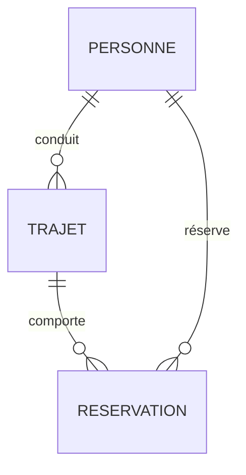

Dans la leçon précédente, la table des ventes répétait le prix de chaque article à chaque vente, et un élève pouvait appartenir
à une classe inexistante. Ces défauts deviennent graves à grande échelle : informations contradictoires, données orphelines,
mises à jour oubliées. Le **modèle relationnel**, proposé par Edgar F. Codd en 1970, répond à ces problèmes : on répartit les
données en **relations** (tables) reliées par des **clés**, et on impose des **contraintes** que le système vérifie. C'est le
modèle de presque toutes les bases de données (MySQL, PostgreSQL, SQLite, Oracle…), au programme de terminale et du concours.

## 1. Relations, attributs, domaines

:::definition
- Une **relation** est un ensemble de **n-uplets** (les lignes) ; on la représente par une table.
- Chaque colonne est un **attribut**, qui prend ses valeurs dans un **domaine** (entiers, chaînes, dates…).
- Le **schéma** d'une relation est son nom et la liste de ses attributs avec leurs domaines :
  `Eleve(id_eleve : entier, nom : texte, prenom : texte, naissance : date, id_classe : texte)`.
- Le schéma d'une base de données est l'ensemble des schémas de ses relations.
:::

Une relation est un **ensemble** : deux lignes ne peuvent pas être identiques, et l'ordre des lignes n'a pas de sens.

## 2. Les clés

:::definition
- Une **clé primaire** est un attribut (ou un groupe d'attributs) dont la valeur identifie **de façon unique** chaque n-uplet.
  Elle ne peut pas être vide.
- Une **clé étrangère** est un attribut d'une relation qui **fait référence** à la clé primaire d'une autre relation.
:::

On note le schéma en soulignant la clé primaire et en marquant les clés étrangères d'un `#` :

- `Classe(`<u>`id_classe`</u>`, niveau, salle)`
- `Eleve(`<u>`id_eleve`</u>`, nom, prenom, naissance, #id_classe)`
- `Matiere(`<u>`id_matiere`</u>`, intitule, coefficient)`
- `Note(`<u>`id_note`</u>`, #id_eleve, #id_matiere, valeur, date_eval)`

```mermaid legende="Le schéma de la base « lycee » utilisée dans les exercices SQL"
erDiagram
  CLASSE ||--o{ ELEVE : "regroupe"
  ELEVE ||--o{ NOTE : "obtient"
  MATIERE ||--o{ NOTE : "concerne"
  CLASSE {
    text id_classe PK
    text niveau
    text salle
  }
  ELEVE {
    int id_eleve PK
    text nom
    text prenom
    text naissance
    text id_classe FK
  }
  MATIERE {
    int id_matiere PK
    text intitule
    int coefficient
  }
  NOTE {
    int id_note PK
    int id_eleve FK
    int id_matiere FK
    real valeur
    text date_eval
  }
```

On choisit souvent une clé **artificielle** (un numéro) plutôt qu'une clé « naturelle » : le nom d'un élève n'est pas unique, et
un numéro de téléphone peut changer.

## 3. Les contraintes d'intégrité

Le système de gestion de bases de données (SGBD) **refuse** toute modification qui violerait ces contraintes :

| Contrainte          | Ce qu'elle impose                                          | Exemple de violation |
|---------------------|------------------------------------------------------------|----------------------|
| **de domaine**      | chaque valeur appartient au domaine de l'attribut (+ conditions) | une note de 25, un âge « douze » |
| **d'entité**        | la clé primaire est unique et non vide                     | deux élèves avec le même `id_eleve` |
| **de référence**    | toute valeur d'une clé étrangère existe dans la relation référencée | une note pour l'élève n° 999 qui n'existe pas |

```sql exec base=lycee erreur
INSERT INTO note VALUES (100, 999, 1, 12, '2026-10-01');   -- l'élève 999 n'existe pas
```

## 4. Les dépendances fonctionnelles

:::definition
Dans une relation, on dit que l'ensemble d'attributs $A$ **détermine fonctionnellement** l'ensemble $B$, et on note $A \to B$,
si deux n-uplets qui ont les mêmes valeurs pour $A$ ont forcément les mêmes valeurs pour $B$.
:::

Dans `Eleve`, `id_eleve → nom, prenom, naissance, id_classe` : une clé détermine tous les attributs (c'est même la définition
d'une clé : un ensemble minimal d'attributs qui détermine tous les autres). Dans `Classe`, `id_classe → niveau, salle`.
En revanche, `nom → prenom` est **fausse** : deux élèves peuvent s'appeler Martin sans avoir le même prénom.

Une dépendance fonctionnelle est une propriété **du sens des données** (des règles du monde réel), pas d'un état particulier
de la table : une table peut, par hasard, ne contenir aucun contre-exemple à une dépendance qui n'est pas vraie en général.

## 5. Redondance et normalisation

Considérons une seule grande table :

| id_eleve | nom    | id_classe | niveau    | salle | matiere       | coefficient | valeur |
|----------|--------|-----------|-----------|-------|---------------|-------------|--------|
| 6        | Richard | 1G1      | Première  | C201  | NSI           | 4           | 18     |
| 6        | Richard | 1G1      | Première  | C201  | Mathématiques | 4           | 15     |
| 7        | Petit  | 1G1       | Première  | C201  | NSI           | 4           | 16     |

La salle de la classe et le coefficient de la matière sont **répétés** : ils dépendent d'une partie seulement des informations
de la ligne (`id_classe → salle`, `matiere → coefficient`). Cette **redondance** provoque des anomalies :

- **mise à jour** : si la 1G1 change de salle, il faut modifier toutes ses lignes ; en oublier une rend la base incohérente ;
- **insertion** : impossible d'enregistrer une nouvelle classe tant qu'aucun élève n'y a de note ;
- **suppression** : supprimer les notes du seul élève d'une classe fait disparaître la salle de cette classe.

La **normalisation** consiste à **décomposer** la table pour que chaque information ne soit stockée qu'**une fois** : chaque
dépendance fonctionnelle doit avoir pour source une clé de sa relation. On obtient exactement le schéma de la section 2.

:::retenir
Méthode : pour chaque dépendance $A \to B$ dont $A$ n'est pas une clé de la table, on crée une table $(A, B)$ de clé $A$, on
retire $B$ de la table d'origine et on y garde $A$ comme clé étrangère. (Le programme du concours demande de savoir identifier
les dépendances fonctionnelles ; les formes normales 1FN, 2FN, 3FN formalisent cette démarche.)
:::

:::prof
En terminale NSI, on demande d'« identifier les concepts définissant le modèle relationnel », de « savoir distinguer la
structure d'une base de données de son contenu » et de « repérer des anomalies dans le schéma ». Partir d'un tableur mal
conçu (tout dans une feuille) et faire découvrir les anomalies avant de proposer la décomposition est très efficace. Les
diagrammes entités-associations aident à visualiser le schéma.
:::

## Exemple guidé

**Problème (type écrit 2).** Une association de covoiturage note dans un tableur : `trajet ; date ; ville_depart ; ville_arrivee
; conducteur ; telephone_conducteur ; passager ; telephone_passager ; prix`. Un trajet a un conducteur et plusieurs passagers ;
le prix dépend du trajet. Proposer un schéma relationnel.

**1. Dépendances.** `trajet → date, ville_depart, ville_arrivee, conducteur, prix` ; `conducteur → telephone_conducteur` (et de
même pour les passagers : une **personne** a un téléphone) ; un trajet a plusieurs passagers : la ligne est identifiée par
(`trajet`, `passager`).

**2. Anomalies** de la table unique : le téléphone d'une personne est répété à chaque trajet ; on ne peut pas enregistrer une
personne qui n'a pas encore voyagé ; un trajet sans passager ne peut pas être enregistré.

**3. Schéma normalisé.**
- `Personne(`<u>`id_personne`</u>`, nom, telephone)`
- `Trajet(`<u>`id_trajet`</u>`, date, ville_depart, ville_arrivee, prix, #id_conducteur)`
- `Reservation(`<u>`#id_trajet, #id_passager`</u>`)` — clé primaire composée des deux clés étrangères.



**4. Contraintes.** Domaine : `prix >= 0` ; entité : clés primaires ; référence : `id_conducteur` et `id_passager` existent dans
`Personne`, `id_trajet` dans `Trajet`. On pourrait aussi interdire qu'un conducteur soit passager de son propre trajet : cette
règle ne s'exprime pas par une simple clé (contrainte plus complexe, ou vérification par l'application).

## L'essentiel

- Relation = table ; attribut = colonne (avec un domaine) ; n-uplet = ligne ; schéma = nom + attributs.
- Clé primaire : identifie chaque n-uplet (unique, non vide) ; clé étrangère : référence la clé primaire d'une autre relation.
- Contraintes d'intégrité : domaine, entité, référence — vérifiées par le SGBD.
- Dépendance fonctionnelle $A \to B$ : mêmes valeurs de $A$ ⇒ mêmes valeurs de $B$ ; une clé détermine tous les attributs.
- Redondance ⇒ anomalies de mise à jour, d'insertion, de suppression ; on décompose (normalisation) pour que chaque information soit stockée une fois.

## Exercices

::::exercice[Reconnaître une clé primaire]{niveau=1}
Dans la relation `Livre(id_livre, titre, id_auteur, annee, genre, pages)` de la base « bibliotheque », quel attribut est la
clé primaire ?

- [ ] `titre`
- [x] `id_livre`
- [ ] `id_auteur`
- [ ] le couple (`titre`, `annee`)

:::corrige
`id_livre` identifie chaque livre de façon unique. Deux livres peuvent avoir le même titre ; `id_auteur` est une **clé
étrangère** (plusieurs livres ont le même auteur).
:::
::::

::::exercice[Quelle contrainte est violée ?]{niveau=1}
On tente d'insérer un emprunt pour le livre n° 42, qui n'existe pas dans la table `livre`. Quelle contrainte est violée ?

- [ ] de domaine
- [ ] d'entité
- [x] de référence
- [ ] aucune

:::corrige
`id_livre` est une clé étrangère de `emprunt` qui référence `livre` : sa valeur doit exister dans `livre`. C'est l'intégrité
**référentielle**.
:::
::::

::::exercice[Dépendances fonctionnelles]{niveau=2}
Dans la relation `Emprunt(id_emprunt, id_livre, id_adherent, date_emprunt, date_retour)`, lesquelles de ces dépendances
fonctionnelles sont vraies (d'après le sens des données) ?

- [x] `id_emprunt → id_livre, id_adherent, date_emprunt`
- [ ] `id_livre → id_adherent`
- [ ] `id_adherent → id_livre`
- [x] `id_emprunt → date_retour`

:::corrige
`id_emprunt` est la clé : il détermine tous les attributs. Un même livre est emprunté successivement par plusieurs adhérents
(donc `id_livre → id_adherent` est fausse), et un adhérent emprunte plusieurs livres.
:::
::::

::::exercice[Vérifier une dépendance sur une table]{niveau=2}
Écris `respecte_df(table, a, b)` qui vérifie si, **dans le contenu donné**, l'attribut `a` détermine l'attribut `b` (aucun
contre-exemple). `table` est une liste de dictionnaires. Coût linéaire.

```python depart
def respecte_df(table, a, b):
    ...
```

```python tests
t = [{"classe": "1G1", "salle": "C201", "nom": "Lucas"}, {"classe": "1G1", "salle": "C201", "nom": "Manon"},
     {"classe": "1G2", "salle": "C203", "nom": "Jade"}]
assert respecte_df(t, "classe", "salle") == True, "classe -> salle"
assert respecte_df(t, "classe", "nom") == False, "classe -/-> nom"
assert respecte_df(t, "nom", "classe") == True, "vrai sur ce contenu (par hasard)"
assert respecte_df([], "x", "y") == True, "table vide"
```

:::corrige
```python solution
def respecte_df(table, a, b):
    vu = {}
    for ligne in table:
        if ligne[a] in vu and vu[ligne[a]] != ligne[b]:
            return False
        vu[ligne[a]] = ligne[b]
    return True
```
Le troisième test illustre un point important : une table peut respecter « par hasard » une dépendance (ici, aucun homonyme)
qui n'est pas vraie en général. Le programme ne peut que **réfuter** une dépendance ; c'est le sens des données qui la justifie.
:::
::::

::::exercice[Est-ce une clé ?]{niveau=3}
Écris `est_cle(table, attributs)` qui renvoie `True` si, dans le contenu donné, la liste `attributs` identifie chaque ligne de
façon unique (aucune valeur manquante `None`, aucun doublon), et `minimale(table, attributs)` qui vérifie de plus qu'aucun
sous-ensemble strict de ces attributs n'est déjà une clé.

```python depart
from itertools import combinations

def est_cle(table, attributs):
    ...

def minimale(table, attributs):
    ...
```

```python tests
r = [{"id_trajet": 1, "id_passager": 7, "place": 1}, {"id_trajet": 1, "id_passager": 8, "place": 2},
     {"id_trajet": 2, "id_passager": 7, "place": 1}]
assert est_cle(r, ["id_trajet", "id_passager"]) == True, "clé composée"
assert est_cle(r, ["id_trajet"]) == False, "doublon sur id_trajet"
assert est_cle(r, ["id_trajet", "place"]) == True, "autre clé possible"
assert minimale(r, ["id_trajet", "id_passager"]) == True, "minimale"
assert minimale(r, ["id_trajet", "id_passager", "place"]) == False, "pas minimale"
assert est_cle([{"a": None}], ["a"]) == False, "valeur manquante"
```

:::corrige
```python solution
from itertools import combinations

def est_cle(table, attributs):
    vues = set()
    for ligne in table:
        valeur = tuple(ligne[a] for a in attributs)
        if None in valeur or valeur in vues:
            return False
        vues.add(valeur)
    return True

def minimale(table, attributs):
    if not est_cle(table, attributs):
        return False
    for k in range(1, len(attributs)):
        for sous in combinations(attributs, k):
            if est_cle(table, list(sous)):
                return False
    return True
```
On teste les sous-ensembles stricts avec `itertools.combinations`. Comme pour les dépendances, un contenu particulier ne peut
que suggérer une clé : c'est la règle du domaine (« un passager ne réserve qu'une fois un trajet ») qui la fonde.
:::
::::

::::exercice[Normaliser une table]{niveau=4 duree=25}
Une médiathèque utilise la table unique `Pret(numero_pret, date, titre, auteur, annee_naissance_auteur, nom_adherent,
email_adherent)`, où un prêt concerne un seul livre et un seul adhérent ; un auteur a une seule année de naissance ; un
adhérent a un seul e-mail ; deux livres différents peuvent avoir le même titre.

1. Donne les dépendances fonctionnelles pertinentes et la clé de la relation.
2. Donne un exemple concret de chacune des trois anomalies (mise à jour, insertion, suppression).
3. Propose un schéma relationnel normalisé (clés primaires et étrangères), en justifiant l'introduction d'identifiants.
4. Écris les contraintes d'intégrité de domaine que tu ajouterais.

:::criteres
- DF : `numero_pret → date, titre, auteur, nom_adherent, email_adherent` ; `auteur → annee_naissance_auteur` ; `nom_adherent → email_adherent` (si le nom identifie l'adhérent, à discuter) ; clé : `numero_pret`.
- Anomalies : modifier l'e-mail d'un adhérent sur toutes ses lignes ; impossible d'enregistrer un livre ou un adhérent sans prêt ; supprimer le dernier prêt d'un adhérent efface son e-mail.
- Schéma : `Auteur(id_auteur, nom, annee_naissance)`, `Livre(id_livre, titre, #id_auteur)`, `Adherent(id_adherent, nom, email)`, `Pret(numero_pret, date, #id_livre, #id_adherent)` ; identifiants car titres et noms ne sont pas uniques.
- Contraintes de domaine : date valide, année de naissance plausible, e-mail unique et de format correct, `NOT NULL` sur les attributs obligatoires.
:::

:::corrige
1. `numero_pret → date, titre, auteur, nom_adherent, email_adherent` (un prêt, un livre, un adhérent) ; `auteur →
   annee_naissance_auteur` ; `nom_adherent → email_adherent` (si l'on suppose que le nom identifie l'adhérent — en réalité, deux
   adhérents peuvent avoir le même nom, d'où l'intérêt d'un identifiant). La clé de la relation est `numero_pret`. Les dépendances
   `auteur → annee…` et `nom_adherent → email` ont une source qui n'est pas une clé : c'est la cause de la redondance.
2. **Mise à jour** : quand un adhérent change d'e-mail, il faut modifier toutes les lignes de ses prêts ; une ligne oubliée laisse
   deux e-mails différents. **Insertion** : impossible d'enregistrer un nouvel adhérent (ou un nouveau livre) tant qu'il n'a pas de
   prêt (le numéro de prêt, clé, serait vide). **Suppression** : supprimer l'unique prêt d'un adhérent fait disparaître son e-mail
   de la base.
3. Schéma normalisé :
   - `Auteur(`<u>`id_auteur`</u>`, nom, annee_naissance)`
   - `Livre(`<u>`id_livre`</u>`, titre, #id_auteur)`
   - `Adherent(`<u>`id_adherent`</u>`, nom, email)`
   - `Pret(`<u>`numero_pret`</u>`, date, #id_livre, #id_adherent)`

   On introduit des identifiants car aucun attribut « naturel » n'est unique et stable : deux livres peuvent avoir le même titre,
   deux auteurs ou adhérents le même nom, et un e-mail peut changer.
4. `date` et `annee_naissance` dans des intervalles plausibles (`annee_naissance BETWEEN 1000 AND 2026`), `email` unique
   (`UNIQUE`) et contenant un « @ » (`CHECK`), `NOT NULL` pour `titre`, `nom`, `date`, et les clés étrangères.
:::
::::
