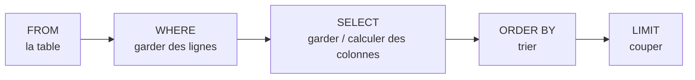

Dans la leçon « Données en table », il fallait écrire une boucle Python pour chaque question : quels élèves ont plus de 10 ?
quelles classes sont au deuxième étage ? Avec une base de données, on **décrit** ce qu'on veut obtenir, dans un langage de
requêtes, et c'est le système qui trouve comment l'obtenir efficacement. Ce langage, **SQL** (*Structured Query Language*), est
utilisé depuis les années 1970 par presque toutes les bases de données. Le programme du concours exige sa « maîtrise » :
cette leçon et les deux suivantes y sont consacrées.

Toutes les requêtes de la leçon s'exécutent sur la base **lycee** (classes, élèves, matières, notes). Clique sur « Exécuter »,
puis sur « Modifier » pour essayer tes propres variantes ; la base est remise à zéro à chaque exécution.

## 1. SELECT et FROM : choisir les colonnes

```sql exec base=lycee
SELECT nom, prenom FROM eleve;
```

`FROM` indique la **table**, `SELECT` les **colonnes** à afficher (c'est une **projection**). `*` désigne toutes les colonnes.
Une requête se termine par un point-virgule ; les mots-clés s'écrivent souvent en majuscules par convention (SQL ne distingue
pas les majuscules dans les mots-clés).

```sql exec base=lycee
SELECT * FROM classe;
```

On peut aussi calculer des **expressions** et **renommer** une colonne du résultat avec `AS` :

```sql exec base=lycee
SELECT intitule, coefficient, coefficient * 20 AS points_max FROM matiere;
```

## 2. WHERE : choisir les lignes

`WHERE` garde seulement les lignes qui vérifient une **condition** (c'est une **sélection**) :

```sql exec base=lycee
SELECT nom, prenom, id_classe FROM eleve WHERE id_classe = '1G1';
```

| Opérateur                         | Exemple                                     |
|-----------------------------------|---------------------------------------------|
| `=`, `<>` (ou `!=`), `<`, `<=`, `>`, `>=` | `valeur >= 10`, `id_classe <> 'TG1'` |
| `AND`, `OR`, `NOT`                | `valeur >= 10 AND id_matiere = 2`           |
| `BETWEEN a AND b` (bornes incluses) | `valeur BETWEEN 10 AND 12`               |
| `IN (…)`                          | `id_classe IN ('1G1', '1G2')`               |
| `LIKE` (motif)                    | `nom LIKE 'M%'` (commence par M), `nom LIKE '%r%'` (contient un r) |
| `IS NULL`, `IS NOT NULL`          | `naissance IS NULL`                         |

Les chaînes s'écrivent entre **apostrophes** simples (`'1G1'`) ; une apostrophe dans une chaîne se double (`'L''Étranger'`).

```sql exec base=lycee
SELECT id_eleve, valeur FROM note WHERE id_matiere = 2 AND valeur >= 15;
```

```sql exec base=lycee
SELECT nom, prenom FROM eleve WHERE naissance IS NULL OR id_classe IS NULL;
```

:::attention[NULL]
`NULL` représente une valeur **absente** ou inconnue. Toute comparaison avec `NULL` (`= NULL`, `<> NULL`, `> NULL`) donne
« inconnu », jamais vrai : la ligne n'est pas sélectionnée. Pour tester l'absence de valeur, on écrit `IS NULL`.
:::

## 3. ORDER BY, DISTINCT, LIMIT

```sql exec base=lycee
SELECT nom, prenom, naissance FROM eleve
WHERE naissance IS NOT NULL
ORDER BY naissance DESC, nom;
```

- `ORDER BY` trie le résultat (`ASC` croissant par défaut, `DESC` décroissant) ; plusieurs critères séparés par des virgules.
  **Sans `ORDER BY`, l'ordre des lignes n'est pas garanti.**
- `DISTINCT` supprime les doublons du résultat.
- `LIMIT n` ne garde que les `n` premières lignes.

```sql exec base=lycee
SELECT DISTINCT niveau FROM classe ORDER BY niveau;
```

```sql exec base=lycee
SELECT id_eleve, valeur FROM note ORDER BY valeur DESC LIMIT 3;
```

Les dates étant écrites `AAAA-MM-JJ`, l'ordre alphabétique des chaînes est l'ordre chronologique : on peut les comparer et les
trier directement.

## 4. Lire une requête

Une requête s'**écrit** dans l'ordre `SELECT … FROM … WHERE … ORDER BY …`, mais elle se **comprend** mieux dans l'ordre logique
de son évaluation :



C'est pourquoi on peut trier selon une colonne calculée dans le `SELECT`, mais pas filtrer dans le `WHERE` avec un alias défini
dans le `SELECT` (selon les SGBD).

:::prof
En terminale NSI, les élèves doivent « identifier les composants d'une requête » et « construire des requêtes d'interrogation à
l'aide des clauses du langage SQL : SELECT, FROM, WHERE, JOIN » ainsi que de mise à jour. La pratique dans un SGBD réel (SQLite,
via DB Browser, un site en ligne ou un notebook) est indispensable. L'erreur fréquente : `= NULL`, les guillemets doubles au lieu
des apostrophes, ou un `ORDER BY` oublié quand l'énoncé parle de classement.
:::

## Exemple guidé

**Problème.** Sur la base lycee : « Quelles sont les notes de NSI (matière n° 2) comprises entre 12 et 18, de la meilleure à la
moins bonne, avec l'identifiant de l'élève ? En cas d'égalité, par identifiant croissant. »

**1. Table** : les notes sont dans `note`. **2. Lignes** : matière 2 **et** valeur entre 12 et 18 (bornes incluses : `BETWEEN`).
**3. Colonnes** : `id_eleve`, `valeur`. **4. Ordre** : `valeur DESC`, puis `id_eleve`.

```sql exec base=lycee
SELECT id_eleve, valeur
FROM note
WHERE id_matiere = 2 AND valeur BETWEEN 12 AND 18
ORDER BY valeur DESC, id_eleve;
```

**5. Vérifier.** Les notes de NSI de la base sont 18, 16, 9,5, 14, 19, 17,5, 12, 20, 11 et 15 : on garde 18, 16, 14, 17,5, 12
et 15, soit 6 lignes, dans l'ordre 18, 17,5, 16, 15, 14, 12. (Pour afficher le **nom** de l'élève, il faut une **jointure** avec
la table `eleve` : leçon suivante.)

## L'essentiel

- `SELECT colonnes FROM table` : projection (`*` = tout ; expressions et `AS` pour renommer).
- `WHERE condition` : sélection, avec `= <> < <= > >=`, `AND OR NOT`, `BETWEEN`, `IN`, `LIKE` (`%`, `_`), `IS NULL`.
- `ORDER BY col [ASC|DESC], …` : tri (sinon l'ordre n'est pas garanti) ; `DISTINCT` : sans doublons ; `LIMIT n`.
- Chaînes entre apostrophes ; `NULL` se teste avec `IS NULL`, jamais avec `=`.
- Ordre logique : FROM → WHERE → SELECT → ORDER BY → LIMIT.

## Exercices

::::exercice[Prévoir le résultat]{niveau=1}
Combien de lignes renvoie `SELECT * FROM classe WHERE niveau = 'Première';` sur la base lycee (classes 2D1, 2D2, 2D3, 1G1,
1G2, TG1, TG2) ?

- [ ] 1
- [x] 2
- [ ] 6
- [ ] 0, car il faut écrire `"Première"`

:::corrige
Les classes de Première sont 1G1 et 1G2 : 2 lignes. En SQL, les chaînes s'écrivent entre **apostrophes** simples.
:::
::::

::::exercice[Le piège de NULL]{niveau=1}
Quelle requête renvoie les élèves dont la date de naissance est inconnue ?

- [ ] `SELECT nom FROM eleve WHERE naissance = NULL;`
- [x] `SELECT nom FROM eleve WHERE naissance IS NULL;`
- [ ] `SELECT nom FROM eleve WHERE naissance = '';`
- [ ] `SELECT nom FROM eleve WHERE NOT naissance;`

:::corrige
Une comparaison avec `NULL` n'est jamais vraie : `= NULL` ne renvoie aucune ligne. Il faut `IS NULL`. La chaîne vide `''` est une
valeur, différente de `NULL`.
:::
::::

::::exercice[Les élèves de Terminale]{niveau=2 base=lycee}
Écris une requête qui affiche le nom et le prénom des élèves des classes TG1 et TG2, triés par nom.

:::corrige
```sql solution
SELECT nom, prenom FROM eleve WHERE id_classe IN ('TG1', 'TG2') ORDER BY nom;
```
On peut aussi écrire `WHERE id_classe = 'TG1' OR id_classe = 'TG2'`, ou `WHERE id_classe LIKE 'TG%'`.
:::
::::

::::exercice[Les bonnes notes]{niveau=2 base=lycee}
Affiche l'identifiant de l'élève, l'identifiant de la matière et la valeur des notes **strictement supérieures à 16**, de la plus
grande à la plus petite (en cas d'égalité, par identifiant d'élève croissant).

:::corrige
```sql solution
SELECT id_eleve, id_matiere, valeur FROM note WHERE valeur > 16 ORDER BY valeur DESC, id_eleve;
```
« Strictement supérieures » : `>` et non `>=` (le 16 est exclu).
:::
::::

::::exercice[Une liste sans doublons]{niveau=2 base=lycee}
Affiche, sans doublons et dans l'ordre chronologique, les dates d'évaluation de la matière n° 1 (Mathématiques).

:::corrige
```sql solution
SELECT DISTINCT date_eval FROM note WHERE id_matiere = 1 ORDER BY date_eval;
```
Plusieurs élèves ont été évalués le même jour : sans `DISTINCT`, chaque date apparaîtrait plusieurs fois.
:::
::::

::::exercice[Motifs et dates]{niveau=3 base=lycee}
Affiche le nom, le prénom et la date de naissance des élèves dont le nom commence par **L** ou se termine par **d**, nés en 2008
ou après, du plus jeune au plus âgé.

:::indice
Pour « né en 2008 ou après », compare la chaîne de la date à `'2008-01-01'`. Pense aux parenthèses autour du `OR`.
:::

:::corrige
```sql solution
SELECT nom, prenom, naissance FROM eleve
WHERE (nom LIKE 'L%' OR nom LIKE '%d') AND naissance >= '2008-01-01'
ORDER BY naissance DESC;
```
Sans parenthèses, `AND` étant prioritaire sur `OR`, la condition serait `nom LIKE 'L%' OR (nom LIKE '%d' AND naissance >= …)` :
les élèves en L nés avant 2008 seraient gardés. Les élèves sans date de naissance (NULL) sont exclus, car `NULL >= …` n'est pas vrai.
:::
::::

::::exercice[Lire et corriger des requêtes]{niveau=4 duree=20}
Pour chacune des questions, une requête a été proposée. Dis si elle est correcte ; sinon, explique l'erreur et corrige-la.

1. « Les trois meilleures notes de la base » : `SELECT valeur FROM note LIMIT 3;`
2. « Les élèves qui ne sont pas en 1G1 » : `SELECT nom FROM eleve WHERE id_classe <> '1G1';` — que se passe-t-il pour Louis David
   (classe inconnue) ?
3. « Les notes entre 10 et 12, 10 et 12 exclus » : `SELECT valeur FROM note WHERE valeur BETWEEN 10 AND 12;`
4. « Les élèves dont le prénom contient un accent é » : `SELECT prenom FROM eleve WHERE prenom = '%é%';`

:::criteres
- Q1 : faux, il manque `ORDER BY valeur DESC` : sans tri, LIMIT prend 3 lignes quelconques.
- Q2 : l'élève à `id_classe` NULL n'est pas renvoyé, car `NULL <> '1G1'` n'est pas vrai ; correction selon l'intention : ajouter `OR id_classe IS NULL`.
- Q3 : faux, `BETWEEN` inclut les bornes ; correction : `valeur > 10 AND valeur < 12`.
- Q4 : faux, `=` compare littéralement ; il faut `LIKE '%é%'`.
:::

:::corrige
1. **Incorrecte** : sans `ORDER BY`, l'ordre des lignes n'est pas garanti, `LIMIT 3` prend trois notes quelconques. Correction :
   `SELECT valeur FROM note ORDER BY valeur DESC LIMIT 3;`
2. Correcte pour les élèves qui ont une classe, mais Louis David, dont `id_classe` vaut `NULL`, **n'apparaît pas** : la comparaison
   `NULL <> '1G1'` n'est pas vraie. Si l'on veut tous les élèves « pas en 1G1 », y compris sans classe :
   `SELECT nom FROM eleve WHERE id_classe <> '1G1' OR id_classe IS NULL;`
3. **Incorrecte** : `BETWEEN 10 AND 12` **inclut** 10 et 12. Correction : `SELECT valeur FROM note WHERE valeur > 10 AND valeur < 12;`
4. **Incorrecte** : `=` compare avec la chaîne littérale `'%é%'`. Il faut `LIKE` : `SELECT prenom FROM eleve WHERE prenom LIKE '%é%';`
:::
::::
