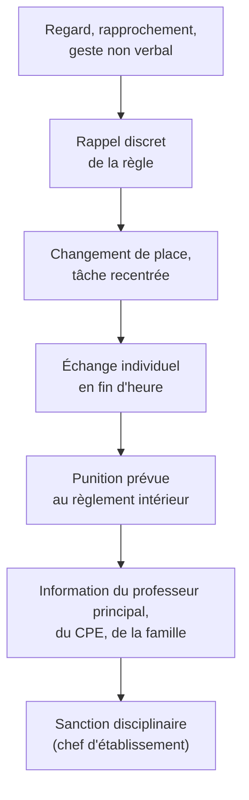

Un recruteur demande presque toujours : « Comment se passe votre premier cours ? » ou « Un élève perturbe : que faites-vous ? ». Ce n'est pas un piège : la
gestion de classe est ce qui inquiète le plus quand on débute, et ce qui conditionne tout le reste. La bonne nouvelle : elle s'apprend, et repose sur des
gestes simples, **préparés à l'avance** et **tenus avec constance**.

## 1. Ce qui fait l'autorité

:::definition[Autorité]
L'autorité du professeur ne vient pas de la sévérité mais de quatre choses : sa **légitimité** (il sait, il est préparé, il a un cadre institutionnel), un **cadre
clair** (des règles peu nombreuses, connues, justifiées), la **cohérence** (ce qui est annoncé est fait, pour tous) et une **relation** respectueuse (on s'adresse
à chaque élève avec considération, on valorise). L'autoritarisme (crier, menacer, humilier) donne l'illusion du contrôle et s'effondre au premier conflit.
:::

Les élèves testent un nouveau professeur, surtout un remplaçant arrivant en cours d'année : ce n'est pas personnel. Ce qui compte est la **réponse** apportée
aux premiers tests — calme, ferme, prévisible.

## 2. Le premier cours

:::methode[Un premier cours qui installe le cadre]
1. **Accueillir à la porte** : on entre quand le professeur le dit, on salue chaque élève.
2. **Placer** les élèves (plan de classe préparé, ou on le fait pendant l'heure) : c'est le professeur qui décide.
3. **Se présenter** en deux phrases et faire **l'appel** (il est obligatoire, sur le logiciel de vie scolaire de l'établissement).
4. **Annoncer le cadre** : 3 à 5 règles, formulées positivement et **justifiées** (« on lève la main pour parler, pour que chacun puisse être entendu »), le matériel,
   l'organisation (cahier ou classeur, dossier de travail sur l'ordinateur, ENT).
5. **Faire travailler dès la première heure** : une activité courte et réussissable (un petit programme à modifier, une énigme débranchée). Les élèves jugent un
   professeur sur ce qu'on fait dans son cours, pas sur son discours.
6. **Finir proprement** : bilan d'une minute, travail noté dans le cahier de textes, sortie dans le calme.
:::

## 3. Règles et routines en salle informatique

Une salle informatique est un lieu tentant (jeux, réseaux sociaux, vidéos) et techniquement fragile. Quelques routines évitent la plupart des problèmes :

| Moment | Routine |
|---|---|
| entrée | on s'installe à sa place (plan de salle), on se connecte, on ouvre seulement le document indiqué au tableau |
| consignes | **écrans éteints ou baissés**, chaises tournées vers le tableau ; consigne écrite au tableau ou dans le document |
| travail | binômes avec des rôles (l'un tape, l'autre guide, on échange toutes les 15 minutes) ; on lève la main ou on pose un « gobelet rouge » pour demander de l'aide |
| fin | enregistrement dans le bon dossier, déconnexion, chaise rangée, deux minutes de bilan |

Prévoir toujours un **plan B** (panne de réseau, ordinateurs qui ne démarrent pas) : une activité papier ou débranchée sur le même objectif. Et **circuler**
dans la salle : le professeur qui reste assis derrière son bureau ne voit pas les écrans.

## 4. Prévenir plutôt que guérir

- **Rythme** : une séance découpée en phases courtes (5 à 15 minutes) avec des changements d'activité ; une activité de démarrage dès l'entrée.
- **Consignes** claires, écrites, avec un exemple ; vérifier qu'elles sont comprises en les faisant reformuler.
- **Différencier** : des indices pour ceux qui bloquent, des défis pour ceux qui ont fini (un élève qui s'ennuie ou qui ne comprend pas devient vite perturbateur).
- **Présence** : regard, déplacement, voix posée (baisser la voix fait souvent plus d'effet que crier), appeler les élèves par leur prénom.
- **Valoriser** ce qui va bien : les élèves qui travaillent méritent autant d'attention que ceux qui perturbent.

## 5. Réagir de façon graduée

:::retenir[Punitions et sanctions]
- Les **punitions scolaires** répondent aux manquements mineurs aux obligations des élèves ; elles peuvent être prononcées par les professeurs et personnels
  de l'établissement : inscription sur le carnet de correspondance, excuse orale ou écrite, devoir supplémentaire, retenue. L'exclusion ponctuelle d'un cours
  doit rester **exceptionnelle** : l'élève est alors pris en charge par la vie scolaire, et un rapport est rédigé.
- Les **sanctions disciplinaires** répondent aux atteintes graves (violence, insulte grave, harcèlement…) ; elles sont prononcées par le **chef d'établissement**
  ou le **conseil de discipline** : avertissement, blâme, mesure de responsabilisation, exclusion temporaire, exclusion définitive (par le conseil).
- Toujours : **individuelles** (pas de punition collective), **proportionnées**, **expliquées**, conformes au **règlement intérieur** — et **jamais par la note**
  (une note mesure des acquis, pas un comportement).
:::

:::attention
Ne jamais laisser une **insulte**, une **violence** ou un propos **discriminatoire** sans réponse immédiate ; ne jamais humilier un élève ni entrer dans un bras de
fer public (on reporte l'échange à la fin de l'heure) ; ne jamais laisser un élève exclu sans surveillance ; et **ne pas rester seul** : le professeur principal,
le CPE, les collègues et la direction sont là pour ça. Écrire un court rapport factuel dès qu'un incident sort de l'ordinaire.
:::

## 6. Les familles et l'équipe

Prendre contact avec les familles **tôt** et pas seulement pour les problèmes (un mot positif sur l'ENT fait beaucoup) ; s'appuyer sur le **professeur
principal** (qui centralise le suivi de la classe), le **CPE** (vie scolaire, absences, comportement), l'**infirmier** et le **psychologue de l'Éducation nationale**
(un élève qui va mal), les **collègues** de la classe (cohérence des règles). Pour un contractuel qui arrive en cours d'année : demander dès le premier jour le
règlement intérieur, les règles déjà en place dans la classe et les élèves à besoins particuliers (PAP, PPS).

:::prof
En entretien, une réponse de gestion de classe convaincante a toujours la même forme : **prévention** (ce que je mets en place pour que ça n'arrive pas),
**réaction immédiate** graduée et calme, **suite** (échange, punition prévue au règlement), **équipe** (qui j'informe). Citer les punitions et sanctions avec le
bon vocabulaire montre qu'on connaît le cadre.
:::

## Exemple guidé

**Situation (question d'entretien).** « En première NSI, trois élèves jouent en ligne sur leur ordinateur pendant que vous expliquez, et rient fort. Que faites-vous ? »

**1. Sur le moment** : je m'interromps et je me rapproche d'eux sans un mot ; je demande calmement à toute la classe d'éteindre les écrans pendant la consigne
(c'est la règle) ; je vérifie que les trois écrans sont éteints, et je reprends.

**2. Pendant le travail** : je passe vérifier leur avancée en premier ; si l'un recommence, je le change de place (près du bureau) et je lui donne une tâche précise
avec un objectif à atteindre en 10 minutes.

**3. En fin d'heure** : un échange court avec chacun (« qu'est-ce qui s'est passé ? qu'attend-on de toi la prochaine fois ? ») ; si cela se répète, une punition
prévue au règlement (travail à rattraper en retenue, mot aux parents) et l'information du professeur principal.

**4. Prévenir la suite** : demander à l'administrateur réseau si l'accès aux sites de jeux peut être filtré ou si un logiciel de supervision des écrans existe ;
revoir le rythme de mes consignes (plus courtes, plus tôt dans l'heure) pour que les élèves soient vite au travail.

## L'essentiel

- Autorité = légitimité + cadre clair + cohérence + relation respectueuse ; pas d'autoritarisme.
- Premier cours : accueil à la porte, placement, appel, 3 à 5 règles justifiées, activité dès la première heure, fin propre.
- Salle informatique : écrans éteints pendant les consignes, binômes à rôles, circuler, enregistrer avant la fin, plan B papier.
- Prévenir : rythme, consignes écrites, différenciation, présence, valorisation.
- Réagir de façon graduée ; **punitions** (professeur) et **sanctions** (chef d'établissement, conseil de discipline) : individuelles, proportionnées, jamais par la note.
- Ne jamais rester seul : professeur principal, CPE, collègues, direction, familles.

## Exercices

::::exercice[Punition ou sanction ?]{niveau=1}
Lequel de ces exemples est une **sanction disciplinaire**, qui ne peut pas être décidée par le professeur seul ?

- [ ] Un devoir supplémentaire
- [ ] Une retenue
- [x] Une exclusion temporaire de l'établissement
- [ ] Une excuse écrite

:::corrige
L'exclusion temporaire de l'établissement est une sanction disciplinaire, prononcée par le chef d'établissement (ou le conseil de discipline). Les trois autres
sont des punitions scolaires, que le professeur peut donner dans le cadre du règlement intérieur.
:::
::::

::::exercice[Ce qui est interdit]{niveau=1}
Laquelle de ces réponses à un mauvais comportement est **contraire** aux règles ?

- [ ] Changer l'élève de place
- [ ] Prévenir le professeur principal
- [x] Retirer deux points à son devoir pour le punir
- [ ] Lui donner un devoir supplémentaire en lien avec le cours

:::corrige
La note évalue les acquis, pas le comportement : baisser une note pour punir est interdit. Le comportement se traite par une punition ou une sanction prévue au règlement intérieur.
:::
::::

::::exercice[Écrire ses règles]{niveau=2 duree=10}
Rédige les **cinq règles** que tu afficheras dans ta salle informatique dès le premier cours, formulées positivement, chacune avec une courte justification.

:::criteres
- Cinq règles claires, peu nombreuses, formulées positivement (« on… » plutôt que « interdit de… »).
- Chaque règle justifiée par une raison compréhensible par des élèves (écoute, sécurité, matériel, respect, travail).
- Au moins deux règles spécifiques à la salle informatique (écrans, applications, enregistrement, matériel).
:::

:::corrige
Exemple : (1) **On éteint ou baisse l'écran pendant les explications**, pour que chacun puisse suivre. (2) **On n'ouvre que ce qui est demandé**, parce que le
temps de cours sert à apprendre et que le réseau est partagé. (3) **On lève la main pour parler ou demander de l'aide**, pour que tout le monde soit entendu à son
tour. (4) **On enregistre son travail dans son dossier avant la fin de l'heure**, pour ne rien perdre. (5) **On respecte le matériel et les autres** (pas de
nourriture près des claviers, on s'adresse aux autres avec respect), parce que la salle et la classe sont à tout le monde.
:::
::::

::::exercice[Un élève qui refuse de travailler]{niveau=3 duree=10}
« En seconde (SNT), un élève reste les bras croisés et dit : "De toute façon, je comprends rien à l'informatique." » Que fais-tu, sur le moment et ensuite ?

:::criteres
- Réaction sur le moment discrète et bienveillante (aller vers l'élève, ne pas l'exposer), tâche découpée et réussissable, encouragement.
- Recherche de la cause (difficulté réelle, manque de confiance, problème extérieur) lors d'un échange individuel.
- Suite : suivi, différenciation, information du professeur principal si cela persiste ou cache autre chose ; ni moquerie ni punition immédiate.
:::

:::corrige
**Sur le moment** : je vais le voir discrètement, sans lui faire la leçon devant la classe ; je lui propose une **première étape très courte** et réussissable (« on
change juste cette valeur et on regarde ce qui se passe ») et je reste une minute pour qu'il réussisse quelque chose ; je reviens le voir plus tard pour valoriser ce
qu'il a fait. **En fin d'heure** : un échange court pour comprendre (difficulté réelle, souvenir d'échec, fatigue, problème personnel ?). **Ensuite** : je prévois pour
lui des aides (fiche d'indices, binôme bienveillant) et je surveille l'évolution ; si le blocage persiste ou semble cacher autre chose, j'en parle au **professeur
principal** (et au CPE ou au psychologue de l'Éducation nationale selon les cas).
:::
::::

::::exercice[Préparer son premier cours]{niveau=4 duree=25}
Tu remplaces un professeur de NSI en première, à partir de lundi, en plein mois de novembre. Décris précisément ce que tu fais **avant** le premier cours et
**pendant** ta première heure, minute par minute.

:::criteres
- Avant : contacts (chef d'établissement, collègues, professeur principal), récupération de la progression déjà faite, du cahier de textes, du règlement intérieur, des listes et des élèves à besoins particuliers, test de la salle et des comptes, plan de classe.
- Pendant : accueil, appel, présentation brève, cadre (règles), point sur ce qui a été fait, activité de reprise courte et réussissable, bilan et cahier de textes.
- Posture : continuité avec le travail précédent, fermeté calme, valorisation ; anticipation des tests des élèves.
:::

:::corrige
**Avant** : je rencontre ou j'appelle le chef d'établissement (emploi du temps, règlement intérieur, accès au logiciel de vie scolaire et à l'ENT), un collègue de
NSI ou de mathématiques s'il y en a, et le professeur principal de la classe ; je récupère le **cahier de textes** et la progression déjà réalisée (où en sont-ils ?
quelles évaluations ?), la liste des élèves avec ceux qui ont un PAP ou un PPS ; je teste la salle (ordinateurs, comptes, logiciels, accès à Capytale ou à l'éditeur
Python) et je prépare un plan de classe. **Pendant la première heure** (55 min) : *0-5* accueil à la porte, placement selon mon plan ; *5-10* appel, présentation en
deux phrases, cadre en quatre règles affichées ; *10-15* « où en êtes-vous ? » : je fais rappeler par les élèves ce qu'ils ont vu (je vérifie avec le cahier de
textes) ; *15-45* une activité de **reprise** courte sur la dernière notion, réussissable, avec des défis pour les plus rapides, pendant laquelle je circule et
j'apprends les prénoms ; *45-55* bilan, annonce de la suite, cahier de textes, sortie dans le calme. Je reste ferme et calme face aux tests (« avec l'autre prof on
avait le droit de… ») : « dans ce cours, voici les règles ».
:::
::::
