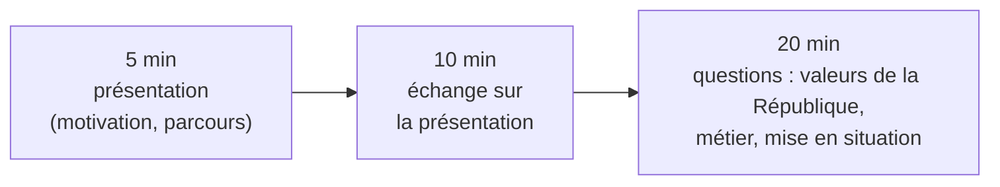

L'**entretien avec le jury** est la seconde épreuve d'admission (35 minutes, coefficient 3, note éliminatoire 0). Il ne porte pas sur l'informatique, mais sur le
**futur professeur** : sa motivation, sa connaissance du métier, sa capacité à incarner les valeurs du service public. Il s'ouvre par une **présentation de 5 minutes**
que l'on prépare à l'avance : c'est la seule partie de l'épreuve entièrement entre tes mains.

## 1. Le déroulement

Texte de l'épreuve (arrêté du 17 avril 2025) : un premier temps de 15 minutes débute par une présentation de 5 minutes de la **motivation** et du **parcours** du candidat,
suivie d'un échange de 10 minutes ; un second temps de 20 minutes porte, à travers des questionnements dont une **mise en situation**, sur les **valeurs de la
République** dont la laïcité, puis sur l'aptitude à **se projeter dans le métier**, à incarner les exigences du **service public** (neutralité, lutte contre les
discriminations, égalité entre les filles et les garçons), à comprendre les enjeux de la **transition écologique** et à appréhender l'**épanouissement de l'élève**
dans toutes ses dimensions. Les leçons suivantes du module traitent chacun de ces thèmes.

## 2. Ce que le jury cherche

:::retenir
- Une **motivation pour enseigner**, pas seulement pour l'informatique : pourquoi transmettre, à des adolescents, dans le service public ?
- Un **parcours relu** à la lumière du métier : ce que chaque expérience t'a appris d'utile pour enseigner (expliquer, accompagner, travailler en équipe, persévérer).
- Une **connaissance concrète** du métier et du lycée (SNT, NSI, les élèves, l'établissement), sans naïveté.
- Une expression **claire**, une posture **ouverte** et **réfléchie** : le jury se demande s'il confierait une classe à cette personne.
:::

## 3. Construire ses 5 minutes

:::methode[Un plan en cinq temps]
1. **Accroche** (30 s) : une situation vécue ou une question qui t'a mené vers l'enseignement de l'informatique.
2. **Parcours** (2 min) : deux ou trois expériences choisies (études, tutorat, animation, stage, emploi, projet associatif) ; pour chacune, **ce que tu en retires
   pour le métier**.
3. **Pourquoi l'informatique au lycée** (1 min) : un enjeu qui te tient à cœur (former des citoyens éclairés face au numérique, donner leur chance à tous, en
   particulier aux filles, développer la rigueur et la créativité).
4. **Le professeur que tu veux être** (1 min) : deux ou trois principes concrets (exigence et bienveillance, faire programmer et expliquer, travailler en équipe).
5. **Ouverture** (30 s) : ce que tu veux encore apprendre, un projet pour tes futurs élèves.
:::

Écrire un **canevas** (des mots-clés, pas un texte rédigé), le dire à voix haute, le **chronométrer** (5 minutes, c'est court : environ 650 mots), l'enregistrer et
le réécouter. Il ne s'agit pas de réciter : le jury perçoit immédiatement un texte appris par cœur.

:::attention[Les écueils]
- Le **CV chronologique** (« en 2021 j'ai eu mon bac, en 2022… ») : le jury a peu d'informations sur toi, mais il veut du **sens**, pas une liste.
- Le **discours convenu** (« j'aime transmettre », « l'informatique est partout ») sans exemple qui le rende personnel.
- Les **promesses** impossibles ou la critique de l'institution : on peut avoir un regard critique, argumenté et constructif.
- **Dépasser** les 5 minutes : le jury interrompt, et c'est mal parti.
:::

## 4. Les 10 minutes d'échange

Le jury rebondit sur ce que tu as dit : « Vous parlez de tutorat : qu'avez-vous appris d'un élève en difficulté ? », « Pourquoi pas ingénieur ? », « Comment
donneriez-vous envie à une élève de choisir NSI ? », « Qu'est-ce qui vous inquiète dans le métier ? ». Tout ce que tu dis peut être **questionné** : n'avance rien
que tu ne puisses développer.

:::methode[Répondre]
Écouter la question jusqu'au bout ; reformuler si elle est complexe ; répondre **directement**, puis **illustrer** par un exemple ; savoir dire « je ne sais pas, mais
voici comment je chercherais / ce que je ferais ». Un temps de réflexion de quelques secondes est tout à fait acceptable.
:::

:::prof
Le jury est composé d'enseignants et de cadres de l'Éducation nationale (inspecteurs, chefs d'établissement, professeurs). Ils évaluent une posture
professionnelle : la sincérité, la cohérence entre le discours et les exemples, et la capacité à se remettre en question comptent plus que l'éloquence.
:::

## Exemple guidé

**Situation.** Une candidate a une licence d'informatique, a donné des cours particuliers de mathématiques pendant deux ans et a animé un club de robotique dans une
association de quartier.

**1. Choisir le fil rouge** : « faire réussir des élèves qui pensaient ne pas être faits pour ça ».

**2. Relier chaque expérience au métier** : les cours particuliers → *repérer d'où vient une difficulté, adapter l'explication* ; le club de robotique → *faire travailler
un groupe hétérogène sur un projet, susciter la curiosité de jeunes, dont des filles, qui ne se voyaient pas « informaticiennes »* ; la licence → *la rigueur, et le
souvenir de ce qui m'a aidée ou bloquée en apprenant à programmer*.

**3. Canevas** (mots-clés) : accroche — la fierté d'un collégien du club dont le robot a fini par avancer ; parcours — cours particuliers (diagnostiquer, adapter),
club (projet, groupe, mixité), licence (rigueur, souvenir de mes blocages) ; pourquoi la NSI — former des citoyens qui comprennent le numérique, ouvrir la discipline à
tous ; mon projet de professeure — faire programmer et expliquer, exigence bienveillante, travail en équipe avec les collègues ; ouverture — me former à la
différenciation et à l'accompagnement des élèves à besoins particuliers.

**4. Anticiper l'échange** : « Comment avez-vous attiré des filles au club ? », « Quelle différence entre un cours particulier et une classe de 35 élèves ? », « Qu'est-ce
qui a été difficile pour vous en apprenant à programmer, et qu'en ferez-vous avec vos élèves ? ».

## L'essentiel

- Entretien : 35 min (5 min de présentation + 10 min d'échange ; puis 20 min de questions dont une mise en situation) ; coefficient 3 ; 0 éliminatoire.
- Le jury cherche une motivation réfléchie pour **enseigner**, un parcours relié au métier, une connaissance concrète du lycée, une posture ouverte.
- Plan : accroche, 2-3 expériences reliées au métier, pourquoi l'informatique au lycée, le professeur que je veux être, ouverture ; canevas de mots-clés, chronométré, dit à voix haute.
- Échange : écouter, reformuler, répondre puis illustrer, savoir dire « je ne sais pas » et raisonner.

## Exercices

::::exercice[Le format]{niveau=1}
Combien de temps dure la présentation que le candidat fait au début de l'entretien ?

- [ ] 2 minutes
- [x] 5 minutes
- [ ] 10 minutes
- [ ] 15 minutes

:::corrige
La présentation dure 5 minutes ; elle est suivie de 10 minutes d'échange (premier temps de 15 minutes), puis de 20 minutes de questions.
:::
::::

::::exercice[Une bonne accroche]{niveau=1}
Laquelle de ces ouvertures de présentation est la plus efficace ?

- [ ] « Je m'appelle Hugo, j'ai 21 ans, j'ai eu mon bac en 2023. »
- [ ] « L'informatique est partout dans notre société. »
- [x] « La première fois qu'un élève m'a dit "j'ai compris pourquoi ma boucle ne s'arrêtait pas", j'ai su que je voulais enseigner. »
- [ ] « Je voudrais d'abord dire que je ne suis pas très à l'aise à l'oral. »

:::corrige
Une accroche **personnelle** et **concrète**, liée à l'enseignement, capte l'attention et annonce le fil rouge. Les autres sont soit une fiche d'état civil, soit un lieu
commun, soit une façon de se dévaloriser d'entrée.
:::
::::

::::exercice[Relier une expérience au métier]{niveau=2}
Tu as travaillé deux étés comme animateur en centre de loisirs. Rédige les deux ou trois phrases de ta présentation qui en parlent, en les reliant au métier de
professeur.

:::criteres
- Une expérience décrite brièvement et concrètement (un fait précis).
- Un lien explicite avec une compétence du métier (gérer un groupe, poser un cadre, adapter une activité, coopérer avec une équipe, communiquer avec des familles).
- Pas de généralité ni d'exagération ; ton sincère.
:::

:::corrige
Exemple : « Deux étés comme animateur en centre de loisirs m'ont appris à tenir un groupe de quinze enfants : poser des règles claires dès le début, les faire
respecter avec constance, et prévoir une activité de rechange quand la première ne prend pas. J'ai aussi découvert l'importance du travail d'équipe et du dialogue
avec les familles — deux choses que je retrouverai au lycée. » Le fait est concret, le lien avec le métier explicite (cadre, adaptation, équipe, parents).
:::
::::

::::exercice[Répondre à une question piège]{niveau=3 duree=10}
Le jury demande : « Avec votre licence d'informatique, vous gagneriez plus dans le privé. Pourquoi l'enseignement ? Et si dans cinq ans une entreprise vous fait
une offre ? » Rédige une réponse de 1 à 2 minutes.

:::criteres
- Réponse honnête, qui ne nie pas l'écart de rémunération mais l'assume.
- Motivation positive et personnelle pour enseigner (transmission, service public, sens, relation aux élèves), illustrée par un exemple.
- Projection crédible dans la durée (formation continue, évolution dans le métier), sans promesse excessive.
:::

:::corrige
« C'est vrai, et j'ai fait ce choix en connaissance de cause. Ce qui me motive, c'est de voir un élève comprendre et réussir quelque chose qu'il pensait hors de
portée ; je l'ai vécu en donnant des cours particuliers, et aucun projet en entreprise ne m'a donné ce sentiment. Enseigner l'informatique dans le service public,
c'est aussi donner à **tous** les élèves, pas seulement à ceux qui ont un ordinateur et des parents du métier, les moyens de comprendre le numérique. Dans cinq ans,
je me vois plutôt approfondir le métier — me former, accompagner des projets d'élèves, peut-être accueillir des stagiaires — que le quitter. Et si un jour je
m'interroge, ce sera sur la base de ce que j'aurai vécu en classe, pas d'une offre de salaire. »
:::
::::

::::exercice[Écrire son canevas]{niveau=4 duree=30}
Rédige le **canevas** complet de ta propre présentation de 5 minutes (mots-clés et articulations, pas un texte rédigé), puis liste cinq questions que le jury
pourrait te poser à partir de ce canevas, avec pour chacune l'idée principale de ta réponse.

:::criteres
- Canevas en cinq temps (accroche, parcours relié au métier, pourquoi l'informatique au lycée, le professeur que je veux être, ouverture), personnel, avec des exemples précis.
- Durée réaliste (environ 650 mots une fois dit) ; fil rouge identifiable.
- Questions pertinentes, qui rebondissent sur les éléments du canevas ; réponses honnêtes, argumentées, illustrées, cohérentes avec la présentation.
:::

:::corrige
Production personnelle : il n'y a pas de corrigé unique. Pour t'auto-évaluer : (1) chaque expérience citée est-elle **reliée** explicitement au métier ? (2) Peux-tu
développer **chaque** affirmation par un exemple si le jury le demande ? (3) As-tu parlé des **élèves** autant que de toi ? (4) Ta présentation tient-elle en 5 minutes,
dite à voix haute, sans lire ? (5) Le jury sait-il, à la fin, **pourquoi tu veux enseigner** l'informatique — et pas seulement que tu aimes l'informatique ?
:::
::::
