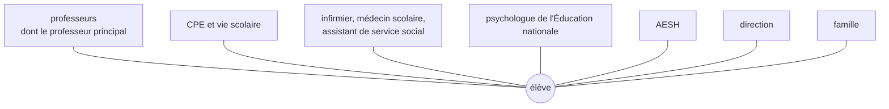

Le texte de l'épreuve demande d'« appréhender l'épanouissement de l'élève dans toutes ses dimensions ». L'élève n'est pas seulement un apprenant : c'est un adolescent,
avec sa santé, sa vie sociale, ses fragilités, ses projets. Le professeur n'est ni psychologue ni infirmier, mais il est souvent **le premier adulte** à remarquer qu'un élève
ne va pas bien — et c'est dans sa classe que se construisent, ou non, la confiance et le goût d'apprendre.

## 1. Les dimensions de l'épanouissement

- **Apprentissages** : progresser, réussir, avoir confiance en ses capacités.
- **Santé et bien-être** : sommeil, alimentation, santé mentale, usage des écrans, absence de harcèlement.
- **Relations** : appartenance à un groupe, coopération, respect, sentiment de sécurité.
- **Orientation et projets** : se projeter, découvrir des métiers et des formations, choisir.
- **Engagement et citoyenneté** : délégués, conseil de la vie lycéenne, éco-délégués, associations, projets.
- **Ouverture** : culture, sport, sorties, concours, clubs (programmation, robotique…).

Un bon **climat scolaire** (règles claires et justes, relations respectueuses, sentiment de sécurité) favorise à la fois le bien-être et les apprentissages.

## 2. L'école inclusive

La loi du 11 février 2005 reconnaît à tout enfant en situation de handicap le droit à une scolarisation, de préférence en milieu ordinaire ; les lois de 2013 et 2019 ont
renforcé l'**école inclusive**. Des dispositifs formalisent les adaptations :

| Dispositif | Pour qui ? | Qui le met en place ? |
|---|---|---|
| **PPS** (projet personnalisé de scolarisation) | élève en situation de handicap reconnu | la MDPH, avec l'équipe de suivi de la scolarisation ; peut prévoir un **AESH**, du matériel adapté |
| **PAP** (plan d'accompagnement personnalisé) | troubles des apprentissages (dyslexie, dyspraxie, troubles de l'attention…) | le chef d'établissement, après avis du médecin scolaire |
| **PAI** (projet d'accueil individualisé) | maladie chronique, allergie, traitement | le chef d'établissement, avec le médecin et la famille |
| **PPRE** (programme personnalisé de réussite éducative) | élève en difficulté scolaire | l'équipe pédagogique |

L'accompagnement des élèves en situation de handicap est organisé localement (pôles inclusifs, pôles d'appui à la scolarité déployés progressivement depuis 2024). Le
professeur **applique** les adaptations prévues et **participe** aux réunions de suivi : c'est une obligation, pas une option.

:::methode[Adapter en NSI]
Consignes courtes et structurées ; supports lisibles (police, contraste, taille) ; code de départ fourni plutôt qu'à recopier ; temps supplémentaire ; tolérance sur la
graphie et l'orthographe hors du code ; outils numériques d'accessibilité (synthèse vocale, agrandissement) ; place adaptée en salle ; consignes orales doublées à l'écrit. Pour
un élève avec un trouble de l'attention : tâches découpées, jalons fréquents, rappel discret des consignes.
:::

## 3. Ne pas rester seul : les professionnels

Face à un élève qui change (absences, isolement, fatigue, chute des résultats, propos inquiétants), le professeur **repère**, **écoute** s'il est sollicité, et **transmet**
aux bonnes personnes ; en cas de danger, il applique les procédures de protection (voir la leçon sur les obligations du fonctionnaire).

## 4. Dans la classe

Ce qui favorise l'épanouissement relève aussi de **pratiques pédagogiques** : des objectifs clairs et atteignables, une évaluation qui valorise les progrès et donne des
retours utiles, le droit à l'erreur (en programmation, l'erreur est la norme : on la **débogue**), des projets qui donnent du sens et de l'autonomie, du travail en équipe,
la reconnaissance de chacun. En NSI, les clubs, concours et projets ouverts sont des occasions de s'investir et de se découvrir des talents.

:::prof
Le jury attend une vision de l'élève **globale** mais un professionnalisme **délimité** : le professeur agit dans sa classe (adaptations, climat, évaluation), repère et
transmet ; il travaille avec les autres professionnels et avec les familles, sans prétendre tout résoudre seul.
:::

## Exemple guidé

**Situation.** Un élève de terminale NSI, jusqu'ici investi, ne rend plus ses travaux, dort en classe et a été absent plusieurs fois ce mois-ci.

**1. Observer et noter** : depuis quand ? dans toutes les matières ? (en parler avec le professeur principal et les collègues).

**2. Un échange individuel**, bienveillant, en fin de cours : « Je remarque que ça a l'air difficile en ce moment ; est-ce que ça va ? Est-ce que je peux t'aider ? » Sans
interrogatoire ni jugement ; sans promettre le secret si l'élève révèle une situation de danger.

**3. Transmettre** : au professeur principal et au CPE (absences, changement de comportement) ; selon ce qui ressort, l'infirmier, le psychologue de l'Éducation nationale
ou l'assistant de service social prennent le relais ; la famille est contactée par l'équipe.

**4. En classe** : maintenir le lien et l'exigence, en ajustant (délais pour les travaux en retard, points d'étape), valoriser ce qui avance.

## L'essentiel

- Épanouissement : apprentissages, santé et bien-être, relations, orientation, engagement, ouverture ; climat scolaire.
- École inclusive (loi de 2005) : **PPS** (handicap, MDPH, AESH), **PAP** (troubles des apprentissages), **PAI** (santé), **PPRE** (difficultés) ; le professeur applique les adaptations.
- Une équipe autour de l'élève : professeur principal, CPE, infirmier, médecin, assistant social, psychologue de l'Éducation nationale, AESH, direction, famille.
- Repérer, écouter, transmettre ; en classe : objectifs clairs, droit à l'erreur, valorisation des progrès, projets.

## Exercices

::::exercice[Le bon dispositif]{niveau=1}
Un élève dyslexique, sans reconnaissance de handicap par la MDPH, a besoin d'aménagements (temps, supports). Quel dispositif est adapté ?

- [ ] un PAI
- [x] un PAP
- [ ] un PPS
- [ ] un conseil de discipline

:::corrige
Le **PAP** concerne les troubles des apprentissages sans reconnaissance de handicap ; il est mis en place par le chef d'établissement après avis du médecin scolaire. Le PPS
suppose une décision de la MDPH ; le PAI concerne la santé (maladie, allergie).
:::
::::

::::exercice[À qui s'adresser ?]{niveau=1}
Un élève te dit qu'il hésite à quitter le lycée et ne sait pas quoi faire après le bac. Vers qui l'orientes-tu en priorité, en plus du professeur principal ?

- [ ] l'infirmier
- [x] le psychologue de l'Éducation nationale
- [ ] l'agent d'accueil
- [ ] le gestionnaire

:::corrige
Le **psychologue de l'Éducation nationale** (spécialité « éducation, développement et conseil en orientation ») accompagne les élèves dans leurs choix d'orientation et peut
repérer d'éventuelles difficultés plus profondes. Le professeur principal coordonne le suivi.
:::
::::

::::exercice[Adapter une évaluation]{niveau=2}
Un élève de ta classe de première NSI a un PAP pour une dyspraxie (difficultés d'écriture manuscrite et de mise en page). Décris trois adaptations concrètes pour une évaluation
écrite comportant du code à écrire.

:::criteres
- Adaptations pertinentes pour la dyspraxie : composition sur ordinateur (éditeur de code), temps majoré, sujet aéré et agrandi, code à compléter plutôt qu'à écrire en entier, tolérance sur la présentation manuscrite.
- Respect du PAP (les adaptations prévues s'appliquent) ; mêmes compétences évaluées que pour les autres élèves.
:::

:::corrige
(1) Permettre de composer **sur ordinateur**, dans un éditeur de code (indentation automatique), plutôt qu'à la main. (2) Un sujet **aéré**, en police plus grande, avec des
**cadres de réponse** et du **code à compléter** plutôt qu'un programme entier à recopier. (3) Un **temps majoré** (selon le PAP) et une tolérance sur la présentation des
schémas faits à la main. Les compétences évaluées (algorithmique, programmation) restent les mêmes que pour les autres élèves : on adapte l'accès, pas l'exigence.
:::
::::

::::exercice[Un élève qui s'isole]{niveau=3 duree=10}
Lors des projets en groupe, un élève de seconde reste systématiquement seul ; les autres refusent qu'il les rejoigne, et tu entends des moqueries sur sa tenue. Que fais-tu,
en classe et au-delà ?

:::criteres
- En classe : constitution des groupes par le professeur (et non par affinités), rôles définis, réaction immédiate aux moqueries, protection de l'élève.
- Au-delà : échange individuel avec l'élève ; information du professeur principal et du CPE (risque de harcèlement) ; vigilance et suivi.
- Dimension éducative : climat de classe, coopération, travail sur le respect (vie de classe, EMC).
:::

:::corrige
**En classe** : je compose moi-même les groupes (ou j'utilise un tirage), avec des **rôles** définis, pour que personne ne soit laissé de côté ; je réagis immédiatement aux
moqueries (rappel du respect, sans exposer l'élève). **Au-delà** : je prends un moment avec l'élève pour savoir comment il vit la situation ; j'informe le **professeur
principal** et le **CPE**, car isolement et moqueries répétées peuvent relever du **harcèlement** (protocole de l'établissement). **Dans la durée** : des activités coopératives
où chacun a une place, et, en lien avec le professeur principal, un temps de vie de classe sur le respect et le vivre-ensemble.
:::
::::

::::exercice[Une classe épanouissante]{niveau=4 duree=20}
Décris, en une page, les principes et les pratiques concrètes par lesquels ta classe de NSI favorisera l'épanouissement de **tous** les élèves (y compris ceux en difficulté et
ceux qui sont très avancés), en t'appuyant sur au moins un dispositif institutionnel et sur le travail en équipe.

:::criteres
- Principes explicites (exigence et bienveillance, droit à l'erreur, valorisation des progrès, sentiment de sécurité, coopération).
- Pratiques concrètes : différenciation (indices gradués, défis), évaluation formative, projets à sens, rôles tournants, clubs et concours, adaptations prévues par les PAP/PPS.
- Dispositif institutionnel et travail en équipe (professeur principal, CPE, psychologue de l'Éducation nationale, AESH, familles) ; prise en compte de la santé et des écrans.
- Cohérence et réalisme.
:::

:::corrige
Production personnelle. Pour t'auto-évaluer : tes principes sont-ils **traduits en pratiques** observables (« le droit à l'erreur » devient « une première version non notée
de chaque programme, puis une version finale ») ? Prévois-tu quelque chose pour l'élève en difficulté (indices, code à compléter, PPRE) **et** pour l'élève très avancé
(défis, projets ouverts, concours) ? Mentionnes-tu les **adaptations** des PAP et PPS, le rôle des **AESH**, le lien avec les **familles** et les autres professionnels ?
As-tu pensé à la santé (pauses écran, posture, sommeil évoqué avec la classe) et au climat (règles claires, respect, coopération) ?
:::
::::
