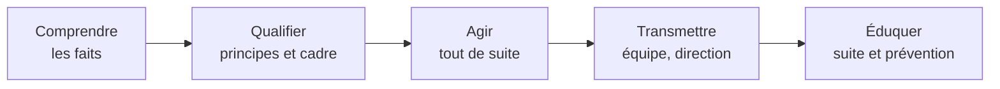

Le second temps de l'entretien comporte une **mise en situation** : le jury décrit une situation de la vie d'un établissement et demande ce que tu ferais. Il n'y a pas
une seule bonne réponse, mais il y a de **mauvaises postures**. Cette leçon donne une méthode, puis une banque de situations à travailler à voix haute.

## 1. Une méthode en cinq temps

:::methode[Comprendre, qualifier, agir, transmettre, éduquer]
1. **Comprendre** : reformuler les faits en une phrase ; si un point est flou, le dire (« selon que… je ferais… »).
2. **Qualifier** : quel principe est en jeu (laïcité, égalité, respect, sécurité, protection de l'enfance, obligations professionnelles) ? quel cadre s'applique (règlement
   intérieur, loi, texte de référence) ?
3. **Agir** : la réaction **immédiate**, calme et **proportionnée** — en classe, devant les élèves.
4. **Transmettre** : à qui je parle ensuite (professeur principal, CPE, direction, infirmier, psychologue, référents), qu'est-ce que j'écris (rapport factuel) ; je ne reste
   pas seul, mais je ne me défausse pas non plus.
5. **Éduquer** : la suite pédagogique (échange avec l'élève, travail avec la classe, prévention), et ce que j'en retire pour ma pratique.
:::

Durée de la réponse : deux à trois minutes, structurées ; le jury relancera.

## 2. Une banque de situations

| Situation | Principes en jeu | Pistes de réponse |
|---|---|---|
| Un élève tient des propos racistes envers un camarade pendant un travail de groupe | égalité, dignité, lutte contre les discriminations | réagir immédiatement en qualifiant le propos ; protéger l'élève visé ; échange individuel ; information du CPE et de la direction (sanction éducative selon le règlement) ; travail sur le respect |
| Une élève arrive en cours avec une tenue que d'autres élèves présentent comme religieuse | laïcité, loi de 2004, dialogue | ne pas agir seul dans la classe, sans exposer l'élève ; informer la direction, qui conduit le dialogue prévu par la loi ; rester factuel |
| Un parent conteste vivement une note par courriel et menace de « monter au rectorat » | relation avec les familles, équité de l'évaluation | répondre calmement, proposer un rendez-vous ; expliquer les critères ; informer le chef d'établissement ; ne pas modifier une note sous pression, mais vérifier une éventuelle erreur |
| Un élève est filmé à son insu par d'autres et la vidéo circule | droit à l'image, harcèlement, protection | conserver les preuves sans diffuser ; information immédiate CPE et direction (protocole harcèlement) ; protection de la victime ; travail éducatif (droit à l'image, cyberharcèlement) |
| Ton chef d'établissement te demande d'ajouter une heure de soutien non prévue | obéissance hiérarchique, droits | dialoguer sur les modalités (service, rémunération éventuelle) ; appliquer si c'est conforme au cadre ; faire valoir ses droits par les voies normales |
| Un élève révèle des violences subies à la maison | protection de l'enfance, signalement | écouter sans enquêter ; ne pas promettre le secret ; transmettre immédiatement au chef d'établissement (information préoccupante ou signalement) ; noter les propos |
| Une élève te dit que l'informatique « n'est pas pour elle » | égalité filles-garçons, orientation, confiance | entendre, déconstruire le stéréotype, valoriser ses réussites, présenter des parcours, en parler au professeur principal et au psychologue de l'Éducation nationale |
| Pendant un projet, un élève utilise une IA générative pour produire tout son code | intégrité des évaluations, apprentissage | rappeler les règles fixées, faire expliquer le code à l'oral, adapter l'évaluation (processus, explications), éduquer à un usage critique |
| Un collègue tient en salle des professeurs des propos méprisants sur un élève handicapé | dignité, école inclusive, travail en équipe | réagir sans agressivité (rappeler les droits de l'élève, son PPS), proposer une solution constructive ; si les propos ou pratiques persistent et nuisent à l'élève, en parler à la direction |
| Les éco-délégués veulent supprimer l'usage des ordinateurs en classe « pour la planète » | transition écologique, nuance, projet | valoriser l'engagement ; apporter des données (fabrication vs usage) ; proposer un projet concret (réemploi, extinction, sobriété) |

:::attention[Les mauvaises postures]
- **Tout régler seul** (« je convoque les parents et je règle ça ») ou **tout renvoyer** (« je préviens la direction » sans rien faire en classe).
- **Réciter** des textes sans les relier à la situation.
- **Surréagir** (sanction immédiate, humiliation publique, débat religieux en classe) ou **minimiser** (« ce sont des enfants »).
- **S'obstiner** quand le jury apporte un élément nouveau.
:::

:::prof
S'entraîner **à voix haute**, avec un chronomètre et, si possible, un camarade qui joue le jury et relance (« et si l'élève refuse ? », « et si les parents appellent le
lendemain ? »). Enregistrer ses réponses et vérifier qu'on y retrouve les cinq temps.
:::

## Exemple guidé

**Situation (jury).** « Vous êtes professeur de NSI. Pendant une évaluation sur machine, vous constatez qu'un élève a ouvert une conversation avec un camarade sur son
téléphone et y copie du code. Que faites-vous ? » — puis la relance : « L'élève nie et devient agressif. »

**1. Comprendre** : une fraude probable pendant une évaluation, constatée par moi.

**2. Qualifier** : équité de l'évaluation, respect du règlement (le règlement intérieur et les consignes de l'évaluation encadrent l'usage du téléphone), intégrité.

**3. Agir** : calmement et discrètement, je retire ou fais ranger le téléphone selon le règlement, je note l'heure et ce que j'ai constaté, je laisse l'élève terminer ou je
le place autrement ; je ne fais pas de scène devant la classe.

**4. Transmettre** : à la fin, j'en informe le CPE et le professeur principal (et la direction si le règlement le prévoit) ; je fais un rapport factuel ; la décision sur la
note et une éventuelle sanction suit les règles de l'établissement.

**5. Éduquer** : un échange avec l'élève (pourquoi la fraude ne l'aide pas, ce qu'on attend de lui), et pour la suite, une évaluation conçue pour limiter la fraude
(questions d'explication, oral court).

**Relance** (« il nie et devient agressif ») : je ne rentre pas dans l'escalade ; je garde mon calme, je rappelle que j'ai constaté les faits et qu'on en reparlera après ; si
l'agressivité perturbe la classe ou menace la sécurité, je fais appel à la vie scolaire. L'incident et l'agressivité figurent dans mon rapport.

## L'essentiel

- Méthode : **comprendre, qualifier, agir, transmettre, éduquer** ; deux à trois minutes structurées.
- Mobiliser les principes (laïcité, neutralité, égalité, respect, protection de l'enfance, obligations du fonctionnaire) en les **appliquant** à la situation.
- Agir en classe de façon proportionnée, transmettre aux bonnes personnes, ne jamais rester seul, ne pas se défausser.
- Face aux relances : intégrer l'élément nouveau et ajuster calmement ; c'est la posture qui est évaluée.

## Exercices

::::exercice[La bonne réaction]{niveau=1}
En pleine séance, un élève insulte violemment un camarade. Quelle est la meilleure première réaction ?

- [ ] L'exclure du cours et le renvoyer chez lui
- [ ] Faire comme si de rien n'était pour ne pas perturber la séance
- [x] Intervenir immédiatement et calmement, rappeler la règle, protéger l'élève visé, puis traiter l'incident avec la vie scolaire après le cours
- [ ] Demander à la classe de voter une sanction

:::corrige
Réaction immédiate et proportionnée, protection de la victime, puis transmission au CPE pour la suite (éducative et, si nécessaire, disciplinaire selon le règlement). Renvoyer un
élève chez lui n'est pas de la compétence du professeur ; ignorer l'insulte la cautionne.
:::
::::

::::exercice[Repérer l'erreur de posture]{niveau=1}
À la question « un élève vous confie qu'il est harcelé », un candidat répond : « Je convoque les harceleurs à la fin du cours pour leur parler. » Quelle est l'erreur principale ?

- [ ] Il devrait d'abord prévenir les parents des harceleurs
- [x] Il agit seul, sans protéger la victime ni appliquer le protocole de l'établissement
- [ ] Il devrait attendre d'avoir des preuves
- [ ] Il n'y a pas d'erreur

:::corrige
Confronter seul les auteurs peut aggraver la situation pour la victime. Il faut écouter, rassurer, et transmettre immédiatement au CPE et à la direction, qui déclenchent le
protocole de traitement du harcèlement.
:::
::::

::::exercice[Rédiger une réponse]{niveau=2}
« Un élève de seconde refuse de faire l'activité de SNT sur les réseaux sociaux en disant : "De toute façon, je ne suis sur aucun réseau, ça ne me concerne pas." » Rédige
une réponse structurée selon les cinq temps (une dizaine de lignes).

:::criteres
- Cinq temps présents et pertinents ; situation qualifiée correctement (désengagement, pas une faute grave).
- Réaction pédagogique : expliquer l'objectif (comprendre un phénomène de société, pas l'usage personnel), adapter éventuellement le support, maintenir l'exigence.
- Suite : échange individuel, attention à un éventuel mal-être ou à une interdiction familiale, information du professeur principal si le désengagement est général.
:::

:::corrige
**Comprendre** : un élève refuse une activité en la jugeant sans rapport avec lui. **Qualifier** : un désengagement, pas une faute grave ; enjeu : le droit de chacun à
comprendre son environnement numérique, et l'obligation de suivre les enseignements. **Agir** : je lui explique que l'objectif n'est pas d'utiliser les réseaux mais de
**comprendre** comment ils fonctionnent (graphes, modèle économique) — ce qui concerne tout citoyen, utilisateur ou non ; son point de vue de non-utilisateur est même
intéressant pour la discussion. Je maintiens l'activité, en lui confiant par exemple l'analyse du modèle économique. **Transmettre** : si ce refus s'inscrit dans un
désengagement plus large, j'en parle au professeur principal. **Éduquer** : un échange en fin de séance pour comprendre (choix personnel, interdiction familiale, mauvaise
expérience ?) et valoriser son regard critique.
:::
::::

::::exercice[Gérer une relance]{niveau=3 duree=10}
Situation : « Une élève de terminale vous dit qu'elle a peur de rentrer chez elle à cause d'un conflit violent avec son beau-père. » Tu as répondu (écoute, transmission
immédiate à la direction, pas de promesse de secret). Le jury relance : « C'est vendredi, 17 h 30, la direction est partie et l'élève doit prendre son bus dans 15 minutes. »
Que fais-tu ?

:::criteres
- Prise en compte de l'urgence et du danger potentiel immédiat : ne pas laisser l'élève partir sans solution si elle exprime un danger.
- Recherche immédiate d'un adulte responsable présent (CPE, vie scolaire, personnel de direction d'astreinte, infirmerie) ; à défaut, appel au 119 ou aux services de police/gendarmerie (17) en cas de danger immédiat.
- Traçabilité (écrit factuel), information de la direction dès que possible ; posture calme et protectrice envers l'élève.
:::

:::corrige
La relance introduit l'**urgence** : l'élève exprime une peur de rentrer chez elle, je ne peux pas la laisser partir sans m'assurer de sa sécurité. Je cherche
**immédiatement** un responsable encore présent (CPE, personnel de vie scolaire, infirmier, personnel de direction d'astreinte — chaque établissement a une organisation
pour ces cas). Si personne n'est joignable et que l'élève dit être en **danger immédiat**, j'appelle les secours ou la police (17), ou le **119** (enfance en danger) pour
avoir une conduite à tenir. Je reste avec elle, calme et rassurant, sans lui poser de questions d'enquête. J'écris ensuite précisément ce qu'elle a dit et ce que j'ai fait,
et j'informe le chef d'établissement dès que possible, pour que la procédure de protection (information préoccupante ou signalement) soit engagée.
:::
::::

::::exercice[Un entraînement complet]{niveau=4 duree=30}
Choisis trois situations différentes de la banque de la section 2 (dont une sur la laïcité et une sur l'égalité). Pour chacune, rédige ta réponse selon les cinq temps, puis
imagine une relance du jury et ta réponse à cette relance. Enfin, dis en quelques lignes ce que tu as appris sur ta propre posture.

:::criteres
- Trois situations variées traitées selon les cinq temps, avec des principes et des textes correctement mobilisés.
- Relances crédibles et réponses ajustées (prise en compte de l'élément nouveau, sans contradiction).
- Réflexion personnelle sincère (points forts, points à travailler, ressources à approfondir).
:::

:::corrige
Production personnelle. Pour t'auto-évaluer, vérifie pour chaque réponse : les **faits** sont-ils reformulés ? Le **principe** et le **cadre** sont-ils nommés et
appliqués (pas seulement cités) ? Ta réaction **immédiate** est-elle proportionnée ? As-tu dit **à qui** tu transmets et ce que tu **écris** ? Y a-t-il une **suite
éducative** ? Ta réponse à la relance **intègre**-t-elle l'élément nouveau ? Puis fais-la écouter à quelqu'un : est-elle claire en deux à trois minutes ?
:::
::::
