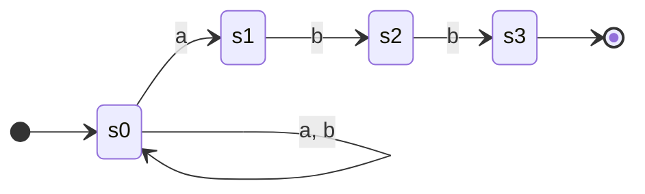

Comment décrire **en une ligne** « les numéros de téléphone français », « les adresses électroniques » ou « les mots qui se terminent par `abb` » ? Les
**expressions rationnelles** (on dit aussi « expressions régulières », *regex*) sont une notation compacte pour des langages. Elles sont à la fois un objet
théorique — elles décrivent exactement les langages reconnus par les automates finis — et un outil quotidien du programmeur, présent dans tous les
langages, les éditeurs de texte et les commandes shell (`grep`).

## 1. Les expressions rationnelles théoriques

:::definition
Sur un alphabet $\Sigma$, les **expressions rationnelles** sont construites à partir de $\varnothing$ (langage vide), $\varepsilon$ (mot vide) et des **lettres**,
avec trois opérations :
- l'**union** $e \mid f$ : les mots de $e$ ou de $f$ ;
- la **concaténation** $ef$ : un mot de $e$ suivi d'un mot de $f$ ;
- l'**étoile** $e^*$ : la concaténation de zéro, un ou plusieurs mots de $e$.

Priorités : l'étoile, puis la concaténation, puis l'union ; $ab^*$ est $a(b^*)$, pas $(ab)^*$.
:::

| Expression | Langage |
|---|---|
| $a^*$ | $\varepsilon, a, aa, aaa, \dots$ |
| $(a \mid b)^*$ | tous les mots sur $\{a, b\}$ |
| $(a \mid b)^* abb$ | les mots qui finissent par $abb$ |
| $b^* (a b^* a b^*)^*$ | les mots qui ont un nombre **pair** de $a$ |
| $(0 \mid 1(01^*0)^*1)^*$ | les écritures binaires des multiples de 3 |

:::retenir[Théorème de Kleene (1956)]
Un langage est décrit par une **expression rationnelle** si et seulement s'il est **reconnu par un automate fini**. Dans un sens, on construit un AFN à partir
de l'expression, morceau par morceau (construction de Thompson : un petit automate par lettre, puis des $\varepsilon$-transitions pour l'union, la concaténation
et l'étoile) ; dans l'autre, on élimine les états un à un en étiquetant les transitions par des expressions.
:::



Conséquence : les langages rationnels sont stables par union, concaténation, étoile, **mais aussi** intersection et complémentaire (grâce aux automates).
Et leurs limites sont celles des automates : $\{a^n b^n\}$, les palindromes et les expressions bien parenthésées ne sont **pas** rationnels.

## 2. Les expressions rationnelles en Python

Les bibliothèques ajoutent de nombreux raccourcis (qui s'écrivent tous avec les trois opérations de base, sauf exceptions) :

| Syntaxe | Sens | Exemple |
|---|---|---|
| `.` | n'importe quel caractère (sauf saut de ligne) | `a.c` : `abc`, `a5c` |
| `[abc]`, `[a-z]`, `[^0-9]` | un caractère de l'ensemble, d'un intervalle, hors de l'ensemble | `[A-Z][a-z]+` : un mot à majuscule |
| `\d`, `\w`, `\s` | un chiffre, un caractère de mot, un espace | `\d\d` : deux chiffres |
| `*`, `+`, `?` | 0 ou plus, 1 ou plus, 0 ou 1 | `colou?r` |
| `{n}`, `{n,m}` | exactement $n$, entre $n$ et $m$ fois | `\d{5}` : un code postal |
| `\|` | union | `chat\|chien` |
| `( … )` | groupe (et capture) | `(\d{2})/(\d{2})` |
| `^`, `$` | début, fin | `^#` : ligne qui commence par `#` |

```python exec
import re

# Valider : la chaîne entière doit correspondre
code_postal = re.compile(r"\d{5}")
for c in ["75005", "7500", "75005A"]:
    print(c, bool(code_postal.fullmatch(c)))

# Extraire : toutes les dates JJ/MM/AAAA d'un texte, avec des groupes
texte = "Écrit 1 le 09/03/2027, écrit 2 le 10/03/2027, inscriptions avant le 25/11/2026."
for jour, mois, annee in re.findall(r"(\d{2})/(\d{2})/(\d{4})", texte):
    print(annee, mois, jour)

# Remplacer : anonymiser des adresses
print(re.sub(r"[\w.]+@[\w.]+", "<adresse>", "Écrire à lea.martin@lycee.fr ou hugo@ent.fr"))
```

:::methode[Écrire une expression pour valider]
1. Écrire des exemples **valides** et **invalides** (dont les cas limites).
2. Construire l'expression morceau par morceau, en la **testant** sur tous les exemples.
3. Utiliser `fullmatch` (ou `^…$`) pour valider : sinon `search` trouve un morceau valide dans une chaîne invalide.
4. Écrire les expressions en chaînes brutes `r"…"` : sinon `\d` et `\b` sont interprétés par Python avant d'arriver au module `re`.
:::

:::attention[Au-delà des langages rationnels]
Les références arrière (`(\w+) \1` : un mot répété) dépassent les langages rationnels, et le moteur de Python fonctionne par **retour sur trace** : certaines
expressions mal écrites (`(a+)+$` sur une longue suite de `a` suivie d'un `b`) prennent un temps **exponentiel** — une faille connue (« ReDoS »). Les moteurs
fondés sur les automates (RE2, celui de Go, `grep`) garantissent un temps linéaire, mais n'acceptent pas les références arrière.
:::

:::prof
Les expressions rationnelles ne sont pas explicitement au programme de NSI, mais elles sont très utiles en projet (valider une saisie, nettoyer des données
CSV) et au concours (lien automates – expressions). Faire écrire la validation d'une adresse électronique est instructif : la version « parfaite » est
monstrueuse, et l'on apprend à se contenter d'une approximation raisonnable, complétée par une vérification réelle (envoi d'un courriel de confirmation).
:::

## Exemple guidé

**Problème.** Valider les heures au format 24 h `HH:MM` (de `00:00` à `23:59`).

**1. Exemples.** Valides : `00:00`, `09:30`, `19:45`, `23:59`. Invalides : `24:00`, `7:30`, `12:60`, `12h30`, ` 12:30`.

**2. Construire.** Les minutes : `[0-5]\d`. Les heures : de 00 à 19, `[01]\d`, ou de 20 à 23, `2[0-3]` ; d'où `([01]\d|2[0-3])`.

**3. Assembler et tester.**

```python exec
import re

heure = re.compile(r"([01]\d|2[0-3]):([0-5]\d)")
valides = ["00:00", "09:30", "19:45", "23:59"]
invalides = ["24:00", "7:30", "12:60", "12h30", " 12:30", "23:59:00"]
print(all(heure.fullmatch(h) for h in valides), not any(heure.fullmatch(h) for h in invalides))
m = heure.fullmatch("19:45")
print("heures :", m.group(1), "minutes :", m.group(2))

# Vérification exhaustive : comparer avec la définition
toutes = [f"{h:02d}:{mi:02d}" for h in range(100) for mi in range(100)]
print(all(bool(heure.fullmatch(t)) == (int(t[:2]) < 24 and int(t[3:]) < 60) for t in toutes))
```

**4. Pièges évités.** Avec `search` au lieu de `fullmatch`, `23:59:00` et ` 12:30` seraient acceptés (ils **contiennent** une heure valide). Avec `\d\d:\d\d`,
`24:00` et `99:99` passeraient.

## L'essentiel

- Expressions rationnelles : $\varnothing$, $\varepsilon$, lettres, union $\mid$, concaténation, étoile $^*$ ; priorités étoile > concaténation > union.
- **Kleene** : expressions rationnelles ⇔ automates finis (construction de Thompson) ; langages rationnels stables par union, concaténation, étoile, intersection, complémentaire.
- Non rationnels : $\{a^n b^n\}$, parenthésage, palindromes.
- Python `re` : `.`, `[...]`, `\d \w \s`, `* + ?`, `{n,m}`, `|`, groupes `( )`, ancres `^ $` ; `fullmatch` (valider), `search`, `findall`, `sub` ; chaînes brutes `r"…"`.
- Retour sur trace : risque exponentiel (ReDoS) ; moteurs à automates : temps linéaire.

## Exercices

::::exercice[Lire une expression]{niveau=1}
Quel mot appartient au langage de $a(ba)^*b$ ?

- [ ] $aab$
- [x] $abab$
- [ ] $abba$
- [ ] $ba$

:::corrige
$a(ba)^*b$ : un $a$, puis zéro ou plusieurs $ba$, puis un $b$ : $ab$, $abab$, $ababab$… ($a$ · $ba$ · $b$ = $abab$).
:::
::::

::::exercice[Valider ou chercher]{niveau=1}
Avec `re.search(r"\d{5}", "Code : 750056")`, que se passe-t-il ?

- [ ] Aucune correspondance, car la chaîne a 6 chiffres
- [x] Une correspondance (`75005`), car `search` trouve un morceau de la chaîne
- [ ] Une erreur
- [ ] Une correspondance (`750056`)

:::corrige
`search` cherche **n'importe où** : les 5 premiers chiffres suffisent. Pour valider qu'une chaîne **est** un code postal, il faut `fullmatch`.
:::
::::

::::exercice[Valider des formats]{niveau=2}
Complète les trois expressions pour qu'elles valident (avec `fullmatch`) : une **plaque** d'immatriculation `AB-123-CD` (lettres majuscules, chiffres),
un **numéro de téléphone** français de 10 chiffres commençant par 0, éventuellement groupés par deux avec des espaces (`0612345678` ou `06 12 34 56 78`,
mais pas un mélange), et une **date** `JJ/MM/AAAA` avec un jour de 01 à 31 et un mois de 01 à 12 (sans vérifier les jours par mois).

```python depart
import re

PLAQUE = r""
TELEPHONE = r""
DATE = r""
```

```python tests
import re
ok = lambda motif, s: bool(re.fullmatch(motif, s))
assert ok(PLAQUE, "AB-123-CD") and not ok(PLAQUE, "ab-123-cd") and not ok(PLAQUE, "AB-12-CD") and not ok(PLAQUE, "AB123CD"), "plaque"
assert ok(TELEPHONE, "0612345678") and ok(TELEPHONE, "06 12 34 56 78"), "téléphones valides"
assert not ok(TELEPHONE, "612345678") and not ok(TELEPHONE, "06 1234 5678") and not ok(TELEPHONE, "06123456789"), "téléphones invalides"
assert ok(DATE, "09/03/2027") and ok(DATE, "31/12/1999"), "dates valides"
assert not ok(DATE, "32/01/2027") and not ok(DATE, "00/05/2027") and not ok(DATE, "15/13/2027") and not ok(DATE, "1/1/2027"), "dates invalides"
```

:::corrige
```python solution
import re

PLAQUE = r"[A-Z]{2}-\d{3}-[A-Z]{2}"
TELEPHONE = r"0\d{9}|0\d( \d{2}){4}"
DATE = r"(0[1-9]|[12]\d|3[01])/(0[1-9]|1[0-2])/\d{4}"
```
Le téléphone est une **union** de deux formats, ce qui interdit les mélanges. Pour la date, on découpe les jours en 01-09, 10-29, 30-31 et les mois en 01-09,
10-12. Une expression ne peut raisonnablement pas vérifier que le 31/04 n'existe pas : on le contrôle ensuite par programme.
:::
::::

::::exercice[Extraire des données]{niveau=2}
Un journal de serveur contient des lignes `2026-10-12 08:15:02 ERREUR [module] message`. Écris `erreurs_par_module(journal)` qui renvoie un dictionnaire
`{module: nombre d'erreurs}` en ne comptant que les lignes de niveau `ERREUR`.

```python depart
import re

def erreurs_par_module(journal):
    ...
```

```python tests
journal = """2026-10-12 08:15:02 ERREUR [disque] plein à 98 %
2026-10-12 08:15:07 INFO [web] requête GET /
2026-10-12 08:16:00 ERREUR [web] délai dépassé
2026-10-12 08:17:12 ERREUR [disque] écriture impossible
2026-10-12 08:18:00 AVERTISSEMENT [web] lent
ligne mal formée ERREUR sans module"""
assert erreurs_par_module(journal) == {"disque": 2, "web": 1}, "comptage par module"
assert erreurs_par_module("") == {}, "journal vide"
```

:::corrige
```python solution
import re

def erreurs_par_module(journal):
    compte = {}
    for module in re.findall(r"^\S+ \S+ ERREUR \[(\w+)\]", journal, flags=re.MULTILINE):
        compte[module] = compte.get(module, 0) + 1
    return compte
```
`re.MULTILINE` fait correspondre `^` au début de **chaque ligne** ; le groupe `(\w+)` capture le module, et `findall` renvoie la liste des captures. La
dernière ligne, mal formée, est ignorée parce que l'expression impose la structure complète du début de ligne.
:::
::::

::::exercice[Un mini-moteur d'expressions]{niveau=3}
Écris `correspond(motif, texte)` qui dit si **tout** `texte` correspond à `motif`, où le motif ne contient que des lettres, `.` (n'importe quel caractère)
et `*` (zéro ou plusieurs répétitions du caractère **précédent**, lettre ou `.`). Utilise la récursivité, sans le module `re`.

```python depart
def correspond(motif, texte):
    ...
```

```python tests
assert correspond("abc", "abc") and not correspond("abc", "abd"), "lettres"
assert correspond("a.c", "axc") and not correspond("a.c", "ac"), "point"
assert correspond("ab*c", "ac") and correspond("ab*c", "abbbc") and not correspond("ab*c", "abxc"), "étoile"
assert correspond(".*", "") and correspond(".*", "nimporte quoi"), "tout"
assert correspond("a*a*b", "aaab") and not correspond("a*b", "aaa"), "étoiles successives"
assert correspond("", "") and not correspond("", "a"), "motif vide"
```

:::corrige
```python solution
def correspond(motif, texte):
    if motif == "":
        return texte == ""
    premier = texte != "" and motif[0] in (".", texte[0])
    if len(motif) >= 2 and motif[1] == "*":
        # soit l'étoile ne prend rien, soit elle consomme un caractère et on recommence
        return correspond(motif[2:], texte) or (premier and correspond(motif, texte[1:]))
    return premier and correspond(motif[1:], texte[1:])
```
Pour `x*`, deux choix : ne rien consommer (on saute `x*`) ou consommer un caractère qui correspond à `x` et garder `x*`. C'est un **retour sur trace** : la
fonction essaie les deux possibilités. Sur certains motifs, le nombre d'essais explose (exponentiel) ; les moteurs à base d'automates suivent toutes les
possibilités **en même temps** (ensemble d'états) et restent linéaires.
:::
::::

::::exercice[Enseigner la validation de saisie]{niveau=4 duree=20}
Dans un projet de première, les élèves doivent valider l'adresse électronique saisie dans un formulaire d'inscription.

1. Proposez une expression rationnelle raisonnable pour une adresse électronique, avec trois exemples valides et trois invalides qu'elle traite correctement,
   et un exemple réel qu'elle refuse à tort ou accepte à tort.
2. Pourquoi est-il illusoire de chercher une validation « parfaite » ? Que faut-il faire en plus ?
3. Comment introduiriez-vous les expressions rationnelles à des élèves qui ne les connaissent pas ?

:::criteres
- Expression du type `[\w.+-]+@[\w-]+(\.[\w-]+)+` avec `fullmatch`, exemples pertinents et un cas limite honnête (adresse avec guillemets, domaine internationalisé, `a..b@x.fr` accepté…).
- Limites : la norme est très permissive et complexe ; une adresse bien formée peut ne pas exister ; validation réelle par courriel de confirmation ; contrôle côté serveur.
- Introduction progressive : recherche de motifs dans un texte, quelques symboles à la fois, testeur interactif, exemples valides/invalides fournis, lien avec les automates.
:::

:::corrige
1. `[\w.+-]+@[\w-]+(\.[\w-]+)+` avec `fullmatch` : une partie locale (lettres, chiffres, `.`, `+`, `-`), un `@`, puis un domaine d'au moins deux morceaux
   séparés par des points. Valides : `lea.martin@lycee.fr`, `hugo+nsi@ent.ac-paris.fr`, `x@a.io`. Invalides : `lea@`, `@lycee.fr`, `lea.lycee.fr`. Erreurs
   possibles : elle **accepte** `lea..martin@lycee.fr` (deux points consécutifs, interdits) et **refuse** des adresses valides mais rares
   (`"jean dupont"@exemple.fr`, avec guillemets).
2. La norme des adresses est très permissive (guillemets, commentaires, adresses IP, domaines internationalisés) : l'expression exacte fait des centaines de
   caractères. Et surtout, une adresse **bien formée** peut ne pas **exister** ou ne pas appartenir à la personne. La seule vraie validation est l'envoi d'un
   **courriel de confirmation** ; l'expression sert seulement à attraper les fautes de frappe grossières, et la vérification doit être refaite côté serveur.
3. Partir d'un besoin concret (« trouver tous les numéros de téléphone dans ce texte ») ; introduire les symboles **un par un** (classes `[0-9]`, puis
   quantificateurs, puis groupes) avec un **testeur interactif** qui surligne les correspondances ; fournir des listes d'exemples valides et invalides et
   demander aux élèves d'écrire l'expression qui les sépare, en testant en Python avec `fullmatch`. Pour les plus avancés, montrer l'automate correspondant
   à une petite expression.
:::
::::
