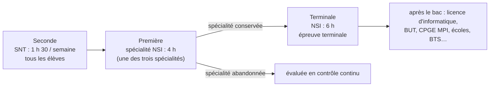

Le futur professeur d'informatique enseignera principalement deux choses : **SNT** à tous les élèves de seconde, et la spécialité **NSI** en première et
terminale à ceux qui l'ont choisie. Connaître précisément leurs programmes, leurs horaires et leurs modes d'évaluation est indispensable : l'oral
disciplinaire et l'entretien du concours demandent de situer une notion dans le cursus, et l'épreuve écrite 2 porte sur des situations d'enseignement.

## 1. L'informatique au lycée



- **SNT** (sciences numériques et technologie) est un enseignement **commun** de seconde, 1 h 30 par semaine. Il vise une culture numérique pour tous,
  autour de sept thèmes et d'une pratique de la programmation (Python).
- **NSI** (numérique et sciences informatiques) est une **spécialité** de la voie générale : 4 h en première ; 6 h en terminale pour les élèves qui la
  gardent parmi leurs deux spécialités. Elle prépare aux études supérieures scientifiques et informatiques.

:::remarque[Une évolution annoncée]
Le ministère a demandé au Conseil supérieur des programmes de **réviser le programme de SNT** (lettre de saisine du 20 juillet 2026) pour y intégrer une
formation à l'**intelligence artificielle** : à partir de la rentrée 2027, une heure hebdomadaire dédiée à l'IA est prévue en seconde, dans le cadre de
SNT. Le nouveau programme n'étant pas publié au moment où cette leçon est écrite, il faudra vérifier sur Éduscol avant le concours.
:::

## 2. Le programme de SNT

| Thème | Exemples de contenus |
|---|---|
| Internet | protocole TCP/IP, adresses, routage, DNS, réseaux pair-à-pair |
| Le Web | URL, HTTP, HTML/CSS, moteurs de recherche, confidentialité |
| Les réseaux sociaux | modèle économique, graphes (rayon, diamètre, centre), cyberharcèlement, identité numérique |
| Les données structurées | données et métadonnées, formats (CSV), traitement, *open data*, cloud |
| Localisation, cartographie et mobilité | GPS, trames NMEA, cartes numériques, calcul d'itinéraires |
| Informatique embarquée et objets connectés | capteurs, actionneurs, interfaces, systèmes embarqués |
| La photographie numérique | capteurs, pixels, couleurs (RVB), traitement d'image, métadonnées EXIF |

La **programmation** (affectations, variables, séquences, instructions conditionnelles, boucles, fonctions) est travaillée de façon **transversale**,
en Python, sur des exemples tirés des thèmes. Chaque thème aborde aussi les **impacts** sur les pratiques humaines (enjeux sociétaux, éthiques,
environnementaux) et quelques **repères historiques**.

## 3. Le programme de NSI

| Première (2019) | Terminale (2020) |
|---|---|
| Histoire de l'informatique | Histoire de l'informatique |
| Représentation des données : types et valeurs de base ; types construits | Structures de données (interface, implémentation, POO, listes, piles, files, arbres, graphes) |
| Traitement de données en tables | Bases de données (modèle relationnel, SQL, SGBD) |
| Interactions entre l'homme et la machine sur le Web | Architectures matérielles, systèmes d'exploitation et réseaux (SoC, processus, routage, sécurisation) |
| Architectures matérielles et systèmes d'exploitation | |
| Langages et programmation | Langages et programmation (récursivité, modularité, paradigmes, calculabilité, mise au point) |
| Algorithmique (parcours, tris, dichotomie, gloutons, $k$ plus proches voisins) | Algorithmique (arbres, graphes, diviser pour régner, programmation dynamique, recherche textuelle) |

Les programmes se présentent en **tableaux** : contenus, **capacités attendues** (ce que l'élève doit savoir faire) et **commentaires** (limites, pistes).
Ils insistent sur trois points transversaux :

- les **projets** : au moins **un quart** de l'horaire est consacré à des projets menés en équipe, qui mobilisent les notions dans des réalisations
  concrètes et développent l'autonomie ;
- l'**histoire de l'informatique**, qui éclaire les concepts par leur genèse et les personnes qui les ont portés ;
- la **démarche** : alternance d'activités débranchées, de programmation, de recherche, de mise en commun ; et une attention à la **mixité** (les
  filles sont nettement minoritaires en NSI).

Ce cours (l'Atelier) couvre l'ensemble de ces contenus : la page « Couverture du programme » indique, pour chaque ligne, les leçons correspondantes.

## 4. Le baccalauréat

La note de service du 11 septembre 2026 (BO spécial n° 4 du 17 septembre 2026), en vigueur **à partir de la session 2027**, définit l'épreuve terminale :

| Partie | Durée | Contenu | Notation |
|---|---|---|---|
| écrite | 3 h 30 | trois exercices indépendants | sur 20, dont 2 points de maîtrise de la langue ; coefficient **0,75** |
| pratique | 1 h | programmer sur ordinateur une application à partir d'un document fourni, avec un **dialogue** avec l'examinateur | sur 20 ; coefficient **0,25** |

L'épreuve porte sur le programme de terminale ; les notions de première non approfondies en terminale doivent être connues mais ne peuvent pas être le
ressort essentiel d'un sujet. Un **oral de contrôle** (second groupe : 20 min de préparation, 20 min d'épreuve) porte sur le même programme. La spécialité
abandonnée en fin de première est évaluée en **contrôle continu**. Enfin, le **Grand oral** peut porter sur une question liée à NSI.

:::prof
Au concours, citer précisément le programme (« le programme de terminale demande de… ») est un atout, à condition de ne pas réciter : il s'agit de montrer
qu'on sait **où** se situe une notion, **ce qui est attendu** des élèves, et **ce qui ne l'est pas** (les commentaires du programme fixent souvent des
limites). Avoir lu en entier les programmes de SNT et de NSI sur Éduscol, ainsi que quelques sujets de bac récents, est indispensable.
:::

## Exemple guidé

**Problème.** Construire une progression annuelle de terminale NSI (6 h par semaine, environ 30 semaines utiles avant l'épreuve) qui respecte les
contraintes du programme.

**1. Les contraintes.** Tout le programme est évaluable à l'écrit ; un quart du temps en projets (≈ 45 h) ; les notions doivent s'appuyer les unes sur les
autres (la POO avant les structures, la récursivité avant les arbres, les graphes avant le routage).

**2. Un découpage possible** (en semaines) :

| Période | Contenus | Projet |
|---|---|---|
| 1-5 | récursivité, modularité, POO, mise au point | |
| 6-10 | structures linéaires (listes, piles, files), dictionnaires | mini-projet (POO) |
| 11-14 | bases de données, SQL | |
| 15-19 | arbres, ABR, parcours ; diviser pour régner | projet 1 (équipes) |
| 20-23 | graphes et parcours ; routage (RIP, OSPF) | |
| 24-26 | processus, ordonnancement, SoC ; sécurisation (chiffrement, HTTPS) | |
| 27-30 | programmation dynamique, recherche textuelle, calculabilité ; révisions | projet 2 |

**3. Vérifier** : chaque ligne du programme apparaît, les prérequis précèdent, l'histoire est intégrée au fil des chapitres (Turing avec la calculabilité,
Codd avec les bases de données, Dijkstra avec les graphes), les projets sont répartis et les épreuves pratiques préparées par des séances sur machine
régulières.

## L'essentiel

- **SNT** : seconde, tous les élèves, 1 h 30 ; sept thèmes + programmation transversale ; révision annoncée (IA, rentrée 2027).
- **NSI** : spécialité, 4 h en première, 6 h en terminale ; programmes de 2019 et 2020 ; tableaux contenus / capacités attendues / commentaires.
- Transversal : **projets** (≥ un quart du temps), **histoire** de l'informatique, démarche active, mixité.
- Bac (session 2027) : écrit 3 h 30 (trois exercices, coefficient 0,75, 2 points de langue) + pratique 1 h sur machine avec dialogue (coefficient 0,25).
- Une progression respecte les dépendances entre notions et intègre projets et histoire.

## Exercices

::::exercice[Situer une notion]{niveau=1}
Dans quel enseignement les élèves rencontrent-ils pour la première fois les requêtes SQL ?

- [ ] SNT
- [ ] NSI première, « traitement de données en tables »
- [x] NSI terminale, « bases de données »
- [ ] Elles ne sont pas au programme du lycée

:::corrige
En première, les données en tables sont traitées en Python (CSV, tri, fusion) ; le modèle relationnel et SQL sont au programme de **terminale**. En SNT,
on parle de données structurées et de formats, sans SQL.
:::
::::

::::exercice[Le format du bac]{niveau=1}
À partir de la session 2027, comment se compose la note de l'épreuve terminale de NSI ?

- [ ] 12 points d'écrit et 8 points de pratique
- [x] la note d'écrit sur 20 avec un coefficient 0,75 et celle de pratique sur 20 avec un coefficient 0,25
- [ ] uniquement un écrit de 4 heures
- [ ] un écrit et un oral de 20 minutes

:::corrige
La note de service de septembre 2026 note chaque partie sur 20, avec les coefficients 0,75 (écrit, 3 h 30) et 0,25 (pratique, 1 h). Le « 12 + 8 » était
l'ancien format. L'oral de 20 minutes est l'épreuve de contrôle du second groupe.
:::
::::

::::exercice[Calculer une note de bac]{niveau=2}
Écris `note_nsi(ecrit, pratique)` qui renvoie la note de l'épreuve sur 20 (arrondie au centième) à partir de la note de la partie écrite (sur 20, maîtrise
de la langue comprise) et de celle de la partie pratique (sur 20), selon le format de la session 2027. Si `pratique` vaut `None` (candidat dispensé), la
note est celle de l'écrit.

```python depart
def note_nsi(ecrit, pratique):
    ...
```

```python tests
assert note_nsi(12, 16) == 13.0, "pondération 0,75 / 0,25"
assert note_nsi(20, 20) == 20.0 and note_nsi(0, 0) == 0.0, "bornes"
assert note_nsi(9.5, 14.5) == 10.75, "décimales"
assert note_nsi(11, None) == 11, "candidat dispensé de pratique"
```

:::corrige
```python solution
def note_nsi(ecrit, pratique):
    if pratique is None:
        return ecrit
    return round(0.75 * ecrit + 0.25 * pratique, 2)
```
$0{,}75 \times 12 + 0{,}25 \times 16 = 9 + 4 = 13$. La pratique pèse un quart de la note : préparer les élèves sur machine tout au long de l'année n'est
pas accessoire. (Les candidats individuels sont dispensés de la partie pratique ; leur note est celle de l'écrit.)
:::
::::

::::exercice[Lire un extrait de programme]{niveau=3 duree=15}
Le programme de première NSI indique, pour la rubrique « Algorithmique », la capacité attendue « écrire un algorithme de tri ; décrire un invariant de boucle
qui prouve la correction des tris par insertion, par sélection », avec le commentaire « la terminaison de ces algorithmes est à justifier ; on montre que leur
coût est quadratique dans le pire cas ».

1. Reformulez ce qu'un élève doit savoir faire à l'issue de la séquence.
2. Qu'est-ce qui n'est **pas** exigé ?
3. Proposez une question d'évaluation conforme à cet attendu.

:::criteres
- Attendus : écrire en Python le tri par insertion et par sélection, énoncer un invariant de boucle et l'utiliser pour justifier la correction, justifier la terminaison, établir le coût quadratique dans le pire cas.
- Non exigés : preuve formelle complète par récurrence, coût en moyenne, tris efficaces (fusion : terminale), complexité au sens asymptotique formel.
- Question d'évaluation précise (code à compléter, invariant à formuler, nombre de comparaisons à compter sur un exemple et dans le pire cas).
:::

:::corrige
1. L'élève doit savoir **écrire** (et donc comprendre) le tri par insertion et le tri par sélection, **énoncer un invariant** (« après le tour $i$, les $i$ premiers
   éléments sont triés » pour l'insertion ; « …sont les $i$ plus petits, triés » pour la sélection) et l'utiliser pour expliquer pourquoi le tableau final est
   trié, **justifier la terminaison** (boucles `for` bornées, ou variant pour une boucle `while`), et **montrer** que le nombre de comparaisons est de l'ordre
   de $n^2$ dans le pire cas (en le comptant : $\frac{n(n-1)}{2}$).
2. Ne sont pas exigés : une preuve formelle par récurrence rédigée en toute rigueur, l'étude du coût **moyen**, les notations asymptotiques formelles, et les
   tris en $n \log n$ (le tri fusion relève de la terminale, avec « diviser pour régner »).
3. Exemple : « On donne le tri par insertion ci-dessous. (a) Complétez la ligne manquante. (b) Donnez l'état du tableau `[5, 2, 4, 1]` après chaque tour de la
   boucle principale. (c) Énoncez une propriété vraie à la fin de chaque tour et expliquez pourquoi elle garantit que le tableau est trié à la fin. (d) Combien
   de comparaisons sont faites sur un tableau de $n$ éléments rangés dans l'ordre décroissant ? »
:::
::::

::::exercice[Défendre la place des projets]{niveau=4 duree=20}
Un parent d'élève vous dit en réunion : « Les projets, c'est du temps perdu ; ma fille ferait mieux de s'entraîner aux exercices du bac. »

1. Que lui répondez-vous, en vous appuyant sur le programme et sur les compétences visées ?
2. Comment organisez-vous concrètement un projet de 6 semaines pour qu'il soit efficace pour **tous** les élèves d'une équipe ?
3. Comment évaluez-vous un projet de façon juste et individuelle ?

:::criteres
- Appui sur le programme (au moins un quart du temps en projets), compétences visées (analyser, décomposer, concevoir, coopérer, communiquer, mettre au point), lien avec l'épreuve pratique et les études supérieures ; ton respectueux et rassurant.
- Organisation : cahier des charges, rôles tournants, jalons et points d'étape, outils de partage, revue de code, fiches de suivi, différenciation, temps de classe dédié.
- Évaluation : critères connus à l'avance, part individuelle (journal de bord, entretien, explication de son code), part collective, évaluation des compétences et pas seulement du produit final.
:::

:::corrige
1. Le programme **impose** qu'au moins un quart de l'horaire soit consacré aux projets : ce n'est pas un choix personnel. Surtout, le projet entraîne des
   compétences que les exercices ne travaillent pas seuls : **décomposer** un problème, concevoir une architecture, **mettre au point** un programme réel, travailler
   en **équipe**, présenter son travail — toutes évaluées dans la partie pratique du bac (programmer et dialoguer avec l'examinateur) et attendues dans le
   supérieur. Les notions du programme y sont **réinvesties** : c'est souvent là qu'elles deviennent solides. Je rassure aussi : les exercices de type bac ont
   leur place et sont travaillés régulièrement.
2. Un **cahier des charges** précis et réaliste ; des équipes de 3-4 avec des **rôles** qui tournent ; des **jalons** hebdomadaires (spécification, maquette,
   version minimale, fonctionnalités, tests, présentation) ; un **journal de bord** individuel ; un dépôt partagé ; des points d'étape avec chaque équipe pour
   repérer qui décroche ; des fonctionnalités « bonus » pour les plus avancés et des aides ciblées pour les autres.
3. Critères donnés **dès le départ** (grille) ; une note **collective** (produit, organisation) et une note **individuelle** (journal de bord, contribution
   visible dans le code, **entretien** où chaque élève explique une partie qu'il a écrite et répond à une question sur le reste) ; évaluer aussi la démarche
   (tests, mise au point), pas seulement le résultat final.
:::
::::
