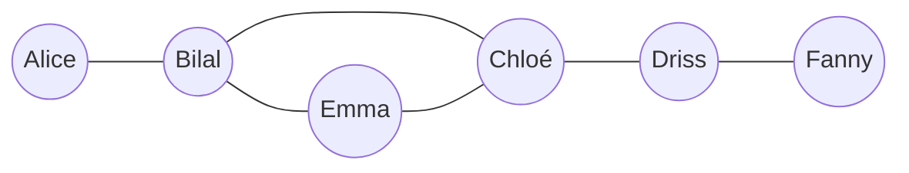

Les trois premiers thèmes de SNT parlent de **réseaux** : le réseau physique et ses protocoles (Internet), le service de documents qui l'utilise (le Web), et
les réseaux de personnes (réseaux sociaux). Les notions techniques ont été traitées dans les modules Réseaux et Web ; cette leçon les regarde avec les yeux
de l'enseignant de seconde : ce qu'il faut faire comprendre à **tous** les élèves, avec quelles activités, et les outils mathématiques simples (graphes)
que le programme mobilise.

## 1. Thème Internet

Notions : un réseau de réseaux, la transmission par **paquets**, le protocole **IP** (adresses, routage) et **TCP** (fiabilité), le **DNS**, les réseaux
**pair-à-pair**, la **neutralité** du Net. Capacités typiques : distinguer Internet et le Web, caractériser quelques types de réseaux, expliquer le rôle
des protocoles, comprendre comment un paquet trouve son chemin.

:::methode[Des activités qui marchent]
- **Débranché** : simuler l'envoi de paquets numérotés à travers la classe (élèves-routeurs), avec perte et réordonnancement.
- **Commandes** : `ping`, `tracert`/`traceroute` (voir les routeurs traversés jusqu'à un site lointain), `nslookup` (interroger le DNS).
- **Simulateur** : Filius, pour construire un petit réseau et observer les échanges.
- **Ordres de grandeur** : nombre de câbles sous-marins, consommation énergétique des réseaux et des centres de données.
:::

## 2. Thème Web

Notions : **URL**, **HTTP** (client-serveur, requêtes), **HTML/CSS**, les **moteurs de recherche** (exploration, indexation, classement), la
**confidentialité** (cookies, traces). Capacités : décomposer une URL, écrire une page simple, comprendre ce qu'un moteur de recherche fait de nos requêtes.

Un moteur de recherche **explore** le Web avec des robots qui suivent les liens, **indexe** les pages (pour chaque mot, la liste des pages qui le contiennent)
et **classe** les résultats. L'idée historique de Google (Brin et Page, 1998) est **PageRank** : une page est importante si des pages importantes pointent
vers elle.

```python exec
def pagerank(liens, amortissement=0.85, iterations=50):
    pages = list(liens)
    n = len(pages)
    score = {p: 1 / n for p in pages}
    for _ in range(iterations):
        nouveau = {p: (1 - amortissement) / n for p in pages}
        for p, cibles in liens.items():
            for c in cibles:
                nouveau[c] += amortissement * score[p] / len(cibles)
        score = nouveau
    return {p: round(s, 3) for p, s in sorted(score.items(), key=lambda x: -x[1])}

web = {"accueil": ["cours", "blog"], "cours": ["accueil"], "blog": ["accueil", "cours"], "perso": ["cours"]}
print(pagerank(web))
```

Interprétation : un « surfeur aléatoire » clique sur un lien au hasard (probabilité 0,85) ou saute sur une page quelconque (0,15) ; le score d'une page est la
proportion du temps qu'il y passe à long terme. La page `perso`, vers laquelle personne ne pointe, a le score minimal.

## 3. Thème réseaux sociaux

Notions : **identité numérique**, paramètres de confidentialité, **modèle économique** (publicité ciblée), **graphes** de relations, phénomène **petit
monde**, **cyberharcèlement**. Le programme demande de « déterminer les caractéristiques de graphes simples » : distances, **excentricité**, **diamètre**,
**rayon**, **centre**.



:::definition
Dans un graphe connexe, la **distance** entre deux sommets est le nombre d'arêtes du plus court chemin. L'**excentricité** d'un sommet est sa distance
maximale aux autres sommets. Le **diamètre** est la plus grande excentricité, le **rayon** la plus petite, et le **centre** est l'ensemble des sommets dont
l'excentricité égale le rayon.
:::

Ici : excentricités Alice 4, Bilal 3, Chloé 2, Driss 3, Emma 3, Fanny 4. Diamètre 4, rayon 2, centre {Chloé}. Ce sont des **parcours en largeur** (non exigés
des élèves de seconde, qui calculent à la main sur de petits graphes, mais que le professeur sait programmer).

:::attention[Les enjeux, sans moraliser]
Le thème est l'occasion de travailler l'**esprit critique** (bulles de filtres, désinformation, algorithmes de recommandation), la **protection des données**
(RGPD, paramètres de confidentialité) et la **prévention du cyberharcèlement** (le harcèlement scolaire est un délit depuis 2022 ; numéro national 3018).
L'enseignant y intervient aussi en tant que membre de la communauté éducative : un signalement passe par le protocole de l'établissement (direction, CPE).
:::

:::prof
SNT s'adresse à **tous** les élèves de seconde, dont beaucoup ne poursuivront pas en informatique : l'objectif est une culture scientifique et citoyenne,
pas une formation de spécialistes. Les activités doivent partir de **pratiques** des élèves (leur téléphone, leurs réseaux), alterner débranché et
manipulation, et faire **programmer** un peu à chaque thème (la programmation est transversale).
:::

## Exemple guidé

**Problème.** Calculer automatiquement les excentricités, le rayon, le diamètre et le centre du graphe ci-dessus, pour préparer le corrigé d'une activité.

```python exec
from collections import deque

amis = {"Alice": ["Bilal"], "Bilal": ["Alice", "Chloé", "Emma"], "Chloé": ["Bilal", "Driss", "Emma"],
        "Driss": ["Chloé", "Fanny"], "Emma": ["Bilal", "Chloé"], "Fanny": ["Driss"]}

def distances(graphe, depart):
    dist, file = {depart: 0}, deque([depart])
    while file:
        u = file.popleft()
        for v in graphe[u]:
            if v not in dist:
                dist[v] = dist[u] + 1
                file.append(v)
    return dist

ex = {s: max(distances(amis, s).values()) for s in amis}
rayon, diametre = min(ex.values()), max(ex.values())
print(ex)
print("rayon", rayon, "diamètre", diametre, "centre", [s for s in ex if ex[s] == rayon])
```

**Démarche avec les élèves** : d'abord à la main (tableau des distances), puis discussion (« qui faut-il informer en premier pour qu'une rumeur se diffuse
le plus vite ? » → le centre), puis éventuellement le programme fourni, qu'ils modifient pour leur propre graphe.

## L'essentiel

- Internet (réseau : paquets, IP, TCP, DNS, routage, pair-à-pair) ≠ Web (service : URL, HTTP, HTML, moteurs de recherche).
- Moteur de recherche : exploration, indexation, classement ; **PageRank** (surfeur aléatoire, amortissement 0,85).
- Graphes sociaux : distance, excentricité, **diamètre** (max), **rayon** (min), **centre** ; petit monde (Milgram, ≈ 6 ; Facebook < 4).
- Enjeux : modèle économique (données, publicité), identité numérique, RGPD, cyberharcèlement (délit, 3018, protocole d'établissement).
- SNT : culture pour tous, partir des pratiques des élèves, débranché + manipulation + un peu de programmation à chaque thème.

## Exercices

::::exercice[Rayon et diamètre]{niveau=1}
Dans un graphe en étoile (un sommet central relié à 5 autres, qui ne sont pas reliés entre eux), que valent le rayon et le diamètre ?

- [ ] rayon 2, diamètre 2
- [x] rayon 1, diamètre 2
- [ ] rayon 1, diamètre 1
- [ ] rayon 5, diamètre 5

:::corrige
Le centre est à distance 1 de tous : excentricité 1 (rayon). Deux feuilles sont à distance 2 (en passant par le centre) : excentricité 2 pour chaque feuille,
d'où un diamètre de 2.
:::
::::

::::exercice[Gratuit ?]{niveau=1}
Comment se financent principalement les grands réseaux sociaux gratuits ?

- [ ] Par des subventions publiques
- [ ] Par les abonnements de la majorité des utilisateurs
- [x] Par la publicité ciblée, grâce aux données et à l'attention des utilisateurs
- [ ] Par la vente des téléphones

:::corrige
Leur modèle économique repose sur la publicité ciblée : plus ils connaissent l'utilisateur et plus il passe de temps sur la plateforme, plus l'espace
publicitaire a de valeur. D'où des algorithmes conçus pour capter l'attention.
:::
::::

::::exercice[Caractéristiques d'un graphe]{niveau=2}
Écris `caracteristiques(graphe)` qui renvoie le triplet `(rayon, diamètre, centre)` d'un graphe non orienté **connexe** (dictionnaire de listes de voisins),
le centre étant une liste **triée**.

```python depart
from collections import deque

def caracteristiques(graphe):
    ...
```

```python tests
amis = {"Alice": ["Bilal"], "Bilal": ["Alice", "Chloé", "Emma"], "Chloé": ["Bilal", "Driss", "Emma"],
        "Driss": ["Chloé", "Fanny"], "Emma": ["Bilal", "Chloé"], "Fanny": ["Driss"]}
assert caracteristiques(amis) == (2, 4, ["Chloé"]), "graphe de la leçon"
etoile = {0: [1, 2, 3], 1: [0], 2: [0], 3: [0]}
assert caracteristiques(etoile) == (1, 2, [0]), "étoile"
chaine = {1: [2], 2: [1, 3], 3: [2, 4], 4: [3]}
assert caracteristiques(chaine) == (2, 3, [2, 3]), "chaîne de 4 : deux centres"
assert caracteristiques({"x": []}) == (0, 0, ["x"]), "un seul sommet"
```

:::corrige
```python solution
from collections import deque

def caracteristiques(graphe):
    def excentricite(depart):
        dist, file = {depart: 0}, deque([depart])
        while file:
            u = file.popleft()
            for v in graphe[u]:
                if v not in dist:
                    dist[v] = dist[u] + 1
                    file.append(v)
        return max(dist.values())

    ex = {s: excentricite(s) for s in graphe}
    rayon, diametre = min(ex.values()), max(ex.values())
    return rayon, diametre, sorted(s for s in ex if ex[s] == rayon)
```
Un parcours en largeur par sommet : coût $O(n(n + m))$, très raisonnable pour les graphes de l'activité. Pour les vrais réseaux sociaux (des milliards de
sommets), on n'estime ces valeurs que par échantillonnage.
:::
::::

::::exercice[Un PageRank]{niveau=3}
Écris `pagerank(liens, d, iterations)` : `liens` associe à chaque page la liste des pages vers lesquelles elle pointe (on suppose que chaque page a au moins
un lien sortant), `d` est le facteur d'amortissement. On part de scores tous égaux à $\frac1n$, et à chaque itération le nouveau score de $p$ vaut
$\frac{1-d}{n} + d \sum_{q \to p} \frac{\text{score}(q)}{\text{nb de liens de } q}$. Renvoie le dictionnaire des scores (non arrondis).

```python depart
def pagerank(liens, d, iterations):
    ...
```

```python tests
web = {"accueil": ["cours", "blog"], "cours": ["accueil"], "blog": ["accueil", "cours"], "perso": ["cours"]}
s = pagerank(web, 0.85, 100)
assert abs(sum(s.values()) - 1) < 1e-9, "les scores forment une distribution de probabilité"
assert max(s, key=s.get) == "accueil" and min(s, key=s.get) == "perso", "page la plus et la moins importante"
assert abs(s["perso"] - 0.15 / 4) < 1e-9, "page sans lien entrant : score minimal (1 - d) / n"
cycle = {"a": ["b"], "b": ["c"], "c": ["a"]}
assert all(abs(v - 1 / 3) < 1e-9 for v in pagerank(cycle, 0.85, 50).values()), "cycle : scores égaux"
```

:::corrige
```python solution
def pagerank(liens, d, iterations):
    pages = list(liens)
    n = len(pages)
    score = {p: 1 / n for p in pages}
    for _ in range(iterations):
        nouveau = {p: (1 - d) / n for p in pages}
        for q, cibles in liens.items():
            part = d * score[q] / len(cibles)
            for p in cibles:
                nouveau[p] += part
        score = nouveau
    return score
```
Chaque page « distribue » son score à parts égales entre ses liens ; le terme $\frac{1-d}{n}$ modélise le saut au hasard. La somme reste égale à 1 (si chaque
page a au moins un lien). Les itérations convergent vers la distribution stationnaire d'une chaîne de Markov — mais pour des élèves de seconde, l'image
du « surfeur aléatoire » suffit, et peut même se **simuler** avec des dés.
:::
::::

::::exercice[Préparer une séance « réseaux sociaux »]{niveau=4 duree=25}
Vous préparez une séance d'1 h 30 de SNT sur le thème « réseaux sociaux » pour une classe de seconde.

1. Formulez deux objectifs (une capacité du programme et un objectif de culture citoyenne).
2. Décrivez le déroulement (accroche, activités, mise en commun, trace écrite), en précisant ce que font les élèves.
3. Comment abordez-vous la question du cyberharcèlement sans transformer la séance en sermon ?
4. Comment évaluez-vous les acquis ?

:::criteres
- Objectifs précis et alignés sur le programme (calculer rayon/diamètre/centre sur un graphe simple ; identifier le modèle économique ou paramétrer sa confidentialité).
- Déroulement réaliste en 1 h 30 avec activité élève (graphe construit à partir d'une situation, calculs, discussion), alternance des modalités, mise en commun et trace écrite.
- Cyberharcèlement : étude de cas, débat argumenté, ressources (3018, référents, protocole), posture bienveillante, attention aux élèves concernés.
- Évaluation : exercice sur un autre graphe, question de réflexion argumentée, auto-évaluation ; critères explicites.
:::

:::corrige
1. **Capacité** : « déterminer le rayon, le diamètre et le centre d'un graphe simple ». **Culture citoyenne** : comprendre le modèle économique d'un réseau social
   gratuit et savoir régler la visibilité de ses publications.
2. **Accroche** (10 min) : « en combien d'intermédiaires pourriez-vous joindre le président de la République ? » (petit monde, Milgram). **Activité 1** (30 min) :
   à partir d'une situation (dix personnages et leurs amitiés), les élèves dessinent le graphe, calculent les distances, puis excentricités, rayon, diamètre,
   centre ; question finale : qui choisir pour diffuser une information le plus vite ? **Activité 2** (25 min) : par groupes, analyse des conditions d'utilisation
   d'un réseau social (quelles données ? pour quoi faire ?), puis mise en commun du modèle économique. **Trace écrite** (15 min) : définitions, méthode de calcul,
   schéma du modèle économique. **Bilan** (10 min) : questions et lien avec la séance suivante (algorithmes de recommandation).
3. Par une **étude de cas** fictive (une capture d'écran de messages qui dégénèrent), avec des questions d'analyse : à partir de quand est-ce du harcèlement ?
   quel est le rôle des témoins ? que dit la loi ? qui peut aider (3018, CPE, référents) ? Les élèves argumentent, je cadre le débat sans désigner personne, et
   je reste attentif à d'éventuels élèves concernés, en leur indiquant discrètement les personnes ressources.
4. Un exercice individuel sur un autre graphe (rayon, diamètre, centre, avec justification) ; une question courte argumentée (« pourquoi ce réseau social est-il
   gratuit ? ») ; une auto-évaluation avec les capacités de la séance ; les critères sont donnés à l'avance.
:::
::::
