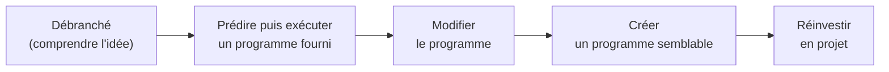

Savoir l'informatique ne suffit pas pour l'enseigner : il faut savoir **ce que les élèves vont comprendre de travers**, choisir des **activités** qui les font
réellement apprendre, et **évaluer** ce qu'on a visé. L'écrit 2 du concours et les oraux interrogent précisément cette capacité à transposer un savoir en
situation de classe. Cette leçon rassemble des outils de **didactique de l'informatique** éprouvés.

## 1. Partir des objectifs

Une séance se construit à partir des **capacités attendues** du programme, formulées avec des verbes d'action observables : « écrire une fonction qui… »,
« dérouler l'exécution de… », « identifier… », « justifier… ». On se demande ensuite : quels **prérequis** ? quels **obstacles** ? quelle **production** des
élèves montrera que c'est acquis ?

:::methode[La fiche de préparation]
1. **Objectifs** (2 ou 3 capacités, tirées du programme).
2. **Prérequis** et petite évaluation diagnostique (3 questions en début de séance).
3. **Déroulement** minuté : accroche, activité(s) des élèves, mise en commun, trace écrite, exercice d'application.
4. **Obstacles** anticipés et aides prévues (indices gradués).
5. **Évaluation** : comment je saurai que l'objectif est atteint.
:::

## 2. Les conceptions erronées des élèves

La recherche en didactique de la programmation a recensé des erreurs **très stables** d'une génération à l'autre. Les connaître permet de les provoquer et de
les traiter, plutôt que de les découvrir le jour du contrôle.

| Conception erronée | Exemple | Comment la travailler |
|---|---|---|
| l'affectation est une égalité symétrique | `a = b` et `b = a` « c'est pareil » | tracer l'état des variables pas à pas ; « `a` prend la valeur de `b` » |
| une variable garde plusieurs valeurs, ou se met à jour seule | après `b = a + 1` puis `a = 5`, `b` « vaut 6 » | tableau de suivi des variables |
| confusion `=` et `==`, `print` et `return` | `if x = 3`, une fonction qui affiche au lieu de renvoyer | comparer les deux, utiliser le résultat dans un calcul |
| la boucle `for i in range(n)` va jusqu'à `n` | décalages d'un (*off-by-one*) | afficher `i`, prévoir puis vérifier |
| la machine comprend l'intention | « mais je voulais dire… » | **prédire** avant d'exécuter, modèle de la « machine notionnelle » |
| copier une liste copie son contenu | `t2 = t1` puis `t2.append(…)` | diagrammes de références (Python Tutor) |

Un outil commun à presque toutes ces difficultés : le **tableau de suivi** (trace) des variables, où l'élève note la valeur de chaque variable après chaque
instruction. On l'exige en prédiction, puis on le compare avec l'exécution réelle.

## 3. Des types d'activités

- **Débranché** : manipuler un concept sans ordinateur (trier des cartes, jouer les routeurs, coder en binaire avec des cartes à points) ; idéal pour introduire
  une notion et montrer qu'elle est **indépendante** de la machine.
- **Prédire – exécuter – étudier – modifier – créer** (PRIMM) : on donne un programme qui fonctionne ; les élèves **prédisent** ce qu'il fait, l'**exécutent**, l'**étudient**
  (questions ciblées), le **modifient**, puis en **créent** un semblable. La lecture précède l'écriture.
- **Problèmes de Parsons** : remettre en ordre les lignes d'un programme correct ; on travaille la logique sans être bloqué par la syntaxe.
- **Exercices à trous**, **débogage** d'un programme fautif, **tests** à écrire avant le code.
- **Projets** : réinvestir dans une réalisation complète (au moins un quart du temps en NSI).



## 4. Évaluer et différencier

- L'évaluation **diagnostique** (avant) repère les prérequis manquants ; la **formative** (pendant) donne des retours pour progresser — QCM rapides, questions
  flash, auto-correction ; la **sommative** (après) certifie. L'évaluation doit être **alignée** : on évalue ce qu'on a visé et fait travailler.
- Des **critères** connus à l'avance (grilles) rendent l'évaluation lisible et juste, surtout pour les projets et les rédactions.
- **Différencier** : mêmes objectifs, chemins différents — indices gradués, exercices « bonus », code à compléter, travail en binômes hétérogènes, temps ajusté.
  Les élèves à besoins particuliers (PAP, PPS) bénéficient d'adaptations prévues (police, temps, supports).

:::attention[L'intelligence artificielle générative en classe]
Les élèves ont accès à des outils qui écrivent du code. L'enjeu n'est pas seulement de l'interdire, mais d'**évaluer ce qui compte** : expliquer, prédire,
déboguer, justifier — en classe, à l'oral, sur papier. Et d'apprendre à **utiliser** ces outils de façon critique (vérifier, tester, citer). Le règlement de
l'établissement et les consignes institutionnelles s'appliquent.
:::

:::prof
Les outils courants : Capytale (plateforme d'activités de l'Éducation nationale, intégrée à l'ENT), Basthon et Jupyter (notebooks dans le navigateur), Python
Tutor (visualiser l'exécution et les références), Filius (réseaux), Logisim (circuits), et les bibliothèques d'activités partagées par la communauté des
enseignants de NSI. Au concours, citer un outil est utile **si** l'on sait dire ce qu'il apporte aux apprentissages.
:::

## Exemple guidé

**Problème.** Préparer une activité PRIMM d'introduction à la boucle `while` en première NSI.

**1. Objectif** (programme : « mobiliser les concepts de boucle bornée et non bornée »). À la fin, l'élève sait **prédire** le nombre de tours d'une boucle `while`
simple et en **écrire** une qui s'arrête.

**2. Le programme donné** (à prédire) :

```python exec
n = 100
etapes = 0
while n > 1:
    n = n // 2
    etapes = etapes + 1
print(n, etapes)
```

**3. Questions.** *Prédire* : « que va afficher ce programme ? Remplissez le tableau de suivi de `n` et `etapes`. » *Exécuter* et comparer. *Étudier* : « pourquoi
la boucle s'arrête-t-elle ? Que se passe-t-il si on remplace `n > 1` par `n > 0` ? Par `n != 0` avec `n = n - 3` ? » *Modifier* : « faites-la compter combien de
fois on peut diviser 1 000 000 par 10. » *Créer* : « écrivez un programme qui compte le nombre de chiffres d'un entier. »

**4. L'outil du professeur** : générer automatiquement le tableau de suivi pour préparer la correction.

```python exec
def trace(n):
    lignes = [("départ", n, 0)]
    etapes = 0
    while n > 1:
        n = n // 2
        etapes = etapes + 1
        lignes.append((f"tour {etapes}", n, etapes))
    return lignes

for ligne in trace(100):
    print(*ligne, sep="\t")
```

## L'essentiel

- Partir des **capacités attendues**, formulées par des verbes d'action ; prérequis, obstacles, production attendue, évaluation.
- Conceptions erronées classiques : affectation « symétrique », variables qui se mettent à jour seules, `=`/`==`, `print`/`return`, bornes de `range`, machine qui « comprend », copie de listes ; remède central : le **tableau de suivi**.
- Activités : débranché, **PRIMM** (prédire, exécuter, étudier, modifier, créer), problèmes de **Parsons**, débogage, projets.
- Évaluation diagnostique / formative / sommative, **alignée** sur les objectifs, avec des critères explicites ; différenciation ; IA générative : évaluer l'explication et le raisonnement.

## Exercices

::::exercice[Repérer une conception erronée]{niveau=1}
Un élève affirme qu'après `a = 3`, `b = a`, `a = 5`, la variable `b` vaut 5. Quelle conception erronée révèle-t-il ?

- [ ] Il confond `=` et `==`
- [x] Il pense que `b` reste « liée » à `a` et se met à jour quand `a` change
- [ ] Il pense que `range` inclut sa borne
- [ ] Aucune, il a raison

:::corrige
`b = a` copie la **valeur** de `a` (3) dans `b` à ce moment-là ; changer `a` ensuite ne modifie pas `b`. L'élève imagine une liaison permanente, comme une
formule de tableur. (La subtilité des références avec les listes est un autre sujet, à traiter après.)
:::
::::

::::exercice[Type d'évaluation]{niveau=1}
En début de séquence sur les dictionnaires, le professeur pose trois questions rapides sur les listes, sans les noter, pour savoir ce que les élèves maîtrisent.
De quelle évaluation s'agit-il ?

- [x] diagnostique
- [ ] formative
- [ ] sommative
- [ ] certificative

:::corrige
Elle a lieu **avant** l'apprentissage et sert à connaître les acquis (ici les prérequis) pour adapter la séquence : c'est une évaluation **diagnostique**.
:::
::::

::::exercice[Un problème de Parsons]{niveau=2}
Pour préparer un problème de Parsons, on veut vérifier automatiquement la réponse d'un élève. Écris `verifier(lignes, ordre, tests)` : `lignes` est la liste des
lignes de code (avec leur indentation), `ordre` la liste des indices choisis par l'élève, et `tests` une liste de couples `(expression, valeur attendue)`. La
fonction assemble le programme, l'exécute dans un dictionnaire vide avec `exec`, évalue chaque expression avec `eval` dans ce dictionnaire, et renvoie le nombre de
tests réussis (une erreur pendant l'exécution donne 0).

```python depart
def verifier(lignes, ordre, tests):
    ...
```

```python tests
lignes = ["def maximum(t):", "    return m", "    m = t[0]", "    for x in t:", "        if x > m:", "            m = x"]
tests = [("maximum([3, 1, 4])", 4), ("maximum([-2, -5])", -2), ("maximum([7])", 7)]
assert verifier(lignes, [0, 2, 3, 4, 5, 1], tests) == 3, "bon ordre"
assert verifier(lignes, [0, 1, 2, 3, 4, 5], tests) == 0, "return avant toute affectation : erreur à l'appel"
assert verifier(lignes, [0, 2, 1, 3, 4, 5], tests) == 2, "return avant la boucle : renvoie t[0], deux tests passent quand même"
assert verifier(lignes, [2, 0], tests) == 0, "indentation incohérente : erreur, 0"
```

:::corrige
```python solution
def verifier(lignes, ordre, tests):
    programme = "\n".join(lignes[i] for i in ordre)
    espace = {}
    try:
        exec(programme, espace)
    except Exception:
        return 0
    reussis = 0
    for expression, attendu in tests:
        try:
            if eval(expression, espace) == attendu:
                reussis += 1
        except Exception:
            pass
    return reussis
```
Le programme est une **donnée** (une chaîne) qu'on assemble et qu'on exécute : c'est ainsi que fonctionnent les plateformes d'exercices auto-corrigés (y compris
celle-ci). Attention : `exec` exécute n'importe quel code, il ne faut jamais l'utiliser sur un texte venant d'un inconnu sans isolation (bac à sable). Le
troisième ordre place `return m` juste après `m = t[0]` : la fonction renvoie toujours le premier élément, et **deux tests sur trois passent** (`[-2, -5]` et
`[7]` ont leur maximum en tête). Leçon pour le professeur : un jeu de tests doit être conçu pour faire échouer les erreurs **prévisibles** — ici, il faut
plusieurs listes dont le maximum n'est **pas** le premier élément.
:::
::::

::::exercice[Analyser une copie d'élève]{niveau=3 duree=15}
Consigne : « Écrire une fonction `moyenne(notes)` qui renvoie la moyenne d'une liste de notes. » Un élève rend :

```python
def moyenne(notes):
    for i in range(len(notes)):
        s = 0
        s = s + notes[i]
    print(s / len(notes))
```

1. Identifiez les erreurs et, pour chacune, la conception erronée probable.
2. Quelles questions poseriez-vous à l'élève pour qu'il les trouve lui-même ?
3. Proposez un exercice de remédiation ciblé.

:::criteres
- Erreurs : initialisation de `s` dans la boucle (réinitialisée à chaque tour : résultat = dernière note / n) ; `print` au lieu de `return` ; absence de gestion de la liste vide ; (accessoire : parcours par indice plutôt que par valeur).
- Conceptions : confusion entre ce qui se répète et ce qui se fait une fois ; affichage confondu avec la valeur renvoyée.
- Questions : prédire le résultat pour `[10, 20]` avec un tableau de suivi ; « que vaut `s` au début du 2e tour ? » ; « comment utiliser la moyenne dans un calcul ? ».
- Remédiation ciblée : tableaux de suivi de boucles d'accumulation, exercices où le résultat doit être réutilisé, problème de Parsons sur l'accumulation.
:::

:::corrige
1. **`s = 0` dans la boucle** : `s` est remis à 0 à chaque tour, donc à la fin `s` vaut la **dernière** note seulement ; conception probable : l'élève ne distingue pas
   ce qui doit être fait **une fois** (avant la boucle) de ce qui est **répété** — ou pense que l'initialisation « n'a lieu qu'une fois » où qu'elle soit. **`print`
   au lieu de `return`** : la fonction affiche mais renvoie `None` ; conception : « afficher, c'est renvoyer », très fréquente. **Liste vide** : division par zéro, non
   traitée (précondition à préciser). Le parcours par indice n'est pas une erreur, juste moins lisible que `for note in notes`.
2. « Avec `notes = [10, 20]`, remplis le tableau de suivi de `i` et `s` : que vaut `s` au début du deuxième tour ? » ; « Qu'affiche `print(moyenne([10, 20]) + 1)` ?
   Pourquoi ? » ; « Que se passe-t-il pour une liste vide ? Que devrait faire la fonction ? »
3. Une série courte de **boucles d'accumulation** (somme, produit, comptage) à **prédire** avec un tableau de suivi, dont une version avec l'initialisation mal
   placée ; puis trois fonctions dont le résultat doit être **réutilisé** dans un calcul (ce qui rend `print` inopérant) ; éventuellement un problème de Parsons
   où l'initialisation doit être placée correctement.
:::
::::

::::exercice[Concevoir une séance complète]{niveau=4 duree=30}
Concevez une séance d'1 h 30 de première NSI dont l'objectif est « écrire un algorithme de recherche dichotomique et en justifier le coût logarithmique ».

1. Rédigez les objectifs, les prérequis et une question diagnostique.
2. Décrivez le déroulement minuté (au moins une phase débranchée et une phase de programmation), en précisant l'activité des élèves.
3. Anticipez deux difficultés et prévoyez les aides.
4. Proposez la trace écrite et une évaluation formative de fin de séance.

:::criteres
- Objectifs alignés sur le programme ; prérequis (listes, boucle `while`, tableau trié, recherche séquentielle) ; question diagnostique pertinente.
- Déroulement réaliste : accroche (jeu du nombre mystère), phase débranchée (cartes triées, nombre de questions), formalisation, programmation (PRIMM ou à trous), tests, coût (doublement de la taille → une étape de plus).
- Difficultés anticipées crédibles (bornes et mise à jour `g = m + 1` / `d = m - 1`, boucle infinie, tableau non trié, confusion indice/valeur) et aides graduées.
- Trace écrite claire (algorithme, invariant informel, coût) et évaluation formative courte (prédire les étapes sur un exemple, compter les tours pour n = 1 000 000).
:::

:::corrige
1. **Objectifs** : écrire la recherche dichotomique dans une liste triée ; expliquer pourquoi le nombre d'étapes est de l'ordre de $\log_2 n$. **Prérequis** : listes et
   indices, boucle `while`, recherche séquentielle, notion de liste triée. **Diagnostic** : « combien de comparaisons fait la recherche séquentielle, au pire, dans une
   liste de 1 000 éléments ? »
2. **Accroche** (10 min) : jeu du nombre mystère entre 1 et 100 (« plus grand / plus petit ») ; quelle stratégie ? combien de questions au pire ? **Débranché**
   (20 min) : par binômes, des cartes numérotées triées faces cachées ; trouver une valeur en retournant le moins de cartes possible ; on note le nombre de cartes
   retournées pour 8, 16, 32 cartes. **Formalisation** (15 min) : variables `g`, `d`, `m`, et la règle de mise à jour, écrites ensemble. **Programmation** (30 min) :
   compléter une fonction à trous, la tester sur des listes fournies (dont valeur absente, premier et dernier élément) ; les plus rapides comptent les tours et
   comparent avec $\log_2 n$. **Trace écrite et bilan** (15 min).
3. **Bornes** : `g = m` au lieu de `g = m + 1` → boucle infinie ; aide : tracer à la main sur une liste de 2 éléments. **Valeur absente** : condition d'arrêt mal
   écrite ; aide : test fourni qui échoue et question « que valent `g` et `d` à la fin ? ». Autres : liste non triée, confusion entre indice et valeur.
4. **Trace écrite** : l'algorithme (code commenté), l'idée « la zone de recherche est divisée par deux à chaque étape », d'où au plus environ $\log_2 n$ étapes (20 pour
   un million), et la condition : la liste doit être **triée**. **Évaluation formative** (5 min, sans note) : dérouler la recherche de 42 dans une liste de 16 éléments
   donnée (valeurs de `g`, `d`, `m` à chaque tour) et répondre : « combien d'étapes au plus pour 1 000 000 d'éléments ? ».
:::
::::
