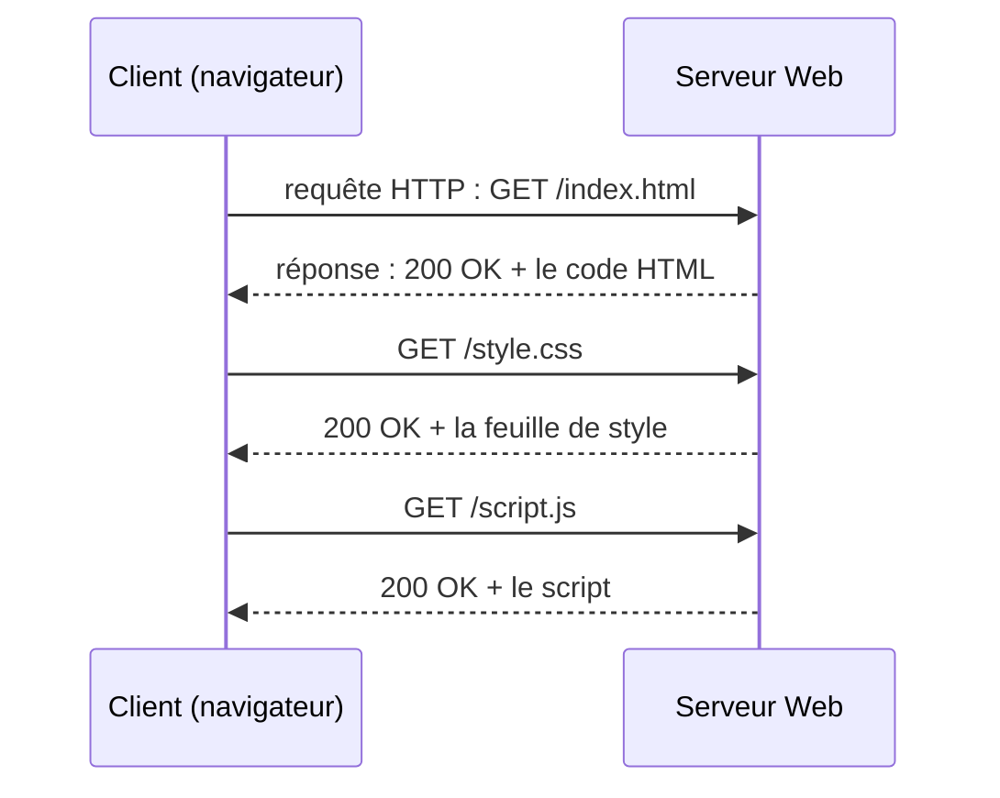

En SNT, les élèves ont vu ce qu'est le Web (URL, HTML, HTTP). En première NSI, on passe à l'**interaction** : comment une page réagit à
l'utilisateur, ce qui se passe entre le navigateur et le serveur, et comment les données d'un formulaire voyagent.

## Ce que dit le programme

Contenus : *modalités de l'interaction entre l'homme et la machine ; événements ; interaction avec l'utilisateur dans une page Web ; interaction
client-serveur, requêtes HTTP, réponses du serveur ; formulaire d'une page Web*. Capacités attendues : **identifier les différents composants
graphiques** d'une page et les **événements** associés ; **analyser et modifier** les méthodes exécutées lors d'un clic ; **distinguer ce qui
est exécuté sur le client ou sur le serveur** ; **distinguer une page statique et une page dynamique** ; **analyser le fonctionnement d'un
formulaire** ; **distinguer GET et POST** et le passage des paramètres ; **reconnaître** une transmission chiffrée (HTTPS).

## 1. Trois langages, trois rôles

```html
<!DOCTYPE html>
<html>
  <head>
    <title>Compteur</title>
    <link rel="stylesheet" href="style.css">
  </head>
  <body>
    <h1>Mon compteur</h1>
    <p>Valeur : <span id="valeur">0</span></p>
    <button id="plus">+1</button>
    <script src="script.js"></script>
  </body>
</html>
```

```css
h1 { color: darkblue; }
button { font-size: 20px; padding: 8px 16px; }
```

```javascript
let compteur = 0;
const bouton = document.getElementById("plus");
bouton.addEventListener("click", function () {
  compteur = compteur + 1;
  document.getElementById("valeur").textContent = compteur;
});
```

- **HTML** décrit la **structure** : des **balises** imbriquées (`<h1>`, `<p>`, `<button>`), avec des **attributs** (`id`, `href`).
- **CSS** décrit l'**apparence** : des règles `sélecteur { propriété: valeur; }`.
- **JavaScript** décrit le **comportement** : il manipule la page (le **DOM**, l'arbre des balises) en réaction aux actions de l'utilisateur.

## 2. Les événements

Une interface graphique attend que l'utilisateur agisse : on parle de **programmation événementielle**. On associe une **fonction** à un
**événement** sur un **élément** :

| Événement | Déclenché quand… |
| --- | --- |
| `click` | on clique sur l'élément |
| `mouseover` | la souris passe sur l'élément |
| `keydown` | on appuie sur une touche |
| `input` / `change` | le contenu d'un champ change |
| `submit` | un formulaire est envoyé |

Le programme n'exige pas d'écrire du JavaScript de zéro, mais de **lire** et **modifier** un code comme celui du compteur : faire un bouton −1,
remettre à zéro, changer la couleur au survol…

## 3. Le modèle client-serveur



Le **client** (le navigateur) **demande**, le **serveur** **répond**. Une page complète demande souvent des dizaines de requêtes (images,
styles, scripts).

Une **requête HTTP** ressemble à ceci :

```
GET /recherche?q=nsi HTTP/1.1
Host: www.exemple.fr
User-Agent: Firefox/131.0
```

et la **réponse** :

```
HTTP/1.1 200 OK
Content-Type: text/html; charset=utf-8

<!DOCTYPE html><html>...
```

Codes de réponse à connaître : **200** OK, **301** redirection, **403** interdit, **404** introuvable, **500** erreur interne du serveur.
On les observe dans les **outils de développement** du navigateur (F12, onglet Réseau).

## 4. Statique ou dynamique ? Client ou serveur ?

- Une page **statique** est un fichier HTML envoyé tel quel : tout le monde reçoit la même page.
- Une page **dynamique** est **fabriquée par le serveur** au moment de la requête, par un programme (PHP, Python…), souvent à partir d'une base
  de données : votre page Pronote n'est pas celle de votre voisin.

| S'exécute sur le **client** | S'exécute sur le **serveur** |
| --- | --- |
| JavaScript de la page | PHP, Python (Flask, Django), Node.js |
| affichage, animations, vérification rapide d'un formulaire | accès à la base de données, authentification, calculs secrets |
| l'utilisateur peut lire et modifier le code | l'utilisateur ne voit que le résultat |

:::attention[Conséquence importante]
Une vérification faite seulement en JavaScript (« le mot de passe fait au moins 8 caractères ») peut être contournée : le serveur doit
**toujours revérifier** les données reçues.
:::

## 5. Les formulaires : GET et POST

```html
<form action="/inscription" method="get">
  <input type="text" name="nom">
  <input type="number" name="age">
  <input type="submit" value="Envoyer">
</form>
```

À l'envoi, le navigateur fait une requête vers l'adresse `action`, avec les couples `name=valeur` des champs.

- Avec **GET**, les paramètres sont ajoutés à l'**URL** : `/inscription?nom=L%C3%A9a&age=15`. Ils sont **visibles**, restent dans
  l'historique et les favoris, et leur taille est limitée. On l'utilise pour une **recherche** ou un filtre.
- Avec **POST**, les paramètres sont dans le **corps** de la requête, pas dans l'URL. On l'utilise pour un **mot de passe**, un envoi de
  fichier, une action qui **modifie** des données (inscription, paiement).

Les caractères spéciaux (accents, espaces) sont **encodés** dans l'URL : `é` devient `%C3%A9` (ses octets UTF-8), un espace devient `+` ou
`%20`.

## 6. HTTPS

POST ne **chiffre** rien : sans précaution, un mot de passe circule en clair sur le réseau. **HTTPS** = HTTP + chiffrement (TLS) : le cadenas du
navigateur indique que les échanges sont chiffrés et que le serveur est authentifié par un **certificat**. Le fonctionnement du chiffrement est
vu en terminale.

## Les erreurs classiques des élèves

:::attention[Ce que tu verras en classe]
- **Confondre HTML et CSS** : mettre la couleur dans le HTML, ou croire que le CSS ajoute du contenu.
- **Croire que POST est sécurisé** : c'est HTTPS qui chiffre.
- **Croire que tout s'exécute sur le serveur** (ou tout sur le client).
- **Oublier l'attribut `name`** d'un champ : il n'est pas envoyé.
- **Confondre le Web et Internet** (vu en SNT, à rappeler).
- **Appeler la fonction** dans `addEventListener("click", f())` au lieu de la passer : `f`.
:::

## En classe

:::methode[Activités qui marchent]
1. **Outils de développement (F12)** : inspecter une page, modifier son CSS en direct, observer les requêtes et les codes dans l'onglet Réseau.
2. **Modifier un compteur** en JavaScript : bouton −1, remise à zéro, couleur selon la valeur.
3. **Formulaire GET puis POST** vers un petit serveur (Flask ou un service de test) : comparer l'URL obtenue.
4. **Débat** : quelles vérifications faire côté client, côté serveur ?
:::

## L'essentiel

- **HTML** = structure, **CSS** = apparence, **JavaScript** = comportement (événements, modification du DOM).
- **Événement** : `element.addEventListener("click", fonction)`.
- **Client-serveur** : le navigateur envoie une **requête HTTP**, le serveur renvoie une **réponse** avec un **code** (200, 404, 500…).
- **Statique** (fichier envoyé tel quel) / **dynamique** (fabriquée par le serveur). JavaScript sur le **client**, PHP ou Python sur le
  **serveur** ; toujours revérifier côté serveur.
- **Formulaire** : **GET** = paramètres dans l'URL ; **POST** = dans le corps. **HTTPS** chiffre, pas POST.

## Exercices

::::exercice[Grand QCM : le Web]{niveau=1 type=quiz}
Douze questions sur les interactions sur le Web.

1. Quel langage décrit la mise en forme (couleurs, tailles, marges) d'une page ?

   - [ ] HTML
   - [x] CSS
   - [ ] JavaScript
   - [ ] HTTP

   > HTML structure, CSS met en forme, JavaScript fait réagir.

1. Où s'exécute le JavaScript d'une page Web ?

   - [ ] sur le serveur
   - [x] dans le navigateur du client
   - [ ] sur le routeur
   - [ ] dans la base de données

   > Le serveur l'envoie comme un fichier, le navigateur l'exécute.

1. Quel événement correspond à un clic sur un bouton ?

   - [x] `click`
   - [ ] `submit`
   - [ ] `keydown`
   - [ ] `load`

   > `submit` concerne l'envoi d'un formulaire.

1. Que signifie le code de réponse 404 ?

   - [ ] tout va bien
   - [ ] erreur interne du serveur
   - [x] ressource introuvable
   - [ ] accès interdit

   > 200 OK, 403 interdit, 404 introuvable, 500 erreur du serveur.

1. Avec un formulaire en GET, où sont transmis les paramètres ?

   - [x] dans l'URL, après le `?`
   - [ ] dans le corps de la requête, cachés
   - [ ] dans un cookie
   - [ ] ils ne sont pas transmis

   > Exemple : `/recherche?q=nsi&page=2`.

1. Pour envoyer un mot de passe, on utilise de préférence :

   - [ ] GET, car c'est plus rapide
   - [x] POST, et surtout HTTPS
   - [ ] GET avec HTTPS, car l'URL est chiffrée et ne reste nulle part
   - [ ] peu importe

   > Avec GET, le mot de passe resterait dans l'historique et les journaux du serveur. HTTPS chiffre l'échange.

1. Une page dynamique est :

   - [ ] une page avec des animations
   - [x] une page fabriquée par un programme sur le serveur au moment de la requête
   - [ ] une page qui contient du JavaScript
   - [ ] une page qui change de couleur

   > Dynamique au sens « générée côté serveur », par exemple à partir d'une base de données.

1. Quelle URL correspond au formulaire `<form action="/cherche" method="get">` avec un champ `name="ville"` rempli par « Lyon » ?

   - [ ] `/cherche/Lyon`
   - [x] `/cherche?ville=Lyon`
   - [ ] `/cherche?Lyon=ville`
   - [ ] `/cherche#ville=Lyon`

   > Les paramètres sont des couples `name=valeur`.

1. Un champ de formulaire n'a pas d'attribut `name`. Que se passe-t-il à l'envoi ?

   - [ ] le formulaire ne s'envoie pas
   - [x] sa valeur n'est pas transmise
   - [ ] sa valeur est transmise sous le nom « champ »
   - [ ] une erreur 500

   > Le navigateur n'envoie que les champs nommés.

1. Pourquoi le serveur doit-il revérifier les données d'un formulaire déjà vérifiées en JavaScript ?

   - [ ] parce que JavaScript fait des erreurs de calcul
   - [x] parce que l'utilisateur peut contourner ou modifier le code exécuté chez lui
   - [ ] parce que HTTP perd des données
   - [ ] ce n'est pas nécessaire

   > Tout ce qui s'exécute sur le client est sous le contrôle de l'utilisateur.

1. Que garantit le cadenas HTTPS ?

   - [ ] que le site est honnête
   - [x] que les échanges sont chiffrés et que le serveur possède un certificat pour ce nom de domaine
   - [ ] que le site n'a pas de virus
   - [ ] que les données ne sont pas stockées

   > Un site frauduleux peut avoir HTTPS : le cadenas ne dit rien de ses intentions.

1. Combien de requêtes HTTP demande en général l'affichage d'une page avec une feuille de style, un script et trois images ?

   - [ ] une seule
   - [ ] deux
   - [x] au moins six
   - [ ] aucune si la page est statique

   > Une pour le HTML, puis une par ressource (si elles ne sont pas déjà en cache).
::::

::::exercice[Lire les paramètres d'une URL]{niveau=2}
Côté serveur, un programme reçoit la partie de l'URL après le `?`, par exemple `"nom=Lea&classe=1G2&age=15"`. Écris `parametres(chaine)` qui
renvoie le dictionnaire `{"nom": "Lea", "classe": "1G2", "age": "15"}`. Une chaîne vide donne un dictionnaire vide. Les `+` représentent des
espaces et doivent être remplacés.

```python depart
def parametres(chaine):
    ...
```

```python tests
assert parametres("nom=Lea&classe=1G2&age=15") == {"nom": "Lea", "classe": "1G2", "age": "15"}, "trois paramètres"
assert parametres("q=cours+de+NSI") == {"q": "cours de NSI"}, "les + deviennent des espaces"
assert parametres("") == {}, "chaîne vide"
```

:::corrige
```python solution
def parametres(chaine):
    resultat = {}
    if chaine == "":
        return resultat
    for couple in chaine.split("&"):
        morceaux = couple.split("=")
        resultat[morceaux[0]] = morceaux[1].replace("+", " ")
    return resultat
```

C'est ce que fait tout serveur Web avec une requête GET. Les bibliothèques réelles décodent aussi les `%C3%A9` (accents) : en Python,
`urllib.parse.parse_qs`.
:::
::::

::::exercice[Fabriquer une page dynamique]{niveau=2}
Un serveur en Python fabrique une page à partir de données. Écris `tableau_html(table)` qui reçoit un tableau de dictionnaires ayant tous les
mêmes clés (non vide) et renvoie le code HTML d'un tableau : une ligne d'en-tête `<tr><th>…</th></tr>` avec les clés, puis une ligne
`<tr><td>…</td></tr>` par enregistrement, le tout entre `<table>` et `</table>`, sans espaces ni retours à la ligne.

```python depart
def tableau_html(table):
    ...
```

```python tests
t = [{"nom": "Léa", "note": 15}, {"nom": "Tom", "note": 9}]
attendu = "<table><tr><th>nom</th><th>note</th></tr><tr><td>Léa</td><td>15</td></tr><tr><td>Tom</td><td>9</td></tr></table>"
assert tableau_html(t) == attendu, "deux lignes"
assert tableau_html([{"a": 1}]) == "<table><tr><th>a</th></tr><tr><td>1</td></tr></table>", "une seule case"
```

:::corrige
```python solution
def tableau_html(table):
    html = "<table><tr>"
    for cle in table[0]:
        html = html + "<th>" + cle + "</th>"
    html = html + "</tr>"
    for ligne in table:
        html = html + "<tr>"
        for cle in table[0]:
            html = html + "<td>" + str(ligne[cle]) + "</td>"
        html = html + "</tr>"
    return html + "</table>"
```

C'est le principe d'une page dynamique : le serveur produit du HTML à partir de données (ici une table, souvent une base de données), et le
navigateur ne reçoit que le résultat.
:::
::::

::::exercice[GET ou POST ?]{niveau=1}
Pour chacun de ces formulaires, choisis GET ou POST et justifie en une phrase : (a) la barre de recherche d'un site de recettes ; (b) la
connexion à l'ENT ; (c) le filtre « prix croissant » d'une boutique en ligne ; (d) l'envoi d'une photo de profil ; (e) le formulaire de
commande avec adresse de livraison.

:::criteres
- (a) et (c) en GET : pas de donnée sensible, et on veut pouvoir partager ou mettre en favori le résultat.
- (b), (d) et (e) en POST : données sensibles, volumineuses ou action qui modifie des données sur le serveur.
- Mention de HTTPS pour les données sensibles.
:::

:::corrige
(a) **GET** : la recherche n'est pas secrète, et l'URL `?q=crepes` peut être partagée ou mise en favori. (b) **POST** (et HTTPS) : le mot de
passe ne doit pas apparaître dans l'URL ni dans l'historique. (c) **GET** : un filtre est une simple consultation, on veut pouvoir partager le
lien. (d) **POST** : une photo est trop volumineuse pour une URL. (e) **POST** (et HTTPS) : données personnelles, et l'action crée une commande
sur le serveur. Règle simple : GET pour **consulter**, POST pour **envoyer** ou **modifier**, HTTPS dès qu'il y a des données personnelles.
:::
::::

::::exercice[Client ou serveur ? Expliquer à un élève]{niveau=2}
Un élève pense que « tout le site Pronote est dans son navigateur ». Explique-lui, avec l'exemple de la consultation de ses notes, ce qui se
passe sur son ordinateur et ce qui se passe sur le serveur.

:::criteres
- Le navigateur envoie une requête HTTP (HTTPS) ; le serveur vérifie l'identité, interroge la base de données, fabrique la page.
- Le client affiche le HTML/CSS reçu et exécute le JavaScript (menus, animations).
- Les notes de toute la classe ne sont pas sur l'ordinateur de l'élève : seul le résultat le concernant est envoyé.
:::

:::corrige
Quand tu cliques sur « Notes », ton **navigateur** (le client) envoie une **requête HTTPS** au **serveur** de l'établissement. Le serveur
vérifie qui tu es (ta session de connexion), va chercher **tes** notes dans sa **base de données**, et **fabrique** une page avec elles : c'est
une page **dynamique**. Il te renvoie ce HTML, avec le CSS et le JavaScript. Ton navigateur, lui, se contente d'**afficher** la page et
d'exécuter le JavaScript (menus, graphiques). Les notes des autres élèves, la base de données et le programme du serveur ne quittent jamais le
serveur : tu ne reçois que le résultat qui te concerne. C'est pour cela que tu ne peux pas « modifier tes notes » en changeant la page
affichée : tu ne changes que ta copie locale.
:::
::::
