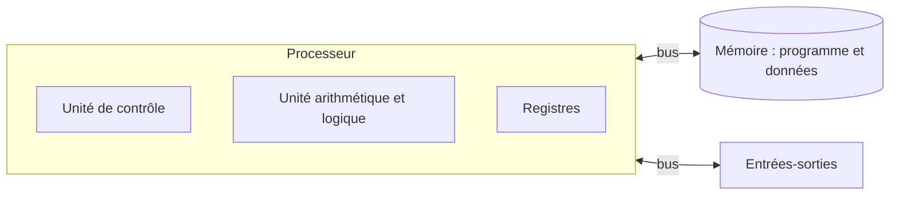

Un programme Python finit toujours par être exécuté par un **processeur** qui ne comprend que des instructions très simples, codées en binaire.
Ce chapitre ouvre le capot : de quoi est fait un ordinateur, et comment il exécute un programme instruction par instruction.

## Ce que dit le programme

Contenus : *modèle d'architecture séquentielle (von Neumann)*. Capacités attendues : **distinguer les rôles et les caractéristiques des
différents constituants d'une machine** ; **dérouler l'exécution d'une séquence d'instructions simples du type langage machine**. Le programme
précise qu'il s'agit d'une présentation simple, sans entrer dans un jeu d'instructions réel, et suggère un simulateur.

## 1. Le modèle de von Neumann

En 1945, John von Neumann décrit une machine dont le **programme est enregistré en mémoire**, au même titre que les données. Avant, on
programmait en recâblant la machine. Presque tous les ordinateurs actuels suivent ce modèle.



| Composant | Rôle |
| --- | --- |
| **Unité arithmétique et logique** (UAL) | effectue les calculs : addition, comparaison, ET, OU… |
| **Unité de contrôle** | lit les instructions une à une, les décode et commande les autres composants |
| **Registres** | petites mémoires ultra-rapides dans le processeur : accumulateur, compteur de programme (adresse de la prochaine instruction), registre d'instruction |
| **Mémoire** (RAM) | contient le programme **et** les données, chaque case ayant une **adresse** |
| **Entrées-sorties** | clavier, écran, disque, réseau |
| **Bus** | fils qui transportent données, adresses et signaux de commande |

L'UAL, l'unité de contrôle et les registres forment le **processeur** (CPU).

## 2. Le cycle d'exécution

Le processeur répète sans fin le même cycle, cadencé par une **horloge** (quelques milliards de fois par seconde, en GHz) :

1. **Chercher** : lire en mémoire l'instruction dont l'adresse est dans le **compteur de programme** (CP).
2. **Décoder** : comprendre ce qu'elle demande.
3. **Exécuter** : faire le calcul, lire ou écrire en mémoire ; puis le CP passe à l'instruction suivante (ou ailleurs en cas de **saut**).

## 3. Un petit langage machine

Prenons une machine simple, avec un registre **A** (l'accumulateur) et ces instructions :

| Instruction | Effet |
| --- | --- |
| `LOAD x` | A ← contenu de la case d'adresse x |
| `STORE x` | case x ← A |
| `ADD x` | A ← A + contenu de la case x |
| `SUB x` | A ← A − contenu de la case x |
| `JUMP n` | aller à l'instruction n |
| `JUMPZ n` | si A = 0, aller à l'instruction n |
| `HALT` | arrêter |

Programme qui calcule `c = a + b`, avec a en case 10, b en case 11, c en case 12 :

```
0  LOAD 10
1  ADD 11
2  STORE 12
3  HALT
```

On le **déroule** en suivant le compteur de programme et le registre A (avec a = 5, b = 7) :

| CP | Instruction | A | Mémoire modifiée |
| --- | --- | --- | --- |
| 0 | `LOAD 10` | 5 | |
| 1 | `ADD 11` | 12 | |
| 2 | `STORE 12` | 12 | case 12 = 12 |
| 3 | `HALT` | 12 | |

Les **sauts** permettent les conditions et les boucles : c'est ainsi qu'un `if` ou un `while` Python est traduit.

Dans une vraie machine, chaque instruction est codée en binaire (par exemple `LOAD 10` → `0001 00001010`) : c'est le **langage machine**.
L'**assembleur** est sa version lisible. Un **compilateur** ou un **interpréteur** traduit un langage de haut niveau comme Python en ces
instructions.

On peut simuler cette machine en Python :

```python exec
def executer(programme, memoire):
    a = 0
    cp = 0
    while True:
        op, x = programme[cp]
        cp = cp + 1
        if op == "LOAD":
            a = memoire[x]
        elif op == "STORE":
            memoire[x] = a
        elif op == "ADD":
            a = a + memoire[x]
        elif op == "SUB":
            a = a - memoire[x]
        elif op == "JUMP":
            cp = x
        elif op == "JUMPZ":
            if a == 0:
                cp = x
        elif op == "HALT":
            return memoire

mem = {10: 5, 11: 7, 12: 0}
prog = [("LOAD", 10), ("ADD", 11), ("STORE", 12), ("HALT", 0)]
print(executer(prog, mem))
```

## 4. Des machines d'aujourd'hui

- La **hiérarchie des mémoires** : registres (très rapides, minuscules), mémoire **cache**, RAM, disque (lent, énorme). Le processeur attend
  souvent la mémoire : c'est le **goulot d'étranglement de von Neumann**.
- La **loi de Moore** : le nombre de transistors double environ tous les deux ans depuis 1965 (des milliards aujourd'hui).
- Depuis 2005 environ, la fréquence ne monte plus (chaleur) : on met **plusieurs cœurs** dans un processeur, qui travaillent en parallèle.
- Les **systèmes sur puce** (SoC) des téléphones regroupent processeur, mémoire, graphique et radio sur une seule puce (vu en terminale).

## Les erreurs classiques des élèves

:::attention[Ce que tu verras en classe]
- **Confondre mémoire vive et stockage** (RAM et disque) : la RAM est effacée à l'extinction.
- **Croire que le programme est dans le processeur** : il est en mémoire, le processeur le lit instruction par instruction.
- **Confondre adresse et contenu** : `LOAD 10` charge le **contenu** de la case 10, pas le nombre 10.
- **Oublier d'avancer le compteur de programme** lors du déroulé à la main, ou mal gérer les sauts.
- **Croire que 3 GHz signifie 3 milliards de lignes Python par seconde.**
:::

## En classe

:::methode[Activités qui marchent]
1. **Jeu de rôle** : un élève est l'unité de contrôle, un autre l'UAL, des enveloppes numérotées sont la mémoire ; on exécute un programme à la
   main.
2. **Simulateur** : un simulateur en ligne de type « M999 » ou un petit simulateur d'assembleur pour voir le compteur de programme avancer.
3. **Démonter** un vieil ordinateur : repérer processeur, barrettes de RAM, disque, bus.
4. **Traduire** une boucle Python simple en assembleur avec des sauts.
:::

## L'essentiel

- **Von Neumann** : UAL + unité de contrôle (+ registres) = processeur ; **mémoire** qui contient **programme et données** ; entrées-sorties ;
  bus.
- **Cycle** : chercher (à l'adresse du compteur de programme), décoder, exécuter.
- **Langage machine** (binaire) ↔ **assembleur** (lisible) ; les **sauts** réalisent les conditions et les boucles.
- **Dérouler** un programme : suivre CP, registres et mémoire dans un tableau.
- Évolutions : cache, loi de Moore, multicœurs, systèmes sur puce.

## Exercices

::::exercice[Grand QCM : architecture]{niveau=1 type=quiz}
Dix questions sur l'architecture de von Neumann.

1. Quelle est l'idée essentielle de l'architecture de von Neumann ?

   - [ ] le processeur a plusieurs cœurs
   - [x] le programme est stocké en mémoire, comme les données
   - [ ] les données sont sur le disque
   - [ ] la machine est programmée en recâblant des fils

   > C'est le principe du « programme enregistré ».

1. Quel composant effectue une addition ?

   - [ ] l'unité de contrôle
   - [x] l'unité arithmétique et logique
   - [ ] la mémoire
   - [ ] le bus

   > L'UAL calcule ; l'unité de contrôle commande.

1. Que contient le compteur de programme ?

   - [ ] le nombre d'instructions déjà exécutées
   - [x] l'adresse de la prochaine instruction à exécuter
   - [ ] le résultat du dernier calcul
   - [ ] la vitesse du processeur

   > Il avance après chaque instruction, ou change lors d'un saut.

1. Dans l'ordre, les étapes du cycle d'une instruction sont :

   - [ ] exécuter, décoder, chercher
   - [x] chercher, décoder, exécuter
   - [ ] décoder, chercher, exécuter
   - [ ] chercher, exécuter, décoder

   > On ne peut décoder qu'une instruction déjà lue.

1. La case 10 contient 42. Après `LOAD 10`, que vaut A ?

   - [ ] 10
   - [x] 42
   - [ ] 52
   - [ ] 0

   > On charge le contenu de l'adresse 10.

1. Où se trouve un registre ?

   - [x] dans le processeur
   - [ ] dans la RAM
   - [ ] sur le disque
   - [ ] dans le bus

   > C'est la mémoire la plus rapide et la plus petite.

1. Quelle mémoire est effacée quand on éteint l'ordinateur ?

   - [ ] le disque SSD
   - [x] la mémoire vive (RAM)
   - [ ] une clé USB
   - [ ] aucune

   > La RAM est volatile ; le stockage (disque, SSD) est permanent.

1. À quoi servent les instructions de saut (`JUMP`, `JUMPZ`) ?

   - [ ] à accélérer le processeur
   - [x] à réaliser des conditions et des boucles
   - [ ] à effacer la mémoire
   - [ ] à communiquer avec l'écran

   > Un `while` devient un test suivi d'un saut en arrière.

1. Quelle est la différence entre langage machine et assembleur ?

   - [ ] l'assembleur est plus rapide
   - [x] l'assembleur est l'écriture lisible des instructions machine
   - [ ] le langage machine est un langage de haut niveau
   - [ ] aucune

   > Une instruction assembleur correspond à une instruction machine.

1. Pourquoi les processeurs ont-ils plusieurs cœurs depuis les années 2000 ?

   - [ ] pour consommer plus
   - [x] parce qu'on ne pouvait plus augmenter la fréquence sans trop chauffer
   - [ ] parce que la loi de Moore s'est arrêtée en 1990
   - [ ] pour pouvoir utiliser plusieurs écrans

   > On fait travailler plusieurs cœurs en parallèle plutôt qu'un seul plus vite.
::::

::::exercice[Dérouler un programme avec une boucle]{niveau=2}
La case 20 contient 3, la case 21 contient 1, la case 22 contient 0. Déroule ce programme instruction par instruction (CP, A, mémoire) et dis
ce qu'il calcule dans la case 22.

```
0  LOAD 20
1  JUMPZ 9
2  LOAD 22
3  ADD 20
4  STORE 22
5  LOAD 20
6  SUB 21
7  STORE 20
8  JUMP 0
9  HALT
```

:::criteres
- Le déroulé suit correctement les sauts : trois passages dans la boucle.
- Les valeurs successives de la case 22 : 3, 5, 6.
- La conclusion : le programme calcule 3 + 2 + 1 = 6 (la somme des entiers de 1 à n).
:::

:::corrige
Premier passage : A = 3 (non nul, pas de saut), case 22 = 0 + 3 = 3, case 20 = 3 − 1 = 2, saut en 0. Deuxième passage : A = 2, case 22 =
3 + 2 = 5, case 20 = 1. Troisième passage : A = 1, case 22 = 5 + 1 = 6, case 20 = 0. Quatrième passage : `LOAD 20` donne A = 0, `JUMPZ 9`
saute à `HALT`. La case 22 contient **6 = 3 + 2 + 1** : le programme calcule la somme des entiers de 1 à n (n étant dans la case 20). En
Python : `while n != 0: s = s + n; n = n - 1`.
:::
::::

::::exercice[Écrire le simulateur]{niveau=2}
Écris `executer(programme, memoire)` qui simule la machine du cours : `programme` est un tableau de couples `(operation, x)`, `memoire` un
dictionnaire adresse → valeur. La fonction renvoie la mémoire à l'arrêt (`HALT`). Instructions : `LOAD`, `STORE`, `ADD`, `SUB`, `JUMP`,
`JUMPZ`, `HALT`.

```python depart
def executer(programme, memoire):
    ...
```

```python tests
prog = [("LOAD", 10), ("ADD", 11), ("STORE", 12), ("HALT", 0)]
assert executer(prog, {10: 5, 11: 7, 12: 0})[12] == 12, "addition"
boucle = [("LOAD", 20), ("JUMPZ", 9), ("LOAD", 22), ("ADD", 20), ("STORE", 22),
          ("LOAD", 20), ("SUB", 21), ("STORE", 20), ("JUMP", 0), ("HALT", 0)]
assert executer(boucle, {20: 4, 21: 1, 22: 0})[22] == 10, "somme de 1 à 4"
assert executer(boucle, {20: 0, 21: 1, 22: 0})[22] == 0, "boucle jamais exécutée"
```

:::corrige
```python solution
def executer(programme, memoire):
    a = 0
    cp = 0
    while True:
        op, x = programme[cp]
        cp = cp + 1
        if op == "LOAD":
            a = memoire[x]
        elif op == "STORE":
            memoire[x] = a
        elif op == "ADD":
            a = a + memoire[x]
        elif op == "SUB":
            a = a - memoire[x]
        elif op == "JUMP":
            cp = x
        elif op == "JUMPZ":
            if a == 0:
                cp = x
        elif op == "HALT":
            return memoire
```

La boucle `while True` est le cycle du processeur : chercher (`programme[cp]`), avancer le compteur, décoder (les `if`) et exécuter.
:::
::::

::::exercice[Écrire un programme en assembleur]{niveau=2}
Avec les instructions du cours, écris un programme qui calcule `d = a − b + c`, avec a en case 10, b en case 11, c en case 12 et d en case 13.
Puis explique pourquoi il faut une instruction `STORE` à la fin.

:::criteres
- Programme correct : `LOAD 10`, `SUB 11`, `ADD 12`, `STORE 13`, `HALT`.
- Explication : le résultat est dans le registre A, il faut l'écrire en mémoire pour le conserver ; le registre sera écrasé par la suite.
:::

:::corrige
```
0  LOAD 10
1  SUB 11
2  ADD 12
3  STORE 13
4  HALT
```

Le calcul se fait dans le registre **A**, à l'intérieur du processeur. Sans `STORE 13`, le résultat n'existerait que dans ce registre, qui
sera réutilisé (et écrasé) par l'instruction `LOAD` suivante : il faut le recopier dans une case **mémoire** pour le conserver et que le reste du
programme puisse s'en servir.
:::
::::
