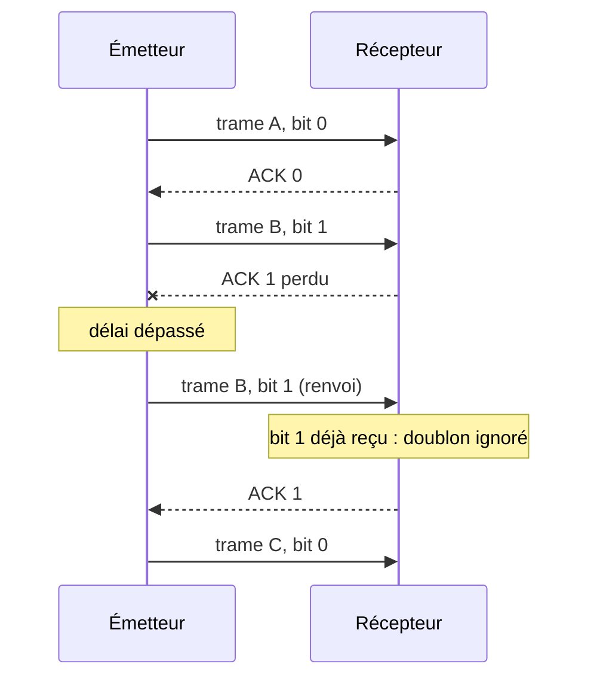

En SNT, les élèves ont vu qu'Internet transporte des **paquets** entre des machines repérées par une **adresse IP**. En première NSI, on
approfondit : comment savoir si deux machines sont sur le même réseau, comment les couches s'emboîtent, et comment garantir qu'un message
arrive malgré les pertes, avec le **protocole du bit alterné**.

## Ce que dit le programme

Contenus : *transmission de données dans un réseau ; protocoles de communication ; architecture d'un réseau*. Capacités attendues : **mettre en
évidence l'intérêt du découpage des données en paquets et de leur encapsulation** ; **dérouler le fonctionnement d'un protocole simple de
récupération de perte de paquets (bit alterné)** ; **simuler ou mettre en œuvre un réseau**. Le programme précise que le protocole TCP est
présenté simplement et que l'on peut utiliser un simulateur (Filius).

## 1. La transmission par paquets

Un fichier de 3 Mo n'est pas envoyé d'un bloc : il est **découpé en paquets** d'environ 1 500 octets, chacun portant l'adresse de destination
et un **numéro d'ordre**.

- Les liens sont **partagés** : les paquets de milliers d'utilisateurs s'intercalent sur un même câble.
- En cas d'erreur, on ne renvoie **qu'un** paquet, pas tout le fichier.
- Les paquets peuvent prendre des **chemins différents** et arriver **dans le désordre** : on les remet en ordre à l'arrivée.

## 2. Adresses IP et réseaux

Une adresse **IPv4** est formée de 4 octets, écrits en décimal : `192.168.1.17`, soit 32 bits. Elle comprend deux parties : le **réseau** et la
**machine**. La notation `/24` indique que les **24 premiers bits** désignent le réseau.

| Adresse | Masque | Réseau | Machine |
| --- | --- | --- | --- |
| `192.168.1.17/24` | `255.255.255.0` | `192.168.1.0` | 17 |
| `10.0.5.200/16` | `255.255.0.0` | `10.0.0.0` | 5.200 |

Deux machines peuvent communiquer **directement** (via un switch) si elles sont sur le **même réseau**, c'est-à-dire si leurs adresses ont la
même partie réseau. Sinon, elles passent par un **routeur**.

Dans un réseau `/24`, il y a 2⁸ = 256 adresses, dont deux réservées (l'adresse du réseau, qui finit par 0, et l'adresse de diffusion, qui finit
par 255) : **254 machines** au plus.

## 3. Switchs et routeurs

- Un **switch** (commutateur) relie les machines d'un **même réseau local** ; il utilise les adresses **MAC** (l'adresse physique de la carte
  réseau).
- Un **routeur** relie des **réseaux différents** ; il lit l'adresse **IP** de destination et choisit, grâce à sa **table de routage**, vers
  quel réseau voisin envoyer le paquet. Votre box est un routeur entre votre réseau local et Internet.

Le choix des routes (protocoles RIP, OSPF) est vu en terminale.

## 4. Le modèle en couches et l'encapsulation

Pour envoyer une page Web, plusieurs **protocoles** coopèrent, chacun à sa **couche**. En descendant, chaque couche **ajoute son en-tête** :
c'est l'**encapsulation**.

| Couche | Protocole | Ajoute… | Unité |
| --- | --- | --- | --- |
| Application | HTTP | la requête (`GET /index.html`) | message |
| Transport | TCP | **ports** source et destination, numéro de séquence | segment |
| Réseau (Internet) | IP | **adresses IP** source et destination | paquet |
| Liaison | Ethernet, Wi-Fi | **adresses MAC** | trame |

```
[ Ethernet | IP | TCP | HTTP : GET /index.html ]
```

À l'arrivée, chaque couche **retire** son en-tête et passe le reste à la couche du dessus (désencapsulation). Chaque couche n'a besoin de
connaître que **sa** couche : on peut changer le Wi-Fi pour la 4G sans toucher à HTTP.

IP fait **au mieux** : il ne garantit ni l'arrivée, ni l'ordre. C'est **TCP** qui assure la fiabilité, grâce aux **accusés de réception** et
aux **renvois**.

## 5. Le protocole du bit alterné

C'est le plus simple des protocoles de récupération des pertes. Il illustre le principe de TCP.

- L'émetteur envoie une trame avec un **bit de contrôle** (0, puis 1, puis 0…) et lance un **minuteur**.
- Le récepteur, s'il reçoit une trame **nouvelle**, la garde et renvoie un **accusé** (ACK) portant le même bit.
- Si l'émetteur reçoit l'accusé attendu, il passe à la trame suivante en **alternant** le bit.
- Si le minuteur expire (trame ou accusé perdu), l'émetteur **renvoie** la même trame, avec le même bit.
- Le récepteur qui reçoit une trame dont le bit est celui de la **dernière trame acceptée** sait que c'est un **doublon** : il l'ignore, mais
  renvoie l'accusé.



Sans le bit, le récepteur ne pourrait pas distinguer une **nouvelle** trame B d'un **renvoi** de B après la perte de l'accusé, et garderait B
deux fois.

Le côté récepteur s'écrit en quelques lignes :

```python exec
def recevoir(trames):
    """trames : liste de couples (bit, donnée) arrivés, renvois compris."""
    attendu = 0
    message = []
    for bit, donnee in trames:
        if bit == attendu:
            message.append(donnee)
            attendu = 1 - attendu
        # sinon : doublon, on l'ignore (mais on renverrait l'accusé)
    return message

print(recevoir([(0, "A"), (1, "B"), (1, "B"), (0, "C")]))
```

Limite : on attend chaque accusé avant d'envoyer la suite, ce qui est **lent**. TCP envoie plusieurs segments d'avance (fenêtre glissante).

## Les erreurs classiques des élèves

:::attention[Ce que tu verras en classe]
- **Croire qu'un fichier part d'un bloc**, ou que tous les paquets prennent le même chemin.
- **Confondre adresse IP et adresse MAC**, switch et routeur.
- **Comparer les adresses en entier** au lieu de la seule partie réseau.
- **Oublier les deux adresses réservées** dans le calcul du nombre de machines.
- **Bit alterné** : croire que le bit change lors d'un renvoi, ou que le récepteur ne renvoie pas d'accusé pour un doublon (l'émetteur
  attendrait alors indéfiniment).
:::

## En classe

:::methode[Activités qui marchent]
1. **Filius** : construire deux réseaux reliés par un routeur, configurer les adresses, tester avec `ping`, observer les paquets.
2. **Débranché** : un message découpé en enveloppes numérotées, qui passent par plusieurs élèves « routeurs », certaines perdues.
3. **Bit alterné joué** : deux élèves s'envoient des cartes, un troisième en « perd » au hasard ; on découvre pourquoi le bit est nécessaire.
4. **Commandes** : `ipconfig` / `ip a`, `ping`, `tracert` / `traceroute` sur les machines du lycée.
:::

## L'essentiel

- Les données voyagent en **paquets** : liens partagés, renvoi d'un seul paquet, chemins différents, réordonnancement à l'arrivée.
- **IPv4** : 32 bits ; `/n` = les n premiers bits désignent le **réseau** ; même réseau = communication directe, sinon **routeur**.
- **Switch** (même réseau, adresses MAC) / **routeur** (entre réseaux, adresses IP, table de routage).
- **Encapsulation** : HTTP dans TCP (ports) dans IP (adresses IP) dans Ethernet (MAC).
- **Bit alterné** : bit de contrôle, accusé, minuteur, renvoi ; le bit permet de reconnaître les **doublons**.

## Exercices

::::exercice[Grand QCM : réseaux]{niveau=1 type=quiz}
Douze questions sur les réseaux et les protocoles.

1. Pourquoi découpe-t-on les données en paquets ?

   - [ ] pour les chiffrer
   - [x] pour partager les liens et ne renvoyer que ce qui est perdu
   - [ ] pour les compresser
   - [ ] parce que les câbles sont courts

   > C'est la commutation de paquets.

1. Combien de bits compte une adresse IPv4 ?

   - [ ] 8
   - [ ] 16
   - [x] 32
   - [ ] 128

   > 4 octets de 8 bits. IPv6 en compte 128.

1. `192.168.1.17/24` et `192.168.1.200/24` sont-elles sur le même réseau ?

   - [x] oui
   - [ ] non
   - [ ] impossible à dire
   - [ ] seulement si elles ont la même adresse MAC

   > Les 24 premiers bits (192.168.1) sont identiques.

1. `192.168.1.17/24` et `192.168.2.17/24` sont-elles sur le même réseau ?

   - [ ] oui
   - [x] non
   - [ ] oui, car elles finissent toutes deux par 17
   - [ ] impossible à dire

   > Le troisième octet diffère : il faut passer par un routeur.

1. Combien de machines au plus dans un réseau `/24` ?

   - [ ] 256
   - [x] 254
   - [ ] 255
   - [ ] 24

   > 256 adresses moins l'adresse du réseau et celle de diffusion.

1. Quel équipement relie deux réseaux différents ?

   - [ ] un switch
   - [x] un routeur
   - [ ] une carte réseau
   - [ ] un câble Ethernet

   > Le switch relie des machines d'un même réseau local.

1. Quelle couche ajoute les numéros de port ?

   - [ ] Ethernet
   - [ ] IP
   - [x] TCP
   - [ ] HTTP

   > Les ports désignent l'application (80 ou 443 pour le Web).

1. Dans l'ordre de l'encapsulation, de l'intérieur vers l'extérieur :

   - [x] HTTP, TCP, IP, Ethernet
   - [ ] Ethernet, IP, TCP, HTTP
   - [ ] IP, TCP, HTTP, Ethernet
   - [ ] TCP, HTTP, IP, Ethernet

   > Les données de l'application sont au cœur ; la trame Ethernet est l'enveloppe extérieure.

1. Quel protocole garantit que les données arrivent complètes et dans l'ordre ?

   - [ ] IP
   - [x] TCP
   - [ ] Ethernet
   - [ ] HTML

   > IP achemine au mieux, sans garantie.

1. Dans le bit alterné, que fait l'émetteur si l'accusé n'arrive pas avant la fin du délai ?

   - [ ] il passe à la trame suivante
   - [x] il renvoie la même trame avec le même bit
   - [ ] il renvoie la même trame avec l'autre bit
   - [ ] il abandonne

   > Le bit ne change qu'après réception de l'accusé attendu.

1. Le récepteur a accepté une trame de bit 1 et reçoit à nouveau une trame de bit 1. Que fait-il ?

   - [ ] il la garde, c'est une nouvelle donnée
   - [x] il l'ignore comme doublon et renvoie l'accusé 1
   - [ ] il l'ignore et ne répond rien
   - [ ] il renvoie l'accusé 0

   > Sans accusé, l'émetteur renverrait la trame indéfiniment.

1. Pourquoi le bit de contrôle est-il nécessaire ?

   - [ ] pour chiffrer la trame
   - [x] pour distinguer une nouvelle trame d'un renvoi après la perte d'un accusé
   - [ ] pour indiquer la longueur de la trame
   - [ ] pour choisir le chemin

   > Sinon, une trame renvoyée serait gardée deux fois.
::::

::::exercice[Même réseau ?]{niveau=1}
Écris `meme_reseau(ip1, ip2, n)` qui renvoie `True` si les adresses `ip1` et `ip2` (chaînes comme `"192.168.1.17"`) sont sur le même réseau
avec un masque `/n`, où `n` vaut 8, 16 ou 24. On compare les `n // 8` premiers octets.

```python depart
def meme_reseau(ip1, ip2, n):
    ...
```

```python tests
assert meme_reseau("192.168.1.17", "192.168.1.200", 24), "même /24"
assert not meme_reseau("192.168.1.17", "192.168.2.17", 24), "troisième octet différent"
assert meme_reseau("10.0.5.1", "10.0.200.3", 16), "même /16"
assert meme_reseau("10.1.2.3", "10.9.9.9", 8), "même /8"
assert not meme_reseau("10.1.2.3", "11.1.2.3", 8), "premier octet différent"
```

:::corrige
```python solution
def meme_reseau(ip1, ip2, n):
    octets1 = ip1.split(".")
    octets2 = ip2.split(".")
    for i in range(n // 8):
        if octets1[i] != octets2[i]:
            return False
    return True
```

Pour un masque qui n'est pas un multiple de 8 (par exemple `/20`), il faudrait comparer les **bits** : c'est l'objet d'un exercice de terminale.
:::
::::

::::exercice[Découper et réassembler]{niveau=2}
Écris `decouper(message, taille)` qui découpe une chaîne en paquets numérotés : une liste de couples `(numero, morceau)` où chaque morceau fait
`taille` caractères (le dernier peut être plus court), numérotés à partir de 0. Puis `reassembler(paquets)` qui reçoit les paquets **dans
le désordre** et reconstitue le message.

```python depart
def decouper(message, taille):
    ...

def reassembler(paquets):
    ...
```

```python tests
assert decouper("BONJOUR", 3) == [(0, "BON"), (1, "JOU"), (2, "R")], "découpage"
assert decouper("", 3) == [], "message vide"
assert reassembler([(2, "R"), (0, "BON"), (1, "JOU")]) == "BONJOUR", "désordre"
assert reassembler(decouper("Les paquets arrivent", 4)[::-1]) == "Les paquets arrivent", "aller-retour"
```

:::corrige
```python solution
def decouper(message, taille):
    paquets = []
    numero = 0
    for debut in range(0, len(message), taille):
        morceau = ""
        for i in range(debut, min(debut + taille, len(message))):
            morceau = morceau + message[i]
        paquets.append((numero, morceau))
        numero = numero + 1
    return paquets

def reassembler(paquets):
    ordonnes = sorted(paquets)
    message = ""
    for numero, morceau in ordonnes:
        message = message + morceau
    return message
```

`sorted` trie les couples selon leur premier élément, le numéro : c'est ce que fait TCP avec les numéros de séquence. Les tranches
(`message[debut:debut + taille]`) simplifieraient le découpage, mais elles ne sont pas exigibles.
:::
::::

::::exercice[Simuler le bit alterné]{niveau=2}
Côté émetteur, on simule le réseau par une liste `pertes` de booléens : à chaque envoi (trame ou renvoi), on consomme la valeur suivante de
`pertes` ; `True` signifie que la trame **ou** son accusé est perdu. Écris `nombre_envois(nb_trames, pertes)` qui renvoie le nombre total
d'envois nécessaires pour transmettre `nb_trames` trames. On suppose que `pertes` est assez longue.

```python depart
def nombre_envois(nb_trames, pertes):
    ...
```

```python tests
assert nombre_envois(3, [False, False, False]) == 3, "aucune perte"
assert nombre_envois(2, [True, False, False]) == 3, "une perte sur la première trame"
assert nombre_envois(2, [False, True, True, False]) == 4, "deux pertes sur la deuxième"
assert nombre_envois(0, []) == 0, "rien à envoyer"
```

:::corrige
```python solution
def nombre_envois(nb_trames, pertes):
    envois = 0
    trame = 0
    while trame < nb_trames:
        perdu = pertes[envois]
        envois = envois + 1
        if not perdu:
            trame = trame + 1
    return envois
```

On ne passe à la trame suivante (en alternant le bit) que si l'envoi a réussi ; sinon on renvoie la même. Plus le réseau perd, plus il faut
d'envois.
:::
::::

::::exercice[Pourquoi le bit ?]{niveau=2}
Un élève propose de supprimer le bit de contrôle : « l'émetteur renvoie si l'accusé ne vient pas, ça suffit ». Construis un scénario précis
où son protocole fait une erreur, et explique comment le bit l'évite.

:::criteres
- Scénario : la trame arrive, mais l'**accusé** est perdu ; l'émetteur renvoie la même trame.
- Conséquence sans bit : le récepteur la prend pour une nouvelle trame et la garde deux fois.
- Avec le bit : la trame renvoyée porte le même bit que la dernière acceptée, le récepteur la reconnaît comme doublon.
:::

:::corrige
L'émetteur envoie la trame « B ». Elle **arrive** et le récepteur la garde, mais l'**accusé est perdu**. L'émetteur, ne voyant rien venir,
renvoie « B ». Sans bit, le récepteur ne peut pas savoir s'il s'agit d'une nouvelle trame (qui contiendrait par hasard la même chose) ou d'un
renvoi : il la garde, et le message reçu devient « A B B C » au lieu de « A B C ». Avec le bit, le renvoi de B porte le **même bit** (1) que la
trame B déjà acceptée, alors que le récepteur attend désormais un 0 : il sait que c'est un **doublon**, l'ignore et renvoie l'accusé 1.
:::
::::
