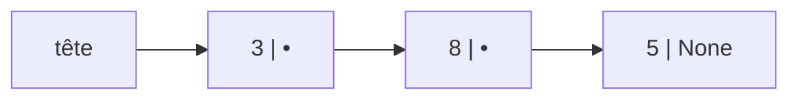

En première, le tableau Python servait à tout. En terminale, on étudie des structures plus spécialisées, définies par ce qu'on peut faire avec
elles : la **liste**, la **pile** et la **file**. On distingue soigneusement leur **interface** (les opérations disponibles) de leur
**implémentation** (comment on les programme), ce qui prolonge directement le chapitre sur les objets.

## Ce que dit le programme

Contenus : *structures de données, interface et implémentation ; listes, piles, files*. Capacités attendues : **spécifier une structure de
données par son interface** ; **distinguer interface et implémentation** ; **écrire plusieurs implémentations d'une même structure de
données** ; **distinguer des structures par le jeu des méthodes qui les caractérisent** ; **choisir une structure de données adaptée** à la
situation à modéliser.

## 1. Type abstrait : interface et implémentation

Un **type abstrait** est défini par ses **opérations** et ce qu'elles font. Par exemple, une **pile** :

| Opération | Effet |
| --- | --- |
| `creer_pile()` | renvoie une pile vide |
| `est_vide(p)` | `True` si la pile est vide |
| `empiler(p, x)` | ajoute x au **sommet** |
| `depiler(p)` | retire l'élément du sommet et le renvoie (pile non vide) |

C'est l'**interface**. Elle ne dit pas **comment** la pile est rangée en mémoire : c'est l'**implémentation**, qu'on peut choisir et changer
sans modifier les programmes qui utilisent la pile.

## 2. La liste chaînée

Une **liste chaînée** est formée de **maillons** : chacun contient une **valeur** et une référence vers le **maillon suivant**. Le dernier
pointe vers `None`.



```python exec
class Maillon:
    def __init__(self, valeur, suivant=None):
        self.valeur = valeur
        self.suivant = suivant

# la liste 3 -> 8 -> 5
tete = Maillon(3, Maillon(8, Maillon(5)))

def longueur(m):
    n = 0
    while m is not None:
        n = n + 1
        m = m.suivant
    return n

def afficher(m):
    valeurs = []
    while m is not None:
        valeurs.append(str(m.valeur))
        m = m.suivant
    return " -> ".join(valeurs)

print(afficher(tete), "| longueur :", longueur(tete))
tete = Maillon(1, tete)             # ajout en tête : immédiat
print(afficher(tete))
```

Comparaison avec un tableau :

| Opération | Tableau | Liste chaînée |
| --- | --- | --- |
| lire le i-ème élément | immédiat | parcourir i maillons (linéaire) |
| ajouter en tête | décaler tous les éléments (linéaire) | immédiat |
| ajouter à la fin | immédiat (en Python, `append`) | parcourir jusqu'au bout (linéaire), sauf si on garde un lien vers le dernier |

Le parcours d'une liste chaînée est aussi l'occasion d'écrire des fonctions **récursives** : `longueur(m)` vaut 0 si `m` est `None`, sinon
1 + `longueur(m.suivant)`.

## 3. La pile (LIFO)

Une **pile** fonctionne comme une pile d'assiettes : on ajoute et on retire **au sommet**. Le dernier entré est le premier sorti : **LIFO**
(*Last In, First Out*).

```python exec
class Pile:
    def __init__(self):
        self._contenu = []          # le sommet est la fin du tableau

    def est_vide(self):
        return len(self._contenu) == 0

    def empiler(self, x):
        self._contenu.append(x)

    def depiler(self):
        assert not self.est_vide(), "pile vide"
        return self._contenu.pop()

    def sommet(self):
        assert not self.est_vide(), "pile vide"
        return self._contenu[-1]

p = Pile()
for x in [1, 2, 3]:
    p.empiler(x)
print(p.depiler(), p.depiler(), p.sommet())
```

Autre implémentation, avec des maillons : le sommet est la **tête** de la liste chaînée.

```python exec
class Maillon:
    def __init__(self, valeur, suivant=None):
        self.valeur = valeur
        self.suivant = suivant

class PileChainee:
    def __init__(self):
        self._sommet = None

    def est_vide(self):
        return self._sommet is None

    def empiler(self, x):
        self._sommet = Maillon(x, self._sommet)

    def depiler(self):
        assert not self.est_vide(), "pile vide"
        x = self._sommet.valeur
        self._sommet = self._sommet.suivant
        return x

p = PileChainee()
for x in [1, 2, 3]:
    p.empiler(x)
print(p.depiler(), p.depiler())
```

Les deux classes ont la **même interface** : un programme qui utilise une pile marche avec l'une comme avec l'autre.

**Applications** : la fonction « annuler » d'un logiciel, le bouton « précédent » du navigateur, la vérification des parenthèses, l'évaluation
d'expressions, la **pile d'appels** des fonctions (vue avec la récursivité), le parcours en profondeur d'un graphe.

## 4. La file (FIFO)

Une **file** fonctionne comme une file d'attente : on ajoute à la **fin**, on retire au **début**. Le premier entré est le premier sorti :
**FIFO** (*First In, First Out*).

| Opération | Effet |
| --- | --- |
| `est_vide()` | `True` si la file est vide |
| `enfiler(x)` | ajoute x à la fin |
| `defiler()` | retire le premier élément et le renvoie |

Implémentation astucieuse avec **deux piles** : on enfile sur une pile `entree` ; pour défiler, si la pile `sortie` est vide, on y verse
toute la pile `entree` (ce qui inverse l'ordre), puis on dépile `sortie`.

```python exec
class File:
    def __init__(self):
        self._entree = []
        self._sortie = []

    def est_vide(self):
        return len(self._entree) == 0 and len(self._sortie) == 0

    def enfiler(self, x):
        self._entree.append(x)

    def defiler(self):
        assert not self.est_vide(), "file vide"
        if len(self._sortie) == 0:
            while len(self._entree) > 0:
                self._sortie.append(self._entree.pop())
        return self._sortie.pop()

f = File()
for x in "ABC":
    f.enfiler(x)
print(f.defiler(), f.defiler())
f.enfiler("D")
print(f.defiler(), f.defiler())
```

Chaque élément n'est transvasé qu'**une fois** : en moyenne, enfiler et défiler sont rapides, contrairement à `pop(0)` sur un tableau qui décale
tous les éléments.

**Applications** : file d'impression, file des processus prêts dans un système d'exploitation, mémoire tampon (clavier, réseau), parcours en
largeur d'un graphe.

## 5. Choisir la bonne structure

| Besoin | Structure |
| --- | --- |
| accéder à n'importe quel élément par sa position | tableau |
| traiter **le plus récent** d'abord (annuler, revenir en arrière) | pile |
| traiter dans l'**ordre d'arrivée** | file |
| ajouter et retirer souvent en tête, taille très variable | liste chaînée |
| retrouver une valeur par une clé | dictionnaire |

## Les erreurs classiques des élèves

:::attention[Ce que tu verras en classe]
- **Confondre pile et file** (LIFO et FIFO).
- **Dépiler une pile vide** sans tester `est_vide`.
- **Perdre la tête** d'une liste chaînée en la parcourant avec la variable `tete` elle-même.
- **Oublier le cas `None`** dans un parcours de maillons (`AttributeError: 'NoneType' object has no attribute 'valeur'`).
- **Utiliser l'implémentation au lieu de l'interface** (`p._contenu[0]` au lieu des méthodes).
- **Croire qu'une liste Python est une liste chaînée** : c'est un tableau dynamique.
:::

## En classe

:::methode[Activités qui marchent]
1. **Objets réels** : une pile d'assiettes ou de livres, une file d'élèves ; jouer les opérations.
2. **Maillons en papier** reliés par des ficelles : insérer, supprimer, parcourir.
3. **Parenthésage** : vérifier `(a + [b * c]) - {d}` avec une pile.
4. **Deux implémentations** de la même pile, échangées entre binômes : le programme de test doit fonctionner avec les deux.
:::

## L'essentiel

- **Type abstrait** = interface (opérations et effets) ; **implémentation** = programmation concrète, interchangeable.
- **Liste chaînée** : maillons (valeur, suivant) ; ajout en tête immédiat, accès au i-ème linéaire.
- **Pile** = **LIFO** : `empiler`, `depiler` au sommet ; annuler, parenthèses, appels de fonctions.
- **File** = **FIFO** : `enfiler` à la fin, `defiler` au début ; files d'attente, parcours en largeur ; implémentable avec deux piles.
- Choisir la structure selon l'**ordre** dans lequel on traite les données.

## Exercices

::::exercice[Grand QCM : listes, piles, files]{niveau=1 type=quiz}
Douze questions sur les structures linéaires.

1. Une pile fonctionne selon le principe :

   - [ ] FIFO
   - [x] LIFO
   - [ ] trié
   - [ ] aléatoire

   > Dernier entré, premier sorti.

1. On empile 1, 2, 3 puis on dépile une fois. Quel élément obtient-on ?

   - [ ] 1
   - [ ] 2
   - [x] 3
   - [ ] la pile entière

   > Le sommet est le dernier élément empilé.

1. On enfile A, B, C dans une file puis on défile une fois. Quel élément obtient-on ?

   - [x] A
   - [ ] B
   - [ ] C
   - [ ] rien

   > Premier entré, premier sorti.

1. Quelle structure pour la fonction « annuler » d'un traitement de texte ?

   - [x] une pile
   - [ ] une file
   - [ ] un dictionnaire
   - [ ] un tableau trié

   > On annule d'abord la dernière action.

1. Quelle structure pour une file d'impression ?

   - [ ] une pile
   - [x] une file
   - [ ] un arbre
   - [ ] un ensemble

   > Les documents sont imprimés dans l'ordre d'arrivée.

1. Que contient un maillon d'une liste chaînée ?

   - [ ] seulement une valeur
   - [x] une valeur et une référence vers le maillon suivant
   - [ ] l'indice du maillon
   - [ ] la longueur de la liste

   > Le dernier maillon a `None` pour suivant.

1. Quel est le coût de l'accès au i-ème élément d'une liste chaînée ?

   - [ ] immédiat
   - [x] linéaire : il faut parcourir i maillons
   - [ ] quadratique
   - [ ] logarithmique

   > Contrairement au tableau, pas d'accès direct.

1. Quelle opération est immédiate sur une liste chaînée et coûteuse sur un tableau ?

   - [ ] lire le dernier élément
   - [x] ajouter un élément en tête
   - [ ] lire le i-ème élément
   - [ ] connaître la longueur

   > Dans un tableau, il faut décaler tous les éléments.

1. Qu'appelle-t-on l'interface d'une structure de données ?

   - [ ] son code Python
   - [x] l'ensemble de ses opérations et de leur effet
   - [ ] son affichage à l'écran
   - [ ] la mémoire qu'elle occupe

   > L'implémentation, elle, est le code.

1. On enfile 1, 2, 3 dans une file implémentée avec deux piles, puis on défile. Que contient la pile de sortie après ce défilement ?

   - [ ] [1, 2, 3]
   - [x] [3, 2] (sommet 2)
   - [ ] [2, 3]
   - [ ] elle est vide

   > On a versé 3, 2, 1 dans la sortie, puis dépilé 1.

1. Quelle structure sert à vérifier qu'une expression est bien parenthésée ?

   - [x] une pile
   - [ ] une file
   - [ ] un dictionnaire
   - [ ] une liste triée

   > Chaque parenthèse fermante doit correspondre à la dernière ouvrante.

1. Que provoque `m.valeur` si `m` vaut `None` ?

   - [ ] `None`
   - [ ] 0
   - [x] une `AttributeError`
   - [ ] une `IndexError`

   > Il faut tester `m is not None` avant d'accéder au maillon.
::::

::::exercice[Fonctions sur une liste chaînée]{niveau=1}
Avec la classe `Maillon` fournie, écris `somme(m)` (somme des valeurs), `contient(m, x)` et `vers_tableau(m)` qui renvoie le tableau Python des
valeurs dans l'ordre. `m` est le premier maillon, ou `None` pour une liste vide.

```python depart
class Maillon:
    def __init__(self, valeur, suivant=None):
        self.valeur = valeur
        self.suivant = suivant

def somme(m):
    ...

def contient(m, x):
    ...

def vers_tableau(m):
    ...
```

```python tests
l = Maillon(3, Maillon(8, Maillon(5)))
assert somme(l) == 16, "somme"
assert somme(None) == 0, "liste vide"
assert contient(l, 8) and not contient(l, 4), "contient"
assert vers_tableau(l) == [3, 8, 5], "conversion"
assert vers_tableau(None) == [], "vide"
```

:::corrige
```python solution
class Maillon:
    def __init__(self, valeur, suivant=None):
        self.valeur = valeur
        self.suivant = suivant

def somme(m):
    s = 0
    while m is not None:
        s = s + m.valeur
        m = m.suivant
    return s

def contient(m, x):
    while m is not None:
        if m.valeur == x:
            return True
        m = m.suivant
    return False

def vers_tableau(m):
    t = []
    while m is not None:
        t.append(m.valeur)
        m = m.suivant
    return t
```

Le schéma est toujours le même : `while m is not None:` … `m = m.suivant`. On modifie la variable locale `m`, pas la liste.
:::
::::

::::exercice[Bien parenthésé ?]{niveau=2}
Écris `bien_parenthese(texte)` qui renvoie `True` si les parenthèses `()`, crochets `[]` et accolades `{}` du texte sont correctement
appariés et imbriqués. Utilise une pile (un tableau avec `append` et `pop` suffit). Les autres caractères sont ignorés.

```python depart
def bien_parenthese(texte):
    ...
```

```python tests
assert bien_parenthese("(a + [b * c]) - {d}"), "correct"
assert not bien_parenthese("(a + b]"), "mauvais type"
assert not bien_parenthese("([)]"), "mauvaise imbrication"
assert not bien_parenthese("((a)"), "ouvrante en trop"
assert not bien_parenthese("a)"), "fermante en trop"
assert bien_parenthese(""), "vide"
```

:::corrige
```python solution
def bien_parenthese(texte):
    paires = {")": "(", "]": "[", "}": "{"}
    pile = []
    for c in texte:
        if c in "([{":
            pile.append(c)
        elif c in ")]}":
            if len(pile) == 0 or pile.pop() != paires[c]:
                return False
    return len(pile) == 0
```

Chaque fermante doit correspondre à la **dernière** ouvrante encore ouverte : c'est le sommet de la pile. À la fin, la pile doit être vide
(sinon une ouvrante n'a jamais été fermée).
:::
::::

::::exercice[Une pile avec des maillons]{niveau=2}
Écris une classe `Pile` implémentée avec des maillons (sans tableau Python), avec `est_vide()`, `empiler(x)`, `depiler()`, `sommet()` et
`taille()`. Pour que `taille` soit immédiate, garde un attribut compteur.

```python depart
class Maillon:
    def __init__(self, valeur, suivant=None):
        self.valeur = valeur
        self.suivant = suivant

class Pile:
    ...
```

```python tests
p = Pile()
assert p.est_vide() and p.taille() == 0, "vide"
p.empiler(4); p.empiler(7)
assert p.sommet() == 7 and p.taille() == 2, "sommet et taille"
assert p.depiler() == 7 and p.depiler() == 4, "LIFO"
assert p.est_vide(), "vide à la fin"
```

:::corrige
```python solution
class Maillon:
    def __init__(self, valeur, suivant=None):
        self.valeur = valeur
        self.suivant = suivant

class Pile:
    def __init__(self):
        self._sommet = None
        self._taille = 0

    def est_vide(self):
        return self._sommet is None

    def empiler(self, x):
        self._sommet = Maillon(x, self._sommet)
        self._taille = self._taille + 1

    def depiler(self):
        assert not self.est_vide(), "pile vide"
        x = self._sommet.valeur
        self._sommet = self._sommet.suivant
        self._taille = self._taille - 1
        return x

    def sommet(self):
        assert not self.est_vide(), "pile vide"
        return self._sommet.valeur

    def taille(self):
        return self._taille
```

Empiler crée un maillon qui pointe vers l'ancien sommet ; dépiler fait avancer le sommet d'un cran. Toutes les opérations sont immédiates.
:::
::::

::::exercice[Simuler une file d'attente]{niveau=2}
Au guichet de la cantine, on reçoit une suite d'événements : un nom (un élève arrive et se met au bout de la file) ou `"servir"` (le premier
de la file est servi). Écris `ordre_service(evenements)` qui renvoie la liste des élèves dans l'ordre où ils sont servis, en utilisant la classe
`File` fournie. Un `"servir"` sur une file vide est ignoré.

```python depart
class File:
    def __init__(self):
        self._entree = []
        self._sortie = []

    def est_vide(self):
        return len(self._entree) == 0 and len(self._sortie) == 0

    def enfiler(self, x):
        self._entree.append(x)

    def defiler(self):
        if len(self._sortie) == 0:
            while len(self._entree) > 0:
                self._sortie.append(self._entree.pop())
        return self._sortie.pop()

def ordre_service(evenements):
    ...
```

```python tests
ev = ["Léa", "Tom", "servir", "Ana", "servir", "servir", "servir"]
assert ordre_service(ev) == ["Léa", "Tom", "Ana"], "ordre d'arrivée"
assert ordre_service(["servir"]) == [], "file vide"
assert ordre_service(["A", "B", "C"]) == [], "personne servi"
```

:::corrige
```python solution
class File:
    def __init__(self):
        self._entree = []
        self._sortie = []

    def est_vide(self):
        return len(self._entree) == 0 and len(self._sortie) == 0

    def enfiler(self, x):
        self._entree.append(x)

    def defiler(self):
        if len(self._sortie) == 0:
            while len(self._entree) > 0:
                self._sortie.append(self._entree.pop())
        return self._sortie.pop()

def ordre_service(evenements):
    f = File()
    servis = []
    for e in evenements:
        if e == "servir":
            if not f.est_vide():
                servis.append(f.defiler())
        else:
            f.enfiler(e)
    return servis
```

`ordre_service` n'utilise que l'**interface** de la file : on pourrait changer son implémentation sans y toucher.
:::
::::

::::exercice[Pile ou file ?]{niveau=1}
Pour chaque situation, indique s'il faut une pile ou une file, et justifie : (a) l'historique du bouton « précédent » d'un navigateur ; (b) les
requêtes reçues par un serveur Web ; (c) les appels de fonctions en cours d'un programme ; (d) les messages envoyés à une imprimante partagée ;
(e) l'exploration d'un labyrinthe en revenant au dernier carrefour quand on est bloqué.

:::criteres
- (a) pile, (b) file, (c) pile, (d) file, (e) pile.
- Chaque justification parle de l'ordre de traitement : le plus récent d'abord (pile) ou dans l'ordre d'arrivée (file).
:::

:::corrige
(a) **Pile** : « précédent » ramène à la page la plus **récente**. (b) **File** : les requêtes sont traitées dans leur **ordre d'arrivée**,
pour être équitable. (c) **Pile** : la fonction appelée en **dernier** est la première à se terminer (c'est la pile d'appels). (d) **File** :
premier document envoyé, premier imprimé. (e) **Pile** : on revient au **dernier** carrefour rencontré ; c'est le parcours en profondeur
d'un graphe. Règle : le plus récent d'abord, pile ; le plus ancien d'abord, file.
:::
::::
