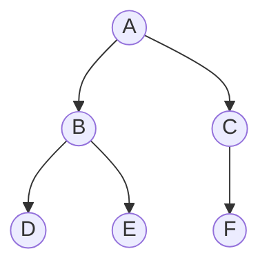

Arborescence des fichiers, page HTML (le DOM), arbre généalogique, tournoi sportif, expression mathématique : les **arbres** sont partout dès
que des données sont **hiérarchisées**. En terminale, on étudie surtout les **arbres binaires**, et on découvre que la **récursivité** est l'outil
naturel pour les manipuler : un arbre est fait d'une racine et de… sous-arbres.

## Ce que dit le programme

Contenus : *arbres : structures hiérarchiques ; arbres binaires : nœuds, racines, feuilles, sous-arbres gauches, sous-arbres droits* ;
*algorithmes sur les arbres binaires*. Capacités attendues : **identifier des situations nécessitant une structure de données arborescente** ;
**évaluer quelques mesures des arbres binaires (taille, encadrement de la hauteur)** ; **calculer la taille et la hauteur d'un arbre** ;
**parcourir un arbre de différentes façons** (ordres infixe, préfixe ou suffixe ; ordre en largeur d'abord). Le programme précise qu'on
fait le lien avec la récursivité.

## 1. Vocabulaire



- **A** est la **racine** (pas de parent).
- **B** et **C** sont les **enfants** (ou fils) de A ; A est leur **parent**.
- **D**, **E** et **F** sont des **feuilles** (pas d'enfant) ; A, B, C sont des **nœuds internes**.
- Le **sous-arbre** de racine B contient B, D et E.
- La **taille** est le nombre de nœuds : 6.
- La **profondeur** d'un nœud est le nombre de nœuds de la racine jusqu'à lui (A : 1, B : 2, D : 3). La **hauteur** de l'arbre est la plus
  grande profondeur : 3.

:::attention[Conventions]
Selon les sujets, la hauteur d'un arbre réduit à sa racine vaut **1** (on compte les nœuds, convention retenue ici) ou **0** (on compte les
arêtes). Toujours lire la définition donnée dans l'énoncé.
:::

## 2. Arbres binaires

Un **arbre binaire** est soit **vide**, soit formé d'une **racine** et de deux arbres binaires : le **sous-arbre gauche** et le **sous-arbre
droit**. Cette définition est **récursive**.

On le représente en Python avec une classe ; l'arbre vide est `None` :

```python exec
class Noeud:
    def __init__(self, valeur, gauche=None, droit=None):
        self.valeur = valeur
        self.gauche = gauche
        self.droit = droit

#        A
#      /   \
#     B     C
#    / \     \
#   D   E     F
arbre = Noeud("A",
              Noeud("B", Noeud("D"), Noeud("E")),
              Noeud("C", None, Noeud("F")))
print(arbre.valeur, arbre.gauche.valeur, arbre.gauche.droit.valeur)
```

**Encadrement de la hauteur** : un arbre binaire de hauteur h a au plus 2ʰ − 1 nœuds (s'il est **complet**, tous les niveaux remplis) et au
moins h nœuds (s'il est **filiforme**, une seule branche). Pour n nœuds, la hauteur est donc comprise entre environ log₂(n) et n.

## 3. Taille et hauteur, en récursif

La définition récursive de l'arbre donne directement les algorithmes :

```python exec
class Noeud:
    def __init__(self, valeur, gauche=None, droit=None):
        self.valeur = valeur
        self.gauche = gauche
        self.droit = droit

def taille(a):
    if a is None:
        return 0
    return 1 + taille(a.gauche) + taille(a.droit)

def hauteur(a):
    if a is None:
        return 0
    return 1 + max(hauteur(a.gauche), hauteur(a.droit))

def nb_feuilles(a):
    if a is None:
        return 0
    if a.gauche is None and a.droit is None:
        return 1
    return nb_feuilles(a.gauche) + nb_feuilles(a.droit)

arbre = Noeud("A", Noeud("B", Noeud("D"), Noeud("E")), Noeud("C", None, Noeud("F")))
print(taille(arbre), hauteur(arbre), nb_feuilles(arbre))
```

Le schéma est toujours le même : **cas de base** pour l'arbre vide, puis on combine les résultats des **deux sous-arbres**.

## 4. Les parcours en profondeur

Parcourir un arbre, c'est visiter tous ses nœuds. Les parcours **en profondeur** descendent le plus loin possible avant de revenir. Ils se
distinguent par le moment où l'on traite la racine :

| Parcours | Ordre | Sur l'exemple |
| --- | --- | --- |
| **préfixe** | racine, gauche, droit | A B D E C F |
| **infixe** | gauche, racine, droit | D B E A C F |
| **suffixe** (postfixe) | gauche, droit, racine | D E B F C A |

```python exec
class Noeud:
    def __init__(self, valeur, gauche=None, droit=None):
        self.valeur = valeur
        self.gauche = gauche
        self.droit = droit

def prefixe(a):
    if a is None:
        return []
    return [a.valeur] + prefixe(a.gauche) + prefixe(a.droit)

def infixe(a):
    if a is None:
        return []
    return infixe(a.gauche) + [a.valeur] + infixe(a.droit)

def suffixe(a):
    if a is None:
        return []
    return suffixe(a.gauche) + suffixe(a.droit) + [a.valeur]

arbre = Noeud("A", Noeud("B", Noeud("D"), Noeud("E")), Noeud("C", None, Noeud("F")))
print(prefixe(arbre), infixe(arbre), suffixe(arbre))
```

:::methode[Astuce pour les trouver à la main]
On fait le tour de l'arbre en longeant les branches, en partant à gauche de la racine. On note un nœud quand on passe **à sa gauche**
(préfixe), **dessous** (infixe) ou **à sa droite** (suffixe).
:::

Exemple d'usage : dans l'arbre de l'expression `(3 + 4) × 2`, le parcours **suffixe** donne `3 4 + 2 ×`, la notation polonaise inverse qu'une
calculatrice évalue avec une pile.

## 5. Le parcours en largeur

Le parcours **en largeur** visite les nœuds **niveau par niveau**, de gauche à droite : A B C D E F. Il utilise une **file** : on enfile la
racine ; puis, tant que la file n'est pas vide, on défile un nœud, on le traite et on enfile ses enfants.

```python exec
class Noeud:
    def __init__(self, valeur, gauche=None, droit=None):
        self.valeur = valeur
        self.gauche = gauche
        self.droit = droit

def largeur(a):
    resultat = []
    file = []
    if a is not None:
        file.append(a)
    while len(file) > 0:
        n = file.pop(0)
        resultat.append(n.valeur)
        if n.gauche is not None:
            file.append(n.gauche)
        if n.droit is not None:
            file.append(n.droit)
    return resultat

arbre = Noeud("A", Noeud("B", Noeud("D"), Noeud("E")), Noeud("C", None, Noeud("F")))
print(largeur(arbre))
```

## Les erreurs classiques des élèves

:::attention[Ce que tu verras en classe]
- **Oublier le cas de base** `if a is None` : `AttributeError` sur les feuilles.
- **Confondre taille et hauteur.**
- **Se tromper de convention** pour la hauteur (compter les arêtes ou les nœuds).
- **Mélanger les ordres** préfixe, infixe, suffixe ; ou traiter le sous-arbre droit avant le gauche.
- **Utiliser une pile** au lieu d'une file pour le parcours en largeur (on obtient un parcours en profondeur).
- **Croire qu'un nœud a toujours deux enfants** dans un arbre binaire.
:::

## En classe

:::methode[Activités qui marchent]
1. **Arbres familiers** : arborescence de fichiers, DOM d'une page Web (outils de développement), tableau d'un tournoi.
2. **Dessiner** des arbres à partir de leurs parcours, et l'inverse.
3. **Arbre d'expression** : construire l'arbre de `(3 + 4) × (5 − 2)`, l'évaluer récursivement.
4. **Visualiser** la récursion de `hauteur` avec Python Tutor.
:::

## L'essentiel

- **Vocabulaire** : racine, nœud, enfant, parent, feuille, sous-arbre ; **taille** = nombre de nœuds ; **hauteur** = plus grande profondeur
  (lire la convention).
- **Arbre binaire** : vide, ou racine + sous-arbre gauche + sous-arbre droit ; en Python, `Noeud(valeur, gauche, droit)` et `None`.
- Hauteur h : au plus 2ʰ − 1 nœuds ; pour n nœuds, hauteur entre ≈ log₂(n) et n.
- **Récursivité** : cas de base `None`, puis combinaison des deux sous-arbres.
- Parcours **préfixe** (R G D), **infixe** (G R D), **suffixe** (G D R) ; **largeur** niveau par niveau avec une **file**.

## Exercices

::::exercice[Grand QCM : arbres]{niveau=1 type=quiz}
Douze questions sur les arbres binaires. On utilise l'arbre du cours : A a pour enfants B et C ; B a pour enfants D et E ; C a un seul
enfant droit F.

1. Quelle est la racine de l'arbre ?

   - [x] A
   - [ ] B
   - [ ] F
   - [ ] il n'y en a pas

   > Le seul nœud sans parent.

1. Quelles sont les feuilles ?

   - [ ] A, B, C
   - [x] D, E, F
   - [ ] B et C
   - [ ] seulement F

   > Les nœuds sans enfant.

1. Quelle est la taille de l'arbre ?

   - [ ] 3
   - [ ] 5
   - [x] 6
   - [ ] 7

   > Six nœuds.

1. Quelle est sa hauteur (en comptant les nœuds, racine seule = 1) ?

   - [ ] 2
   - [x] 3
   - [ ] 4
   - [ ] 6

   > Le chemin le plus long est A, B, D (ou A, C, F).

1. Quel est le parcours préfixe ?

   - [x] A B D E C F
   - [ ] D B E A C F
   - [ ] D E B F C A
   - [ ] A B C D E F

   > Racine, puis sous-arbre gauche, puis droit.

1. Quel est le parcours infixe ?

   - [ ] A B D E C F
   - [x] D B E A C F
   - [ ] D E B F C A
   - [ ] A B C D E F

   > Gauche, racine, droit.

1. Quel est le parcours suffixe ?

   - [ ] A B D E C F
   - [ ] D B E A C F
   - [x] D E B F C A
   - [ ] F E D C B A

   > Gauche, droit, racine : la racine est toujours en dernier.

1. Quel est le parcours en largeur ?

   - [ ] A B D E C F
   - [x] A B C D E F
   - [ ] D E F B C A
   - [ ] A C B F E D

   > Niveau par niveau, de gauche à droite.

1. Quelle structure utilise le parcours en largeur ?

   - [ ] une pile
   - [x] une file
   - [ ] un dictionnaire
   - [ ] un tableau trié

   > Les nœuds sont traités dans l'ordre où on les découvre.

1. Combien de nœuds au plus dans un arbre binaire de hauteur 4 ?

   - [ ] 4
   - [ ] 8
   - [x] 15
   - [ ] 16

   > 2⁴ − 1 = 1 + 2 + 4 + 8.

1. Que vaut `taille(None)` avec la fonction du cours ?

   - [x] 0
   - [ ] 1
   - [ ] `None`
   - [ ] une erreur

   > C'est le cas de base.

1. Dans un arbre binaire, chaque nœud a :

   - [ ] exactement deux enfants
   - [x] au plus deux enfants
   - [ ] au moins un enfant
   - [ ] un nombre quelconque d'enfants

   > Un ou deux sous-arbres peuvent être vides.
::::

::::exercice[Mesures d'un arbre]{niveau=1}
Avec la classe `Noeud` fournie, écris `taille(a)`, `hauteur(a)` (arbre vide : 0, racine seule : 1) et `somme(a)`, la somme des valeurs (des
nombres) de l'arbre.

```python depart
class Noeud:
    def __init__(self, valeur, gauche=None, droit=None):
        self.valeur = valeur
        self.gauche = gauche
        self.droit = droit

def taille(a):
    ...

def hauteur(a):
    ...

def somme(a):
    ...
```

```python tests
a = Noeud(5, Noeud(3, Noeud(1), Noeud(4)), Noeud(8, None, Noeud(9)))
assert taille(a) == 6, "taille"
assert hauteur(a) == 3, "hauteur"
assert somme(a) == 30, "somme"
assert taille(None) == 0 and hauteur(None) == 0 and somme(None) == 0, "arbre vide"
filiforme = Noeud(1, Noeud(2, Noeud(3, Noeud(4))))
assert hauteur(filiforme) == 4 and taille(filiforme) == 4, "arbre filiforme"
```

:::corrige
```python solution
class Noeud:
    def __init__(self, valeur, gauche=None, droit=None):
        self.valeur = valeur
        self.gauche = gauche
        self.droit = droit

def taille(a):
    if a is None:
        return 0
    return 1 + taille(a.gauche) + taille(a.droit)

def hauteur(a):
    if a is None:
        return 0
    return 1 + max(hauteur(a.gauche), hauteur(a.droit))

def somme(a):
    if a is None:
        return 0
    return a.valeur + somme(a.gauche) + somme(a.droit)
```

Trois fonctions, un seul schéma : cas de base `None`, puis combinaison des résultats des deux sous-arbres.
:::
::::

::::exercice[Les trois parcours]{niveau=2}
Écris `prefixe(a)`, `infixe(a)` et `suffixe(a)` qui renvoient la liste des valeurs dans l'ordre de chaque parcours.

```python depart
class Noeud:
    def __init__(self, valeur, gauche=None, droit=None):
        self.valeur = valeur
        self.gauche = gauche
        self.droit = droit

def prefixe(a):
    ...

def infixe(a):
    ...

def suffixe(a):
    ...
```

```python tests
a = Noeud("A", Noeud("B", Noeud("D"), Noeud("E")), Noeud("C", None, Noeud("F")))
assert prefixe(a) == ["A", "B", "D", "E", "C", "F"], "préfixe"
assert infixe(a) == ["D", "B", "E", "A", "C", "F"], "infixe"
assert suffixe(a) == ["D", "E", "B", "F", "C", "A"], "suffixe"
assert prefixe(None) == [] and infixe(None) == [] and suffixe(None) == [], "vide"
```

:::corrige
```python solution
class Noeud:
    def __init__(self, valeur, gauche=None, droit=None):
        self.valeur = valeur
        self.gauche = gauche
        self.droit = droit

def prefixe(a):
    if a is None:
        return []
    return [a.valeur] + prefixe(a.gauche) + prefixe(a.droit)

def infixe(a):
    if a is None:
        return []
    return infixe(a.gauche) + [a.valeur] + infixe(a.droit)

def suffixe(a):
    if a is None:
        return []
    return suffixe(a.gauche) + suffixe(a.droit) + [a.valeur]
```

Seule la **place** de `[a.valeur]` change d'un parcours à l'autre.
:::
::::

::::exercice[Évaluer une expression]{niveau=2}
Une expression arithmétique est représentée par un arbre binaire : les feuilles sont des nombres, les nœuds internes des opérateurs `"+"`,
`"-"`, `"*"`. Écris `evaluer(a)` qui calcule la valeur de l'expression.

```python depart
class Noeud:
    def __init__(self, valeur, gauche=None, droit=None):
        self.valeur = valeur
        self.gauche = gauche
        self.droit = droit

def evaluer(a):
    ...
```

```python tests
# (3 + 4) * (5 - 2)
e = Noeud("*", Noeud("+", Noeud(3), Noeud(4)), Noeud("-", Noeud(5), Noeud(2)))
assert evaluer(e) == 21, "expression complète"
assert evaluer(Noeud(7)) == 7, "un seul nombre"
assert evaluer(Noeud("-", Noeud(2), Noeud(10))) == -8, "soustraction"
```

:::corrige
```python solution
class Noeud:
    def __init__(self, valeur, gauche=None, droit=None):
        self.valeur = valeur
        self.gauche = gauche
        self.droit = droit

def evaluer(a):
    if a.gauche is None and a.droit is None:
        return a.valeur
    g = evaluer(a.gauche)
    d = evaluer(a.droit)
    if a.valeur == "+":
        return g + d
    if a.valeur == "-":
        return g - d
    return g * d
```

C'est un parcours **suffixe** : on évalue les deux sous-arbres avant d'appliquer l'opérateur de la racine. Ici, le cas de base est la
**feuille** (un arbre d'expression n'est jamais vide).
:::
::::

::::exercice[Parcours en largeur]{niveau=2}
Écris `par_niveaux(a)` qui renvoie la liste des niveaux de l'arbre, chaque niveau étant la liste de ses valeurs de gauche à droite. Par
exemple, pour l'arbre du cours : `[["A"], ["B", "C"], ["D", "E", "F"]]`.

```python depart
class Noeud:
    def __init__(self, valeur, gauche=None, droit=None):
        self.valeur = valeur
        self.gauche = gauche
        self.droit = droit

def par_niveaux(a):
    ...
```

```python tests
a = Noeud("A", Noeud("B", Noeud("D"), Noeud("E")), Noeud("C", None, Noeud("F")))
assert par_niveaux(a) == [["A"], ["B", "C"], ["D", "E", "F"]], "trois niveaux"
assert par_niveaux(None) == [], "vide"
assert par_niveaux(Noeud(1, None, Noeud(2))) == [[1], [2]], "deux niveaux"
```

:::corrige
```python solution
class Noeud:
    def __init__(self, valeur, gauche=None, droit=None):
        self.valeur = valeur
        self.gauche = gauche
        self.droit = droit

def par_niveaux(a):
    niveaux = []
    courant = []
    if a is not None:
        courant.append(a)
    while len(courant) > 0:
        niveaux.append([n.valeur for n in courant])
        suivant = []
        for n in courant:
            if n.gauche is not None:
                suivant.append(n.gauche)
            if n.droit is not None:
                suivant.append(n.droit)
        courant = suivant
    return niveaux
```

On traite les nœuds niveau par niveau : la liste `courant` joue le rôle de la file, en traitant tout un niveau à la fois.
:::
::::

::::exercice[Reconstituer un arbre]{niveau=2}
Un arbre binaire a pour parcours préfixe `R A C D B E` et pour parcours infixe `C A D R E B`. (a) Dessine-le en expliquant ta démarche.
(b) Donne son parcours suffixe et sa hauteur.

:::criteres
- Démarche : le premier élément du préfixe est la racine ; dans l'infixe, ce qui est à sa gauche forme le sous-arbre gauche, le reste le
  sous-arbre droit ; on recommence.
- Arbre correct : R ; à gauche A (enfants C et D) ; à droite B (enfant gauche E).
- Suffixe : C D A E B R ; hauteur 3 (en comptant les nœuds).
:::

:::corrige
(a) Le préfixe commence par la racine : **R**. Dans l'infixe `C A D | R | E B`, les nœuds à gauche de R (C, A, D) forment le sous-arbre gauche,
ceux à droite (E, B) le sous-arbre droit. Sous-arbre gauche : dans le préfixe, le suivant est **A**, c'est sa racine ; dans l'infixe `C A D`,
C est à gauche de A et D à droite. Sous-arbre droit : le préfixe donne **B** comme racine ; dans l'infixe `E B`, E est à gauche de B.

```
        R
      /   \
     A     B
    / \   /
   C   D E
```

(b) Suffixe : **C D A E B R**. Hauteur : **3** (chemin R, A, C par exemple).
:::
::::
