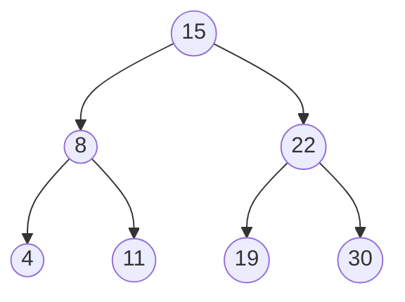

La dichotomie cherche très vite dans un tableau **trié**, mais insérer un élément dans un tableau trié oblige à décaler les autres. Les **arbres
binaires de recherche** (ABR) offrent le meilleur des deux mondes : on y cherche **et** on y insère en descendant une seule branche. Ils sont à
la base des index des bases de données et des dictionnaires ordonnés.

## Ce que dit le programme

Contenus : *arbres binaires de recherche*. Capacités attendues : **rechercher une clé dans un arbre de recherche, insérer une clé**. Le
programme précise qu'une structure de données récursive adaptée est utilisée, et qu'on fait le lien entre le **coût** et la **hauteur**,
en exploitant l'encadrement de la hauteur vu au chapitre sur les arbres.

## 1. Définition

Un **arbre binaire de recherche** est un arbre binaire dont les nœuds portent des **clés** comparables, tel que pour **chaque** nœud :

- toutes les clés de son sous-arbre **gauche** sont **inférieures** à sa clé ;
- toutes les clés de son sous-arbre **droit** sont **supérieures** à sa clé.



:::attention[Pour chaque nœud, tout le sous-arbre]
Il ne suffit pas de comparer chaque nœud à ses deux enfants. Si on remplaçait 11 par 17 dans l'arbre ci-dessus, 17 serait bien plus grand que
son parent 8, mais il serait dans le sous-arbre **gauche** de 15 tout en étant plus grand que 15 : ce ne serait plus un ABR.
:::

On suppose ici que les clés sont **distinctes**.

## 2. Rechercher une clé

À chaque nœud, la comparaison indique **une seule** direction : on élimine tout l'autre sous-arbre, comme la dichotomie élimine une moitié du
tableau.

```python exec
class Noeud:
    def __init__(self, cle, gauche=None, droit=None):
        self.cle = cle
        self.gauche = gauche
        self.droit = droit

def rechercher(a, x):
    """Renvoie True si la clé x est dans l'ABR a."""
    while a is not None:
        if x == a.cle:
            return True
        elif x < a.cle:
            a = a.gauche
        else:
            a = a.droit
    return False

def rechercher_rec(a, x):
    if a is None:
        return False
    if x == a.cle:
        return True
    if x < a.cle:
        return rechercher_rec(a.gauche, x)
    return rechercher_rec(a.droit, x)

abr = Noeud(15, Noeud(8, Noeud(4), Noeud(11)), Noeud(22, Noeud(19), Noeud(30)))
print(rechercher(abr, 19), rechercher(abr, 12), rechercher_rec(abr, 4))
```

Recherche de 19 : 19 > 15, à droite ; 19 < 22, à gauche ; trouvé. Trois comparaisons pour sept clés.

## 3. Insérer une clé

On descend comme pour une recherche ; on arrive sur un emplacement **vide**, où l'on crée une **feuille**. La version récursive renvoie
l'arbre modifié :

```python exec
class Noeud:
    def __init__(self, cle, gauche=None, droit=None):
        self.cle = cle
        self.gauche = gauche
        self.droit = droit

def inserer(a, x):
    """Insère x dans l'ABR a et renvoie l'arbre obtenu."""
    if a is None:
        return Noeud(x)
    if x < a.cle:
        a.gauche = inserer(a.gauche, x)
    elif x > a.cle:
        a.droit = inserer(a.droit, x)
    return a                         # x déjà présent : rien à faire

def infixe(a):
    if a is None:
        return []
    return infixe(a.gauche) + [a.cle] + infixe(a.droit)

abr = None
for x in [15, 8, 22, 4, 11, 19, 30, 12]:
    abr = inserer(abr, x)
print(infixe(abr))
```

12 est descendu : 12 < 15 à gauche, 12 > 8 à droite, 12 > 11 à droite, emplacement vide : il devient l'enfant droit de 11.

## 4. Infixe trié, minimum et maximum

- Le **parcours infixe** d'un ABR (gauche, racine, droit) donne les clés **triées** : c'est une conséquence directe de la définition. Insérer
  des valeurs dans un ABR puis faire un parcours infixe est une façon de **trier**.
- Le **minimum** est le nœud le plus à **gauche** (on descend à gauche tant qu'on peut), le **maximum** le plus à **droite**.

## 5. Le coût dépend de la hauteur

Une recherche ou une insertion suit **une seule branche** : le nombre de comparaisons est au plus la **hauteur** h de l'arbre.

- Si l'arbre est **équilibré** (les branches ont à peu près la même longueur), h ≈ log₂(n) : environ 20 comparaisons pour un million de clés.
- Si l'on insère les clés **dans l'ordre** (1, 2, 3, …), chaque nouvelle clé va à droite de la précédente : l'arbre est **filiforme**, h = n,
  et la recherche devient aussi lente qu'un parcours séquentiel.

```python exec
class Noeud:
    def __init__(self, cle, gauche=None, droit=None):
        self.cle = cle
        self.gauche = gauche
        self.droit = droit

def inserer(a, x):
    if a is None:
        return Noeud(x)
    if x < a.cle:
        a.gauche = inserer(a.gauche, x)
    elif x > a.cle:
        a.droit = inserer(a.droit, x)
    return a

def hauteur(a):
    if a is None:
        return 0
    return 1 + max(hauteur(a.gauche), hauteur(a.droit))

import random
cles = list(range(200))
filiforme = None
for x in cles:
    filiforme = inserer(filiforme, x)
random.seed(1)
random.shuffle(cles)
aleatoire = None
for x in cles:
    aleatoire = inserer(aleatoire, x)
print("ordre croissant :", hauteur(filiforme), "| ordre aléatoire :", hauteur(aleatoire))
```

Il existe des arbres qui se **rééquilibrent** automatiquement (arbres AVL, arbres rouge-noir), hors programme.

## Les erreurs classiques des élèves

:::attention[Ce que tu verras en classe]
- **Vérifier la propriété seulement entre parent et enfants**, pas pour tout le sous-arbre.
- **Descendre du mauvais côté** (à droite pour une clé plus petite).
- **Oublier de rattacher** le résultat de l'appel récursif : `inserer(a.gauche, x)` au lieu de `a.gauche = inserer(a.gauche, x)`.
- **Croire que la recherche est toujours en log₂(n)** : seulement si l'arbre est équilibré.
- **Confondre ABR et tas**, ou croire que le parcours préfixe donne l'ordre trié.
:::

## En classe

:::methode[Activités qui marchent]
1. **Construire à la main** l'ABR obtenu en insérant 50, 30, 70, 20, 40, 60, 80, puis les mêmes valeurs dans l'ordre croissant : comparer
   les formes.
2. **Jeu « plus grand, plus petit »** : l'ABR est l'arbre des questions de la dichotomie.
3. **Vrai ou faux** : des arbres à classer en ABR ou non, dont des pièges où seule la relation parent-enfant est respectée.
4. **Mesurer la hauteur** selon l'ordre d'insertion, en Python.
:::

## L'essentiel

- **ABR** : pour **chaque** nœud, clés du sous-arbre gauche **<** clé **<** clés du sous-arbre droit.
- **Recherche** : comparer à la racine, descendre à gauche ou à droite, jusqu'à trouver ou tomber sur un arbre vide.
- **Insertion** : descendre comme une recherche, créer une **feuille** à l'emplacement vide ; rattacher le résultat récursif.
- Parcours **infixe** = clés **triées** ; minimum tout à gauche, maximum tout à droite.
- Coût = **hauteur** : ≈ log₂(n) si équilibré, n si filiforme (insertions dans l'ordre).

## Exercices

::::exercice[Grand QCM : arbres binaires de recherche]{niveau=1 type=quiz}
Dix questions sur les ABR. On utilise l'ABR du cours : racine 15 ; à gauche 8 (enfants 4 et 11) ; à droite 22 (enfants 19 et 30).

1. Dans un ABR, où se trouvent les clés plus petites que la racine ?

   - [x] dans le sous-arbre gauche
   - [ ] dans le sous-arbre droit
   - [ ] n'importe où
   - [ ] dans les feuilles seulement

   > Par définition, à gauche plus petit, à droite plus grand.

1. Combien de comparaisons pour trouver 11 ?

   - [ ] 1
   - [ ] 2
   - [x] 3
   - [ ] 7

   > 15 (à gauche), 8 (à droite), 11 (trouvé).

1. Où sera insérée la clé 20 ?

   - [ ] enfant gauche de 19
   - [x] enfant droit de 19
   - [ ] enfant gauche de 30
   - [ ] à la racine

   > 20 > 15 à droite, 20 < 22 à gauche, 20 > 19 à droite.

1. Que donne le parcours infixe de cet arbre ?

   - [ ] 15 8 4 11 22 19 30
   - [x] 4 8 11 15 19 22 30
   - [ ] 4 11 8 19 30 22 15
   - [ ] 15 8 22 4 11 19 30

   > Les clés triées.

1. Où se trouve le minimum d'un ABR ?

   - [ ] à la racine
   - [x] au nœud le plus à gauche
   - [ ] dans la feuille la plus à droite
   - [ ] n'importe où

   > On descend à gauche tant que possible.

1. On insère 1, 2, 3, 4, 5 dans cet ordre dans un ABR vide. Quelle est sa hauteur ?

   - [ ] 2
   - [ ] 3
   - [x] 5
   - [ ] 1

   > Chaque clé va à droite de la précédente : arbre filiforme.

1. Quel est le coût d'une recherche dans un ABR de hauteur h ?

   - [ ] toujours log₂(n)
   - [x] au plus h comparaisons
   - [ ] toujours n comparaisons
   - [ ] constant

   > On suit une seule branche.

1. L'arbre de racine 10, d'enfant gauche 5 et dont 5 a pour enfant droit 12, est-il un ABR ?

   - [ ] oui, car 12 > 5
   - [x] non, car 12 est dans le sous-arbre gauche de 10 et 12 > 10
   - [ ] oui, car il est binaire
   - [ ] impossible à dire

   > La propriété porte sur tout le sous-arbre.

1. Un ABR équilibré contient un million de clés. Combien de comparaisons environ pour une recherche ?

   - [ ] un million
   - [ ] 1 000
   - [x] 20
   - [ ] 1

   > Sa hauteur est d'environ log₂(10⁶) ≈ 20.

1. Dans `inserer`, pourquoi écrire `a.gauche = inserer(a.gauche, x)` ?

   - [ ] pour aller plus vite
   - [x] pour rattacher le nouveau nœud quand `a.gauche` était vide
   - [ ] pour supprimer le sous-arbre gauche
   - [ ] ce n'est pas nécessaire

   > Si `a.gauche` vaut `None`, l'appel renvoie le nouveau nœud, qu'il faut accrocher.
::::

::::exercice[Rechercher et insérer]{niveau=1}
Écris `rechercher(a, x)` et `inserer(a, x)` pour un ABR représenté avec la classe `Noeud` fournie. `inserer` renvoie l'arbre et ne fait rien si
x est déjà présent.

```python depart
class Noeud:
    def __init__(self, cle, gauche=None, droit=None):
        self.cle = cle
        self.gauche = gauche
        self.droit = droit

def rechercher(a, x):
    ...

def inserer(a, x):
    ...
```

```python tests
abr = None
for x in [15, 8, 22, 4, 11, 19, 30]:
    abr = inserer(abr, x)
assert abr.cle == 15 and abr.gauche.cle == 8 and abr.droit.droit.cle == 30, "forme"
assert rechercher(abr, 19) and rechercher(abr, 4), "présents"
assert not rechercher(abr, 12) and not rechercher(None, 3), "absents"
abr = inserer(abr, 12)
assert abr.gauche.droit.droit.cle == 12, "12 enfant droit de 11"
abr = inserer(abr, 15)
assert abr.droit.cle == 22 and abr.gauche.cle == 8, "doublon ignoré"
```

:::corrige
```python solution
class Noeud:
    def __init__(self, cle, gauche=None, droit=None):
        self.cle = cle
        self.gauche = gauche
        self.droit = droit

def rechercher(a, x):
    while a is not None:
        if x == a.cle:
            return True
        elif x < a.cle:
            a = a.gauche
        else:
            a = a.droit
    return False

def inserer(a, x):
    if a is None:
        return Noeud(x)
    if x < a.cle:
        a.gauche = inserer(a.gauche, x)
    elif x > a.cle:
        a.droit = inserer(a.droit, x)
    return a
```

La recherche est écrite en itératif, l'insertion en récursif : les deux versions sont attendues à l'écrit.
:::
::::

::::exercice[Minimum, maximum, tri]{niveau=1}
Écris `minimum(a)` et `maximum(a)` (ABR non vide) sans parcourir tout l'arbre, puis `tri_abr(t)` qui trie un tableau de nombres distincts en les
insérant dans un ABR puis en faisant un parcours infixe. La fonction `inserer` est fournie.

```python depart
class Noeud:
    def __init__(self, cle, gauche=None, droit=None):
        self.cle = cle
        self.gauche = gauche
        self.droit = droit

def inserer(a, x):
    if a is None:
        return Noeud(x)
    if x < a.cle:
        a.gauche = inserer(a.gauche, x)
    elif x > a.cle:
        a.droit = inserer(a.droit, x)
    return a

def minimum(a):
    ...

def maximum(a):
    ...

def tri_abr(t):
    ...
```

```python tests
abr = None
for x in [15, 8, 22, 4, 11, 19, 30]:
    abr = inserer(abr, x)
assert minimum(abr) == 4 and maximum(abr) == 30, "extremums"
assert minimum(Noeud(7)) == 7, "un seul nœud"
assert tri_abr([5, 2, 9, 1, 7]) == [1, 2, 5, 7, 9], "tri"
assert tri_abr([]) == [], "vide"
```

:::corrige
```python solution
class Noeud:
    def __init__(self, cle, gauche=None, droit=None):
        self.cle = cle
        self.gauche = gauche
        self.droit = droit

def inserer(a, x):
    if a is None:
        return Noeud(x)
    if x < a.cle:
        a.gauche = inserer(a.gauche, x)
    elif x > a.cle:
        a.droit = inserer(a.droit, x)
    return a

def minimum(a):
    while a.gauche is not None:
        a = a.gauche
    return a.cle

def maximum(a):
    while a.droit is not None:
        a = a.droit
    return a.cle

def infixe(a):
    if a is None:
        return []
    return infixe(a.gauche) + [a.cle] + infixe(a.droit)

def tri_abr(t):
    abr = None
    for x in t:
        abr = inserer(abr, x)
    return infixe(abr)
```

Le minimum ne demande que h comparaisons. Le tri par ABR est rapide si l'arbre reste équilibré, mais quadratique sur un tableau déjà trié
(arbre filiforme).
:::
::::

::::exercice[Est-ce un ABR ?]{niveau=2}
Écris `est_abr(a)` qui renvoie `True` si l'arbre binaire `a` est un arbre binaire de recherche (clés distinctes). Indication : un arbre est un
ABR si et seulement si son parcours infixe est **strictement croissant**.

```python depart
class Noeud:
    def __init__(self, cle, gauche=None, droit=None):
        self.cle = cle
        self.gauche = gauche
        self.droit = droit

def est_abr(a):
    ...
```

```python tests
bon = Noeud(15, Noeud(8, Noeud(4), Noeud(11)), Noeud(22, Noeud(19), Noeud(30)))
assert est_abr(bon), "ABR du cours"
piege = Noeud(10, Noeud(5, None, Noeud(12)), Noeud(20))
assert not est_abr(piege), "12 est à gauche de 10"
assert est_abr(None) and est_abr(Noeud(3)), "cas limites"
assert not est_abr(Noeud(5, Noeud(7))), "enfant gauche plus grand"
```

:::corrige
```python solution
class Noeud:
    def __init__(self, cle, gauche=None, droit=None):
        self.cle = cle
        self.gauche = gauche
        self.droit = droit

def infixe(a):
    if a is None:
        return []
    return infixe(a.gauche) + [a.cle] + infixe(a.droit)

def est_abr(a):
    t = infixe(a)
    for i in range(len(t) - 1):
        if t[i] >= t[i + 1]:
            return False
    return True
```

Comparer chaque nœud à ses seuls enfants ne suffirait pas : l'arbre `piege` passerait ce test (12 > 5) alors que ce n'est pas un ABR.
:::
::::

::::exercice[ABR ou tableau trié ?]{niveau=2}
Un site de vente stocke les références de ses produits. Compare un **tableau trié** (avec recherche dichotomique) et un **ABR** pour :
(a) chercher une référence ; (b) ajouter une nouvelle référence ; (c) ajouter des références qui arrivent déjà dans l'ordre croissant.
Conclus.

:::criteres
- (a) Recherche : log₂(n) pour les deux (si l'ABR est équilibré).
- (b) Ajout : tableau trié, décaler jusqu'à n éléments (linéaire) ; ABR, descendre une branche (hauteur).
- (c) Insertions dans l'ordre : l'ABR devient filiforme, tout devient linéaire ; le tableau, lui, ajoute à la fin sans décalage.
- Conclusion nuancée : l'ABR convient si les ajouts sont fréquents et dans un ordre quelconque, ou s'il est rééquilibré.
:::

:::corrige
(a) **Chercher** : la dichotomie fait environ log₂(n) comparaisons ; un ABR **équilibré** aussi (sa hauteur est environ log₂(n)). (b)
**Ajouter** : dans un tableau trié, il faut **décaler** tous les éléments plus grands, jusqu'à n déplacements ; dans un ABR, on descend une
branche et on crée une feuille, soit h opérations. (c) Si les références arrivent **dans l'ordre**, l'ABR devient **filiforme** : sa hauteur
vaut n, recherche et ajout deviennent linéaires. Le tableau trié, lui, ajoute alors simplement à la fin. **Conclusion** : l'ABR est intéressant
quand il y a beaucoup d'ajouts dans un ordre quelconque ; dans le cas réel, on utilise des arbres qui se **rééquilibrent** (AVL, rouge-noir),
ce que font les index des bases de données.
:::
::::
