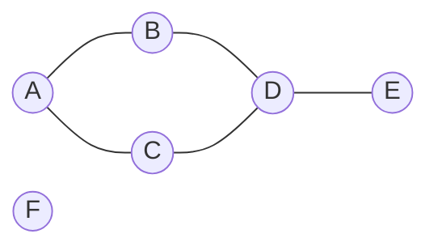

Réseau routier, réseau social, Internet, plan de métro, dépendances entre tâches : dès qu'on représente des **relations** entre des objets, on
obtient un **graphe**. Les arbres en sont un cas particulier. En terminale, on apprend à représenter un graphe en Python et à le **parcourir**,
ce qui permet de répondre à des questions comme « peut-on aller de A à F ? » ou « en combien d'étapes au minimum ? ».

## Ce que dit le programme

Contenus : *graphes : structures relationnelles ; sommets, arcs, arêtes, graphes orientés ou non orientés* ; *algorithmes sur les graphes*.
Capacités attendues : **modéliser des situations sous forme de graphes** ; **écrire les implémentations correspondantes d'un graphe : matrice
d'adjacence, liste de successeurs/de prédécesseurs** ; **passer d'une représentation à une autre** ; **parcourir un graphe en profondeur
d'abord, en largeur d'abord** ; **repérer la présence d'un cycle** ; **chercher un chemin dans un graphe**.

## 1. Vocabulaire



- Les **sommets** sont A, B, C, D, E, F ; les **arêtes** relient deux sommets.
- B et C sont les **voisins** (ou sommets **adjacents**) de A. Le **degré** d'un sommet est son nombre de voisins : D est de degré 3.
- Un **chemin** est une suite de sommets reliés par des arêtes : A, B, D, E. Sa **longueur** est son nombre d'arêtes (3).
- Un **cycle** est un chemin qui revient à son point de départ sans réutiliser d'arête : A, B, D, C, A.
- Le graphe n'est pas **connexe** : F n'est relié à aucun autre sommet.
- Dans un graphe **orienté**, les liens sont des **arcs** à sens unique (A → B ne donne pas B → A) : on parle de **successeurs** et de
  **prédécesseurs**. Dans un graphe **pondéré**, chaque arête porte une valeur (distance, temps, coût).

Un **arbre** est un graphe connexe sans cycle.

## 2. Deux représentations

**Matrice d'adjacence** : on numérote les sommets de 0 à n − 1 ; `m[i][j]` vaut 1 s'il y a une arête entre i et j, 0 sinon.

```python exec
#        A  B  C  D  E  F
m = [[0, 1, 1, 0, 0, 0],   # A
     [1, 0, 0, 1, 0, 0],   # B
     [1, 0, 0, 1, 0, 0],   # C
     [0, 1, 1, 0, 1, 0],   # D
     [0, 0, 0, 1, 0, 0],   # E
     [0, 0, 0, 0, 0, 0]]   # F
print("A et B voisins ?", m[0][1] == 1)
print("degré de D :", sum(m[3]))
```

**Listes d'adjacence** : pour chaque sommet, la liste de ses voisins. En Python, un dictionnaire :

```python exec
g = {
    "A": ["B", "C"],
    "B": ["A", "D"],
    "C": ["A", "D"],
    "D": ["B", "C", "E"],
    "E": ["D"],
    "F": [],
}
print("voisins de D :", g["D"], "| degré :", len(g["D"]))
```

| | Matrice | Listes d'adjacence |
| --- | --- | --- |
| tester si i et j sont voisins | immédiat | parcourir la liste de i |
| lister les voisins de i | parcourir toute la ligne (n cases) | immédiat |
| mémoire | n² cases, même si peu d'arêtes | proportionnelle au nombre d'arêtes |

Pour un graphe avec peu d'arêtes (un réseau social : chacun a quelques centaines d'amis parmi des milliards), les **listes** sont bien plus
économes.

## 3. Le parcours en largeur

On part d'un sommet, on visite tous ses **voisins**, puis les voisins de ses voisins, etc. : par **couches** successives, comme une onde. On
utilise une **file** et on **marque** les sommets déjà découverts.

```python exec
def largeur(g, depart):
    visites = [depart]
    file = [depart]
    while len(file) > 0:
        s = file.pop(0)
        for v in g[s]:
            if v not in visites:
                visites.append(v)
                file.append(v)
    return visites

g = {"A": ["B", "C"], "B": ["A", "D"], "C": ["A", "D"], "D": ["B", "C", "E"], "E": ["D"], "F": []}
print(largeur(g, "A"))
```

Le parcours en largeur découvre les sommets par **distance croissante** au départ (en nombre d'arêtes) : il permet de trouver le **plus court
chemin** en nombre d'arêtes. F n'est jamais atteint : il n'est pas relié à A.

## 4. Le parcours en profondeur

On avance **le plus loin possible** dans une direction, et on ne revient en arrière que lorsqu'on est bloqué, comme dans un labyrinthe. On
l'écrit naturellement en **récursif** (ou avec une **pile**).

```python exec
def profondeur(g, s, visites=None):
    if visites is None:
        visites = []
    visites.append(s)
    for v in g[s]:
        if v not in visites:
            profondeur(g, v, visites)
    return visites

g = {"A": ["B", "C"], "B": ["A", "D"], "C": ["A", "D"], "D": ["B", "C", "E"], "E": ["D"], "F": []}
print(profondeur(g, "A"))
```

Depuis A : on va en B, puis D (voisin de B), puis C (premier voisin non visité de D), C est bloqué, on revient à D, on va en E.

:::attention[Marquer les sommets]
Sans la liste `visites`, le parcours tournerait indéfiniment : A → B → A → B… dès que le graphe contient un cycle (et un graphe non orienté
contient toujours l'aller-retour A–B). Pour de grands graphes, on utilise un **ensemble** ou un dictionnaire plutôt qu'une liste pour tester
`v not in visites` rapidement.
:::

## 5. Chercher un chemin, repérer un cycle

**Existe-t-il un chemin de a à b ?** Il suffit de lancer un parcours depuis a et de regarder si b est visité. Pour **reconstruire** le chemin, on
retient pour chaque sommet découvert **d'où l'on vient** (son prédécesseur), puis on remonte depuis b.

**Le graphe contient-il un cycle ?** Dans un graphe non orienté, lors d'un parcours en profondeur, si l'on rencontre un voisin **déjà visité
qui n'est pas celui dont on vient**, on a trouvé un cycle.

## Les erreurs classiques des élèves

:::attention[Ce que tu verras en classe]
- **Oublier de marquer** les sommets : boucle infinie.
- **Confondre largeur (file) et profondeur (pile)**.
- **Matrice non symétrique** pour un graphe non orienté (oublier `m[j][i]`).
- **Ajouter une arête dans un seul sens** dans les listes d'adjacence d'un graphe non orienté.
- **Croire que le parcours visite tout le graphe** : il ne visite que ce qui est **atteignable** depuis le départ.
- **Confondre chemin le plus court en arêtes** (largeur) et **en distance pondérée** (algorithme de Dijkstra, vu avec le routage).
:::

## En classe

:::methode[Activités qui marchent]
1. **Modéliser** : le plan du lycée, un réseau social de la classe, le métro ; dessiner le graphe et sa matrice.
2. **Parcours débranché** : une « rumeur » qui se propage (largeur), un labyrinthe avec un fil d'Ariane (profondeur).
3. **Passer d'une représentation à l'autre** en Python.
4. **Jeux** : le problème des ponts de Königsberg, les degrés d'un graphe (lemme des poignées de main).
:::

## L'essentiel

- **Graphe** : sommets, arêtes (arcs si **orienté**), éventuellement **pondéré** ; voisins, degré, chemin, cycle, connexité.
- **Matrice d'adjacence** (n × n, test immédiat) ou **listes d'adjacence** (dictionnaire de listes, économe en mémoire).
- **Largeur** : **file**, sommets par distance croissante (plus court chemin en nombre d'arêtes).
- **Profondeur** : **récursif** ou **pile**, on va le plus loin possible puis on revient.
- Toujours **marquer** les sommets visités. Chemin : parcours + prédécesseurs ; cycle : voisin déjà visité qui n'est pas le parent.

## Exercices

::::exercice[Grand QCM : graphes]{niveau=1 type=quiz}
Douze questions sur les graphes. On utilise le graphe du cours : A–B, A–C, B–D, C–D, D–E et un sommet F isolé.

1. Quel est le degré du sommet D ?

   - [ ] 1
   - [ ] 2
   - [x] 3
   - [ ] 5

   > D est relié à B, C et E.

1. Le graphe est-il connexe ?

   - [ ] oui
   - [x] non, F n'est relié à aucun sommet
   - [ ] oui, car il a un cycle
   - [ ] impossible à dire

   > Connexe : on peut aller de n'importe quel sommet à n'importe quel autre.

1. Lequel est un cycle ?

   - [ ] A, B, D, E
   - [x] A, B, D, C, A
   - [ ] A, B, A
   - [ ] D, E, D

   > A, B, A réutilise la même arête : ce n'est pas un cycle.

1. Dans la matrice d'adjacence d'un graphe **non orienté**, on a toujours :

   - [x] `m[i][j] == m[j][i]`
   - [ ] `m[i][i] == 1`
   - [ ] une seule case à 1 par ligne
   - [ ] des valeurs différentes de 0 et 1

   > La matrice est symétrique.

1. Quelle représentation occupe n² cases de mémoire, quel que soit le nombre d'arêtes ?

   - [x] la matrice d'adjacence
   - [ ] les listes d'adjacence
   - [ ] les deux
   - [ ] aucune

   > Les listes n'occupent de la place que pour les arêtes existantes.

1. Quelle structure utilise le parcours en largeur ?

   - [ ] une pile
   - [x] une file
   - [ ] un arbre binaire de recherche
   - [ ] aucune

   > Les sommets sont traités dans l'ordre de découverte.

1. Quel parcours donne le plus court chemin en nombre d'arêtes ?

   - [x] le parcours en largeur
   - [ ] le parcours en profondeur
   - [ ] les deux
   - [ ] aucun

   > Il découvre les sommets par distance croissante.

1. Quel est le parcours en largeur depuis A (voisins dans l'ordre alphabétique) ?

   - [x] A B C D E
   - [ ] A B D C E
   - [ ] A B D E C
   - [ ] A B C D E F

   > F n'est pas atteignable depuis A.

1. Quel est le parcours en profondeur récursif depuis A (voisins dans l'ordre alphabétique) ?

   - [ ] A B C D E
   - [x] A B D C E
   - [ ] A C D B E
   - [ ] A B D E C

   > A, puis B, puis D (voisin de B), puis C (premier voisin non visité de D), puis E.

1. Pourquoi marquer les sommets visités ?

   - [ ] pour les afficher
   - [x] pour ne pas les traiter deux fois et éviter une boucle infinie
   - [ ] pour trier le graphe
   - [ ] ce n'est utile que pour les graphes orientés

   > Un graphe non orienté contient toujours des allers-retours.

1. Dans un graphe orienté avec l'arc A → B, peut-on aller directement de B à A ?

   - [ ] oui
   - [x] non, sauf s'il existe aussi un arc B → A
   - [ ] seulement si le graphe est pondéré
   - [ ] seulement si A et B ont le même degré

   > Un arc a un sens.

1. Qu'est-ce qu'un arbre, du point de vue des graphes ?

   - [ ] un graphe orienté quelconque
   - [x] un graphe connexe sans cycle
   - [ ] un graphe complet
   - [ ] un graphe pondéré

   > On peut aller de tout sommet à tout autre, d'une seule façon.
::::

::::exercice[D'une représentation à l'autre]{niveau=1}
Écris `vers_dico(m, noms)` qui transforme une matrice d'adjacence en dictionnaire de listes d'adjacence (les sommets d'indice i s'appellent
`noms[i]`, voisins dans l'ordre des indices), et `vers_matrice(g, noms)` qui fait l'inverse.

```python depart
def vers_dico(m, noms):
    ...

def vers_matrice(g, noms):
    ...
```

```python tests
m = [[0, 1, 1], [1, 0, 0], [1, 0, 0]]
noms = ["A", "B", "C"]
assert vers_dico(m, noms) == {"A": ["B", "C"], "B": ["A"], "C": ["A"]}, "matrice vers dictionnaire"
assert vers_matrice({"A": ["B", "C"], "B": ["A"], "C": ["A"]}, noms) == m, "dictionnaire vers matrice"
assert vers_dico([[0]], ["X"]) == {"X": []}, "un sommet isolé"
```

:::corrige
```python solution
def vers_dico(m, noms):
    g = {}
    for i in range(len(m)):
        g[noms[i]] = [noms[j] for j in range(len(m)) if m[i][j] == 1]
    return g

def vers_matrice(g, noms):
    n = len(noms)
    m = [[0] * n for i in range(n)]
    for i in range(n):
        for v in g[noms[i]]:
            j = noms.index(v)
            m[i][j] = 1
    return m
```

`noms.index(v)` retrouve le numéro d'un sommet ; pour un grand graphe, on construirait plutôt un dictionnaire nom → indice.
:::
::::

::::exercice[Les deux parcours]{niveau=2}
Écris `largeur(g, depart)` et `profondeur(g, depart)` qui renvoient la liste des sommets dans l'ordre où ils sont visités. Pour la profondeur,
utilise la version récursive (avec une fonction auxiliaire ou un paramètre). Les voisins sont parcourus dans l'ordre des listes.

```python depart
def largeur(g, depart):
    ...

def profondeur(g, depart):
    ...
```

```python tests
g = {"A": ["B", "C"], "B": ["A", "D"], "C": ["A", "D"], "D": ["B", "C", "E"], "E": ["D"], "F": []}
assert largeur(g, "A") == ["A", "B", "C", "D", "E"], "largeur depuis A"
assert profondeur(g, "A") == ["A", "B", "D", "C", "E"], "profondeur depuis A"
assert largeur(g, "F") == ["F"] and profondeur(g, "F") == ["F"], "sommet isolé"
assert largeur(g, "E") == ["E", "D", "B", "C", "A"], "largeur depuis E"
```

:::corrige
```python solution
def largeur(g, depart):
    visites = [depart]
    file = [depart]
    while len(file) > 0:
        s = file.pop(0)
        for v in g[s]:
            if v not in visites:
                visites.append(v)
                file.append(v)
    return visites

def profondeur(g, depart):
    visites = []

    def explorer(s):
        visites.append(s)
        for v in g[s]:
            if v not in visites:
                explorer(v)

    explorer(depart)
    return visites
```

Dans le parcours en largeur, on marque un sommet **dès qu'on l'enfile**, pour ne pas l'enfiler deux fois.
:::
::::

::::exercice[Plus court chemin en nombre d'arêtes]{niveau=2}
Écris `distances(g, depart)` qui renvoie un dictionnaire associant à chaque sommet atteignable sa distance (nombre d'arêtes) au départ, puis
`chemin(g, a, b)` qui renvoie un plus court chemin de a à b sous forme de liste de sommets, ou `None` s'il n'y en a pas. Utilise un parcours en
largeur en retenant le **prédécesseur** de chaque sommet.

```python depart
def distances(g, depart):
    ...

def chemin(g, a, b):
    ...
```

```python tests
g = {"A": ["B", "C"], "B": ["A", "D"], "C": ["A", "D"], "D": ["B", "C", "E"], "E": ["D"], "F": []}
assert distances(g, "A") == {"A": 0, "B": 1, "C": 1, "D": 2, "E": 3}, "distances"
assert chemin(g, "A", "E") == ["A", "B", "D", "E"], "chemin A vers E"
assert chemin(g, "A", "F") is None, "pas de chemin"
assert chemin(g, "C", "C") == ["C"], "chemin trivial"
```

:::corrige
```python solution
def distances(g, depart):
    dist = {depart: 0}
    file = [depart]
    while len(file) > 0:
        s = file.pop(0)
        for v in g[s]:
            if v not in dist:
                dist[v] = dist[s] + 1
                file.append(v)
    return dist

def chemin(g, a, b):
    pred = {a: None}
    file = [a]
    while len(file) > 0:
        s = file.pop(0)
        for v in g[s]:
            if v not in pred:
                pred[v] = s
                file.append(v)
    if b not in pred:
        return None
    resultat = []
    s = b
    while s is not None:
        resultat.append(s)
        s = pred[s]
    resultat.reverse()
    return resultat
```

Les dictionnaires `dist` et `pred` servent aussi de marquage : un sommet y figure dès qu'il est découvert. On reconstruit le chemin **à
l'envers**, de b vers a, en suivant les prédécesseurs.
:::
::::

::::exercice[Repérer un cycle]{niveau=2}
Écris `a_un_cycle(g)` qui renvoie `True` si le graphe **non orienté** `g` contient un cycle. Utilise un parcours en profondeur qui retient le
sommet d'où l'on vient : un voisin déjà visité **différent du parent** signale un cycle. Pense aux graphes non connexes.

```python depart
def a_un_cycle(g):
    ...
```

```python tests
g1 = {"A": ["B", "C"], "B": ["A", "D"], "C": ["A", "D"], "D": ["B", "C", "E"], "E": ["D"], "F": []}
assert a_un_cycle(g1), "cycle A-B-D-C"
arbre = {"A": ["B", "C"], "B": ["A", "D"], "C": ["A"], "D": ["B"]}
assert not a_un_cycle(arbre), "un arbre n'a pas de cycle"
deux = {"A": ["B"], "B": ["A"], "C": ["D", "E"], "D": ["C", "E"], "E": ["C", "D"]}
assert a_un_cycle(deux), "cycle dans la deuxième composante"
assert not a_un_cycle({"X": []}), "sommet seul"
```

:::corrige
```python solution
def a_un_cycle(g):
    visites = []

    def explorer(s, parent):
        visites.append(s)
        for v in g[s]:
            if v not in visites:
                if explorer(v, s):
                    return True
            elif v != parent:
                return True
        return False

    for s in g:
        if s not in visites:
            if explorer(s, None):
                return True
    return False
```

Le voisin `parent` est toujours déjà visité (c'est l'arête par laquelle on est arrivé) : il ne compte pas. La boucle finale relance le
parcours depuis chaque sommet non visité, pour couvrir toutes les composantes.
:::
::::

::::exercice[Modéliser par un graphe]{niveau=2}
Pour chaque situation, dis quels sont les sommets et les arêtes, si le graphe est orienté et/ou pondéré, et quelle question se ramène à un
parcours : (a) le réseau des amis d'un réseau social ; (b) les abonnements sur un réseau où l'on suit des comptes sans réciprocité ; (c) un plan
de métro avec les temps de trajet ; (d) les prérequis entre les chapitres d'un cours.

:::criteres
- (a) sommets = personnes, arêtes = amitié, non orienté, non pondéré ; question : « ami d'ami » (largeur, distance 2).
- (b) orienté (A suit B) ; question : qui peut voir passer un message (parcours depuis un compte).
- (c) sommets = stations, arêtes = tronçons, pondéré par le temps ; question : plus court trajet (pondéré : Dijkstra).
- (d) orienté (prérequis → chapitre) ; un cycle serait une incohérence ; ordre possible des chapitres.
:::

:::corrige
(a) **Sommets** : les personnes ; **arêtes** : « est ami avec ». **Non orienté** (l'amitié est réciproque), non pondéré. « Qui sont les amis de
mes amis ? » : parcours en largeur, sommets à distance 2. (b) **Orienté** : un arc A → B si A suit B. « Jusqu'où un message republié peut-il se
diffuser ? » : parcours depuis l'auteur. (c) **Sommets** : les stations ; **arêtes** : les tronçons entre deux stations ; **pondéré** par le
temps de trajet. Le plus court trajet **en temps** demande l'algorithme de **Dijkstra** ; le parcours en largeur donne le trajet avec le moins
de stations. (d) **Orienté** : un arc du prérequis vers le chapitre. Un **cycle** serait absurde (A exige B qui exige A) ; un parcours en
profondeur permet de le détecter et de trouver un ordre valide des chapitres.
:::
::::
