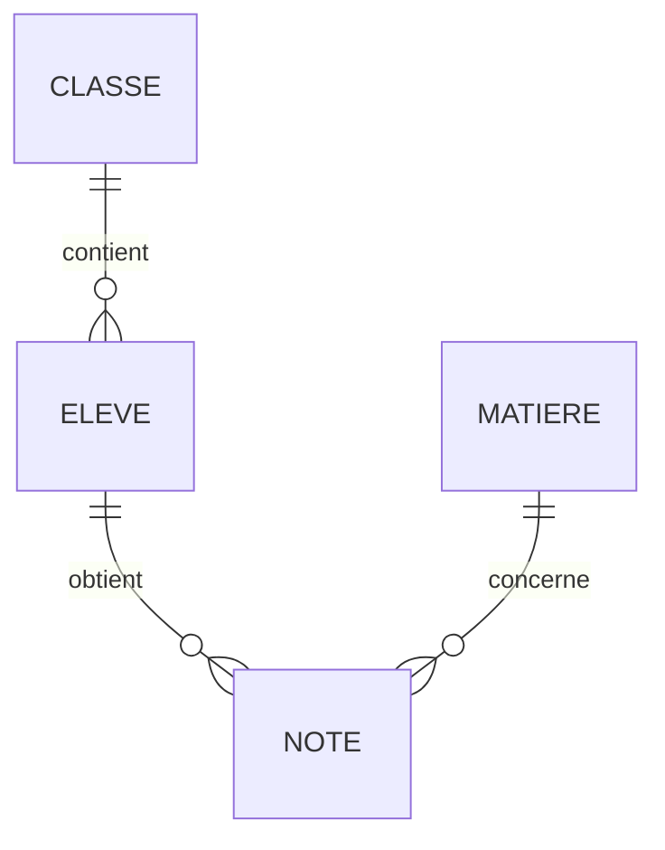

En première, une table était un fichier CSV chargé en tableau de dictionnaires. Dès que les données grossissent, sont partagées par plusieurs
utilisateurs ou doivent rester **cohérentes**, on utilise une **base de données**. Le **modèle relationnel**, proposé par Edgar F. Codd en
1970, organise les données en **tables reliées entre elles**. C'est le modèle de la plupart des bases actuelles (Pronote, banques,
sites marchands).

## Ce que dit le programme

Contenus : *modèle relationnel : relation, attribut, domaine, clef primaire, clef étrangère, schéma relationnel* ; *base de données
relationnelle* ; *système de gestion de bases de données relationnelles*. Capacités attendues : **identifier les concepts définissant le modèle
relationnel** ; **savoir distinguer la structure d'une base de données de son contenu** ; **repérer des anomalies dans le schéma d'une base de
données** ; **identifier les services rendus par un SGBD** (persistance des données, gestion des accès concurrents, efficacité de traitement,
sécurisation des accès).

## 1. Relations, attributs, enregistrements

Une **relation** est une table. Exemple, la relation `eleve` de la base du lycée :

| id_eleve | nom | prenom | naissance | id_classe |
| --- | --- | --- | --- | --- |
| 1 | Martin | Léa | 2010-03-14 | 2D1 |
| 6 | Richard | Lucas | 2009-05-17 | 1G1 |
| 11 | Simon | Louise | 2008-04-04 | TG1 |

- Chaque colonne est un **attribut** (`nom`, `naissance`…), avec un **domaine** : l'ensemble des valeurs permises (entier, texte, date).
- Chaque ligne est un **enregistrement** (ou n-uplet).
- L'ordre des lignes n'a pas d'importance, et deux lignes ne peuvent pas être identiques.

## 2. Le schéma relationnel

Le **schéma** décrit la **structure** de la base (les relations et leurs attributs), indépendamment de son **contenu** (les lignes) :

- classe(<u>id_classe</u>, niveau, salle)
- eleve(<u>id_eleve</u>, nom, prenom, naissance, #id_classe)
- matiere(<u>id_matiere</u>, intitule, coefficient)
- note(<u>id_note</u>, #id_eleve, #id_matiere, valeur, date_eval)

On **souligne** la clé primaire et on marque d'un **#** les clés étrangères.

## 3. Clé primaire et clé étrangère

- La **clé primaire** identifie **de façon unique** chaque enregistrement. Le nom ne convient pas (deux élèves peuvent s'appeler Martin) : on
  ajoute un identifiant `id_eleve`. Une clé primaire peut être formée de **plusieurs** attributs (par exemple (id_eleve, id_matiere, date_eval)).
- Une **clé étrangère** est un attribut qui **fait référence** à la clé primaire d'une autre relation : `eleve.id_classe` désigne une ligne de
  `classe`. C'est ainsi que les tables sont **reliées**.

## 4. Les contraintes d'intégrité

Le SGBD refuse toute modification qui violerait une **contrainte** :

| Contrainte | Garantit que… | Exemple refusé |
| --- | --- | --- |
| de **domaine** | chaque valeur a le bon type et respecte les règles | une note de 25, un coefficient de −2 |
| d'**entité** | la clé primaire est unique et non vide | deux élèves avec `id_eleve = 6` |
| de **référence** | une clé étrangère désigne une ligne existante | une note pour l'élève n° 99, qui n'existe pas ; supprimer un élève qui a des notes |

## 5. Éviter la redondance

Pourquoi ne pas tout mettre dans **une seule** grande table ?

| nom | prenom | classe | salle | matiere | coefficient | note |
| --- | --- | --- | --- | --- | --- | --- |
| Martin | Léa | 2D1 | B104 | Mathématiques | 4 | 14,5 |
| Martin | Léa | 2D1 | B104 | Anglais | 2 | 16 |
| Bernard | Hugo | 2D1 | B104 | Mathématiques | 4 | 9 |

La salle de la 2D1 et le coefficient des maths sont **répétés** : c'est de la **redondance**. Problèmes :

- **anomalie de mise à jour** : si la 2D1 change de salle, il faut modifier **toutes** les lignes ; en oublier une rend la base incohérente ;
- **anomalie d'insertion** : impossible d'enregistrer une nouvelle classe tant qu'elle n'a pas d'élève avec une note ;
- **anomalie de suppression** : supprimer la dernière note d'une matière fait disparaître son coefficient.

La solution : **découper** en plusieurs relations, chacune décrivant **une seule chose** (les classes, les élèves, les matières, les notes),
reliées par des **clés étrangères**. Chaque information est stockée **une seule fois**.

## 6. Le système de gestion de bases de données

Un **SGBD** (SQLite, PostgreSQL, MySQL, Oracle) est le logiciel qui gère la base. Ses services :

- **persistance** : les données sont stockées durablement sur disque ;
- **intégrité** : vérification des contraintes ;
- **accès concurrents** : des milliers d'utilisateurs peuvent lire et écrire en même temps sans corrompre les données (les **transactions** :
  tout ou rien) ;
- **sécurité** : comptes et **droits** d'accès, sauvegardes, reprise après panne ;
- **efficacité** : des **index** (souvent des arbres équilibrés) pour répondre vite, même sur des millions de lignes ;
- un **langage** standard pour l'interroger : **SQL** (chapitre suivant).

On n'écrit pas de programme qui parcourt les fichiers : on **décrit** ce qu'on veut, et le SGBD trouve comment l'obtenir.

## Les erreurs classiques des élèves

:::attention[Ce que tu verras en classe]
- **Choisir comme clé primaire un attribut qui peut se répéter** (nom, ville, date).
- **Confondre clé primaire et clé étrangère**, ou mettre la clé étrangère du mauvais côté (la classe ne contient pas la liste de ses élèves :
  c'est l'élève qui référence sa classe).
- **Confondre schéma (structure) et contenu (lignes).**
- **Ne pas voir la redondance** dans une grande table.
- **Croire que l'ordre des lignes a un sens.**
:::

## En classe

:::methode[Activités qui marchent]
1. **Partir d'un tableur mal conçu** (une seule grande feuille) et faire découvrir les anomalies, puis découper en tables.
2. **Concevoir le schéma** d'une base pour la bibliothèque du lycée, un club sportif, une plateforme de streaming.
3. **Tester les contraintes** dans DB Browser for SQLite : insérer une ligne qui viole une clé étrangère, observer le refus.
4. **Situer** : quelles bases utilisent les élèves sans le savoir (ENT, cantine, réseaux sociaux) ?
:::

## L'essentiel

- **Relation** = table ; **attribut** = colonne (avec un **domaine**) ; **enregistrement** = ligne.
- **Schéma relationnel** : la structure, clés primaires **soulignées**, clés étrangères **#**.
- **Clé primaire** : identifie chaque ligne de façon unique ; **clé étrangère** : référence la clé primaire d'une autre table.
- **Contraintes** : de domaine, d'entité, de référence.
- **Redondance** → anomalies de mise à jour, d'insertion, de suppression ; on découpe en tables reliées.
- **SGBD** : persistance, intégrité, accès concurrents, sécurité, efficacité, langage SQL.

## Exercices

::::exercice[Grand QCM : modèle relationnel]{niveau=1 type=quiz}
Douze questions sur le modèle relationnel. On utilise le schéma de la base du lycée donné dans le cours.

1. Dans le modèle relationnel, une relation est :

   - [ ] un lien entre deux tables
   - [x] une table
   - [ ] une ligne
   - [ ] une requête

   > Le vocabulaire est trompeur : « relation » désigne la table elle-même.

1. Un enregistrement est :

   - [ ] une colonne
   - [x] une ligne
   - [ ] la base entière
   - [ ] une clé

   > On dit aussi n-uplet.

1. Quel attribut convient comme clé primaire de `eleve` ?

   - [ ] nom
   - [ ] naissance
   - [x] id_eleve
   - [ ] id_classe

   > Le seul qui ne peut pas se répéter.

1. Dans `note`, `id_eleve` est :

   - [ ] la clé primaire
   - [x] une clé étrangère vers `eleve`
   - [ ] un attribut sans lien
   - [ ] un domaine

   > Il référence la clé primaire de `eleve`.

1. Quelle opération le SGBD refuse-t-il à cause de la contrainte de référence ?

   - [ ] ajouter un élève sans date de naissance
   - [x] ajouter une note pour un élève qui n'existe pas
   - [ ] modifier la salle d'une classe
   - [ ] ajouter une matière

   > La clé étrangère doit désigner une ligne existante.

1. Deux élèves ont le même `id_eleve`. Quelle contrainte est violée ?

   - [ ] de domaine
   - [x] d'entité (unicité de la clé primaire)
   - [ ] de référence
   - [ ] aucune

   > La clé primaire doit être unique et non vide.

1. Une note de 25 sur 20 viole une contrainte :

   - [x] de domaine
   - [ ] d'entité
   - [ ] de référence
   - [ ] de redondance

   > La base impose `valeur BETWEEN 0 AND 20`.

1. Qu'est-ce que la redondance ?

   - [ ] la sauvegarde des données
   - [x] la répétition d'une même information à plusieurs endroits
   - [ ] l'utilisation de plusieurs tables
   - [ ] une clé composée

   > Elle provoque des incohérences quand on modifie une seule copie.

1. Dans une grande table unique, la 2D1 change de salle. Quel est le risque ?

   - [x] oublier de modifier certaines lignes et obtenir une base incohérente
   - [ ] perdre toutes les notes
   - [ ] ne plus pouvoir lire la table
   - [ ] aucun

   > C'est une anomalie de mise à jour.

1. Que décrit le schéma relationnel ?

   - [ ] les données contenues dans la base
   - [x] la structure : les relations, leurs attributs et leurs clés
   - [ ] les requêtes possibles
   - [ ] les utilisateurs

   > Le contenu (les lignes) change sans cesse ; le schéma rarement.

1. Lequel n'est **pas** un service d'un SGBD ?

   - [ ] gérer les accès concurrents
   - [ ] vérifier les contraintes
   - [ ] stocker durablement les données
   - [x] concevoir automatiquement le schéma de la base

   > La conception reste le travail du concepteur.

1. Comment note-t-on une clé étrangère dans un schéma relationnel ?

   - [ ] en la soulignant
   - [x] avec un # devant
   - [ ] en majuscules
   - [ ] entre parenthèses

   > La clé primaire, elle, est soulignée.
::::

::::exercice[Lire un schéma]{niveau=1}
Voici le schéma de la base d'une médiathèque :

- auteur(<u>id_auteur</u>, nom, prenom, naissance, nationalite)
- livre(<u>id_livre</u>, titre, #id_auteur, annee, genre, pages)
- adherent(<u>id_adherent</u>, nom, prenom, email, ville, inscription)
- emprunt(<u>id_emprunt</u>, #id_livre, #id_adherent, date_emprunt, date_retour)

(a) Donne les clés primaires et étrangères de chaque relation. (b) Un livre peut-il avoir deux auteurs dans ce schéma ? (c) Pourquoi ne pas
mettre le nom de l'auteur directement dans `livre` ? (d) Quelles opérations le SGBD refusera-t-il si l'on veut supprimer l'adhérent n° 3 qui a
des emprunts en cours ?

:::criteres
- (a) Clés primaires : les id ; clés étrangères : `livre.id_auteur`, `emprunt.id_livre`, `emprunt.id_adherent`.
- (b) Non : un seul `id_auteur` par livre ; il faudrait une relation d'association écrit(#id_livre, #id_auteur).
- (c) Redondance : le nom serait répété pour chaque livre de l'auteur, avec risque d'incohérence.
- (d) La suppression est refusée (contrainte de référence) tant que des emprunts le référencent.
:::

:::corrige
(a) **Clés primaires** : `id_auteur`, `id_livre`, `id_adherent`, `id_emprunt`. **Clés étrangères** : `livre.id_auteur` (vers `auteur`),
`emprunt.id_livre` (vers `livre`) et `emprunt.id_adherent` (vers `adherent`). (b) **Non** : chaque livre n'a qu'**un** `id_auteur`. Pour
plusieurs auteurs, on supprimerait cet attribut et on créerait une relation d'association `ecrit(#id_livre, #id_auteur)`, dont la clé
primaire est le couple. (c) Le nom de l'auteur serait **répété** pour chacun de ses livres (redondance) : une faute corrigée sur un seul livre
rendrait la base incohérente. (d) Le SGBD **refuse** de supprimer l'adhérent tant que des lignes de `emprunt` le référencent (contrainte de
**référence**) : il faut d'abord traiter ses emprunts.
:::
::::

::::exercice[Repérer les anomalies]{niveau=2}
Un club de sport stocke tout dans une seule table :
inscription(nom_membre, telephone, nom_activite, jour, tarif_activite, nom_coach, telephone_coach).
(a) Donne un exemple de chaque anomalie (mise à jour, insertion, suppression). (b) Propose un schéma relationnel sans redondance, avec ses clés
primaires et étrangères.

:::criteres
- (a) Mise à jour : changer le tarif d'une activité ou le téléphone d'un coach sur toutes les lignes ; insertion : impossible d'ajouter une
  activité sans membre ; suppression : le dernier membre qui se désinscrit fait disparaître l'activité et son coach.
- (b) Au moins quatre relations : membre, coach, activite (avec #id_coach), inscription (#id_membre, #id_activite).
- Clés primaires (identifiants) et étrangères correctement placées.
:::

:::corrige
(a) **Mise à jour** : si le tarif du judo augmente, il faut le modifier sur la ligne de **chaque** inscrit ; un oubli et deux tarifs coexistent.
**Insertion** : on ne peut pas créer une nouvelle activité (avec son coach et son tarif) tant que personne n'y est inscrit. **Suppression** :
si le dernier inscrit au yoga part, on perd le tarif du yoga et le téléphone de son coach.

(b) Un schéma possible :

- membre(<u>id_membre</u>, nom, telephone)
- coach(<u>id_coach</u>, nom, telephone)
- activite(<u>id_activite</u>, nom, jour, tarif, #id_coach)
- inscription(<u>#id_membre, #id_activite</u>)

Chaque information est stockée une fois. La clé primaire d'`inscription` est le **couple** (id_membre, id_activite) : un membre ne s'inscrit
qu'une fois à une activité.
:::
::::

::::exercice[Pourquoi un SGBD ?]{niveau=2}
Le lycée gère les réservations de salles dans un fichier tableur partagé, ouvert par plusieurs professeurs en même temps. Explique trois
problèmes qui peuvent survenir et comment un SGBD les résout.

:::criteres
- Accès concurrents : deux professeurs réservent la même salle au même moment, l'un écrase l'autre ; le SGBD gère les transactions.
- Intégrité : rien n'empêche une salle inexistante ou un créneau incohérent ; le SGBD vérifie les contraintes.
- Sécurité et persistance : n'importe qui peut tout effacer, pas de reprise après panne ; le SGBD gère les droits et les sauvegardes.
:::

:::corrige
1. **Accès concurrents** : deux professeurs réservent la salle C201 au même créneau, chacun sur sa copie ouverte ; le dernier qui enregistre
   **écrase** l'autre. Un SGBD traite les modifications comme des **transactions** : la seconde voit la salle déjà prise et est refusée.
2. **Intégrité** : le tableur accepte une salle qui n'existe pas, une date mal écrite, une réservation sans professeur. Un SGBD impose des
   **contraintes** (domaine, clé étrangère vers la table des salles, unicité du couple salle-créneau).
3. **Sécurité et persistance** : n'importe qui peut supprimer toutes les lignes, et un fichier corrompu fait tout perdre. Un SGBD gère des
   **droits** (un professeur ne modifie que ses réservations), journalise les opérations et permet la **reprise** après panne.
:::
::::
