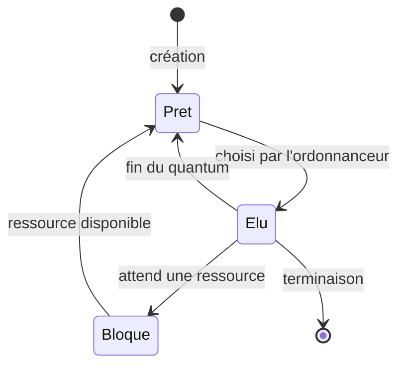
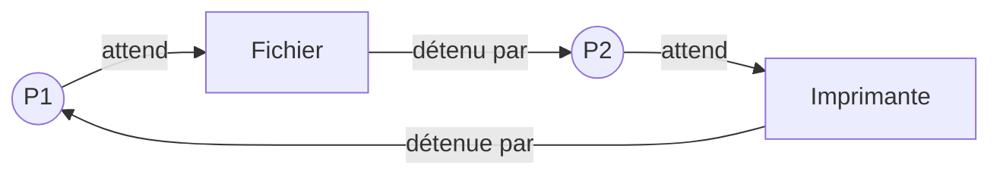

Sur un ordinateur, des dizaines de programmes semblent tourner **en même temps** : navigateur, musique, antivirus, traitement de texte. Pourtant,
un cœur de processeur n'exécute qu'**une** instruction à la fois. Le système d'exploitation crée cette illusion en partageant le processeur entre
des **processus**, qu'il fait alterner très vite. Ce chapitre explique comment, et ce qui peut mal tourner.

## Ce que dit le programme

Contenus : *composants intégrés d'un système sur puce* ; *gestion des processus et des ressources par un système d'exploitation*. Capacités
attendues : **identifier les principaux composants sur un schéma de circuit** et les avantages de leur intégration ; **décrire la création d'un
processus, l'ordonnancement de plusieurs processus par le système** ; **mettre en évidence le risque de l'interblocage (deadlock)**. Le programme
précise qu'on utilise les commandes Unix de gestion des processus.

## 1. Programme et processus

Un **programme** est un fichier (du code, sur le disque). Un **processus** est une **exécution** de ce programme : il a sa zone de mémoire, l'état
de ses registres, ses fichiers ouverts, et un numéro unique, le **PID**. On peut lancer plusieurs processus du même programme (deux fenêtres d'un
éditeur).

Sous Linux :

```bash
ps -ef            # liste tous les processus (PID, PPID, commande)
top               # processus classés par utilisation du processeur, en direct
kill 4321         # demande au processus 4321 de se terminer
kill -9 4321      # le force à s'arrêter
```

Chaque processus est créé par un autre, son **parent** (PPID) : ils forment un **arbre** dont la racine est le premier processus lancé au
démarrage (`init` ou `systemd`, PID 1).

## 2. Les états d'un processus



- **Prêt** : il pourrait s'exécuter, il attend son tour.
- **Élu** : il s'exécute sur le processeur (un seul par cœur).
- **Bloqué** : il attend un événement (lecture sur le disque, saisie au clavier, réponse du réseau) ; il ne consomme pas de processeur.

## 3. L'ordonnancement

L'**ordonnanceur** du système choisit quel processus prêt passe à l'état élu. Plusieurs stratégies existent. Prenons trois processus :

| Processus | Arrivée | Durée d'exécution |
| --- | --- | --- |
| P1 | 0 | 5 |
| P2 | 1 | 2 |
| P3 | 2 | 1 |

**Premier arrivé, premier servi** (FIFO) : chacun s'exécute jusqu'au bout, dans l'ordre d'arrivée.

```
temps : 0 1 2 3 4 5 6 7
        P1P1P1P1P1P2P2P3
```

P1 finit à 5, P2 à 7, P3 à 8. Le court P3 attend longtemps derrière le long P1.

**Plus court d'abord** : parmi les processus prêts, on choisit celui qui a la plus petite durée. À 0, seul P1 est là, il s'exécute jusqu'à 5 ;
puis P3 (1) avant P2 (2) : P3 finit à 6, P2 à 8. Le temps d'attente moyen diminue, mais il faut connaître les durées à l'avance, et un long
processus peut attendre indéfiniment (**famine**).

**Tourniquet** (round robin), avec un quantum de 2 : chaque processus prêt s'exécute au plus 2 unités, puis repasse en **fin de file**.

```
temps : 0 1 2 3 4 5 6 7
        P1P1P2P2P3P1P1P1
```

P2 finit à 4, P3 à 5, P1 à 8. Chacun avance régulièrement : c'est la base des systèmes interactifs. La **file** des processus prêts est
exactement la structure de données vue en début d'année.

Indicateurs : le **temps de séjour** (fin − arrivée) et le **temps d'attente** (séjour − durée d'exécution).

## 4. L'interblocage

Deux processus utilisent deux ressources en accès exclusif (une imprimante, un fichier) :

- P1 obtient l'imprimante, puis demande le fichier ;
- P2 obtient le fichier, puis demande l'imprimante.

Chacun attend une ressource que l'autre ne libérera jamais : c'est un **interblocage** (*deadlock*). On le représente par un **graphe** : un
**cycle** dans le graphe « processus attend ressource détenue par processus » signale l'interblocage.



Il faut quatre conditions simultanées : ressources en **exclusion mutuelle**, processus qui **gardent** une ressource en en attendant une autre,
**pas de réquisition** (on ne peut pas reprendre une ressource de force), **attente circulaire**. Pour l'éviter, on casse une condition, par
exemple en imposant à tous un **ordre** de demande des ressources (toujours l'imprimante avant le fichier).

## 5. Les systèmes sur puce

Un **SoC** (*System on Chip*) intègre sur **une seule puce** ce qui occupait autrefois toute une carte mère : un ou plusieurs **cœurs** de
processeur (CPU), un processeur graphique (**GPU**), de la **mémoire**, des contrôleurs (USB, écran), des modules de communication (**Wi-Fi**,
**4G/5G**, Bluetooth), parfois une unité dédiée à l'intelligence artificielle. Avantages : **petite taille**, **faible consommation**
(essentiel sur batterie), **coût** réduit en grande série, communications plus **rapides** entre composants. Inconvénient : on ne peut rien
remplacer ni améliorer séparément. On en trouve dans les téléphones, les tablettes, les objets connectés, et désormais certains ordinateurs.

## Les erreurs classiques des élèves

:::attention[Ce que tu verras en classe]
- **Confondre programme et processus.**
- **Croire que les processus s'exécutent réellement en même temps** sur un seul cœur.
- **Mal dérouler le tourniquet** : oublier qu'un processus qui arrive se place en fin de file, ou qu'un processus interrompu repasse derrière.
- **Confondre bloqué et prêt** : un processus bloqué n'attend pas le processeur mais une ressource.
- **Confondre interblocage et famine.**
:::

## En classe

:::methode[Activités qui marchent]
1. **Gestionnaire des tâches** ou `top` : observer les processus, leur PID, leur consommation, en tuer un.
2. **Diagrammes de Gantt** à remplir pour plusieurs stratégies, et comparaison des temps d'attente.
3. **Simuler le tourniquet en Python** avec une file.
4. **Interblocage débranché** : deux élèves, deux objets, des règles de demande ; un carrefour à quatre stops.
5. **SoC** : comparer la carte mère d'un vieux PC et la puce d'un téléphone (photos, schémas).
:::

## L'essentiel

- **Processus** = programme en cours d'exécution (PID, mémoire, parent) ; `ps`, `top`, `kill`.
- États : **prêt**, **élu**, **bloqué** ; l'**ordonnanceur** choisit le processus élu.
- Stratégies : **premier arrivé premier servi**, **plus court d'abord** (risque de famine), **tourniquet** (quantum, file).
- **Interblocage** : attente circulaire de ressources ; cycle dans le graphe d'attente ; prévention par un ordre de demande.
- **SoC** : CPU, GPU, mémoire, radio sur une puce ; compact, économe, peu cher, non réparable.

## Exercices

::::exercice[Grand QCM : processus]{niveau=1 type=quiz}
Dix questions sur les processus, l'ordonnancement et les SoC.

1. Qu'est-ce qu'un processus ?

   - [ ] un fichier exécutable sur le disque
   - [x] un programme en cours d'exécution
   - [ ] un composant du processeur
   - [ ] une commande Linux

   > Il a son identifiant (PID) et sa mémoire.

1. Un processus attend la fin d'une lecture sur le disque. Il est :

   - [ ] élu
   - [ ] prêt
   - [x] bloqué
   - [ ] terminé

   > Il ne peut pas avancer tant que la donnée n'est pas arrivée.

1. Combien de processus peuvent être élus en même temps sur un processeur à un seul cœur ?

   - [x] un
   - [ ] deux
   - [ ] autant que de processus prêts
   - [ ] aucun

   > L'impression de simultanéité vient de l'alternance rapide.

1. Quelle commande affiche la liste des processus sous Linux ?

   - [ ] `ls`
   - [x] `ps`
   - [ ] `kill`
   - [ ] `cd`

   > `kill` sert à les arrêter.

1. Dans le tourniquet, que devient un processus dont le quantum est écoulé mais qui n'a pas fini ?

   - [ ] il est terminé
   - [x] il repasse en fin de file des processus prêts
   - [ ] il devient bloqué
   - [ ] il garde le processeur

   > Chacun son tour.

1. Quel est le défaut de la stratégie « plus court d'abord » ?

   - [ ] elle est toujours plus lente
   - [x] un long processus peut attendre indéfiniment (famine)
   - [ ] elle provoque des interblocages
   - [ ] elle ne marche qu'avec deux processus

   > S'il arrive sans cesse des processus courts.

1. Trois processus de durées 6, 1 et 1 arrivent ensemble dans cet ordre. En FIFO, quand finit le dernier ?

   - [ ] à 1
   - [ ] à 6
   - [x] à 8
   - [ ] à 2

   > 6 + 1 + 1 ; les deux courts attendent derrière le long.

1. P1 détient A et attend B ; P2 détient B et attend A. C'est :

   - [ ] une famine
   - [x] un interblocage
   - [ ] un ordonnancement
   - [ ] un tourniquet

   > Attente circulaire : aucun ne peut avancer.

1. Comment éviter cet interblocage ?

   - [ ] augmenter le quantum
   - [x] imposer que tous demandent A avant B
   - [ ] lancer plus de processus
   - [ ] utiliser la commande `ps`

   > On casse l'attente circulaire.

1. Quel est un avantage d'un SoC ?

   - [ ] on peut changer le processeur seul
   - [x] il consomme peu d'énergie et prend peu de place
   - [ ] il n'a pas besoin de système d'exploitation
   - [ ] il n'a pas de processeur graphique

   > Idéal pour les appareils sur batterie.
::::

::::exercice[Simuler FIFO]{niveau=1}
Des processus sont donnés par des triplets `(nom, arrivee, duree)`, triés par arrivée. Écris `fifo(processus)` qui renvoie le dictionnaire nom →
instant de fin, avec la stratégie « premier arrivé, premier servi » (le processeur peut rester inactif si aucun processus n'est arrivé).

```python depart
def fifo(processus):
    ...
```

```python tests
assert fifo([("P1", 0, 5), ("P2", 1, 2), ("P3", 2, 1)]) == {"P1": 5, "P2": 7, "P3": 8}, "exemple du cours"
assert fifo([("A", 0, 2), ("B", 5, 1)]) == {"A": 2, "B": 6}, "processeur inactif entre 2 et 5"
assert fifo([]) == {}, "aucun processus"
```

:::corrige
```python solution
def fifo(processus):
    t = 0
    fins = {}
    for nom, arrivee, duree in processus:
        if t < arrivee:
            t = arrivee
        t = t + duree
        fins[nom] = t
    return fins
```

L'horloge `t` avance de la durée de chaque processus ; si le suivant n'est pas encore arrivé, on saute à son instant d'arrivée.
:::
::::

::::exercice[Simuler le tourniquet]{niveau=2}
Écris `tourniquet(processus, quantum)` qui simule le tourniquet et renvoie le dictionnaire nom → instant de fin. Les processus `(nom, arrivee,
duree)` sont triés par arrivée. Règle : à un même instant, les processus **qui arrivent** sont placés dans la file **avant** celui dont le
quantum vient de se terminer.

```python depart
def tourniquet(processus, quantum):
    ...
```

```python tests
assert tourniquet([("P1", 0, 5), ("P2", 1, 2), ("P3", 2, 1)], 2) == {"P2": 4, "P3": 5, "P1": 8}, "exemple du cours"
assert tourniquet([("A", 0, 3)], 1) == {"A": 3}, "un seul processus"
assert tourniquet([("A", 0, 2), ("B", 0, 2)], 1) == {"A": 3, "B": 4}, "alternance"
assert tourniquet([("A", 0, 1), ("B", 4, 1)], 2) == {"A": 1, "B": 5}, "processeur inactif"
```

:::corrige
```python solution
def tourniquet(processus, quantum):
    restant = {}
    for nom, arrivee, duree in processus:
        restant[nom] = duree
    a_venir = list(processus)
    file = []
    t = 0
    fins = {}
    while len(a_venir) > 0 or len(file) > 0:
        while len(a_venir) > 0 and a_venir[0][1] <= t:
            file.append(a_venir.pop(0)[0])
        if len(file) == 0:
            t = a_venir[0][1]
            continue
        nom = file.pop(0)
        temps = min(quantum, restant[nom])
        t = t + temps
        restant[nom] = restant[nom] - temps
        while len(a_venir) > 0 and a_venir[0][1] <= t:
            file.append(a_venir.pop(0)[0])
        if restant[nom] == 0:
            fins[nom] = t
        else:
            file.append(nom)
    return fins
```

On fait entrer dans la file les processus arrivés **avant** de remettre en fin de file le processus interrompu : c'est la règle de l'énoncé.
:::
::::

::::exercice[Détecter un interblocage]{niveau=2}
On représente la situation par deux dictionnaires : `detient[p]` est la ressource détenue par le processus p, `attend[p]` la ressource qu'il
attend (ou `None`). Écris `interblocage(detient, attend)` qui renvoie `True` s'il existe un cycle d'attente : en partant d'un processus, on suit
« la ressource qu'il attend est détenue par tel processus », et on revient à un processus déjà rencontré.

```python depart
def interblocage(detient, attend):
    ...
```

```python tests
assert interblocage({"P1": "A", "P2": "B"}, {"P1": "B", "P2": "A"}), "deux processus en cycle"
assert not interblocage({"P1": "A", "P2": "B"}, {"P1": "B", "P2": None}), "P2 peut finir"
d = {"P1": "A", "P2": "B", "P3": "C"}
assert interblocage(d, {"P1": "B", "P2": "C", "P3": "A"}), "cycle de trois"
assert not interblocage(d, {"P1": "B", "P2": "C", "P3": "D"}), "D est libre"
```

:::corrige
```python solution
def interblocage(detient, attend):
    proprietaire = {}
    for p in detient:
        proprietaire[detient[p]] = p
    for depart in detient:
        vus = []
        p = depart
        while p is not None and p not in vus:
            vus.append(p)
            r = attend[p]
            if r is None or r not in proprietaire:
                p = None
            else:
                p = proprietaire[r]
        if p is not None:
            return True
    return False
```

C'est une recherche de **cycle** dans un graphe où chaque processus a au plus un successeur (celui qui détient la ressource qu'il attend).
:::
::::

::::exercice[Comparer des stratégies]{niveau=2}
Quatre processus arrivent tous à l'instant 0, dans l'ordre P1 (durée 8), P2 (durée 2), P3 (durée 4), P4 (durée 1). (a) Donne les instants de fin
et le temps d'attente moyen avec FIFO, puis avec « plus court d'abord ». (b) Quelle stratégie choisirait-on pour un ordinateur de bureau
utilisé de façon interactive ? Pourquoi ?

:::criteres
- (a) FIFO : fins 8, 10, 14, 15 ; attentes 0, 8, 10, 14 ; moyenne 8.
- Plus court d'abord : ordre P4, P2, P3, P1 ; fins 1, 3, 7, 15 ; attentes 0, 1, 3, 7 ; moyenne 2,75.
- (b) Le tourniquet : réactivité, aucun programme ne monopolise le processeur, pas besoin de connaître les durées.
:::

:::corrige
(a) **FIFO** : P1 finit à 8, P2 à 10, P3 à 14, P4 à 15. Temps d'attente (fin − durée, tous arrivés à 0) : 0, 8, 10, 14 ; moyenne **8**.
**Plus court d'abord** : ordre P4, P2, P3, P1 ; fins 1, 3, 7, 15 ; attentes 0, 1, 3, 7 ; moyenne **2,75**. Le plus court d'abord minimise
l'attente moyenne, mais il faut connaître les durées et le long P1 peut subir une famine. (b) Pour un usage **interactif**, on choisit le
**tourniquet** (avec priorités) : chaque programme obtient régulièrement le processeur, la souris et le clavier restent réactifs même si un
calcul long tourne, et il n'est pas nécessaire de connaître les durées à l'avance.
:::
::::
