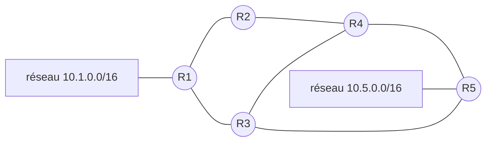

En première, on a vu qu'un **routeur** relie des réseaux et transmet chaque paquet vers le réseau suivant grâce à sa **table de routage**. Mais
qui remplit ces tables ? Sur Internet, des dizaines de milliers de réseaux changent sans cesse (pannes, nouveaux liens). Les routeurs se
mettent à jour **automatiquement** grâce à des **protocoles de routage**. Le programme en étudie deux : **RIP** et **OSPF**.

## Ce que dit le programme

Contenus : *protocoles de routage*. Capacités attendues : **identifier, suivant le protocole de routage utilisé, la route empruntée par un
paquet**. Le programme précise : en mode débranché, les tables de routage étant données, on se réfère au **nombre de sauts** (protocole RIP) ou
au **coût des routes** (protocole OSPF) ; le lien avec les **algorithmes de recherche de chemin sur un graphe** est mis en évidence.

## 1. Les tables de routage

Un réseau d'entreprise :



Une ligne de la table de routage de R1 pourrait être :

| Destination | Passerelle | Interface | Métrique |
| --- | --- | --- | --- |
| 10.5.0.0/16 | R3 | eth1 | 2 |

« Pour atteindre le réseau 10.5.0.0/16, envoyer le paquet à R3 par l'interface eth1 ; il est à 2 sauts. » Chaque routeur ne connaît que le
**prochain** routeur, pas le chemin complet : le paquet avance de proche en proche.

- **Routage statique** : un administrateur remplit les tables à la main. Simple, mais ne réagit pas aux pannes.
- **Routage dynamique** : les routeurs échangent des informations et calculent eux-mêmes leurs tables.

## 2. Le protocole RIP

**RIP** (*Routing Information Protocol*) est un protocole à **vecteur de distances** :

- la **métrique** est le **nombre de sauts** (nombre de routeurs à traverser) ;
- toutes les 30 secondes, chaque routeur envoie sa table à ses **voisins** directs ;
- quand un routeur apprend d'un voisin V qu'une destination est à d sauts de V, il sait qu'elle est à **d + 1** sauts de lui en passant par V ;
  il garde la route si elle est **nouvelle** ou **plus courte** que celle qu'il connaît.

Pour éviter les boucles, une distance de **16** signifie « inaccessible » : RIP est limité aux petits réseaux (15 sauts au maximum).

Dans le réseau ci-dessus, de R1 vers R5 : par R3, 2 sauts ; par R2 et R4, 3 sauts. RIP choisit **R3**.

Si la liaison R3–R5 tombe en panne, R3 ne reçoit plus d'informations de R5 ; au bout d'un délai, la route est supprimée et les échanges suivants
font converger les tables vers la route passant par R4.

## 3. Le protocole OSPF

**OSPF** (*Open Shortest Path First*) est un protocole à **état des liens** :

- chaque routeur diffuse à **tout** le réseau l'état de ses liaisons ; chacun connaît donc la **carte complète** (un **graphe** pondéré) ;
- la métrique est un **coût** qui dépend du **débit** des liaisons : coût = 10⁸ / débit (en bit/s) ;
- chaque routeur calcule les **plus courts chemins** (en coût) avec l'**algorithme de Dijkstra**.

| Liaison | Débit | Coût |
| --- | --- | --- |
| fibre | 1 Gbit/s | 10⁸ / 10⁹ = 0,1 (souvent arrondi à 1) |
| Fast Ethernet | 100 Mbit/s | 1 |
| Ethernet | 10 Mbit/s | 10 |
| ADSL | 1 Mbit/s | 100 |

Supposons que R1–R3 et R3–R5 soient des liaisons à 10 Mbit/s (coût 10 chacune), et toutes les autres à 100 Mbit/s (coût 1). De R1 vers R5 :

- par R3 : 10 + 10 = **20** ;
- par R2 et R4 : 1 + 1 + 1 = **3**.

OSPF choisit la route **par R2 et R4**, plus longue en sauts mais bien plus rapide. RIP aurait choisi la route lente par R3.

## 4. L'algorithme de Dijkstra

Il calcule, depuis un sommet de départ, la distance minimale (en coût) vers tous les autres sommets d'un graphe pondéré à poids **positifs**.

1. Distance du départ : 0 ; tous les autres : infini.
2. Tant qu'il reste des sommets non traités : choisir celui de **plus petite distance**, le marquer comme **définitif** ; pour chacun de ses
   voisins, si passer par lui donne une distance plus courte, mettre à jour la distance et retenir ce sommet comme **prédécesseur**.

Déroulé depuis R1 avec les coûts précédents (R1–R2 : 1, R1–R3 : 10, R2–R4 : 1, R3–R4 : 1, R3–R5 : 10, R4–R5 : 1) :

| Étape | Fixé | R1 | R2 | R3 | R4 | R5 |
| --- | --- | --- | --- | --- | --- | --- |
| départ | | 0 | ∞ | ∞ | ∞ | ∞ |
| 1 | R1 | **0** | 1 (R1) | 10 (R1) | ∞ | ∞ |
| 2 | R2 | | **1** | 10 (R1) | 2 (R2) | ∞ |
| 3 | R4 | | | 3 (R4) | **2** | 3 (R4) |
| 4 | R3 | | | **3** | | 3 (R4) |
| 5 | R5 | | | | | **3** |

Le meilleur chemin vers R5 coûte 3 ; en remontant les prédécesseurs : R5 ← R4 ← R2 ← R1. Même R3 est mieux atteint en passant par R2 et R4
(coût 3) qu'en direct (10).

```python exec
def dijkstra(g, depart):
    dist = {s: float("inf") for s in g}
    pred = {s: None for s in g}
    dist[depart] = 0
    a_traiter = list(g)
    while len(a_traiter) > 0:
        s = min(a_traiter, key=lambda x: dist[x])
        a_traiter.remove(s)
        for v, cout in g[s]:
            if dist[s] + cout < dist[v]:
                dist[v] = dist[s] + cout
                pred[v] = s
    return dist, pred

g = {
    "R1": [("R2", 1), ("R3", 10)],
    "R2": [("R1", 1), ("R4", 1)],
    "R3": [("R1", 10), ("R4", 1), ("R5", 10)],
    "R4": [("R2", 1), ("R3", 1), ("R5", 1)],
    "R5": [("R3", 10), ("R4", 1)],
}
dist, pred = dijkstra(g, "R1")
print(dist)
print(pred)
```

## 5. RIP ou OSPF ?

| | RIP | OSPF |
| --- | --- | --- |
| type | vecteur de distances | état des liens |
| métrique | nombre de sauts | coût (débit) |
| connaissance | seulement les voisins | carte complète |
| calcul | mises à jour successives | Dijkstra |
| taille de réseau | petite (15 sauts) | grande |
| réaction aux pannes | lente | rapide |

Entre les grands opérateurs d'Internet, c'est encore un autre protocole, **BGP**, qui est utilisé (hors programme).

## Les erreurs classiques des élèves

:::attention[Ce que tu verras en classe]
- **Compter les liaisons au lieu des routeurs** (ou l'inverse) pour les sauts : lire la convention de l'énoncé.
- **Croire qu'un routeur connaît tout le chemin** : il ne connaît que le prochain saut.
- **Oublier que RIP ignore le débit.**
- **Inverser la formule du coût** : c'est référence / débit, donc plus le débit est grand, plus le coût est **petit**.
- **Dijkstra** : fixer un sommet qui n'a pas la plus petite distance, ou oublier de mettre à jour un voisin.
:::

## En classe

:::methode[Activités qui marchent]
1. **Jeu de rôle RIP** : chaque élève est un routeur, ne parle qu'à ses voisins, et met à jour sa fiche de distances à chaque tour.
2. **Filius** : construire un réseau avec plusieurs routeurs, tracer un paquet, provoquer une panne.
3. **Dijkstra à la main** sur une carte de villes ou de métro, en tableau.
4. **`traceroute`** vers un site lointain : observer les routeurs traversés.
:::

## L'essentiel

- Une **table de routage** associe à chaque destination une **passerelle** (prochain routeur), une interface et une métrique.
- **RIP** : vecteur de distances, métrique = **nombre de sauts**, échanges avec les voisins, 15 sauts maximum.
- **OSPF** : état des liens, métrique = **coût** = 10⁸ / débit, carte complète, **Dijkstra**.
- **Dijkstra** : fixer le sommet non traité de plus petite distance, mettre à jour ses voisins, retenir les prédécesseurs.
- OSPF peut préférer un chemin plus long en sauts mais plus rapide.

## Exercices

::::exercice[Grand QCM : routage]{niveau=1 type=quiz}
Dix questions sur le routage. Pour les questions 6 à 8, on utilise le réseau du cours.

1. Que connaît un routeur pour une destination donnée ?

   - [ ] le chemin complet
   - [x] le prochain routeur (passerelle) et une métrique
   - [ ] uniquement l'adresse de destination
   - [ ] l'adresse MAC du destinataire final

   > Le paquet avance de proche en proche.

1. Quelle est la métrique de RIP ?

   - [x] le nombre de sauts
   - [ ] le débit
   - [ ] le délai en millisecondes
   - [ ] le coût financier

   > Une limite de 15 sauts en découle.

1. Quelle est la métrique d'OSPF ?

   - [ ] le nombre de sauts
   - [x] un coût qui dépend du débit des liaisons
   - [ ] l'adresse IP
   - [ ] le nombre de voisins

   > Coût = 10⁸ / débit.

1. Quel est le coût OSPF d'une liaison à 10 Mbit/s (référence 10⁸) ?

   - [ ] 1
   - [x] 10
   - [ ] 100
   - [ ] 0,1

   > 10⁸ / 10⁷ = 10.

1. Quel algorithme utilise OSPF pour calculer les meilleurs chemins ?

   - [ ] la recherche dichotomique
   - [ ] le tri par insertion
   - [x] l'algorithme de Dijkstra
   - [ ] le parcours en profondeur

   > Plus courts chemins dans un graphe pondéré.

1. Avec RIP, quelle route R1 choisit-il pour atteindre R5 ?

   - [x] par R3 (2 sauts)
   - [ ] par R2 et R4 (3 sauts)
   - [ ] les deux en alternance
   - [ ] aucune

   > Le moins de sauts.

1. Avec les coûts OSPF du cours, quelle route R1 choisit-il pour atteindre R5 ?

   - [ ] par R3, coût 20
   - [x] par R2 et R4, coût 3
   - [ ] par R3 puis R4, coût 12
   - [ ] aucune

   > Plus de sauts mais des liaisons rapides.

1. Dans le déroulé de Dijkstra depuis R1, quel sommet est fixé juste après R1 ?

   - [x] R2 (distance 1)
   - [ ] R3 (distance 10)
   - [ ] R5
   - [ ] R4

   > Toujours le sommet non traité de plus petite distance.

1. Avec RIP, à quoi correspond une distance de 16 ?

   - [ ] 16 routeurs
   - [x] une destination inaccessible
   - [ ] un débit de 16 Mbit/s
   - [ ] une erreur de configuration

   > C'est « l'infini » de RIP.

1. Quel protocole connaît la carte complète du réseau ?

   - [ ] RIP
   - [x] OSPF
   - [ ] les deux
   - [ ] aucun

   > Chaque routeur OSPF reçoit l'état de toutes les liaisons.
::::

::::exercice[Coûts OSPF]{niveau=1}
Écris `cout(debit)` qui renvoie le coût OSPF d'une liaison de débit donné en bit/s (référence 10⁸), puis `cout_chemin(debits)` qui renvoie le
coût total d'un chemin, donné par la liste des débits de ses liaisons.

```python depart
def cout(debit):
    ...

def cout_chemin(debits):
    ...
```

```python tests
assert cout(10**8) == 1 and cout(10**7) == 10 and cout(10**6) == 100, "coûts"
assert cout_chemin([10**7, 10**7]) == 20, "deux liaisons à 10 Mbit/s"
assert cout_chemin([10**8, 10**8, 10**8]) == 3, "trois liaisons à 100 Mbit/s"
assert cout_chemin([]) == 0, "chemin vide"
```

:::corrige
```python solution
def cout(debit):
    return 10**8 / debit

def cout_chemin(debits):
    total = 0
    for d in debits:
        total = total + cout(d)
    return total
```

On retrouve l'exemple du cours : 20 par R3, 3 par R2 et R4.
:::
::::

::::exercice[Une mise à jour RIP]{niveau=2}
La table d'un routeur est un dictionnaire destination → `(passerelle, distance)`. Il reçoit la table de son voisin `v` (dictionnaire destination
→ distance depuis v). Écris `mise_a_jour(table, v, table_voisin)` qui renvoie la nouvelle table : pour chaque destination du voisin, la route via
v coûte distance + 1 ; on l'adopte si la destination est inconnue ou si c'est strictement plus court. On ignore les distances ≥ 16.

```python depart
def mise_a_jour(table, v, table_voisin):
    ...
```

```python tests
t = {"N1": ("direct", 0), "N5": ("R2", 3)}
nt = mise_a_jour(t, "R3", {"N5": 1, "N7": 2, "N1": 1})
assert nt["N5"] == ("R3", 2), "route plus courte adoptée"
assert nt["N7"] == ("R3", 3), "nouvelle destination"
assert nt["N1"] == ("direct", 0), "route directe gardée"
assert "N9" not in mise_a_jour(t, "R3", {"N9": 15}), "16 = inaccessible"
assert t == {"N1": ("direct", 0), "N5": ("R2", 3)}, "table de départ intacte"
```

:::corrige
```python solution
def mise_a_jour(table, v, table_voisin):
    nouvelle = dict(table)
    for dest in table_voisin:
        d = table_voisin[dest] + 1
        if d < 16:
            if dest not in nouvelle or d < nouvelle[dest][1]:
                nouvelle[dest] = (v, d)
    return nouvelle
```

C'est tout RIP : chaque routeur ne fait que cette opération, avec chacun de ses voisins, toutes les 30 secondes. `dict(table)` crée une
copie pour ne pas modifier la table reçue.
:::
::::

::::exercice[Dijkstra et chemin]{niveau=2}
Écris `dijkstra(g, depart)` qui renvoie le dictionnaire des distances minimales depuis `depart` dans un graphe pondéré (dictionnaire sommet →
liste de couples `(voisin, cout)`), puis `chemin(g, a, b)` qui renvoie le meilleur chemin de a à b sous forme de liste de sommets.

```python depart
def dijkstra(g, depart):
    ...

def chemin(g, a, b):
    ...
```

```python tests
g = {
    "R1": [("R2", 1), ("R3", 10)],
    "R2": [("R1", 1), ("R4", 1)],
    "R3": [("R1", 10), ("R4", 1), ("R5", 10)],
    "R4": [("R2", 1), ("R3", 1), ("R5", 1)],
    "R5": [("R3", 10), ("R4", 1)],
}
assert dijkstra(g, "R1") == {"R1": 0, "R2": 1, "R3": 3, "R4": 2, "R5": 3}, "distances"
assert chemin(g, "R1", "R5") == ["R1", "R2", "R4", "R5"], "meilleur chemin"
assert chemin(g, "R3", "R3") == ["R3"], "chemin trivial"
```

:::corrige
```python solution
def plus_courts(g, depart):
    dist = {s: float("inf") for s in g}
    pred = {s: None for s in g}
    dist[depart] = 0
    a_traiter = list(g)
    while len(a_traiter) > 0:
        s = a_traiter[0]
        for x in a_traiter:
            if dist[x] < dist[s]:
                s = x
        a_traiter.remove(s)
        for v, c in g[s]:
            if dist[s] + c < dist[v]:
                dist[v] = dist[s] + c
                pred[v] = s
    return dist, pred

def dijkstra(g, depart):
    return plus_courts(g, depart)[0]

def chemin(g, a, b):
    pred = plus_courts(g, a)[1]
    resultat = [b]
    while resultat[-1] != a:
        resultat.append(pred[resultat[-1]])
    resultat.reverse()
    return resultat
```

La recherche du sommet de plus petite distance est une recherche de minimum. Pour reconstituer le chemin, on remonte les prédécesseurs depuis b.
:::
::::

::::exercice[RIP ou OSPF ?]{niveau=2}
Une entreprise a deux sites reliés de deux façons : une liaison directe à 2 Mbit/s, et un chemin passant par trois routeurs intermédiaires dont
toutes les liaisons sont en fibre à 1 Gbit/s (4 liaisons). (a) Quelle route choisit RIP ? OSPF (coûts 10⁸ / débit, sans arrondi) ? (b) Laquelle
est la meilleure pour transférer de gros fichiers ? (c) Que se passe-t-il avec chaque protocole si la liaison directe tombe en panne ?

:::criteres
- (a) RIP : liaison directe (1 saut contre 4). OSPF : coût direct 50, chemin fibre 4 × 0,1 = 0,4 ; OSPF choisit la fibre.
- (b) La fibre : débit 500 fois supérieur.
- (c) RIP finit par basculer vers le chemin par la fibre après expiration de la route (plus lent) ; OSPF n'utilisait déjà pas la liaison
  directe, pas d'impact.
:::

:::corrige
(a) **RIP** compte les sauts : 1 pour la liaison directe, 4 par la fibre ; il choisit la **liaison directe**. **OSPF** compte les coûts :
10⁸ / (2 × 10⁶) = **50** pour la liaison directe ; 4 × 10⁸ / 10⁹ = **0,4** par la fibre ; il choisit la **fibre**. (b) La fibre est 500 fois
plus rapide : c'est le meilleur choix pour de gros transferts, malgré les routeurs intermédiaires. (c) Avec **RIP**, la route directe disparaît
après un délai (absence de mises à jour), puis les échanges avec les voisins font converger les tables vers le chemin par la fibre : quelques
minutes de perturbation. Avec **OSPF**, la panne ne change rien au trafic, qui passait déjà par la fibre ; et en cas de panne d'une liaison
utilisée, l'information se diffuse à tout le réseau et chaque routeur recalcule immédiatement avec Dijkstra.
:::
::::
