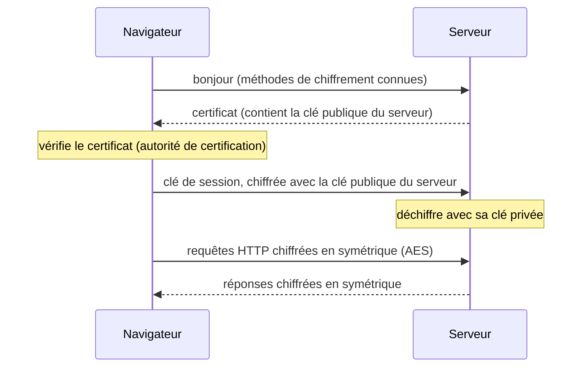

Quand on se connecte à son ENT ou qu'on paie en ligne, les données traversent des dizaines de réseaux et de routeurs que l'on ne contrôle pas.
N'importe qui sur le chemin pourrait les lire. Pour les protéger, on les **chiffre** : on les rend illisibles pour qui ne possède pas la **clé**.
Ce chapitre présente les deux grandes familles de chiffrement et la façon dont HTTPS les combine.

## Ce que dit le programme

Contenus : *sécurisation des communications*. Capacités attendues : **décrire les principes de chiffrement symétrique (clef partagée) et
asymétrique (avec clef privée/clef publique)** ; **décrire l'échange d'une clef symétrique en utilisant un protocole asymétrique pour sécuriser
une communication HTTPS**. Le programme précise que les aspects mathématiques du chiffrement (RSA) ne sont pas exigibles, que la notion de
certificat est évoquée, et que l'on peut programmer des chiffrements simples (César, Vigenère, XOR).

## 1. Vocabulaire

- **Chiffrer** : transformer un message **clair** en message **chiffré**, à l'aide d'une **clé**.
- **Déchiffrer** : retrouver le clair à partir du chiffré, **avec** la clé.
- **Décrypter** : retrouver le clair **sans** la clé (c'est casser le chiffrement). On ne dit pas « crypter ».

Principe de **Kerckhoffs** (1883) : la sécurité doit reposer sur le **secret de la clé**, pas sur le secret de la méthode. Les algorithmes
sérieux sont publics et étudiés par tous.

## 2. Le chiffrement symétrique

Une **seule clé**, partagée par l'émetteur et le destinataire, sert à chiffrer **et** à déchiffrer.

**César** : décaler chaque lettre de k rangs (la clé). Il n'y a que 25 clés : on les essaie toutes. **Vigenère** : le décalage change à chaque
lettre selon un mot-clé, ce qui résiste à l'analyse des fréquences simple.

```python exec
def vigenere(texte, cle, sens=1):
    resultat = ""
    for i in range(len(texte)):
        c = texte[i]
        decalage = ord(cle[i % len(cle)]) - ord("A")
        resultat = resultat + chr((ord(c) - ord("A") + sens * decalage) % 26 + ord("A"))
    return resultat

chiffre = vigenere("ATTAQUEAUBOIS", "NSI")
print(chiffre, vigenere(chiffre, "NSI", -1))
```

**XOR** : on combine chaque bit du message avec un bit de la clé par OU exclusif. Comme `(m XOR k) XOR k = m`, la **même** opération chiffre et
déchiffre.

```python exec
def xor(octets, cle):
    return bytes([octets[i] ^ cle[i % len(cle)] for i in range(len(octets))])

message = "Rendez-vous à 18 h".encode("utf-8")
cle = b"cle!"
chiffre = xor(message, cle)
print(chiffre)
print(xor(chiffre, cle).decode("utf-8"))
```

Si la clé est **aléatoire**, **aussi longue** que le message et **jamais réutilisée** (le **masque jetable**, ou chiffre de Vernam), le
chiffrement est **parfaitement sûr**. Mais il faut transmettre une clé aussi longue que le message…

Aujourd'hui, le standard est **AES** (2001) : des clés de 128 ou 256 bits, des opérations sur des blocs de 128 bits, et aucune attaque connue
plus rapide que d'essayer les 2¹²⁸ clés. Il est **très rapide**, souvent accéléré par le processeur.

:::attention[Le problème de l'échange de clé]
Le chiffrement symétrique est rapide et sûr, mais l'émetteur et le destinataire doivent d'abord **partager la clé** secrètement. Comment
partager une clé avec un site Web qu'on n'a jamais rencontré, à travers un réseau où tout le monde peut écouter ?
:::

## 3. Le chiffrement asymétrique

Inventé dans les années 1970 (Diffie, Hellman ; Rivest, Shamir, Adleman), il utilise **deux clés** liées :

- une **clé publique**, que l'on peut donner à **tout le monde** : elle sert à **chiffrer** ;
- une **clé privée**, que l'on garde **secrète** : elle seule permet de **déchiffrer**.

Image : un **cadenas ouvert** que l'on distribue à tous (la clé publique). N'importe qui peut fermer une boîte avec, mais seul le propriétaire de
la **clé** du cadenas (la clé privée) peut l'ouvrir.

Plus besoin de partager un secret : Alice chiffre avec la clé publique de Bob, seul Bob peut lire.

**RSA** en bref (les mathématiques ne sont pas exigibles) : on choisit deux grands nombres premiers p et q et on publie n = p × q. Retrouver
p et q à partir de n (**factoriser**) est hors de portée pour un nombre de 2 048 bits. Un exemple jouet :

```python exec
p, q = 61, 53
n = p * q                 # 3233, public
e = 17                    # exposant public : clé publique (e, n)
d = 2753                  # exposant privé  : clé privée (d, n), car e * d = 1 modulo (p-1)(q-1)

m = 65                    # message (un nombre plus petit que n)
c = pow(m, e, n)          # chiffrement avec la clé publique
print("chiffré :", c, "| déchiffré :", pow(c, d, n))
```

Inconvénient : le chiffrement asymétrique est **beaucoup plus lent** (environ mille fois) que le symétrique.

**Signature** : en utilisant les clés dans l'autre sens (on « chiffre » avec sa clé **privée**), on prouve qu'un message vient bien de soi,
puisque n'importe qui peut vérifier avec la clé **publique**.

## 4. HTTPS : le meilleur des deux

HTTPS = HTTP + **TLS**. À l'ouverture d'une connexion :



1. Le serveur envoie son **certificat**, qui contient sa **clé publique**.
2. Le navigateur vérifie le certificat : il est **signé** par une **autorité de certification** en laquelle le navigateur a confiance.
3. Le navigateur génère une **clé de session** aléatoire (symétrique) et l'envoie chiffrée avec la clé publique du serveur (**asymétrique**).
4. Seul le serveur peut la déchiffrer. Désormais, les deux partagent un secret : tout l'échange est chiffré en **symétrique**, rapidement.

Les versions actuelles de TLS utilisent plutôt un échange de **Diffie-Hellman** pour fabriquer la clé de session, mais le principe est le même :
l'asymétrique sert à établir le secret, le symétrique à chiffrer les données.

**Pourquoi le certificat ?** Sans lui, un pirate placé entre le navigateur et le serveur (**attaque de l'homme du milieu**) pourrait envoyer
**sa** clé publique en se faisant passer pour le serveur. Le certificat prouve que la clé publique appartient bien au nom de domaine visité.

## Les erreurs classiques des élèves

:::attention[Ce que tu verras en classe]
- **Inverser les clés** : on chiffre avec la clé **publique** du destinataire, il déchiffre avec sa clé **privée**.
- **Croire que la clé publique doit rester secrète.**
- **Croire que HTTPS chiffre tout en asymétrique** : seulement l'échange de la clé de session.
- **Croire que le cadenas garantit l'honnêteté du site** : il garantit seulement le chiffrement et l'identité du nom de domaine.
- **Confondre chiffrer, déchiffrer, décrypter**, ou dire « crypter ».
- **Confondre chiffrement et hachage** (un mot de passe est stocké **haché**, on ne peut pas le « déchiffrer »).
:::

## En classe

:::methode[Activités qui marchent]
1. **Casser César** en essayant les 25 clés, puis par analyse des fréquences (lien avec les dictionnaires de première).
2. **Le cadenas** : faire passer une boîte fermée entre élèves avec deux cadenas successifs, sans jamais transmettre de clé.
3. **Observer un certificat** dans le navigateur (cliquer sur le cadenas) : émetteur, validité, clé publique.
4. **RSA jouet** avec de petits nombres en Python, puis discuter de la factorisation de grands nombres.
:::

## L'essentiel

- **Symétrique** : une seule clé partagée ; rapide (AES) ; problème : **échanger la clé**. César, Vigenère, XOR (masque jetable).
- **Asymétrique** : clé **publique** pour chiffrer, clé **privée** pour déchiffrer ; pas de secret à partager ; lent (RSA, factorisation).
- **HTTPS** : certificat (clé publique du serveur, signé par une autorité) → échange d'une **clé de session** en asymétrique → échange des données
  en **symétrique**.
- Le **certificat** protège contre l'**homme du milieu**.

## Exercices

::::exercice[Grand QCM : chiffrement]{niveau=1 type=quiz}
Douze questions sur la sécurisation des communications.

1. Dans un chiffrement symétrique :

   - [x] la même clé sert à chiffrer et à déchiffrer
   - [ ] il y a une clé publique et une clé privée
   - [ ] il n'y a pas de clé
   - [ ] seul le destinataire a une clé

   > Émetteur et destinataire partagent le même secret.

1. Quel est le principal problème du chiffrement symétrique ?

   - [ ] il est trop lent
   - [x] il faut partager la clé secrètement au préalable
   - [ ] il ne marche que sur du texte
   - [ ] il est toujours facile à casser

   > Comment partager un secret à travers un réseau espionné ?

1. Alice veut envoyer un message secret à Bob avec un chiffrement asymétrique. Elle chiffre avec :

   - [ ] sa clé privée
   - [ ] sa clé publique
   - [x] la clé publique de Bob
   - [ ] la clé privée de Bob

   > Seul Bob, avec sa clé privée, pourra déchiffrer.

1. La clé publique :

   - [ ] doit rester secrète
   - [x] peut être diffusée à tout le monde
   - [ ] sert à déchiffrer
   - [ ] change à chaque message

   > C'est la clé privée qui reste secrète.

1. Quel est le résultat de `(m XOR k) XOR k` ?

   - [ ] k
   - [ ] 0
   - [x] m
   - [ ] m XOR k

   > Appliquer deux fois la même clé redonne le message.

1. Pourquoi HTTPS n'utilise-t-il pas l'asymétrique pour tout l'échange ?

   - [ ] parce qu'il est moins sûr
   - [x] parce qu'il est beaucoup plus lent
   - [ ] parce que les navigateurs ne le connaissent pas
   - [ ] parce qu'il ne chiffre que les nombres

   > On l'utilise seulement pour établir la clé de session.

1. Dans HTTPS, à quoi sert le chiffrement asymétrique ?

   - [x] à échanger de façon sûre une clé de session symétrique
   - [ ] à chiffrer les images
   - [ ] à compresser les pages
   - [ ] à choisir le routeur

   > Ensuite, l'échange se fait en symétrique.

1. À quoi sert le certificat d'un site ?

   - [ ] à prouver que le site est honnête
   - [x] à prouver que la clé publique appartient bien à ce nom de domaine
   - [ ] à accélérer la connexion
   - [ ] à stocker les mots de passe

   > Il est signé par une autorité de certification.

1. Contre quelle attaque protège le certificat ?

   - [ ] le déni de service
   - [x] l'homme du milieu
   - [ ] le virus
   - [ ] l'hameçonnage par courriel

   > Un intermédiaire ne peut pas se faire passer pour le serveur.

1. Sur quoi repose la sécurité de RSA ?

   - [ ] sur le secret de l'algorithme
   - [x] sur la difficulté de factoriser un très grand nombre
   - [ ] sur la longueur des messages
   - [ ] sur la vitesse du réseau

   > Multiplier p et q est facile, retrouver p et q à partir de n ne l'est pas.

1. Combien de clés faut-il essayer au plus pour casser un chiffrement de César ?

   - [x] 25
   - [ ] 26 × 26
   - [ ] 2¹²⁸
   - [ ] une infinité

   > Il n'y a que 25 décalages utiles.

1. Retrouver un message sans connaître la clé, c'est :

   - [ ] chiffrer
   - [ ] déchiffrer
   - [x] décrypter
   - [ ] crypter

   > « Crypter » n'existe pas en cryptographie.
::::

::::exercice[César et force brute]{niveau=1}
Écris `cesar(texte, k)` qui décale chaque lettre majuscule de k rangs (les autres caractères sont inchangés), puis `toutes_les_cles(chiffre)` qui
renvoie la liste des 26 déchiffrements possibles (décalages 0 à 25).

```python depart
def cesar(texte, k):
    ...

def toutes_les_cles(chiffre):
    ...
```

```python tests
assert cesar("NSI", 3) == "QVL", "décalage de 3"
assert cesar("XYZ", 3) == "ABC", "on revient au début"
assert cesar("SALUT, NSI !", 13) == "FNYHG, AFV !", "ponctuation gardée"
assert cesar(cesar("BONJOUR", 7), -7) == "BONJOUR", "déchiffrement"
assert "ATTAQUE" in toutes_les_cles(cesar("ATTAQUE", 11)), "force brute"
assert len(toutes_les_cles("ABC")) == 26, "26 essais"
```

:::corrige
```python solution
def cesar(texte, k):
    resultat = ""
    for c in texte:
        if "A" <= c <= "Z":
            resultat = resultat + chr((ord(c) - ord("A") + k) % 26 + ord("A"))
        else:
            resultat = resultat + c
    return resultat

def toutes_les_cles(chiffre):
    return [cesar(chiffre, -k) for k in range(26)]
```

Avec si peu de clés, il suffit de lire les 26 propositions pour trouver la bonne : c'est l'attaque par **force brute**.
:::
::::

::::exercice[Chiffrer avec XOR]{niveau=2}
Écris `chiffrer_xor(texte, cle)` qui encode le texte en UTF-8, applique un XOR octet par octet avec la clé (une chaîne, répétée si besoin) et
renvoie les octets chiffrés, puis `dechiffrer_xor(octets, cle)` qui renvoie le texte de départ.

```python depart
def chiffrer_xor(texte, cle):
    ...

def dechiffrer_xor(octets, cle):
    ...
```

```python tests
c = chiffrer_xor("Rendez-vous à 18 h", "secret")
assert c != "Rendez-vous à 18 h".encode("utf-8"), "le message est transformé"
assert dechiffrer_xor(c, "secret") == "Rendez-vous à 18 h", "aller-retour"
assert chiffrer_xor("A", "A") == bytes([0]), "un octet XOR lui-même donne 0"
assert dechiffrer_xor(chiffrer_xor("NSI", "k"), "k") == "NSI", "clé d'une lettre"
```

:::corrige
```python solution
def appliquer_xor(octets, cle_octets):
    return bytes([octets[i] ^ cle_octets[i % len(cle_octets)] for i in range(len(octets))])

def chiffrer_xor(texte, cle):
    return appliquer_xor(texte.encode("utf-8"), cle.encode("utf-8"))

def dechiffrer_xor(octets, cle):
    return appliquer_xor(octets, cle.encode("utf-8")).decode("utf-8")
```

La même fonction `appliquer_xor` chiffre et déchiffre : c'est un chiffrement **symétrique**. Une clé courte répétée est faible ; une clé
aléatoire aussi longue que le message et jamais réutilisée serait inviolable.
:::
::::

::::exercice[RSA jouet]{niveau=2}
Avec la clé publique `(e, n) = (17, 3233)` et la clé privée `(d, n) = (2753, 3233)`, écris `chiffrer(m, e, n)` et `dechiffrer(c, d, n)` (avec
`pow(x, y, n)`), puis `chiffrer_texte(texte, e, n)` qui chiffre chaque caractère (son code `ord`) et renvoie la liste des nombres, et
`dechiffrer_texte(nombres, d, n)` qui reconstitue le texte.

```python depart
def chiffrer(m, e, n):
    ...

def dechiffrer(c, d, n):
    ...

def chiffrer_texte(texte, e, n):
    ...

def dechiffrer_texte(nombres, d, n):
    ...
```

```python tests
assert dechiffrer(chiffrer(65, 17, 3233), 2753, 3233) == 65, "un nombre"
assert chiffrer(65, 17, 3233) != 65, "le nombre est transformé"
nombres = chiffrer_texte("NSI", 17, 3233)
assert len(nombres) == 3, "un nombre par caractère"
assert dechiffrer_texte(nombres, 2753, 3233) == "NSI", "aller-retour"
```

:::corrige
```python solution
def chiffrer(m, e, n):
    return pow(m, e, n)

def dechiffrer(c, d, n):
    return pow(c, d, n)

def chiffrer_texte(texte, e, n):
    return [chiffrer(ord(c), e, n) for c in texte]

def dechiffrer_texte(nombres, d, n):
    return "".join([chr(dechiffrer(c, d, n)) for c in nombres])
```

Chiffrer caractère par caractère est un jeu : la même lettre donne toujours le même nombre (analyse des fréquences possible), et n = 61 × 53 se
factorise instantanément. Le vrai RSA utilise des nombres de plus de 600 chiffres et ne chiffre qu'une clé de session.
:::
::::

::::exercice[Expliquer HTTPS]{niveau=2}
Explique à un élève, sans formule, ce qui se passe quand il se connecte à `https://ent.exemple.fr`, depuis la saisie de l'adresse jusqu'à l'envoi
de son mot de passe. Utilise une image (cadenas, coffre…) pour le chiffrement asymétrique, et dis pourquoi on ne chiffre pas tout en
asymétrique.

:::criteres
- Le serveur envoie son certificat avec sa clé publique ; le navigateur vérifie le certificat (autorité de certification).
- Le navigateur crée une clé de session, l'envoie chiffrée avec la clé publique ; seul le serveur (clé privée) peut la lire.
- Ensuite, chiffrement symétrique rapide ; le mot de passe voyage chiffré.
- Image correcte (cadenas ouvert distribué, clé gardée) et raison : l'asymétrique est lent.
:::

:::corrige
Quand tu tapes l'adresse, ton navigateur contacte le serveur de l'ENT, qui lui envoie sa **carte d'identité numérique** : le **certificat**. Il
contient sa **clé publique**, et il est signé par un organisme de confiance que ton navigateur connaît : le navigateur vérifie qu'il parle bien
au vrai `ent.exemple.fr`. Imagine que la clé publique est un **cadenas ouvert** que le serveur distribue à tout le monde : n'importe qui peut
fermer une boîte avec, mais seul le serveur a la **clé** (la clé privée) pour l'ouvrir. Ton navigateur invente alors un **code secret**
aléatoire (la clé de session), le met dans une boîte, la ferme avec le cadenas du serveur et l'envoie : même si quelqu'un intercepte la boîte, il
ne peut pas l'ouvrir. Maintenant, ton navigateur et le serveur connaissent tous les deux ce code secret, et l'utilisent pour chiffrer tout le
reste de l'échange en **symétrique**, dont ton **mot de passe**. Pourquoi ne pas tout faire avec le cadenas ? Parce que le chiffrement
asymétrique est environ **mille fois plus lent** : on ne l'utilise que pour s'échanger le code secret.
:::
::::
