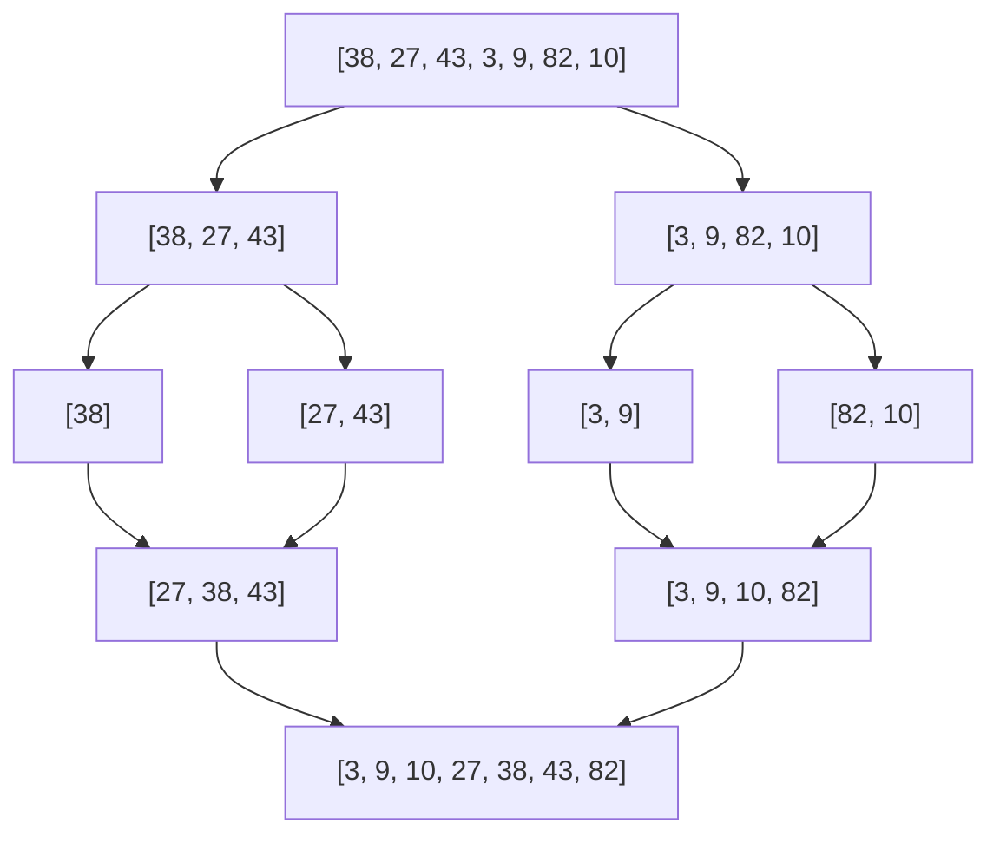

Pour trier un paquet de 1 000 copies, on peut le couper en deux, donner chaque moitié à un collègue, puis **fusionner** les deux paquets triés en
les parcourant ensemble. Chaque collègue peut faire de même… C'est la méthode **diviser pour régner** : elle produit des algorithmes
spectaculairement plus rapides que les méthodes naïves, et la **récursivité** est l'outil naturel pour les écrire.

## Ce que dit le programme

Contenus : *méthode « diviser pour régner »*. Capacités attendues : **écrire un algorithme utilisant la méthode « diviser pour régner »**. Le
programme précise : la **rotation d'une image bitmap d'un quart de tour** avec un coût en mémoire constant est un bon exemple ; l'exemple du
**tri fusion** permet également d'exploiter la récursivité et d'exhiber un algorithme de coût en **n log₂ n** dans les pires des cas.

## 1. La méthode

1. **Diviser** : découper le problème en sous-problèmes **plus petits**, de même nature et **indépendants**.
2. **Régner** : résoudre chaque sous-problème, **récursivement** (jusqu'à un cas de base trivial).
3. **Combiner** : construire la solution du problème à partir des solutions des sous-problèmes.

On l'a déjà rencontrée : la **dichotomie** (diviser en deux, ne garder qu'une moitié) et la **puissance rapide** (aⁿ à partir de a^(n/2)).

## 2. La dichotomie, en récursif

```python exec
def dicho(t, x, debut, fin):
    """Cherche x dans t[debut..fin] (t trié) ; renvoie True ou False."""
    if debut > fin:
        return False
    milieu = (debut + fin) // 2
    if t[milieu] == x:
        return True
    if x < t[milieu]:
        return dicho(t, x, debut, milieu - 1)
    return dicho(t, x, milieu + 1, fin)

t = [2, 5, 8, 12, 16, 23, 38, 56, 72, 91]
print(dicho(t, 23, 0, len(t) - 1), dicho(t, 10, 0, len(t) - 1))
```

On passe les **indices** de la zone de recherche plutôt que de copier des morceaux du tableau.

## 3. Le tri fusion

**Diviser** le tableau en deux moitiés ; **trier** chaque moitié récursivement ; **fusionner** les deux moitiés triées.



L'étape clé est la **fusion** de deux tableaux **déjà triés** : on compare leurs premiers éléments, on prend le plus petit, et on recommence.

```python exec
def fusion(a, b):
    """Fusionne deux tableaux triés en un tableau trié."""
    resultat = []
    i = 0
    j = 0
    while i < len(a) and j < len(b):
        if a[i] <= b[j]:
            resultat.append(a[i])
            i = i + 1
        else:
            resultat.append(b[j])
            j = j + 1
    while i < len(a):          # reste de a
        resultat.append(a[i])
        i = i + 1
    while j < len(b):          # reste de b
        resultat.append(b[j])
        j = j + 1
    return resultat

def tri_fusion(t):
    if len(t) <= 1:            # cas de base : déjà trié
        return t
    milieu = len(t) // 2
    gauche = tri_fusion(t[:milieu])
    droite = tri_fusion(t[milieu:])
    return fusion(gauche, droite)

print(fusion([3, 27, 38], [9, 10, 43]))
print(tri_fusion([38, 27, 43, 3, 9, 82, 10]))
```

Les tranches `t[:milieu]` et `t[milieu:]` copient les deux moitiés : c'est simple à écrire (en terminale, les tranches sont utilisées
librement).

## 4. Le coût : n log n

- La **fusion** de deux tableaux de tailles totales n fait **au plus n** comparaisons (chaque comparaison place un élément).
- Le tableau est coupé en deux jusqu'à des tableaux de taille 1 : il y a environ **log₂ n** niveaux.
- À chaque niveau, les fusions portent en tout sur les **n** éléments.

Total : de l'ordre de **n × log₂ n** opérations, **même dans le pire cas**.

| n | n² / 2 (sélection) | n log₂ n (fusion) |
| --- | --- | --- |
| 1 000 | 500 000 | 10 000 |
| 1 000 000 | 500 milliards | 20 millions |

Pour un million d'éléments, le tri fusion est environ **25 000 fois** plus rapide. C'est le principe des tris réellement utilisés (Timsort de
Python mélange tri fusion et tri par insertion). Contrepartie : il utilise de la **mémoire supplémentaire** pour les tableaux intermédiaires.

## 5. La rotation d'une image

Une image carrée de côté n = 2ᵏ pixels peut être tournée d'un quart de tour par diviser pour régner : on la **découpe en quatre** quarts, on fait
tourner **chaque quart** récursivement, puis on **permute circulairement** les quatre quarts (haut-gauche → haut-droite → bas-droite →
bas-gauche → haut-gauche). En faisant les échanges directement dans l'image, aucune image supplémentaire n'est nécessaire : le coût en mémoire est
**constant**.

## Les erreurs classiques des élèves

:::attention[Ce que tu verras en classe]
- **Oublier le cas de base** (`len(t) <= 1`) : récursion infinie.
- **Fusion** : oublier d'ajouter le **reste** d'un des deux tableaux.
- **Fusion** : comparer avec `<` et perdre la **stabilité** (à égalité, on prend dans `a` pour garder l'ordre de départ).
- **Croire que diviser en deux suffit** : il faut aussi que la **combinaison** soit efficace.
- **Confondre** le coût n log n du tri fusion avec le log n de la dichotomie.
:::

## En classe

:::methode[Activités qui marchent]
1. **Débranché** : trier un paquet de cartes à plusieurs par fusions successives, chronométrer face à un tri par sélection.
2. **Visualisation** du tri fusion (de nombreuses animations en ligne) et de l'arbre des appels.
3. **Mesurer** en Python le temps du tri par sélection et du tri fusion pour n = 1 000, 2 000, 4 000.
4. **Rotation d'image** avec la bibliothèque PIL, sur une petite image de 2ᵏ pixels de côté.
:::

## L'essentiel

- **Diviser pour régner** : diviser en sous-problèmes indépendants, les résoudre récursivement, combiner.
- **Dichotomie** récursive : on ne résout qu'une moitié ; coût log₂ n.
- **Tri fusion** : couper en deux, trier chaque moitié, **fusionner** (comparer les premiers éléments, puis ajouter les restes).
- Coût du tri fusion : **n log₂ n** dans tous les cas, contre n² pour sélection et insertion ; mémoire supplémentaire.
- Rotation d'image d'un quart de tour : quatre quarts tournés récursivement puis permutés.

## Exercices

::::exercice[Grand QCM : diviser pour régner]{niveau=1 type=quiz}
Dix questions sur la méthode diviser pour régner.

1. Quelles sont les trois étapes de la méthode ?

   - [ ] trier, chercher, afficher
   - [x] diviser, régner, combiner
   - [ ] lire, calculer, écrire
   - [ ] découper, compter, choisir

   > Régner = résoudre les sous-problèmes, souvent récursivement.

1. Que renvoie `fusion([1, 4, 9], [2, 3, 10])` ?

   - [ ] `[1, 4, 9, 2, 3, 10]`
   - [x] `[1, 2, 3, 4, 9, 10]`
   - [ ] `[1, 2, 4, 3, 9, 10]`
   - [ ] `[10, 9, 4, 3, 2, 1]`

   > On prend à chaque fois le plus petit des deux premiers éléments.

1. Combien de comparaisons au plus pour fusionner deux tableaux triés de 5 éléments chacun ?

   - [ ] 5
   - [x] 9
   - [ ] 25
   - [ ] 100

   > Chaque comparaison place un élément ; le dernier se place sans comparaison.

1. Quel est le cas de base du tri fusion ?

   - [ ] un tableau de 2 éléments
   - [x] un tableau de 0 ou 1 élément
   - [ ] un tableau déjà trié
   - [ ] il n'y en a pas

   > Un tel tableau est trié par définition.

1. Quel est le coût du tri fusion dans le pire cas ?

   - [ ] n
   - [x] n log₂ n
   - [ ] n²
   - [ ] log₂ n

   > Contrairement au tri par insertion, il n'a pas de « mauvais cas ».

1. Pour n = 1 000 000, combien d'opérations environ fait le tri fusion ?

   - [ ] 1 000
   - [x] 20 millions
   - [ ] 500 milliards
   - [ ] un million

   > n × log₂ n ≈ 10⁶ × 20.

1. Quel est l'inconvénient du tri fusion présenté ?

   - [ ] il est quadratique
   - [x] il utilise de la mémoire supplémentaire
   - [ ] il ne trie pas les nombres négatifs
   - [ ] il ne marche que pour des tailles paires

   > Les moitiés et les fusions créent de nouveaux tableaux.

1. Dans la dichotomie, combien de sous-problèmes résout-on à chaque étape ?

   - [x] un seul
   - [ ] deux
   - [ ] quatre
   - [ ] aucun

   > L'autre moitié est éliminée.

1. Pourquoi, dans la fusion, prend-on `a[i]` quand `a[i] == b[j]` ?

   - [ ] c'est obligatoire en Python
   - [x] pour garder l'ordre de départ des éléments égaux (stabilité)
   - [ ] pour aller plus vite
   - [ ] pour éviter une erreur

   > Les éléments de la moitié gauche étaient avant dans le tableau.

1. Pour faire tourner une image d'un quart de tour par diviser pour régner, on :

   - [ ] trie les pixels
   - [x] découpe l'image en quatre quarts, les fait tourner récursivement et les permute
   - [ ] lit les pixels ligne par ligne
   - [ ] divise les couleurs par deux

   > Possible sans image supplémentaire.
::::

::::exercice[Fusionner deux tableaux triés]{niveau=1}
Écris `fusion(a, b)` qui renvoie le tableau trié contenant les éléments des deux tableaux triés `a` et `b`, en un seul parcours (sans `sort` ni
`sorted`).

```python depart
def fusion(a, b):
    ...
```

```python tests
assert fusion([1, 4, 9], [2, 3, 10]) == [1, 2, 3, 4, 9, 10], "cas général"
assert fusion([], [5, 6]) == [5, 6] and fusion([5, 6], []) == [5, 6], "un tableau vide"
assert fusion([1, 2], [3, 4, 5, 6]) == [1, 2, 3, 4, 5, 6], "a épuisé en premier"
assert fusion([2, 2], [2]) == [2, 2, 2], "égalités"
```

:::corrige
```python solution
def fusion(a, b):
    resultat = []
    i = 0
    j = 0
    while i < len(a) and j < len(b):
        if a[i] <= b[j]:
            resultat.append(a[i])
            i = i + 1
        else:
            resultat.append(b[j])
            j = j + 1
    while i < len(a):
        resultat.append(a[i])
        i = i + 1
    while j < len(b):
        resultat.append(b[j])
        j = j + 1
    return resultat
```

Les deux dernières boucles ajoutent le reste du tableau qui n'est pas épuisé (une seule des deux s'exécute vraiment).
:::
::::

::::exercice[Le tri fusion]{niveau=2}
Écris `tri_fusion(t)` qui renvoie un nouveau tableau trié, avec la méthode diviser pour régner. La fonction `fusion` est fournie.

```python depart
def fusion(a, b):
    resultat = []
    i, j = 0, 0
    while i < len(a) and j < len(b):
        if a[i] <= b[j]:
            resultat.append(a[i]); i = i + 1
        else:
            resultat.append(b[j]); j = j + 1
    return resultat + a[i:] + b[j:]

def tri_fusion(t):
    ...
```

```python tests
assert tri_fusion([38, 27, 43, 3, 9, 82, 10]) == [3, 9, 10, 27, 38, 43, 82], "cas général"
assert tri_fusion([]) == [] and tri_fusion([5]) == [5], "cas de base"
assert tri_fusion([5, 4, 3, 2, 1]) == [1, 2, 3, 4, 5], "ordre inverse"
import random
t = [random.randint(0, 1000) for i in range(500)]
assert tri_fusion(t) == sorted(t), "500 valeurs aléatoires"
```

:::corrige
```python solution
def fusion(a, b):
    resultat = []
    i, j = 0, 0
    while i < len(a) and j < len(b):
        if a[i] <= b[j]:
            resultat.append(a[i]); i = i + 1
        else:
            resultat.append(b[j]); j = j + 1
    return resultat + a[i:] + b[j:]

def tri_fusion(t):
    if len(t) <= 1:
        return t
    milieu = len(t) // 2
    return fusion(tri_fusion(t[:milieu]), tri_fusion(t[milieu:]))
```

Trois lignes après le cas de base : diviser (les tranches), régner (deux appels récursifs), combiner (la fusion).
:::
::::

::::exercice[Maximum et compte en diviser pour régner]{niveau=2}
Écris en diviser pour régner, avec des indices (sans copier le tableau) : `maximum(t, debut, fin)` qui renvoie le maximum de `t[debut..fin]`
(zone non vide), et `compte(t, x, debut, fin)` qui renvoie le nombre d'occurrences de x dans `t[debut..fin]` (zone éventuellement vide si
`debut > fin`).

```python depart
def maximum(t, debut, fin):
    ...

def compte(t, x, debut, fin):
    ...
```

```python tests
t = [4, 17, 3, 9, 17, 2, 8]
assert maximum(t, 0, len(t) - 1) == 17, "maximum"
assert maximum(t, 2, 3) == 9, "sous-tableau"
assert maximum([5], 0, 0) == 5, "un élément"
assert compte(t, 17, 0, len(t) - 1) == 2, "compte"
assert compte(t, 5, 0, len(t) - 1) == 0, "absent"
assert compte([], 1, 0, -1) == 0, "zone vide"
```

:::corrige
```python solution
def maximum(t, debut, fin):
    if debut == fin:
        return t[debut]
    milieu = (debut + fin) // 2
    m1 = maximum(t, debut, milieu)
    m2 = maximum(t, milieu + 1, fin)
    if m1 > m2:
        return m1
    return m2

def compte(t, x, debut, fin):
    if debut > fin:
        return 0
    if debut == fin:
        if t[debut] == x:
            return 1
        return 0
    milieu = (debut + fin) // 2
    return compte(t, x, debut, milieu) + compte(t, x, milieu + 1, fin)
```

Ici le coût reste linéaire (chaque élément est examiné une fois) : diviser pour régner n'accélère pas tout, mais ces calculs se **parallélisent**
facilement, chaque moitié pouvant être traitée par un processeur différent.
:::
::::

::::exercice[Expliquer le tri fusion]{niveau=2}
Un élève a écrit le tri fusion mais ne comprend pas pourquoi il est plus rapide que le tri par sélection, « puisqu'il fait aussi beaucoup de
comparaisons ». Explique-lui avec l'exemple d'un tableau de 8 éléments (nombre de niveaux, comparaisons par niveau), puis généralise à 1 million
d'éléments.

:::criteres
- 8 éléments : 3 niveaux de découpage (8 → 4 → 2 → 1) ; au plus 8 comparaisons par niveau ; au plus 24 environ, contre 28 pour la sélection.
- Généralisation : log₂ n niveaux, n comparaisons par niveau, n log₂ n en tout.
- 1 million : environ 20 millions contre 500 milliards.
- L'écart grandit avec n.
:::

:::corrige
Pour 8 éléments, le tableau est coupé en deux 3 fois : 8 → 4 → 2 → 1, donc **3 niveaux** de fusions. À chaque niveau, les fusions placent les 8
éléments, avec au plus une comparaison par élément : **au plus 8** comparaisons par niveau, donc au plus **24** en tout. Le tri par sélection
en fait 7 + 6 + … + 1 = **28** : sur un petit tableau, la différence est faible. Mais en général, il y a **log₂ n** niveaux et **n** comparaisons
par niveau, soit **n log₂ n**, contre **n²/2** pour la sélection. Pour un million d'éléments : log₂ n ≈ 20, donc environ **20 millions** de
comparaisons, contre **500 milliards** : 25 000 fois moins. La différence ne vient pas d'une astuce sur chaque comparaison, mais du fait que la
fusion **exploite** le travail déjà fait (les moitiés sont déjà triées), au lieu de tout recomparer.
:::
::::
