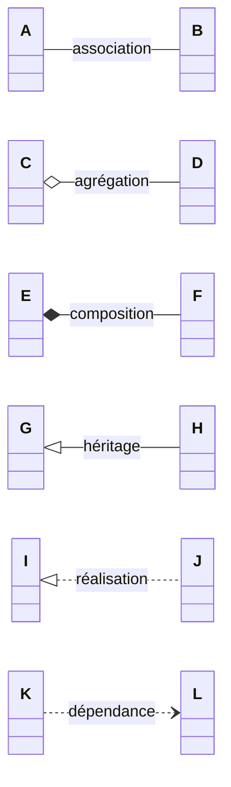
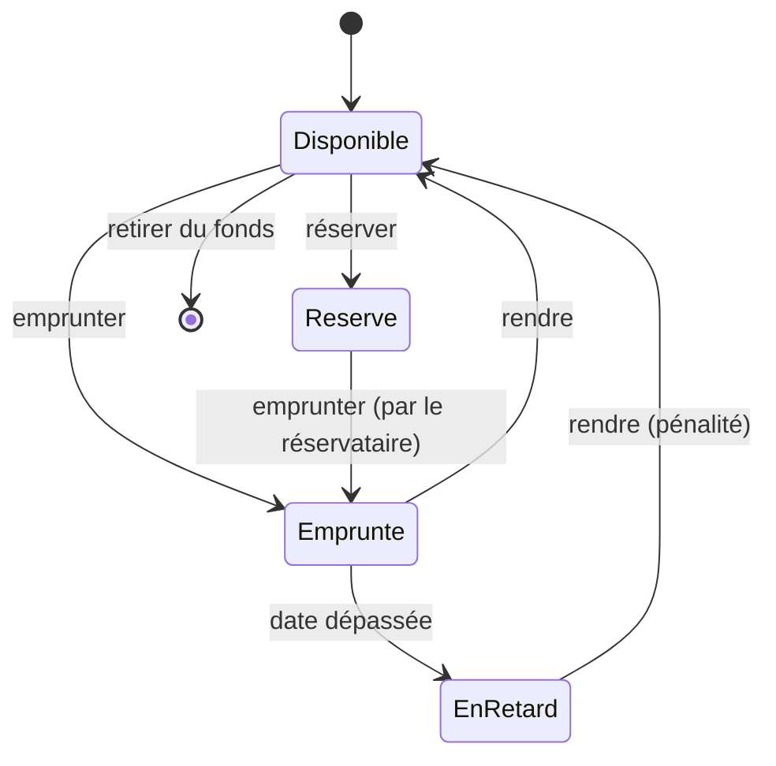
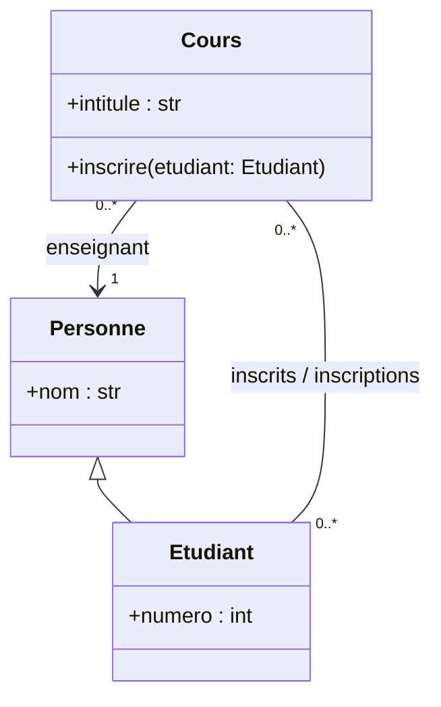
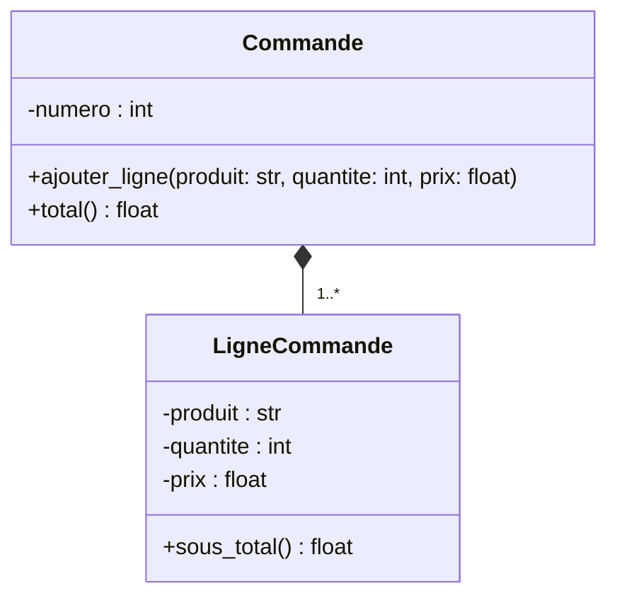

**UML** (*Unified Modeling Language*) est une notation graphique normalisée pour décrire un logiciel avant ou pendant sa
construction. Elle compte une quinzaine de diagrammes ; le concours et l'enseignement en utilisent surtout quatre ou cinq. L'objectif
n'est pas de dessiner pour dessiner : un bon diagramme **répond à une question** (« qui fait quoi ? », « quelles données ? »,
« dans quel ordre ? », « quels états ? »).

## 1. Le diagramme de classes

C'est le plus important : il décrit les **classes**, leurs **attributs**, leurs **méthodes** et leurs **relations**.

```mermaid legende="Une classe UML : nom, attributs (avec visibilité et type), méthodes (avec paramètres et type de retour)"
classDiagram
  class Compte {
    -titulaire : str
    -solde : float
    +nb_comptes : int$
    +Compte(titulaire: str)
    +deposer(montant: float) void
    +retirer(montant: float) bool
    +get_solde() float
  }
```

| Notation | Sens |
|---|---|
| `+` / `-` / `#` / `~` | public / privé / protégé / paquet |
| `nom : type` | attribut typé |
| `methode(p: type) type` | méthode avec paramètres et type de retour |
| souligné (ici `$`) | membre **statique** (de classe) |
| italique (ici `*`), `<<abstract>>` | méthode / classe **abstraite** |
| `<<interface>>` | interface |



:::methode[Lire une multiplicité]
Sur `Adherent "1" -- "0..3" Livre`, on lit **depuis** une classe **vers** l'extrémité opposée : « un adhérent est lié à 0 à 3 livres »,
« un livre est lié à 1 adhérent ». La multiplicité se place **du côté de la classe dont on compte les objets**.
:::

## 2. Du diagramme au code, et retour

| UML | Python | Java |
|---|---|---|
| classe | `class Compte:` | `public class Compte { … }` |
| attribut privé `-solde : float` | `self._solde` (convention) | `private double solde;` |
| méthode `+deposer(m: float)` | `def deposer(self, m):` | `public void deposer(double m)` |
| attribut statique | attribut de classe | `static` |
| héritage `A <|-- B` | `class B(A):` | `class B extends A` |
| réalisation `I <|.. C` | (duck typing ou `ABC`) | `class C implements I` |
| association `0..*` | attribut liste | `ArrayList<B>` |
| association `0..1` / `1` | attribut (ou `None`) | attribut (ou `null`) |

```python exec
class Compte:
    nb_comptes = 0                          # attribut statique (souligné en UML)

    def __init__(self, titulaire):
        self._titulaire = titulaire         # -titulaire : str
        self._solde = 0.0                   # -solde : float
        Compte.nb_comptes += 1

    def deposer(self, montant):
        self._solde += montant

    def retirer(self, montant):             # +retirer(montant: float) bool
        if montant > self._solde:
            return False
        self._solde -= montant
        return True

    def get_solde(self):
        return self._solde

c = Compte("Léa")
c.deposer(50)
print(c.retirer(80), c.retirer(20), c.get_solde(), Compte.nb_comptes)
```

## 3. Les autres diagrammes utiles

### Cas d'utilisation : qui fait quoi ?

Les **acteurs** (bonshommes) sont à l'extérieur du système ; les **cas d'utilisation** (ovales) sont les services rendus. On peut
relier des cas par `<<include>>` (toujours inclus) ou `<<extend>>` (optionnel). Mermaid ne dessine pas ce diagramme : voici sa
structure, sous forme de graphe.

```mermaid legende="Cas d'utilisation d'un ENT simplifié (acteurs à gauche, système encadré)"
flowchart LR
  E(["👤 Élève"])
  P(["👤 Professeur"])
  subgraph S["Système ENT"]
    U1(["Consulter ses notes"])
    U2(["Saisir des notes"])
    U3(["S'authentifier"])
    U4(["Déposer un devoir"])
  end
  E --- U1
  E --- U4
  P --- U2
  U1 -.->|«include»| U3
  U2 -.->|«include»| U3
  U4 -.->|«include»| U3
```

### Séquence : dans quel ordre ?

Les objets sont en colonnes, le temps s'écoule vers le bas, les flèches sont des messages (appels de méthodes) et leurs retours.

```mermaid legende="Séquence d'un emprunt : l'interface demande au catalogue, qui vérifie l'adhérent"
sequenceDiagram
  actor U as Adhérent
  participant B as Borne
  participant C as Catalogue
  participant A as Adherent (objet)
  U->>B: scanner(livre)
  B->>C: emprunter(id_adherent, id_livre)
  C->>A: peut_emprunter()
  A-->>C: True
  C->>C: enregistrer l'emprunt
  C-->>B: date de retour
  B-->>U: affiche « retour le 12/11 »
```

### États-transitions : comment évolue un objet ?



C'est exactement un **automate** (leçon « Automates ») : en code, on le traduit par un attribut `etat` et des méthodes qui vérifient
que la transition est permise.

:::prof
UML n'est pas explicitement au programme du lycée, mais les diagrammes de classes apparaissent dans les sujets de bac (souvent sous
une forme simplifiée) et les diagrammes de cas d'utilisation et de séquence sont précieux en **projet** pour organiser le travail
d'une équipe d'élèves. Au concours, on attend surtout de savoir **lire** un diagramme fourni et **produire** un diagramme de classes
cohérent avec un code.
:::

## Exemple guidé

**Problème.** À partir de ce code, produire le diagramme de classes, puis repérer un défaut de conception.

```python
class Personne:
    def __init__(self, nom):
        self.nom = nom

class Etudiant(Personne):
    def __init__(self, nom, numero):
        super().__init__(nom)
        self.numero = numero
        self.inscriptions = []        # liste d'objets Cours

class Cours:
    def __init__(self, intitule, enseignant):
        self.intitule = intitule
        self.enseignant = enseignant  # un objet Personne
        self.inscrits = []            # liste d'objets Etudiant

    def inscrire(self, etudiant):
        self.inscrits.append(etudiant)
```

**1. Classes et héritage.** `Personne`, `Etudiant`, `Cours` ; `Etudiant` hérite de `Personne` (`super().__init__`).

**2. Associations et multiplicités.** `Cours.enseignant` : un cours a exactement **1** enseignant, une personne enseigne **0..*** cours.
`Cours.inscrits` et `Etudiant.inscriptions` : association **plusieurs à plusieurs**, navigable dans les deux sens.



**3. Le défaut.** L'association `Cours`–`Etudiant` est stockée des deux côtés, mais `inscrire` ne met à jour que `inscrits` : après
`cours.inscrire(e)`, `e.inscriptions` reste vide. Le diagramme rend le problème visible (association bidirectionnelle) ; la
correction : ajouter `etudiant.inscriptions.append(self)` dans `inscrire` (et refuser les doublons).

## L'essentiel

- Diagramme de **classes** : nom, attributs `visibilité nom : type`, méthodes `visibilité nom(params) type` ; `+` public, `-` privé, `#` protégé ; statique souligné, abstrait en italique.
- Relations : association (trait), agrégation (◇), composition (◆), héritage (triangle vide), réalisation (triangle pointillé), dépendance (flèche pointillée) ; multiplicités côté classe comptée.
- **Cas d'utilisation** : acteurs et services ; **séquence** : messages dans le temps ; **états-transitions** : automate de la vie d'un objet ; **objets** : instantané.
- Savoir passer du diagramme au code (Python, Java) et du code au diagramme.

## Exercices

::::exercice[Lire une visibilité]{niveau=1}
Dans un diagramme de classes, que signifie `-solde : float` ?

- [ ] une méthode publique `solde` qui renvoie un flottant
- [x] un attribut privé `solde` de type flottant
- [ ] un attribut `solde` qui doit être négatif
- [ ] un attribut statique

:::corrige
Le `-` indique la visibilité **privée** ; `solde : float` est un attribut (pas de parenthèses) de type flottant.
:::
::::

::::exercice[Choisir le diagramme]{niveau=1}
On veut montrer à des élèves l'ordre des appels de méthodes entre trois objets lorsqu'un joueur valide un coup. Quel diagramme ?

- [ ] un diagramme de classes
- [ ] un diagramme de cas d'utilisation
- [x] un diagramme de séquence
- [ ] un diagramme d'états-transitions

:::corrige
L'**ordre chronologique des messages** entre objets pour un scénario, c'est le diagramme de séquence.
:::
::::

::::exercice[Du diagramme au code]{niveau=2}
Traduis en Python le diagramme suivant : une `Commande` a un numéro et se compose de `LigneCommande` (produit, quantité, prix
unitaire). `Commande` a les méthodes `ajouter_ligne(produit, quantite, prix)` et `total()` ; `LigneCommande` a `sous_total()`.



```python depart
class LigneCommande:
    ...

class Commande:
    ...
```

```python tests
c = Commande(7)
c.ajouter_ligne("stylo", 3, 1.5)
c.ajouter_ligne("cahier", 2, 2.25)
assert abs(c.total() - 9.0) < 1e-9, "total"
assert abs(LigneCommande("gomme", 4, 0.5).sous_total() - 2.0) < 1e-9, "sous-total"
assert Commande(8).total() == 0, "commande vide"
```

:::corrige
```python solution
class LigneCommande:
    def __init__(self, produit, quantite, prix):
        self._produit = produit
        self._quantite = quantite
        self._prix = prix

    def sous_total(self):
        return self._quantite * self._prix

class Commande:
    def __init__(self, numero):
        self._numero = numero
        self._lignes = []

    def ajouter_ligne(self, produit, quantite, prix):
        self._lignes.append(LigneCommande(produit, quantite, prix))

    def total(self):
        return sum(l.sous_total() for l in self._lignes)
```
Composition : c'est la commande qui **crée** ses lignes dans `ajouter_ligne`. Attributs privés → préfixe `_`. (La multiplicité
`1..*` voudrait qu'une commande ait au moins une ligne : le test accepte la commande vide en cours de construction, choix à
documenter.)
:::
::::

::::exercice[Un automate dans une classe]{niveau=3}
Implémente le diagramme d'états du livre (section 3, sans l'état final) : une classe `Livre` avec un attribut `etat` (chaîne parmi
`"Disponible"`, `"Emprunte"`, `"EnRetard"`, `"Reserve"`) et une méthode `evenement(nom)` qui applique la transition (`"emprunter"`,
`"rendre"`, `"date dépassée"`, `"réserver"`) ou lève `ValueError` si elle n'est pas permise dans l'état courant.

```python depart
class Livre:
    def __init__(self):
        self.etat = "Disponible"

    def evenement(self, nom):
        ...
```

```python tests
l = Livre()
for e in ["emprunter", "date dépassée", "rendre", "réserver", "emprunter", "rendre"]:
    l.evenement(e)
assert l.etat == "Disponible", "scénario complet"
try:
    l.evenement("rendre")
    ok = False
except ValueError:
    ok = True
assert ok and l.etat == "Disponible", "transition interdite"
l.evenement("réserver")
try:
    l.evenement("réserver")
    ok = False
except ValueError:
    ok = True
assert ok and l.etat == "Reserve", "pas de double réservation"
```

:::corrige
```python solution
class Livre:
    TRANSITIONS = {
        ("Disponible", "emprunter"): "Emprunte",
        ("Emprunte", "rendre"): "Disponible",
        ("Emprunte", "date dépassée"): "EnRetard",
        ("EnRetard", "rendre"): "Disponible",
        ("Disponible", "réserver"): "Reserve",
        ("Reserve", "emprunter"): "Emprunte",
    }

    def __init__(self):
        self.etat = "Disponible"

    def evenement(self, nom):
        cle = (self.etat, nom)
        if cle not in Livre.TRANSITIONS:
            raise ValueError(f"« {nom} » impossible dans l'état {self.etat}")
        self.etat = Livre.TRANSITIONS[cle]
```
La **table de transitions** (attribut de classe) est une traduction directe du diagramme : ajouter une transition = ajouter une
ligne. C'est la représentation d'un automate déterministe par sa fonction de transition.
:::
::::

::::exercice[Modéliser un sujet de projet]{niveau=4 duree=30}
Des élèves de terminale réalisent une application de **covoiturage** pour le lycée : un conducteur propose un trajet (départ,
arrivée, date, nombre de places) ; un passager réserve une place ; le conducteur peut annuler un trajet, ce qui annule les
réservations ; chaque utilisateur peut noter un trajet terminé.

1. Donnez le diagramme de cas d'utilisation (acteurs, cas, au moins une relation `<<include>>`).
2. Donnez le diagramme de classes (au moins 4 classes, multiplicités, une composition justifiée).
3. Donnez le diagramme d'états d'une réservation.
4. Comment utiliseriez-vous ces diagrammes pour répartir le travail entre trois élèves ?

:::criteres
- Cas d'utilisation : acteurs Conducteur et Passager (éventuellement généralisés en Utilisateur), cas proposer / réserver / annuler / noter, `<<include>>` vers « s'authentifier ».
- Classes : `Utilisateur`, `Trajet`, `Reservation`, `Avis` (ou équivalent) ; conducteur `1` – `0..*` trajets ; trajet `1` – `0..*` réservations ; une composition justifiée (les réservations disparaissent avec le trajet).
- États d'une réservation : demandée / confirmée / annulée / terminée, transitions nommées par des événements.
- Répartition : par classes ou par cas d'utilisation, l'interface (méthodes du diagramme de classes) servant de contrat entre élèves.
:::

:::corrige
1. Acteurs : **Conducteur**, **Passager** (deux rôles d'un même **Utilisateur**, ce qu'on peut noter par une généralisation entre
   acteurs). Cas : « proposer un trajet », « annuler un trajet » (conducteur), « rechercher un trajet », « réserver une place »,
   « annuler sa réservation » (passager), « noter un trajet » (les deux). Tous incluent « s'authentifier » (`<<include>>`) ;
   « annuler un trajet » inclut « prévenir les passagers ».
2. ```mermaid
   classDiagram
     Utilisateur "1" -- "0..*" Trajet : conduit
     Trajet "1" *-- "0..*" Reservation
     Reservation "0..*" --> "1" Utilisateur : passager
     Trajet "1" -- "0..*" Avis
     Avis "0..*" --> "1" Utilisateur : auteur
     class Utilisateur {
       -nom : str
       -email : str
     }
     class Trajet {
       -depart : str
       -arrivee : str
       -date : str
       -places : int
       +places_libres() int
       +reserver(p: Utilisateur) Reservation
       +annuler()
     }
     class Reservation {
       -etat : str
       +annuler()
     }
     class Avis {
       -note : int
       -commentaire : str
     }
   ```
   Composition `Trajet`–`Reservation` : une réservation n'existe que pour un trajet et disparaît (est annulée) avec lui.
3. ```mermaid
   stateDiagram-v2
     [*] --> Confirmee : reserver (place libre)
     Confirmee --> Annulee : annuler (passager)
     Confirmee --> Annulee : trajet annulé
     Confirmee --> Terminee : date du trajet passée
     Terminee --> [*]
     Annulee --> [*]
   ```
4. Le diagramme de classes fixe les **interfaces** (noms et paramètres des méthodes) : un élève code `Trajet`/`Reservation`, un autre
   les utilisateurs et l'authentification, un troisième l'interface (pages ou console) en n'appelant que les méthodes prévues. Les cas
   d'utilisation servent de liste de fonctionnalités à cocher et de scénarios de test ; le diagramme d'états fournit directement les
   tests des transitions interdites.
:::
::::
