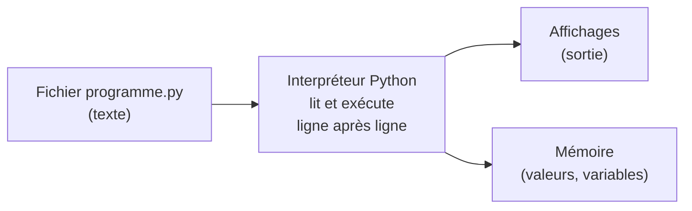

Un ordinateur ne sait faire que des choses très simples : lire un nombre en mémoire, faire une addition,
écrire le résultat ailleurs. Un **programme** est une suite d'instructions de ce genre, écrite dans un
langage que l'on peut traduire pour la machine. Dans cette leçon, on part de zéro : on voit comment Python
calcule des **valeurs**, comment il les classe en **types**, et comment on leur donne des noms avec les
**variables**. Tout le reste du parcours repose sur ces trois idées.

## 1. Un programme est une suite d'instructions

En Python, on écrit les instructions les unes sous les autres. L'**interpréteur** Python les exécute
**dans l'ordre**, de haut en bas, une à une. Clique sur « Exécuter » :

```python exec
print("Bonjour !")
print(2 + 3)
print("2 + 3")
```

Trois instructions, trois lignes affichées. Remarque la différence entre `2 + 3` (un calcul, qui donne `5`)
et `"2 + 3"` (un texte, affiché tel quel grâce aux guillemets).

:::definition
Un **programme** est une suite d'**instructions** exécutées dans l'ordre. En Python, chaque ligne est en
général une instruction. `print(...)` est l'instruction qui **affiche** une valeur à l'écran.
:::

On peut utiliser Python de deux façons : en **mode interactif** (la console, où chaque ligne tapée est
exécutée aussitôt et sa valeur affichée, après l'invite `>>>`) ou en **mode script** (un fichier `.py`
exécuté d'un bloc). Dans un script, rien ne s'affiche sans `print`.



## 2. Les valeurs et leurs types

Tout ce que manipule un programme est une **valeur** : `42`, `3.14`, `"NSI"`, `True`.
Chaque valeur a un **type**, qui dit ce qu'elle représente et quelles opérations sont possibles.
La fonction `type` donne le type d'une valeur :

```python exec
print(type(42))
print(type(3.14))
print(type("NSI"))
print(type(True))
```

| Type    | Ce qu'il représente                 | Exemples                 |
|---------|-------------------------------------|--------------------------|
| `int`   | un nombre entier (sans limite de taille en Python) | `0`, `-17`, `10**30` |
| `float` | un nombre à virgule, **approché**   | `3.14`, `-0.5`, `2.0`, `1e-9` |
| `str`   | une chaîne de caractères (du texte) | `"NSI"`, `'a'`, `""`     |
| `bool`  | une valeur de vérité                | `True`, `False`          |

Le type change le sens des opérations : `+` additionne deux nombres mais **colle** (concatène) deux chaînes.

```python exec
print(2 + 3)
print("2" + "3")
print("ha" * 3)
```

### Les opérateurs arithmétiques

| Opération              | Écriture | Exemple     | Résultat |
|------------------------|----------|-------------|----------|
| addition, soustraction | `+` `-`  | `7 - 10`    | `-3`     |
| multiplication         | `*`      | `6 * 7`     | `42`     |
| division               | `/`      | `7 / 2`     | `3.5` (toujours un `float`) |
| quotient entier        | `//`     | `17 // 5`   | `3`      |
| reste (modulo)         | `%`      | `17 % 5`    | `2`      |
| puissance              | `**`     | `2 ** 10`   | `1024`   |

`//` et `%` vont ensemble : pour des entiers `a` et `b` (avec `b` non nul), on a toujours

$$ a = (a \,/\!/\, b) \times b + (a \,\%\, b) $$

Le reste sert partout : `n % 2 == 0` teste si `n` est pair, `n % 10` donne le chiffre des unités,
`n // 10` enlève ce chiffre.

:::attention
`/` donne **toujours** un flottant, même quand la division « tombe juste » : `8 / 2` vaut `4.0`, pas `4`.
Et avec des nombres négatifs, `//` arrondit **vers le bas** : `-7 // 2` vaut `-4` (et non `-3`),
donc `-7 % 2` vaut `1`. C'est cohérent avec l'égalité ci-dessus : $(-4) \times 2 + 1 = -7$.
:::

```python exec
print(8 / 2, 17 // 5, 17 % 5)
print(-7 // 2, -7 % 2)
print(2 ** 10, 2 ** 0.5)
```

Les **priorités** sont celles des mathématiques : `**` d'abord, puis `*`, `/`, `//`, `%`, puis `+` et `-` ;
à priorité égale, on calcule de gauche à droite. Dans le doute, mets des parenthèses : `(2 + 3) * 4` vaut `20`.

:::question[Que vaut `2 + 3 * 4 ** 2` ?]
`4 ** 2` vaut `16`, puis `3 * 16` vaut `48`, puis `2 + 48` vaut **`50`**.
:::

## 3. Les variables : des noms pour des valeurs

Pour réutiliser une valeur, on lui donne un nom. C'est le rôle de l'**affectation**, écrite avec `=` :

```python exec
largeur = 7
hauteur = 3
aire = largeur * hauteur
print(aire)
```

:::definition
L'**affectation** `nom = expression` se fait en deux temps :
1. Python **calcule** la valeur de l'expression à droite du `=` ;
2. il fait **désigner** cette valeur par le nom à gauche.

Ce nom est une **variable**. Le `=` de Python n'est pas l'égalité des mathématiques : c'est un ordre
(« range ce résultat sous ce nom »). Pour tester une égalité, on écrit `==`.
:::

Une bonne image : une variable est une **étiquette** collée sur une valeur. Réaffecter une variable,
c'est décoller l'étiquette pour la coller sur une autre valeur.

```mermaid legende="Après largeur = 7, hauteur = 3, aire = largeur * hauteur : chaque nom désigne une valeur"
graph LR
  L([largeur]) --> V7["7"]
  H([hauteur]) --> V3["3"]
  A([aire]) --> V21["21"]
```

C'est pourquoi `x = x + 1` a un sens : on calcule `x + 1` avec la valeur **actuelle** de `x`,
puis `x` désigne le résultat. On l'écrit aussi `x += 1` (de même `-=`, `*=`, `//=`…).

```python exec
x = 5
x = x + 1
x *= 10
print(x)
```

Python permet l'**affectation multiple** : `a, b = 1, 2`. Elle permet un échange élégant :
`a, b = b, a` (les deux valeurs de droite sont calculées **avant** d'être rangées).

### Nommer ses variables

Un nom de variable commence par une lettre ou `_`, puis contient lettres, chiffres et `_`.
Il ne peut pas être un **mot-clé** du langage (`if`, `for`, `def`, `class`, `return`…).
Python distingue majuscules et minuscules : `Note` et `note` sont deux variables différentes.
Par convention, on écrit en minuscules avec des `_` : `prix_total`, `nb_eleves`.

:::retenir
Un nom bien choisi est la première documentation d'un programme : `vitesse_moyenne` dit ce que `v` cache.
:::

En Python, le type est porté par la **valeur**, pas par le nom : une même variable peut désigner un
entier puis une chaîne. On dit que Python est **typé dynamiquement** (en Java, au contraire, on déclare
le type de chaque variable une fois pour toutes : on le verra dans le module objet).

## 4. Tracer un programme

Pour comprendre (ou déboguer) un programme, on suit son **état** : la valeur de chaque variable après chaque
instruction. On le note dans un **tableau de trace**. C'est un savoir-faire demandé à l'écrit du concours
(« faire la trace de l'exécution… »).

```python exec
a = 4
b = a + 3
a = b * 2
b = b - a
print(a, b)
```

| Ligne exécutée | `a`  | `b`  |
|----------------|------|------|
| `a = 4`        | 4    | —    |
| `b = a + 3`    | 4    | 7    |
| `a = b * 2`    | 14   | 7    |
| `b = b - a`    | 14   | −7   |

:::methode[Tracer une suite d'affectations]
1. Une colonne par variable, une ligne par instruction exécutée.
2. Pour chaque affectation, calcule la partie droite **avec les valeurs de la ligne précédente**.
3. Ne modifie que la colonne de la variable affectée ; les autres valeurs sont recopiées.
4. Un tiret indique une variable qui n'existe pas encore (l'utiliser provoquerait une `NameError`).
:::

## 5. Convertir et lire des valeurs

On passe d'un type à l'autre avec des fonctions qui portent le nom du type : `int`, `float`, `str`, `bool`.

```python exec
print(int("42") + 1)       # texte -> entier
print(float("2.5") * 2)    # texte -> flottant
print(str(42) + "!")       # entier -> texte
print(int(3.99), int(-3.99))  # tronque vers zéro
print(round(3.567, 1), round(2.5), round(3.5))
```

:::attention
- `int(3.99)` vaut `3` : `int` **tronque** (il enlève la partie décimale), il n'arrondit pas.
- `round(2.5)` vaut `2` et `round(3.5)` vaut `4` : Python arrondit les « .5 » vers le nombre **pair** le plus proche.
- Une conversion peut échouer : `int("douze")` ou `int("12.5")` provoquent une erreur `ValueError`.
:::

```python exec erreur
nombre = int("12.5")
```

Quand un programme demande une valeur à l'utilisateur avec `input`, il reçoit **toujours une chaîne** :
`age = input("Ton âge ? ")` donne par exemple `"17"`, qu'il faut convertir avec `int(age)` avant de calculer.
(Dans l'Atelier, le code s'exécute dans la page sans clavier : on met directement les valeurs dans des variables.)

### Les flottants sont approchés

```python exec
print(0.1 + 0.2)
print(0.1 + 0.2 == 0.3)
print(abs((0.1 + 0.2) - 0.3) < 1e-9)
```

Un flottant est stocké en binaire sur 64 bits : la plupart des décimaux, comme `0.1`, n'y ont pas
d'écriture exacte (comme 1/3 n'a pas d'écriture décimale finie). On compare donc deux flottants
**avec une tolérance**. Le module « Représentation de l'information » explique pourquoi en détail.

## 6. Expressions et instructions

Une **expression** est un morceau de code qui **se calcule** et produit une valeur : `largeur * hauteur`,
`x % 2 == 0`, `"a" * 3`. Une **instruction** est un ordre exécuté pour son **effet** : l'affectation
`aire = largeur * hauteur` range une valeur, `print(aire)` affiche. Une instruction contient souvent des
expressions, mais une affectation n'a pas de valeur : `print(x = 3)` n'a pas de sens.

:::prof
Au lycée, l'erreur la plus fréquente est de lire `=` comme l'égalité mathématique : « `x = x + 1`, c'est
impossible ! ». La trace dans un tableau et l'image de l'étiquette déplacée lèvent l'obstacle. Autre
confusion classique : `"5"` (un texte) et `5` (un nombre), qui apparaît dès le premier `input`.
Le programme de SNT demande de savoir écrire et tracer des affectations ; celui de NSI de première,
de connaître les types de base et la notion d'expression.
:::

## Exemple guidé

**Problème.** Une durée est donnée en secondes, par exemple `n = 3725`. On veut l'écrire en heures,
minutes et secondes (ici : 1 h 2 min 5 s). Comment s'y prendre, et est-ce correct pour toute valeur ?

**1. Comprendre.** Une heure fait 3600 s. Le nombre d'heures complètes, c'est le quotient entier de `n`
par 3600. Ce qui reste (le reste de cette division) est un nombre de secondes inférieur à 3600, qu'on
découpe à son tour en minutes (quotient par 60) et secondes (reste).

**2. Écrire.**

```python exec
n = 3725
h = n // 3600
reste = n % 3600
m = reste // 60
s = reste % 60
print(h, "h", m, "min", s, "s")
```

**3. Tracer.** `h = 3725 // 3600 = 1`, `reste = 3725 % 3600 = 125`, `m = 125 // 60 = 2`, `s = 125 % 60 = 5`.

**4. Justifier.** Par définition de `//` et `%`, on a `n = 3600 h + reste` avec `0 ≤ reste < 3600`,
puis `reste = 60 m + s` avec `0 ≤ s < 60`. Donc `n = 3600 h + 60 m + s` avec `m < 60` (car `reste < 3600`)
et `s < 60` : c'est bien l'écriture cherchée, pour tout entier `n ≥ 0`.

**5. Vérifier les cas limites.** `n = 0` donne `0 h 0 min 0 s` ; `n = 59` donne `0 h 0 min 59 s` ;
`n = 3600` donne `1 h 0 min 0 s`. Le programme suppose `n ≥ 0` : c'est une **précondition** qu'il faudrait écrire.

## L'essentiel

- Un programme est une suite d'instructions exécutées **dans l'ordre**.
- Toute valeur a un **type** : `int`, `float` (approché), `str`, `bool`. Le type fixe le sens des opérations.
- `/` donne un `float` ; `//` et `%` donnent quotient et reste, avec `a == (a // b) * b + a % b`.
- `nom = expression` : on **calcule** la droite, puis le nom **désigne** le résultat. `==` teste l'égalité.
- Tracer = noter la valeur de chaque variable après chaque instruction, dans un tableau.
- `int`, `float`, `str` convertissent ; une conversion peut échouer (`ValueError`) ; `int` tronque.
- On ne compare jamais deux flottants avec `==` : on utilise une tolérance.

## Exercices

::::exercice[Le type d'une division]{niveau=1}
Quel est le type de la valeur de l'expression `9 / 3` ?

- [ ] `int`, car 9 est divisible par 3
- [x] `float`
- [ ] `str`
- [ ] cela dépend de l'ordinateur

:::corrige
L'opérateur `/` produit **toujours** un `float` : `9 / 3` vaut `3.0`. Pour obtenir l'entier `3`, on écrit `9 // 3`.
:::
::::

::::exercice[Quotient et reste]{niveau=1}
Que valent `23 // 4` et `23 % 4` ?

- [ ] `5.75` et `0`
- [x] `5` et `3`
- [ ] `6` et `1`
- [ ] `5` et `75`

:::corrige
$23 = 4 \times 5 + 3$ : le quotient entier est `5`, le reste `3`. On vérifie toujours avec `a == (a // b) * b + a % b`.
:::
::::

::::exercice[Des noms valides]{niveau=1}
Parmi ces noms, lesquels peuvent être utilisés comme noms de variables en Python ?

- [x] `note_1`
- [ ] `1note`
- [x] `_total`
- [ ] `class`
- [x] `prénom`

:::corrige
`note_1` et `_total` sont valides. `1note` commence par un chiffre ; `class` est un mot-clé du langage.
`prénom` est valide en Python 3 (les lettres accentuées sont autorisées), mais on évite souvent les accents
dans les noms par habitude et pour la compatibilité avec d'autres langages.
:::
::::

::::exercice[Trace d'un programme]{niveau=1}
Fais la trace de ce programme dans un tableau (une colonne par variable), puis donne ce qu'il affiche.

```python
x = 3
y = x * x
x = y - x
y = y // x
print(x, y)
```

:::criteres
- Le tableau a une ligne par instruction et une colonne pour `x` et pour `y`.
- Chaque calcul utilise les valeurs de la ligne précédente.
- Les valeurs finales sont `x = 6` et `y = 1`, et l'affichage est `6 1`.
:::

:::corrige
| Ligne        | `x` | `y` |
|--------------|-----|-----|
| `x = 3`      | 3   | —   |
| `y = x * x`  | 3   | 9   |
| `x = y - x`  | 6   | 9   |
| `y = y // x` | 6   | 1   |

Le programme affiche `6 1` (car `9 // 6` vaut `1`).
:::
::::

::::exercice[Échanger deux variables]{niveau=2}
Les variables `a` et `b` valent `3` et `5`. Complète le programme pour que `a` vaille `5` et `b` vaille `3`,
**sans** écrire les nombres 3 ou 5 et **sans** utiliser l'affectation multiple `a, b = b, a`.

```python depart
a = 3
b = 5
# Échange les valeurs de a et b ci-dessous

```

```python tests
assert a == 5, "a vaut maintenant 5"
assert b == 3, "b vaut maintenant 3"
```

:::indice
Si tu écris directement `a = b`, la valeur 3 est perdue. Range-la d'abord sous un troisième nom.
:::

:::corrige
```python solution
a = 3
b = 5
temporaire = a
a = b
b = temporaire
```
La variable `temporaire` garde l'ancienne valeur de `a` avant qu'elle soit écrasée. En Python, on écrit plus
simplement `a, b = b, a` ; mais dans la plupart des langages (et dans certains sujets), il faut savoir le faire
avec une variable temporaire.
:::
::::

::::exercice[Prix toutes taxes comprises]{niveau=2}
Un article coûte `prix_ht = 80` euros hors taxes. La TVA est de `taux = 20` (en pourcentage).
Calcule le prix toutes taxes comprises dans une variable `prix_ttc` (on attend 96), en utilisant les variables
et non les nombres.

```python depart
prix_ht = 80
taux = 20
prix_ttc = ...
```

```python tests
assert abs(prix_ttc - 96) < 1e-9, "prix_ttc vaut 96"
assert isinstance(prix_ttc, (int, float)), "prix_ttc est un nombre"
```

:::corrige
```python solution
prix_ht = 80
taux = 20
prix_ttc = prix_ht * (1 + taux / 100)
```
`taux / 100` vaut `0.2`, donc `prix_ttc` vaut `80 * 1.2 = 96.0` (un flottant, à cause de `/`).
Le test compare avec une tolérance, car un calcul en flottants peut donner `95.99999999999999`.
:::
::::

::::exercice[Chiffres d'un nombre]{niveau=2}
Le nombre `n = 4732` est donné. Sans convertir `n` en chaîne de caractères, range dans `unites` son chiffre
des unités (2), dans `dizaines` son chiffre des dizaines (3) et dans `centaines` celui des centaines (7).

```python depart
n = 4732
unites = ...
dizaines = ...
centaines = ...
```

```python tests
assert unites == 2, "chiffre des unités"
assert dizaines == 3, "chiffre des dizaines"
assert centaines == 7, "chiffre des centaines"
```

:::indice
`n % 10` donne le dernier chiffre ; `n // 10` « enlève » le dernier chiffre.
:::

:::corrige
```python solution
n = 4732
unites = n % 10
dizaines = (n // 10) % 10
centaines = (n // 100) % 10
```
`n // 10` vaut `473`, dont le dernier chiffre est `3` ; `n // 100` vaut `47`, dont le dernier chiffre est `7`.
Le chiffre de rang $k$ (en partant de 0 pour les unités) est `(n // 10**k) % 10`.
:::
::::

::::exercice[Division entière et nombres négatifs]{niveau=3}
Sans exécuter de code, donne la valeur de chacune des expressions suivantes, puis justifie en une phrase
le résultat de la dernière ligne.

```python
print(-7 // 2, -7 % 2)
print(7 // -2, 7 % -2)
print((-7 // 2) * 2 + (-7 % 2))
```

:::criteres
- `-7 // 2` vaut `-4` et `-7 % 2` vaut `1`.
- `7 // -2` vaut `-4` et `7 % -2` vaut `-1`.
- La dernière ligne affiche `-7`, justifié par l'égalité `a == (a // b) * b + a % b`.
- La justification mentionne que `//` arrondit vers le bas (vers moins l'infini).
:::

:::corrige
En Python, `//` est la **partie entière inférieure** du quotient : $-7 / 2 = -3{,}5$ donne `-4`, et
$7 / (-2) = -3{,}5$ donne aussi `-4`. Le reste est alors imposé par `a = (a // b) * b + a % b` :
$-7 = (-4) \times 2 + 1$, donc `-7 % 2 == 1` ; $7 = (-4) \times (-2) + (-1)$, donc `7 % -2 == -1`
(le reste a le signe du diviseur). La dernière ligne affiche `-7` : c'est exactement cette égalité.

Remarque : d'autres langages (C, Java) tronquent vers zéro, et `-7 / 2` y vaut `-3` en division entière.
:::
::::

::::exercice[Expression ou instruction ?]{niveau=3}
Pour chacune des lignes suivantes, dis si c'est une expression ou une instruction, et ce que Python affiche
quand on la tape dans la console interactive (`>>>`) après `x = 4`.

```python
x * 2 + 1
y = x * 2 + 1
x == 4
print(x)
```

:::criteres
- `x * 2 + 1` est une expression ; la console affiche sa valeur `9`.
- `y = x * 2 + 1` est une instruction (affectation) ; la console n'affiche rien.
- `x == 4` est une expression booléenne ; la console affiche `True`.
- `print(x)` est une instruction (un appel de fonction) qui affiche `4`.
:::

:::corrige
- `x * 2 + 1` : **expression**, de valeur `9`. En mode interactif, la console affiche la valeur de
  toute expression tapée seule : `9`.
- `y = x * 2 + 1` : **instruction** d'affectation. Elle ne produit pas de valeur : rien n'est affiché.
- `x == 4` : **expression** booléenne, de valeur `True`, affichée par la console.
- `print(x)` : instruction qui **affiche** `4` (techniquement, c'est un appel de fonction, donc une
  expression de valeur `None`, mais on l'utilise pour son effet).

Dans un script (et non dans la console), seule la dernière ligne afficherait quelque chose.
:::
::::

::::exercice[Expliquer 0.1 + 0.2 != 0.3 à un élève]{niveau=4 duree=15}
Un élève de première écrit le programme suivant et s'étonne qu'il affiche `False`.

```python
x = 0.1 + 0.2
print(x == 0.3)
```

1. Explique précisément la cause du problème, avec le vocabulaire adapté.
2. Propose une correction du programme et justifie-la.
3. Indique comment tu pourrais, en classe, faire **constater** le phénomène à l'élève plutôt que l'affirmer.

:::criteres
- La cause est la représentation des flottants en binaire sur un nombre fini de bits (norme IEEE 754).
- Il est dit que 0,1 n'a pas d'écriture binaire finie (comme 1/3 en décimal), donc est arrondi à la saisie.
- Les erreurs d'arrondi s'accumulent : `0.1 + 0.2` vaut `0.30000000000000004`, qui diffère de l'arrondi de 0,3.
- La correction compare avec une tolérance : `abs(x - 0.3) < 1e-9` (ou `math.isclose`), en justifiant le choix de la tolérance.
- La proposition pédagogique fait manipuler l'élève (afficher `x`, afficher `0.1` avec beaucoup de décimales, convertir 0,1 en binaire à la main).
:::

:::corrige
1. **Cause.** Python représente les nombres non entiers par des **flottants** (norme IEEE 754, sur 64 bits) :
   une mantisse binaire de précision finie et un exposant. Or 0,1 n'a pas d'écriture binaire finie
   ($0{,}1 = 0{,}000110011001100\ldots_2$, le motif `0011` se répète), exactement comme 1/3 n'a pas
   d'écriture décimale finie. Le nombre stocké est donc l'arrondi le plus proche de 0,1, et de même pour 0,2
   et 0,3. La somme des deux arrondis, `0.30000000000000004`, n'est pas égale à l'arrondi de 0,3 :
   le test `==` répond `False`. Ce n'est pas un bug de Python mais une propriété de la représentation.
2. **Correction.** On ne teste pas l'égalité exacte de deux flottants ; on teste qu'ils sont **proches** :
   `print(abs(x - 0.3) < 1e-9)` (ou `math.isclose(x, 0.3)`). La tolérance `1e-9` est très supérieure à l'erreur
   d'arrondi d'un double autour de 0,3 (de l'ordre de $10^{-17}$) et très inférieure aux écarts significatifs
   pour ce calcul. Si on manipule des montants en euros, on peut aussi calculer en **centimes entiers**.
3. **En classe.** Faire afficher `x` (on voit `0.30000000000000004`), puis `format(0.1, ".20f")` pour voir
   que 0,1 n'est pas exact ; faire convertir 0,1 en binaire à la main par multiplications successives par 2,
   pour constater que le développement ne s'arrête pas ; faire le parallèle avec 1/3 = 0,333… en décimal.
:::
::::
