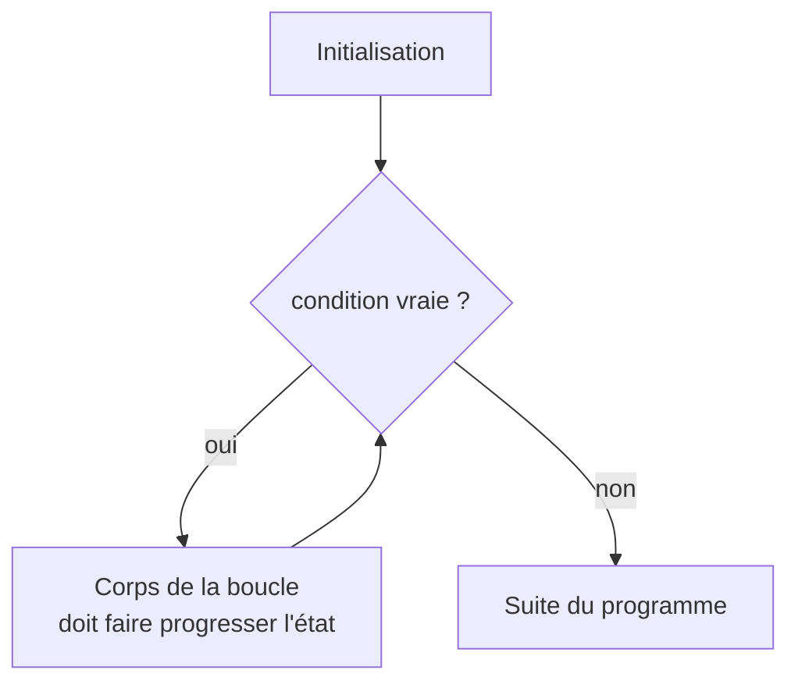

Calculer la moyenne de 30 notes, afficher une table de multiplication, chercher un mot dans un texte, simuler
une population année après année : tous ces programmes **répètent** les mêmes instructions. Plutôt que de copier
30 fois la même ligne, on écrit une **boucle**. Il y en a deux sortes en Python : `for`, quand on sait ce qu'on
parcourt, et `while`, quand on répète tant qu'une condition est vraie.

## 1. La boucle `for` et `range`

```python exec
for i in range(5):
    print("tour", i)
print("fini")
```

La variable `i` (le **compteur**) prend successivement les valeurs produites par `range(5)` : 0, 1, 2, 3, 4.
À chaque valeur, le **corps** de la boucle (le bloc indenté) est exécuté. Puis le programme continue après la boucle.

| Écriture               | Valeurs produites          | Nombre de tours |
|------------------------|----------------------------|-----------------|
| `range(5)`             | 0, 1, 2, 3, 4              | 5               |
| `range(2, 7)`          | 2, 3, 4, 5, 6              | 5               |
| `range(1, 10, 3)`      | 1, 4, 7                    | 3               |
| `range(10, 0, -2)`     | 10, 8, 6, 4, 2             | 5               |
| `range(5, 5)`          | (aucune)                   | 0               |

:::retenir
`range(debut, fin, pas)` commence à `debut` (inclus) et s'arrête **avant** `fin` (exclu).
`range(n)` fait donc exactement `n` tours, numérotés de 0 à `n - 1`.
:::

## 2. Accumuler un résultat

Le schéma le plus courant : une variable **initialisée avant** la boucle, **mise à jour** à chaque tour,
**utilisée après**. On l'appelle un **accumulateur**.

```python exec
n = 10
somme = 0                 # initialisation : la somme de rien vaut 0
for k in range(1, n + 1):
    somme = somme + k     # mise à jour
print(somme)              # 1 + 2 + ... + 10 = 55
```

Selon ce qu'on accumule, la valeur initiale change : `0` pour une somme ou un compteur, `1` pour un produit,
`""` pour une chaîne qu'on construit, et le **premier élément** pour un maximum.

`for` ne sert pas qu'avec `range` : il parcourt n'importe quelle **séquence**, par exemple les caractères d'une
chaîne ou les éléments d'une liste (les listes sont étudiées en détail plus loin).

```python exec
mot = "informatique"
voyelles = 0
for lettre in mot:
    if lettre in "aeiouy":
        voyelles += 1
print(voyelles)

notes = [12, 8.5, 15, 10]
total = 0
for note in notes:
    total += note
print(total / len(notes))
```

## 3. La boucle `while`

`while condition:` répète son bloc **tant que** la condition est vraie. La condition est testée **avant**
chaque tour : si elle est fausse dès le départ, le bloc n'est jamais exécuté.

```python exec
# Combien de chiffres a un entier n ≥ 0 ?
n = 40372
chiffres = 1
while n >= 10:
    n = n // 10       # on enlève le dernier chiffre
    chiffres += 1
print(chiffres)
```



:::attention
Si le corps ne fait jamais progresser l'état vers une condition fausse, la boucle **ne s'arrête jamais**.
Exemple : `i = 0` puis `while i != 10: i += 3` (i vaut 0, 3, 6, 9, 12… et ne vaut jamais 10).
Dans l'Atelier, une exécution qui dure plus de 8 secondes est interrompue.
:::

:::methode[Choisir entre for et while]
- On connaît à l'avance ce qu'on parcourt (les entiers de 1 à n, les lettres d'un mot) → `for`.
- On s'arrête quand quelque chose arrive (un seuil est atteint, un élément est trouvé, une saisie est valide) → `while`.
Toute boucle `for` peut s'écrire avec `while`, mais `for` évite d'oublier d'incrémenter le compteur.
:::

### Sortir plus tôt : `break`

`break` interrompt immédiatement la boucle qui le contient. Il est pratique pour une recherche, mais une condition
de `while` bien écrite est souvent plus lisible (et certains enseignants l'interdisent pour cette raison).

```python exec
for d in range(2, 100):
    if 91 % d == 0:
        print("plus petit diviseur de 91 :", d)
        break
```

## 4. Boucles imbriquées

Une boucle peut en contenir une autre. Le corps intérieur est exécuté **pour chaque** tour de la boucle extérieure.

```python exec
for i in range(1, 4):
    ligne = ""
    for j in range(1, 6):
        ligne += str(i * j) + "\t"
    print(ligne)
```

Ici le corps intérieur est exécuté $3 \times 5 = 15$ fois. Quand la boucle intérieure dépend de la variable
extérieure, on compte avec une somme :

```python exec
compteur = 0
n = 5
for i in range(n):
    for j in range(i):      # i tours à l'étape i
        compteur += 1
print(compteur)             # 0 + 1 + 2 + 3 + 4 = 10 = n(n-1)/2
```

Ce décompte est le cœur de l'**analyse du coût** d'un algorithme (module algorithmique) : deux boucles imbriquées
sur `n` éléments, c'est de l'ordre de $n^2$ opérations.

## 5. Tracer une boucle

Pour tracer une boucle, on note l'état **à la fin de chaque tour** (ou au moment où la condition est testée).

```python exec
s = 0
i = 1
while s < 20:
    s = s + i
    i = i + 2
print(s, i)
```

| Moment                 | `s` | `i` | `s < 20` ? |
|------------------------|-----|-----|------------|
| avant la boucle        | 0   | 1   | oui        |
| fin du tour 1          | 1   | 3   | oui        |
| fin du tour 2          | 4   | 5   | oui        |
| fin du tour 3          | 9   | 7   | oui        |
| fin du tour 4          | 16  | 9   | oui        |
| fin du tour 5          | 25  | 11  | **non** → on sort |

On remarque qu'à la fin du tour $k$, `s` vaut $k^2$ et `i` vaut $2k + 1$ : la somme des $k$ premiers impairs
est $k^2$. Une telle propriété, vraie à chaque tour, s'appelle un **invariant de boucle** ; on s'en servira pour
**prouver** des algorithmes.

:::prof
Erreurs typiques : le **décalage de un** sur les bornes de `range` (oublier le `+ 1` de `range(1, n + 1)`),
l'accumulateur réinitialisé **dans** la boucle (`somme = 0` indenté par erreur), le compteur de `while` jamais
modifié, et la croyance qu'on peut modifier le compteur d'un `for` pour sauter des tours (`i += 1` dans un `for`
n'a aucun effet sur le tour suivant). Les tableaux de trace et la question « combien de tours ? » sont les
meilleurs outils de diagnostic.
:::

## Exemple guidé

**Problème (type écrit 1).** L'algorithme d'Euclide calcule le PGCD de deux entiers naturels `a` et `b` :
tant que `b` n'est pas nul, on remplace `(a, b)` par `(b, a % b)` ; à la fin, `a` est le PGCD.
Programmer l'algorithme, faire sa trace pour `a = 252`, `b = 105`, et justifier qu'il termine.

**1. Programmer.**

```python exec
def pgcd(a, b):
    while b != 0:
        a, b = b, a % b
    return a

print(pgcd(252, 105))
```

L'affectation multiple est indispensable : avec `a = b` puis `b = a % b`, on calculerait le reste avec la
**nouvelle** valeur de `a`.

**2. Tracer.**

| Moment          | `a`  | `b`  | `a % b` |
|-----------------|------|------|---------|
| départ          | 252  | 105  | 42      |
| après le tour 1 | 105  | 42   | 21      |
| après le tour 2 | 42   | 21   | 0       |
| après le tour 3 | 21   | 0    | —       |

`b` vaut 0 : la boucle s'arrête et le PGCD est **21** (en effet $252 = 2^2 \times 3^2 \times 7$ et $105 = 3 \times 5 \times 7$).

**3. Justifier la terminaison.** À chaque tour, `b` est remplacé par `a % b`, qui est un entier vérifiant
$0 \le a \% b < b$. Donc `b` est un entier naturel qui **décroît strictement** à chaque tour. Une suite d'entiers
naturels strictement décroissante est finie : la boucle fait au plus `b` tours (valeur initiale), puis `b` atteint 0.
Une telle quantité s'appelle un **variant** de boucle.

**4. Pourquoi le résultat est-il le PGCD ?** (idée de la preuve) Les diviseurs communs de `a` et `b` sont
exactement ceux de `b` et `a % b`, car `a % b = a - q b`. Le PGCD ne change donc pas d'un tour à l'autre ; et
quand `b = 0`, le PGCD de `a` et `0` est `a`. C'est un **invariant**. Le module algorithmique formalise ces deux notions.

## L'essentiel

- `for x in sequence:` parcourt une séquence ; `range(debut, fin, pas)` exclut `fin`.
- `while condition:` répète tant que la condition est vraie ; elle est testée avant chaque tour.
- Une boucle `while` doit faire progresser l'état vers l'arrêt (un **variant** qui décroît), sinon elle est infinie.
- Accumulateur : initialisé avant, mis à jour dans, utilisé après la boucle.
- Boucles imbriquées : le corps intérieur s'exécute (tours extérieurs) × (tours intérieurs) fois.
- Tracer = tableau de l'état à chaque tour ; une propriété vraie à chaque tour est un **invariant**.

## Exercices

::::exercice[Valeurs d'un range]{niveau=1}
Que contient `list(range(3, 15, 4))` ?

- [ ] `[3, 7, 11, 15]`
- [x] `[3, 7, 11]`
- [ ] `[4, 8, 12]`
- [ ] `[3, 4, 5, 6, 7, 8, 9, 10, 11, 12, 13, 14]`

:::corrige
On part de 3 et on ajoute 4 : 3, 7, 11, puis 15, qui est **exclu** (borne de fin).
:::
::::

::::exercice[Compter les affichages]{niveau=1}
Combien de fois le mot `"NSI"` est-il affiché ?

```python
for i in range(4):
    for j in range(i, 4):
        print("NSI")
```

- [ ] 4
- [ ] 8
- [x] 10
- [ ] 16

:::corrige
Pour `i = 0`, `j` va de 0 à 3 : 4 affichages ; puis 3 pour `i = 1`, 2 pour `i = 2`, 1 pour `i = 3`.
Total : $4 + 3 + 2 + 1 = 10$.
:::
::::

::::exercice[Trace d'une boucle for]{niveau=1}
Fais la trace de ce programme (valeurs de `k` et `s` à la fin de chaque tour) et donne la valeur finale de `s`.

```python
s = 0
for k in range(1, 5):
    s = s + k * k
```

:::criteres
- Le tableau contient une ligne par tour (`k` = 1, 2, 3, 4).
- Les valeurs de `s` sont 1, 5, 14, 30.
- La valeur finale de `s` est 30 (somme des carrés de 1 à 4).
:::

:::corrige
| Tour | `k` | `s` |
|------|-----|-----|
| 1    | 1   | 1   |
| 2    | 2   | 5   |
| 3    | 3   | 14  |
| 4    | 4   | 30  |

`range(1, 5)` s'arrête avant 5 : il y a 4 tours et `s` vaut $1 + 4 + 9 + 16 = 30$.
:::
::::

::::exercice[Factorielle]{niveau=2}
La factorielle de `n` est $n! = 1 \times 2 \times \dots \times n$, avec par convention $0! = 1$.
Écris `factorielle(n)` pour un entier `n ≥ 0`, avec une boucle (sans `math.factorial`).

```python depart
def factorielle(n):
    ...
```

```python tests
assert factorielle(0) == 1, "0! = 1"
assert factorielle(1) == 1, "1! = 1"
assert factorielle(5) == 120, "5! = 120"
assert factorielle(10) == 3628800, "10! = 3628800"
```

:::corrige
```python solution
def factorielle(n):
    produit = 1
    for k in range(2, n + 1):
        produit *= k
    return produit
```
Un produit s'initialise à 1 (élément neutre). Pour `n = 0` ou `n = 1`, la boucle ne fait aucun tour et la
fonction renvoie 1, conformément à la convention. Le nombre de multiplications est $n - 1$ (pour $n \ge 1$).
:::
::::

::::exercice[Nombre de chiffres]{niveau=2}
Écris `nb_chiffres(n)` qui renvoie le nombre de chiffres de l'entier `n ≥ 0` en écriture décimale,
**sans** convertir `n` en chaîne. Attention : 0 s'écrit avec un chiffre.

```python depart
def nb_chiffres(n):
    ...
```

```python tests
assert nb_chiffres(0) == 1, "0 a un chiffre"
assert nb_chiffres(7) == 1, "un seul chiffre"
assert nb_chiffres(10) == 2, "10 a deux chiffres"
assert nb_chiffres(99999) == 5, "99999"
assert nb_chiffres(100000) == 6, "100000"
```

:::indice
Divise `n` par 10 (division entière) tant qu'il a plus d'un chiffre, en comptant les divisions.
:::

:::corrige
```python solution
def nb_chiffres(n):
    chiffres = 1
    while n >= 10:
        n = n // 10
        chiffres += 1
    return chiffres
```
Avec la condition `while n > 0`, il faudrait partir de `chiffres = 0`, et 0 donnerait 0 chiffre : c'est
exactement le cas limite que le test `nb_chiffres(0)` sert à détecter.
:::
::::

::::exercice[Nombre premier]{niveau=2}
Un entier `n` est **premier** s'il est au moins égal à 2 et n'a pas d'autre diviseur positif que 1 et lui-même.
Écris `est_premier(n)`. Pour aller vite, il suffit de tester les diviseurs `d` tels que $d \times d \le n$.

```python depart
def est_premier(n):
    ...
```

```python tests
assert est_premier(2) == True, "2 est premier"
assert est_premier(17) == True, "17 est premier"
assert est_premier(1) == False, "1 n'est pas premier"
assert est_premier(0) == False, "0 n'est pas premier"
assert est_premier(91) == False, "91 = 7 × 13"
assert est_premier(49) == False, "49 = 7 × 7 (carré)"
assert est_premier(7919) == True, "7919 est premier"
```

:::indice
Si `n` a un diviseur `d` avec `1 < d < n`, il en a un qui vérifie $d \le \sqrt{n}$ (car si $d > \sqrt n$, alors $n/d < \sqrt n$).
:::

:::corrige
```python solution
def est_premier(n):
    if n < 2:
        return False
    d = 2
    while d * d <= n:
        if n % d == 0:
            return False
        d += 1
    return True
```
Le test `d * d <= n` (plutôt que `d < n`) réduit le nombre de tours de $n$ à environ $\sqrt n$.
Le test avec 49 vérifie qu'on a bien mis `<=` : avec `<`, le diviseur 7 ne serait jamais essayé.
:::
::::

::::exercice[Temps de vol de Syracuse]{niveau=3}
Partant d'un entier `n ≥ 1`, on applique : si `n` est pair, `n` devient `n // 2`, sinon `n` devient `3 * n + 1`.
On s'arrête quand `n` vaut 1. Écris `temps_de_vol(n)` qui renvoie le nombre d'étapes nécessaires
(0 si `n` vaut déjà 1).

```python depart
def temps_de_vol(n):
    ...
```

```python tests
assert temps_de_vol(1) == 0, "déjà à 1"
assert temps_de_vol(2) == 1, "2 -> 1"
assert temps_de_vol(3) == 7, "3 -> 10 -> 5 -> 16 -> 8 -> 4 -> 2 -> 1"
assert temps_de_vol(27) == 111, "27 vole longtemps"
```

:::corrige
```python solution
def temps_de_vol(n):
    etapes = 0
    while n != 1:
        if n % 2 == 0:
            n = n // 2
        else:
            n = 3 * n + 1
        etapes += 1
    return etapes
```
Remarque de fond : personne ne sait **prouver** que cette boucle termine pour tout `n` (c'est la conjecture
de Syracuse, ou de Collatz). On l'a vérifiée sur d'immenses plages de valeurs, mais aucune quantité n'est connue
pour décroître à coup sûr : c'est un bel exemple de boucle `while` dont la terminaison n'est pas évidente.
:::
::::

::::exercice[Une boucle qui ne s'arrête pas]{niveau=3}
Le programme suivant doit afficher les multiples de 3 inférieurs ou égaux à 10. Explique pourquoi il ne s'arrête
jamais, puis propose deux corrections : une avec `while`, une avec `for`.

```python
i = 0
while i != 10:
    print(i)
    i = i + 3
```

:::criteres
- La trace est donnée : `i` prend les valeurs 0, 3, 6, 9, 12, 15… et n'est jamais égal à 10.
- La cause est identifiée : la condition d'arrêt `i == 10` n'est jamais atteinte.
- Une correction avec `while i <= 10` est proposée.
- Une correction avec `for i in range(0, 11, 3)` est proposée.
:::

:::corrige
`i` vaut successivement 0, 3, 6, 9, 12, 15… : il « saute » par-dessus 10. La condition `i != 10` reste donc
toujours vraie. Le test `!=` est fragile ; on utilise une **inégalité**, qui reste correcte même si on dépasse :

```python
i = 0
while i <= 10:
    print(i)
    i = i + 3
```

ou, puisqu'on connaît la progression, une boucle `for` :

```python
for i in range(0, 11, 3):
    print(i)
```
:::
::::

::::exercice[Analyser une boucle : puissance]{niveau=4 duree=20}
On considère la fonction suivante, pour un nombre `x` et un entier `n ≥ 0`.

```python
def puissance(x, n):
    p = 1
    i = 0
    while i < n:
        p = p * x
        i = i + 1
    return p
```

1. Fais la trace de `puissance(3, 4)`.
2. Montre que la propriété « `p == x ** i` » est vraie avant le premier tour et reste vraie après chaque tour.
   Qu'en déduis-tu sur la valeur renvoyée ?
3. Justifie que la boucle termine.
4. Combien de multiplications sont effectuées en fonction de `n` ? Propose une idée pour en faire beaucoup moins
   (on ne demande pas le code).

:::criteres
- La trace donne `(i, p)` = (0, 1), (1, 3), (2, 9), (3, 27), (4, 81) et le résultat 81.
- Initialisation : avant la boucle, `p = 1 = x**0` et `i = 0`.
- Conservation : si `p == x**i` au début d'un tour, après le tour `p' = p·x = x**(i+1)` et `i' = i + 1`, donc `p' == x**i'`.
- Conclusion : à la sortie, `i == n` (car `i` augmente de 1 depuis 0 et la boucle s'arrête dès que `i >= n`), donc `p == x**n`.
- Terminaison : `n - i` est un entier positif qui décroît de 1 à chaque tour.
- Coût : exactement `n` multiplications ; l'idée d'exponentiation rapide (utiliser $x^{2k} = (x^k)^2$) est évoquée.
:::

:::corrige
1. | Moment | `i` | `p` |
   |--------|-----|-----|
   | avant  | 0   | 1   |
   | tour 1 | 1   | 3   |
   | tour 2 | 2   | 9   |
   | tour 3 | 3   | 27  |
   | tour 4 | 4   | 81  |

   `i < 4` devient faux : la fonction renvoie **81** $= 3^4$.
2. **Initialisation** : avant le premier tour, `i = 0` et `p = 1 = x**0`. **Conservation** : supposons `p == x**i`
   au début d'un tour. Le tour calcule `p' = p * x = x**i * x = x**(i+1)` et `i' = i + 1`, donc `p' == x**i'`.
   La propriété est un **invariant**. À la sortie, la condition est fausse : `i >= n` ; comme `i` part de 0 et
   augmente de 1, il vaut exactement `n`. L'invariant donne alors `p == x**n` : la fonction est correcte.
3. **Terminaison** : la quantité `n - i` est un entier, positif ou nul tant que la boucle tourne, qui diminue de 1
   à chaque tour : elle atteint 0 en `n` tours, et alors `i < n` est faux.
4. La boucle fait exactement `n` multiplications : le coût est **linéaire** en `n`. On peut faire beaucoup mieux
   avec l'**exponentiation rapide** : $x^{2k} = (x^k)^2$ et $x^{2k+1} = x \cdot (x^k)^2$, ce qui divise l'exposant
   par 2 à chaque étape, soit environ $2\log_2 n$ multiplications (voir « Diviser pour régner »).
:::
::::
