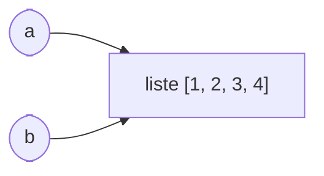

Voici un programme qui surprend presque tout le monde la première fois :

```python exec
a = [1, 2, 3]
b = a
b.append(4)
print(a)
```

On n'a jamais touché à `a`, et pourtant `a` a changé. Ce n'est pas un bug de Python : c'est la conséquence directe
de ce que **désigne** une variable. Comprendre ce mécanisme évite des erreurs très difficiles à trouver, et c'est
un sujet classique des épreuves (« que vaut `a` après… ? », « pourquoi ce programme modifie-t-il la liste ? »).

## 1. Une variable est une référence vers un objet

En Python, toute valeur est un **objet** rangé quelque part en mémoire. Un objet a une **identité** (son adresse,
donnée par `id`), un **type** et une **valeur**. Une variable n'est pas une « boîte » qui contient la valeur : c'est
un **nom** qui **fait référence** à un objet. L'affectation `b = a` ne copie rien : elle fait désigner à `b`
**le même objet** que `a`. On dit que `a` et `b` sont des **alias**.



```python exec
a = [1, 2, 3]
b = a
c = [1, 2, 3]
print(a == b, a is b)    # même valeur, même objet
print(a == c, a is c)    # même valeur, objets différents
print(id(a) == id(b), id(a) == id(c))
```

:::definition
- `x == y` compare les **valeurs** des objets.
- `x is y` teste si `x` et `y` désignent **le même objet** (même identité).
On réserve `is` aux comparaisons avec `None` (`if x is None:`).
:::

## 2. Mutable ou immuable : tout change

Si l'objet est **mutable** (liste, dictionnaire, ensemble), on peut le **modifier sur place** (`append`, `t[i] = …`,
`d[k] = …`) : tous les alias voient la modification, puisqu'ils désignent cet objet.

Si l'objet est **immuable** (entier, flottant, chaîne, tuple), aucune opération ne peut le modifier. Une instruction
comme `x += 1` **crée un nouvel objet** et fait désigner à `x` ce nouvel objet ; les autres noms ne bougent pas.

```python exec
x = 5
y = x
y += 1             # crée l'entier 6 ; y le désigne ; x désigne toujours 5
print(x, y)

s = "abc"
t = s
t += "d"           # nouvelle chaîne "abcd"
print(s, t)

u = [1]
v = u
v += [2]           # pour une liste, += MODIFIE l'objet sur place (comme extend)
print(u, v)
```

:::attention
Pour une liste, `v += [2]` modifie l'objet (tous les alias le voient), alors que `v = v + [2]` crée une **nouvelle**
liste et ne touche pas aux alias. La différence ne concerne que les objets mutables.
:::

## 3. Copier une liste

Pour obtenir une liste **indépendante**, il faut la copier explicitement : `t.copy()`, `t[:]` ou `list(t)`.
Ces trois écritures font une **copie superficielle** : elles créent une nouvelle liste du premier niveau, mais les
éléments eux-mêmes ne sont pas copiés. C'est sans importance pour des entiers ou des chaînes (immuables), mais
avec des **sous-listes**, celles-ci restent **partagées** :

```python exec
import copy

m = [[1, 2], [3, 4]]
superficielle = m.copy()
profonde = copy.deepcopy(m)

superficielle.append([5, 6])   # n'affecte pas m (nouvelle liste extérieure)
superficielle[0][0] = 99       # affecte m : la sous-liste est partagée
profonde[1][1] = -1            # n'affecte pas m
print(m)
print(superficielle)
print(profonde)
```

```mermaid legende="Copie superficielle : nouvelle liste extérieure, mais sous-listes partagées"
graph LR
  M([m]) --> E1["[ • , • ]"]
  S([superficielle]) --> E2["[ • , • , • ]"]
  E1 --> L1["[99, 2]"]
  E1 --> L2["[3, 4]"]
  E2 --> L1
  E2 --> L2
  E2 --> L3["[5, 6]"]
```

C'est exactement ce qui se passe avec le piège de la grille `[[0] * 3] * 2` vu dans la leçon sur les listes :
la multiplication répète **la référence** à la même sous-liste.

:::methode[Copier une liste de listes sans module copy]
Copier chaque ligne : `[ligne.copy() for ligne in m]` (ou `[ligne[:] for ligne in m]`). Cela suffit pour une
matrice de nombres (deux niveaux). Pour une structure plus profonde, `copy.deepcopy`.
:::

## 4. Les paramètres d'une fonction

Lors d'un appel, chaque paramètre devient un **nouveau nom pour l'objet passé en argument** (on parle de passage
« par référence d'objet » ou « par affectation »). Conséquences :

- si la fonction **modifie** un objet mutable reçu (`t.append`, `t[i] = …`), l'appelant voit la modification :
  c'est un **effet de bord** ;
- si la fonction **réaffecte** son paramètre (`t = …`), seul le nom local change : l'appelant n'est pas affecté.

```python exec
def ajoute_zero(t):
    t.append(0)          # modifie l'objet partagé

def remplace(t):
    t = [7, 7, 7]        # nouveau nom local ; l'objet de l'appelant est intact

liste = [1, 2]
ajoute_zero(liste)
remplace(liste)
print(liste)
```

:::retenir
Une fonction qui modifie une liste reçue doit le **dire** dans sa spécification. Quand on ne veut pas d'effet de
bord, on travaille sur une copie, ou on **renvoie une nouvelle liste**.
:::

### Le piège de l'argument par défaut mutable

La valeur par défaut d'un paramètre est évaluée **une seule fois**, quand la fonction est définie. Si c'est une
liste, cette même liste est réutilisée à chaque appel :

```python exec
def ajoute(x, t=[]):
    t.append(x)
    return t

print(ajoute(1))
print(ajoute(2))      # surprise : [1, 2]

def ajoute_correct(x, t=None):
    if t is None:
        t = []        # nouvelle liste à chaque appel
    t.append(x)
    return t

print(ajoute_correct(1), ajoute_correct(2))
```

:::prof
Le modèle « boîte qui contient une valeur », souvent utilisé au collège, devient faux avec les listes : il faut
le faire évoluer vers le modèle « étiquette / référence ». Les schémas « noms → objets » (comme ceux de l'outil
Python Tutor) sont très efficaces. Ce point est au programme de NSI (types construits, mise au point des
programmes) et revient à l'écrit sous forme de questions « que vaut… après… ».
:::

## Exemple guidé

**Problème.** On veut une fonction `normaliser(notes)` qui ramène des notes sur 20 à des notes sur 10.
Proposer deux versions (avec et sans effet de bord), les spécifier, et montrer sur un exemple la différence.

**1. Version qui modifie la liste reçue (en place).**

```python exec
def normaliser_en_place(notes):
    """Divise par 2 chaque note de la liste notes. Effet de bord : notes est modifiée. Renvoie None."""
    for i in range(len(notes)):
        notes[i] = notes[i] / 2

def normaliser(notes):
    """Renvoie une NOUVELLE liste des notes divisées par 2. notes n'est pas modifiée."""
    return [n / 2 for n in notes]

classe = [12, 18, 7]
sur_dix = normaliser(classe)
print(classe, sur_dix)
normaliser_en_place(classe)
print(classe)
```

**2. Pourquoi la boucle par indice ?** Écrire `for n in notes: n = n / 2` ne modifierait **rien** : `n` est un nom
qui désigne successivement chaque nombre ; le réaffecter ne touche pas à la liste. Pour modifier la liste, il faut
écrire dans ses cases : `notes[i] = …`.

**3. Choisir.** La version sans effet de bord est plus sûre (aucune surprise pour l'appelant) et se teste
facilement ; la version en place économise la mémoire pour de très grandes listes. Dans tous les cas, la
spécification doit dire laquelle on a.

## L'essentiel

- Une variable est une **référence** vers un objet ; `b = a` crée un **alias**, pas une copie.
- `==` compare les valeurs, `is` les identités (réservé à `None`).
- Objet **mutable** (list, dict, set) : les modifications sur place sont vues par tous les alias.
  Objet **immuable** (int, float, str, tuple) : toute « modification » crée un nouvel objet.
- `t.copy()`, `t[:]`, `list(t)` : copie **superficielle** (sous-objets partagés) ; `copy.deepcopy` : copie profonde.
- Un paramètre désigne l'objet de l'argument : modifier l'objet = effet de bord visible ; réaffecter le paramètre = invisible.
- Jamais de liste comme valeur par défaut : `t=None`.

## Exercices

::::exercice[Alias]{niveau=1}
Après `a = [1, 2]`, `b = a`, `b.append(3)`, que valent `a` et `b` ?

- [ ] `a == [1, 2]` et `b == [1, 2, 3]`
- [x] `a == [1, 2, 3]` et `b == [1, 2, 3]`
- [ ] `a == [1, 2]` et `b == [3]`
- [ ] une erreur

:::corrige
`b = a` ne copie pas la liste : `a` et `b` désignent le même objet, modifié par `append`.
:::
::::

::::exercice[Copie]{niveau=1}
Après `a = [1, 2]`, `b = a[:]`, `b.append(3)`, que vaut `a` ?

- [x] `[1, 2]`
- [ ] `[1, 2, 3]`
- [ ] `[3]`
- [ ] `[]`

:::corrige
`a[:]` crée une **nouvelle** liste avec les mêmes éléments : la modifier ne change pas `a`.
:::
::::

::::exercice[Copies de matrices]{niveau=1}
Avec `m = [[1, 2], [3, 4]]`, quelles instructions créent une matrice `c` telle que `c[0][0] = 9` **ne modifie pas** `m` ?

- [ ] `c = m`
- [ ] `c = m.copy()`
- [x] `c = [ligne.copy() for ligne in m]`
- [x] `c = copy.deepcopy(m)` (après `import copy`)
- [ ] `c = m[:]`

:::corrige
`c = m` est un alias ; `m.copy()` et `m[:]` sont des copies superficielles : la nouvelle liste extérieure contient
les **mêmes** sous-listes, donc `c[0][0] = 9` modifie aussi `m[0][0]`. Il faut copier chaque ligne, ou utiliser `deepcopy`.
:::
::::

::::exercice[Avec ou sans effet de bord]{niveau=2}
Écris deux fonctions :
- `ajoute_en_place(t, x)` qui ajoute `x` à la fin de `t` (en modifiant `t`) et ne renvoie rien ;
- `ajoute_copie(t, x)` qui renvoie une nouvelle liste égale à `t` suivie de `x`, **sans modifier** `t`.

```python depart
def ajoute_en_place(t, x):
    ...

def ajoute_copie(t, x):
    ...
```

```python tests
a = [1, 2]
r = ajoute_en_place(a, 3)
assert a == [1, 2, 3] and r is None, "en place : a modifiée, rien renvoyé"
b = [1, 2]
c = ajoute_copie(b, 3)
assert c == [1, 2, 3], "copie : bonne valeur renvoyée"
assert b == [1, 2], "copie : b n'est pas modifiée"
assert c is not b, "copie : c'est une nouvelle liste"
```

:::corrige
```python solution
def ajoute_en_place(t, x):
    t.append(x)

def ajoute_copie(t, x):
    return t + [x]
```
`t + [x]` crée une nouvelle liste. Attention : `t += [x]` modifierait `t` sur place.
:::
::::

::::exercice[Copier une matrice]{niveau=2}
Écris `copie_matrice(m)` qui renvoie une copie **indépendante** d'une matrice de nombres (liste de listes),
sans utiliser le module `copy`.

```python depart
def copie_matrice(m):
    ...
```

```python tests
m = [[1, 2], [3, 4]]
c = copie_matrice(m)
assert c == m, "même contenu"
c[0][0] = 99
assert m[0][0] == 1, "modifier la copie ne modifie pas l'original"
c.append([5, 6])
assert len(m) == 2, "ajouter une ligne à la copie ne change pas l'original"
assert copie_matrice([]) == [], "matrice vide"
```

:::corrige
```python solution
def copie_matrice(m):
    return [ligne.copy() for ligne in m]
```
Copier la liste extérieure ne suffit pas : il faut une nouvelle liste pour **chaque** ligne.
:::
::::

::::exercice[La liste qui grossit toute seule]{niveau=3}
Un élève écrit cette fonction pour construire la liste des diviseurs d'un nombre, et s'étonne du résultat.

```python
def diviseurs(n, resultat=[]):
    for d in range(1, n + 1):
        if n % d == 0:
            resultat.append(d)
    return resultat

print(diviseurs(6))
print(diviseurs(4))
```

Qu'affiche ce programme ? Explique la cause et corrige la fonction.

:::criteres
- L'affichage est `[1, 2, 3, 6]` puis `[1, 2, 3, 6, 1, 2, 4]`.
- La cause est expliquée : la valeur par défaut `[]` est créée une seule fois, à la définition de la fonction, et la même liste est réutilisée et complétée à chaque appel sans argument.
- La correction utilise `resultat=None` puis `if resultat is None: resultat = []`, ou supprime le paramètre et crée la liste dans le corps.
:::

:::corrige
Le premier appel affiche `[1, 2, 3, 6]`. Le second affiche `[1, 2, 3, 6, 1, 2, 4]` : la liste par défaut est créée
**une seule fois**, quand `def` est exécuté, puis partagée par tous les appels qui n'indiquent pas `resultat`.
Le premier appel l'a remplie, le second continue de la remplir.

Correction (le paramètre n'a d'ailleurs aucune utilité ici) :

```python
def diviseurs(n):
    resultat = []          # nouvelle liste à chaque appel
    for d in range(1, n + 1):
        if n % d == 0:
            resultat.append(d)
    return resultat
```
:::
::::

::::exercice[Vider une liste : pourquoi ça ne marche pas]{niveau=4 duree=15}
Un élève veut écrire une fonction qui vide la liste qu'on lui passe.

```python
def vider(t):
    t = []

notes = [12, 15, 9]
vider(notes)
print(notes)
```

1. Qu'affiche ce programme ? Explique à l'élève ce qui se passe, en t'appuyant sur un schéma « noms → objets »
   (décris-le en mots si besoin) avant et après l'instruction `t = []`.
2. Propose deux corrections : l'une qui conserve une fonction **avec effet de bord**, l'autre **sans effet de
   bord** (et indique comment l'appel doit alors être écrit).
3. Dans quel cas la différence entre ces deux versions peut-elle avoir des conséquences visibles ailleurs dans un
   programme ?

:::criteres
- L'affichage est `[12, 15, 9]` : la liste n'est pas vidée.
- Explication : à l'appel, le paramètre `t` désigne le même objet que `notes` ; `t = []` fait désigner à `t` une nouvelle liste vide, sans toucher l'objet désigné par `notes`.
- Version avec effet de bord : `t.clear()`, `del t[:]` ou `t[:] = []`, qui modifient l'objet partagé.
- Version sans effet de bord : la fonction renvoie `[]` et l'appel s'écrit `notes = vider(notes)` (ou simplement `notes = []`).
- Conséquence : si d'autres noms (alias) désignent la même liste, seule la version en place les vide aussi ; la réaffectation ne change que `notes`.
:::

:::corrige
1. Le programme affiche `[12, 15, 9]`. Au moment de l'appel, deux noms désignent le même objet liste : `notes`
   (dans le programme principal) et `t` (dans la fonction). L'instruction `t = []` crée une **nouvelle** liste vide
   et fait désigner à `t` cette nouvelle liste ; l'ancienne liste, toujours désignée par `notes`, n'a pas été
   touchée. À la fin de l'appel, le nom local `t` disparaît.
   Avant : `notes → [12, 15, 9] ← t`. Après `t = []` : `notes → [12, 15, 9]` et `t → []`.
2. Avec effet de bord, on **modifie l'objet** :
   ```python
   def vider(t):
       t.clear()          # ou : del t[:]  ou : t[:] = []
   ```
   Sans effet de bord, on **renvoie** le résultat et l'appelant réaffecte son nom :
   ```python
   def vider(t):
       return []

   notes = vider(notes)
   ```
3. Si d'autres noms désignent la même liste (par exemple `sauvegarde = notes` plus haut, ou la liste est rangée
   dans un dictionnaire), `t.clear()` les vide **tous**, alors que `notes = vider(notes)` ne change que le nom
   `notes` : les autres références voient toujours l'ancienne liste pleine. Selon l'intention, l'un ou l'autre est
   le bon choix — d'où l'importance de l'écrire dans la spécification.
:::
::::
