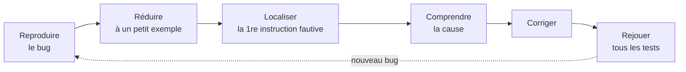

Écrire un programme qui « a l'air de marcher » est facile ; s'assurer qu'il marche **dans tous les cas** l'est
beaucoup moins. Une fonction de moyenne qui plante sur une liste vide, un tri qui oublie le dernier élément, une
recherche qui ne trouve pas une valeur en première position : ces bugs se cachent dans les **cas limites**. Cette
leçon donne les outils pour les débusquer (les **tests**), comprendre les erreurs (les **exceptions**) et les
corriger (le **débogage**).

## 1. Tester une fonction

Un **test** exécute une fonction sur une entrée choisie et compare le résultat obtenu au résultat **attendu**.
En Python, le plus simple est l'instruction `assert` :

```python exec
def maximum(t):
    m = t[0]
    for x in t:
        if x > m:
            m = x
    return m

assert maximum([3, 9, 2]) == 9, "cas courant"
assert maximum([-8, -3, -5]) == -3, "uniquement des négatifs"
assert maximum([4]) == 4, "un seul élément"
print("tous les tests passent")
```

Si la condition d'un `assert` est fausse, Python lève une `AssertionError` avec le message, et le programme s'arrête.

:::methode[Construire un jeu de tests]
1. Lire la **spécification** : entrées permises, résultat attendu, cas particuliers annoncés.
2. Découper les entrées en **classes** qui devraient se comporter pareil, et prendre un représentant de chacune.
3. Ajouter les **cas limites** : liste vide, un seul élément, valeurs égales, élément au début / à la fin,
   bornes des intervalles (0, la valeur maximale), nombres négatifs, chaîne vide.
4. Ajouter les cas d'**erreur** prévus (argument invalide) et vérifier la réaction annoncée.
5. Pour chaque test, calculer le résultat attendu **à la main**, avant d'exécuter.
:::

:::attention
Un jeu de tests qui passe ne **prouve** pas qu'une fonction est correcte : il montre seulement qu'elle se comporte
bien sur ces cas. « Les tests peuvent montrer la présence de bugs, jamais leur absence » (Edsger Dijkstra). Pour
une certitude, il faut un raisonnement : c'est l'objet de la leçon sur la preuve d'algorithmes.
:::

Les **doctests** sont une autre façon d'écrire des tests, directement dans la docstring, sous la forme d'une
session interactive ; le module `doctest` les exécute et compare :

```python exec
def carre(x):
    """Renvoie x au carré.

    >>> carre(3)
    9
    >>> carre(-2)
    4
    """
    return x * x

import doctest
doctest.run_docstring_examples(carre, globals(), verbose=True)
```

## 2. Les erreurs et les exceptions

Il y a deux grandes familles d'erreurs. Les **erreurs de syntaxe** (`SyntaxError`, `IndentationError`) empêchent
le programme de démarrer : Python ne comprend pas le texte. Les **exceptions** surviennent pendant l'exécution,
quand une opération est impossible.

| Exception           | Situation typique                          | Exemple           |
|---------------------|--------------------------------------------|-------------------|
| `NameError`         | nom inconnu (faute de frappe, variable pas encore créée) | `print(totl)` |
| `TypeError`         | opération sur un type inadapté             | `"3" + 1`         |
| `ValueError`        | bon type, mais valeur inacceptable         | `int("douze")`    |
| `IndexError`        | indice hors des limites                    | `[1, 2][5]`       |
| `KeyError`          | clé absente d'un dictionnaire              | `{}["k"]`         |
| `ZeroDivisionError` | division par zéro                          | `1 / 0`           |
| `AttributeError`    | méthode ou attribut inexistant             | `(5).append(1)`   |
| `RecursionError`    | trop d'appels récursifs imbriqués          | récursion sans cas de base |

### Lire un message d'erreur

```python exec erreur
def moyenne(t):
    return sum(t) / len(t)

def bilan(classes):
    for nom, notes in classes.items():
        print(nom, moyenne(notes))

bilan({"1G1": [12, 15], "1G2": []})
```

Le message (la *traceback*) se lit **de bas en haut** : la dernière ligne donne le **type** et la **cause**
(`ZeroDivisionError: division by zero`) ; les lignes au-dessus donnent la **pile d'appels** : l'erreur est dans
`moyenne`, appelée par `bilan`, appelée par le programme principal. On sait donc où regarder et avec quelles données :
la classe `1G2` n'a aucune note.

## 3. Gérer les exceptions : `try / except`

Quand une erreur est **prévisible** et qu'on sait quoi faire, on peut l'intercepter :

```python exec
def lire_note(texte):
    try:
        note = float(texte)
    except ValueError:
        return None          # le texte n'est pas un nombre
    if not 0 <= note <= 20:
        return None
    return note

print(lire_note("14.5"), lire_note("abc"), lire_note("25"))
```

Le bloc `try` est exécuté ; si une exception du type indiqué survient, l'exécution saute dans le bloc `except`
correspondant. Il existe aussi `else` (exécuté si aucune exception) et `finally` (exécuté dans tous les cas,
utile pour libérer une ressource).

:::attention
N'intercepte que les exceptions **précises** que tu sais traiter (`except ValueError:`), jamais toutes
(`except:` ou `except Exception:`) : tu masquerais aussi tes propres bugs, qui deviendraient invisibles.
:::

### Lever une exception : `raise`

Une fonction qui reçoit un argument inacceptable doit **le signaler**, plutôt que renvoyer un résultat faux :

```python exec
def racine_entiere(n):
    """Plus grand entier r tel que r * r <= n. Lève ValueError si n < 0."""
    if n < 0:
        raise ValueError("racine_entiere : n doit être positif ou nul")
    r = 0
    while (r + 1) * (r + 1) <= n:
        r += 1
    return r

print(racine_entiere(17))
try:
    racine_entiere(-4)
except ValueError as e:
    print("erreur signalée :", e)
```

:::definition[assert ou raise ?]
- `assert` exprime une condition qui **doit** être vraie si le programme est correct (un invariant, une
  précondition interne) : c'est un outil de **développement** (on peut désactiver les `assert` avec `python -O`).
- `raise` signale une situation **anormale mais possible** (donnée invalide venue de l'extérieur, fichier absent)
  que l'appelant peut vouloir gérer avec `try`.
:::

## 4. Déboguer avec méthode



Pour **localiser**, on compare ce que le programme fait à ce qu'il **devrait** faire, instruction par instruction :
tableau de trace, `print` temporaires des variables à des points clés, débogueur pas à pas (Thonny, VS Code), ou
un outil de visualisation comme Python Tutor. Un bug corrigé doit laisser un **test de non-régression** : le cas
qui l'a révélé rejoint le jeu de tests, pour qu'il ne revienne jamais.

:::prof
Les élèves testent rarement d'eux-mêmes les cas limites : leur faire écrire les tests **avant** le code (à partir
de la spécification) est un excellent exercice. Apprendre à **lire** une traceback (de bas en haut) fait gagner un
temps considérable en TP. Le programme de première parle de « mise au point des programmes » : tests, assertions,
gestion des erreurs.
:::

## Exemple guidé

**Problème.** Cette fonction doit renvoyer la moyenne des notes **valides** (entre 0 et 20) d'une liste, ou `None`
s'il n'y en a aucune. Elle contient deux bugs. Les trouver avec un jeu de tests, puis corriger.

```python
def moyenne_valides(notes):
    somme = 0
    n = 0
    for note in notes:
        if 0 < note < 20:
            somme += note
            n += 1
        return somme / n
```

**1. Écrire les tests d'après la spécification** (sans regarder le code) :
`[10, 14]` → 12 ; `[10, 25, -3, 14]` → 12 (notes invalides ignorées) ; `[0, 20]` → 10 (bornes valides) ;
`[25]` → `None` ; `[]` → `None`.

**2. Les exécuter et observer.** `moyenne_valides([10, 14])` renvoie `10.0` au lieu de 12 : le `return` est
**dans** la boucle (mal indenté), la fonction s'arrête après la première note. `moyenne_valides([0, 20])` provoquerait
une division par zéro : les inégalités strictes excluent 0 et 20. Et `[]` ne renvoie pas `None`.

**3. Corriger et rejouer tous les tests.**

```python exec
def moyenne_valides(notes):
    somme = 0
    n = 0
    for note in notes:
        if 0 <= note <= 20:
            somme += note
            n += 1
    if n == 0:
        return None
    return somme / n

assert moyenne_valides([10, 14]) == 12
assert moyenne_valides([10, 25, -3, 14]) == 12
assert moyenne_valides([0, 20]) == 10
assert moyenne_valides([25]) is None
assert moyenne_valides([]) is None
print("les cinq tests passent")
```

Trois corrections : l'indentation du `return`, les bornes `<=`, et le cas « aucune note valide ». Chacune a été
révélée par un test **choisi d'après la spécification** — c'est tout l'intérêt de les écrire avant de lire le code.

## L'essentiel

- Un test compare un résultat obtenu à un résultat attendu calculé à la main : `assert f(x) == attendu, "message"`.
- Un bon jeu de tests couvre cas courants, **cas limites** et cas d'erreur ; il ne prouve pas la correction.
- Exceptions courantes : `NameError`, `TypeError`, `ValueError`, `IndexError`, `KeyError`, `ZeroDivisionError`.
- Une traceback se lit de bas en haut : type et cause, puis pile des appels.
- `try / except Type:` pour une erreur prévisible et traitable ; `raise ValueError(...)` pour signaler un argument invalide.
- `assert` pour les conditions internes (développement) ; `raise` pour les situations anormales possibles.
- Débogage : reproduire, réduire, localiser, comprendre, corriger, rejouer les tests (+ test de non-régression).

## Exercices

::::exercice[Reconnaître une exception]{niveau=1}
Quelle exception est levée par `int("12,5")` ?

- [ ] `TypeError`
- [x] `ValueError`
- [ ] `SyntaxError`
- [ ] aucune : cela donne 12

:::corrige
L'argument est bien une chaîne (bon type), mais sa valeur n'est pas l'écriture d'un entier : `ValueError`.
(Même `int("12.5")` échoue ; `float("12,5")` aussi, car Python attend un point décimal.)
:::
::::

::::exercice[Rôle d'un test]{niveau=1}
Une fonction passe avec succès dix tests bien choisis. Que peut-on en conclure ?

- [ ] Elle est correcte pour toutes les entrées.
- [x] Elle se comporte correctement sur ces dix cas, et c'est un indice (pas une preuve) de sa correction.
- [ ] Elle ne peut plus lever d'exception.
- [ ] Il est inutile d'en écrire d'autres.

:::corrige
Un test vérifie un cas. Il peut révéler un bug, pas prouver qu'il n'y en a pas. Seule une preuve (invariant,
récurrence…) établit la correction pour toutes les entrées.
:::
::::

::::exercice[Lire un entier sans planter]{niveau=2}
Écris `lire_entier(texte)` qui renvoie l'entier écrit dans la chaîne `texte` (les espaces autour sont tolérés),
ou `None` si le texte ne représente pas un entier. Utilise `try / except`.

```python depart
def lire_entier(texte):
    ...
```

```python tests
assert lire_entier("42") == 42, "entier simple"
assert lire_entier("  -7 ") == -7, "espaces et signe"
assert lire_entier("douze") is None, "pas un nombre"
assert lire_entier("3.5") is None, "pas un entier"
assert lire_entier("") is None, "chaîne vide"
```

:::corrige
```python solution
def lire_entier(texte):
    try:
        return int(texte)
    except ValueError:
        return None
```
`int` tolère déjà les espaces autour et le signe. On n'intercepte que `ValueError` : une autre erreur (par exemple
si on passe une liste, `TypeError`) n'est pas masquée.
:::
::::

::::exercice[Signaler un argument invalide]{niveau=2}
Écris `moyenne(t)` qui renvoie la moyenne d'une liste de nombres, et qui **lève** `ValueError` si la liste est vide.

```python depart
def moyenne(t):
    ...
```

```python tests
assert moyenne([10, 12, 14]) == 12, "cas courant"
assert moyenne([7]) == 7, "un élément"
try:
    moyenne([])
    signale = False
except ValueError:
    signale = True
assert signale, "une liste vide lève ValueError"
```

:::corrige
```python solution
def moyenne(t):
    if len(t) == 0:
        raise ValueError("moyenne d'une liste vide")
    return sum(t) / len(t)
```
Sans ce test, la liste vide provoquerait une `ZeroDivisionError`, moins explicite pour l'appelant.
Le troisième test montre comment **tester** qu'une exception est bien levée.
:::
::::

::::exercice[Concevoir un jeu de tests]{niveau=2}
La fonction `insere(t, x)` reçoit une liste `t` triée par ordre croissant et une valeur `x` ; elle insère `x` dans `t`
**en place**, à une position qui laisse la liste triée. Sans écrire la fonction, propose au moins six tests
(entrée, état attendu de `t` après l'appel) et dis ce que chacun vérifie.

:::criteres
- Un cas courant (insertion au milieu).
- Insertion en tête (`x` plus petit que tous) et en queue (`x` plus grand que tous).
- Liste vide.
- `x` égal à un élément déjà présent (doublon).
- Un test vérifie que la liste est modifiée en place (même objet) et que la fonction ne renvoie rien d'utile, selon la spécification.
- Chaque test donne le résultat attendu précis.
:::

:::corrige
| Appel                     | `t` attendue après    | Ce qu'on vérifie |
|---------------------------|-----------------------|------------------|
| `insere([1, 3, 5], 4)`    | `[1, 3, 4, 5]`        | cas courant, au milieu |
| `insere([1, 3, 5], 0)`    | `[0, 1, 3, 5]`        | insertion en tête |
| `insere([1, 3, 5], 9)`    | `[1, 3, 5, 9]`        | insertion en queue (souvent oubliée) |
| `insere([], 7)`           | `[7]`                 | liste vide |
| `insere([2, 2, 4], 2)`    | `[2, 2, 2, 4]`        | doublon |
| `insere([5], 5)`          | `[5, 5]`              | un seul élément |

Et pour la nature « en place » : `a = [1, 3]; b = a; insere(a, 2)` doit donner `b == [1, 2, 3]` (c'est le même objet).
:::
::::

::::exercice[Corriger une fonction boguée]{niveau=3}
La fonction suivante doit renvoyer l'indice de la **dernière** occurrence de `x` dans `t`, ou -1. Elle contient
des erreurs. Corrige-la (les tests t'aident à les trouver).

```python depart
def derniere_position(t, x):
    for i in range(len(t) - 1, 0, -1):
        if t[i] == x:
            return i
        else:
            return -1
```

```python tests
assert derniere_position([4, 7, 4, 2], 4) == 2, "plusieurs occurrences : la dernière"
assert derniere_position([4, 7, 9], 4) == 0, "en première position"
assert derniere_position([4, 7, 9], 5) == -1, "absent"
assert derniere_position([], 5) == -1, "liste vide"
assert derniere_position([3, 1, 3, 3], 1) == 1, "pas en dernière position"
```

:::corrige
```python solution
def derniere_position(t, x):
    for i in range(len(t) - 1, -1, -1):
        if t[i] == x:
            return i
    return -1
```
Deux bugs : `range(len(t) - 1, 0, -1)` s'arrête **avant** 0 (l'indice 0 n'est jamais examiné : il faut `-1` comme
borne de fin) ; et le `return -1` dans le `else` arrête la boucle dès le premier élément différent de `x`. Le
`return -1` doit venir **après** la boucle, quand tout a été examiné.
:::
::::

::::exercice[Démarche de débogage]{niveau=4 duree=20}
Dans un programme de gestion de bulletins, l'appel `classement(eleves)` plante parfois avec le message
`IndexError: list index out of range`, mais pas toujours. Voici la fonction en cause, censée renvoyer les noms des
élèves triés par moyenne décroissante (`eleves` est une liste de couples `(nom, liste_de_notes)`).

```python
def classement(eleves):
    moyennes = []
    for nom, notes in eleves:
        moyennes.append((sum(notes) / len(notes), nom))
    moyennes.sort(reverse=True)
    noms = []
    for i in range(len(eleves) + 1):
        noms.append(moyennes[i][1])
    return noms
```

1. Décris la démarche que tu suis pour trouver la cause (sans te contenter de « je lis le code »).
2. Identifie **les** problèmes de cette fonction (il y en a deux) et le cas qui provoque chacun.
3. Propose une version corrigée, et les tests de non-régression que tu ajoutes.
4. L'énoncé dit que le plantage n'arrive « pas toujours ». Est-ce cohérent avec ton analyse ?

:::criteres
- Démarche : reproduire avec une entrée précise, réduire l'entrée, lire la traceback (ligne fautive), tracer ou afficher les indices, corriger, rejouer les tests.
- Problème 1 : `range(len(eleves) + 1)` va un indice trop loin : `IndexError` au dernier tour (dès qu'il y a au moins un élève, et même pour une liste vide).
- Problème 2 : un élève sans aucune note provoque `ZeroDivisionError` dans `sum(notes) / len(notes)`.
- Correction : `range(len(moyennes))` (ou parcours direct), et un traitement explicite des élèves sans note (exclus, ou moyenne `None` placée à la fin, selon la spécification à préciser).
- Tests de non-régression : liste vide, un élève, élève sans note, ex-aequo.
- Réponse à la question 4 : l'IndexError devrait en fait se produire à chaque appel ; « pas toujours » suggère qu'une autre erreur (ZeroDivisionError) masque parfois la première, ou que l'observation est imprécise — il faut reproduire précisément.
:::

:::corrige
1. **Démarche.** Reproduire le plantage avec une entrée précise (par exemple `[("Léa", [12, 14])]`), lire la traceback
   (la ligne `noms.append(moyennes[i][1])` est en cause), réduire l'entrée au plus petit cas qui plante, afficher
   `i` et `len(moyennes)` au moment de l'erreur, comprendre, corriger, puis rejouer tous les tests.
2. **Problème 1** : la seconde boucle va de 0 à `len(eleves)` **inclus**, car `range(len(eleves) + 1)`. Au dernier tour,
   `moyennes[len(eleves)]` n'existe pas : `IndexError`. Cela se produit pour **toute** entrée (même une liste vide :
   `range(1)` donne `i = 0` et `moyennes[0]` n'existe pas).
   **Problème 2** : un élève dont la liste de notes est vide provoque `ZeroDivisionError` dans le calcul de la moyenne.
3. ```python
   def classement(eleves):
       """Noms des élèves ayant au moins une note, par moyenne décroissante."""
       moyennes = []
       for nom, notes in eleves:
           if len(notes) > 0:
               moyennes.append((sum(notes) / len(notes), nom))
       moyennes.sort(reverse=True)
       return [nom for _, nom in moyennes]
   ```
   Le traitement des élèves sans note est un **choix de spécification** (ici : exclus) qu'il faut écrire et faire valider.
   Tests ajoutés : `classement([]) == []` ; un élève ; deux élèves ; un élève sans note ; deux élèves ex aequo
   (ici départagés par ordre alphabétique inverse, à cause du tri des couples — à signaler).
4. D'après l'analyse, l'`IndexError` devrait survenir **à chaque appel**. « Pas toujours » est donc suspect : soit
   certains appels plantaient d'abord sur la `ZeroDivisionError` (élève sans note), soit l'observation a été mal
   rapportée. C'est pourquoi la première étape est de **reproduire** précisément, plutôt que de se fier à une
   description.
:::
::::
