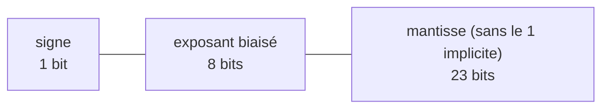

`0.1 + 0.2 == 0.3` vaut `False` en Python — et en JavaScript, en Java, en C… Ce n'est pas un bogue : c'est la conséquence de
la façon dont **tous** les ordinateurs codent les nombres à virgule. Un nombre réel peut avoir une infinité de chiffres ; un
ordinateur ne dispose que d'un nombre fixe de bits. Il faut donc **approcher**, et savoir ce que cette approximation implique.
La norme **IEEE 754** (1985) fixe ce codage pour presque tous les processeurs ; elle est au programme de première NSI et du
concours (« représentation des types simples : flottants »).

## 1. Les nombres à virgule en binaire

Comme en base 10, les chiffres après la virgule correspondent aux puissances **négatives** de la base :
$0{,}101_2 = \frac12 + \frac18 = 0{,}625$ et $101{,}11_2 = 4 + 1 + \frac12 + \frac14 = 5{,}75$.

Pour convertir la partie fractionnaire d'un décimal en binaire, on la **multiplie par 2** : la partie entière obtenue (0 ou 1)
est le chiffre suivant, et on recommence avec la partie fractionnaire.

| calcul     | chiffre | reste |
|------------|---------|-------|
| 0,1 × 2 = 0,2 | 0 | 0,2 |
| 0,2 × 2 = 0,4 | 0 | 0,4 |
| 0,4 × 2 = 0,8 | 0 | 0,8 |
| 0,8 × 2 = 1,6 | 1 | 0,6 |
| 0,6 × 2 = 1,2 | 1 | 0,2 ← on retombe sur 0,2 : le motif se répète |

$0{,}1 = 0{,}0\,0011\,0011\,0011\dots_2$ : l'écriture est **infinie**. Il faut la couper (arrondir) : le flottant stocké
pour `0.1` n'est pas exactement 0,1.

:::retenir
Un décimal a une écriture binaire **finie** si et seulement si c'est une fraction dont le dénominateur (irréductible) est une
**puissance de 2** : 0,5 ; 0,25 ; 0,75 ; 0,375 sont exacts ; 0,1 ; 0,2 ; 0,3 ; 1/3 ne le sont pas.
:::

```python exec
print(format(0.1, ".25f"))
print(format(0.75, ".25f"))
print(0.1 + 0.2, 0.1 + 0.2 == 0.3)
from fractions import Fraction
print(Fraction(0.1))          # la fraction exacte réellement stockée pour 0.1
```

## 2. La notation scientifique en binaire

Comme $6{,}02 \times 10^{23}$ en décimal, un flottant s'écrit en **notation scientifique binaire** :

$$ x = (-1)^s \times 1{,}m \times 2^{E} $$

avec un **signe** $s$, une **mantisse** $1{,}m$ (le premier chiffre est toujours 1, on ne le stocke pas : c'est le **bit
implicite**) et un **exposant** $E$. On « fait flotter » la virgule grâce à l'exposant : on représente aussi bien des nombres
minuscules que gigantesques, avec la même précision **relative**.

| Format                    | signe | exposant (biais)  | mantisse | précision          | plus grand        |
|---------------------------|-------|-------------------|----------|--------------------|-------------------|
| simple précision (32 bits) | 1    | 8 bits (127)      | 23 bits  | ≈ 7 chiffres       | ≈ $3{,}4 \times 10^{38}$ |
| double précision (64 bits) | 1    | 11 bits (1023)    | 52 bits  | ≈ 15-17 chiffres   | ≈ $1{,}8 \times 10^{308}$ |

L'exposant est stocké **avec un biais** : on stocke $e = E + 127$ (simple précision), un entier naturel sur 8 bits. Les
`float` de Python sont des **doubles** (64 bits).



### Coder un nombre (simple précision)

Exemple : $x = -6{,}625$.
1. Signe : négatif, $s = 1$.
2. En binaire : $6 = 110_2$, $0{,}625 = 0{,}101_2$, donc $6{,}625 = 110{,}101_2$.
3. Normaliser : $110{,}101_2 = 1{,}10101_2 \times 2^2$, donc $E = 2$ et la mantisse stockée est `10101` complétée par des 0.
4. Exposant biaisé : $e = 2 + 127 = 129 = 10000001_2$.
5. Résultat : `1 10000001 10101000000000000000000`, soit `C0D40000` en hexadécimal.

```python exec
import struct

def bits_simple(x):
    (n,) = struct.unpack(">I", struct.pack(">f", x))   # les 32 bits du float32 le plus proche
    b = format(n, "032b")
    return b[0], b[1:9], b[9:]

s, e, m = bits_simple(-6.625)
print(s, e, m, int(e, 2) - 127)
print(struct.pack(">f", -6.625).hex())
```

### Décoder

`0 01111110 10000000000000000000000` : signe +, $e = 126$ donc $E = -1$, mantisse $1{,}1_2 = 1{,}5$ :
$x = 1{,}5 \times 2^{-1} = 0{,}75$.

### Les valeurs spéciales

Les exposants extrêmes sont réservés : exposant tout à 0 et mantisse nulle → **±0** ; exposant tout à 0 et mantisse non nulle →
nombres **dénormalisés** (très proches de 0, sans bit implicite) ; exposant tout à 1 et mantisse nulle → **±∞** (`inf`) ;
exposant tout à 1 et mantisse non nulle → **NaN** (*not a number*, par exemple $\infty - \infty$).

```python exec
x = 1e308
print(x * 10, -x * 10, x * 10 - x * 10)    # inf, -inf, nan
print(float("nan") == float("nan"))        # NaN n'est égal à rien, pas même à lui-même
```

## 3. Les pièges du calcul flottant

**Arrondi.** Chaque résultat est arrondi au flottant le plus proche : l'erreur relative est d'au plus $2^{-53} \approx 1{,}1
\times 10^{-16}$ par opération (pour les doubles), mais elle peut s'accumuler.

**Absorption.** Ajouter un nombre très petit à un très grand peut ne rien changer : autour de $10^{16}$, deux doubles
consécutifs sont espacés de 2, donc $10^{16} + 1 = 10^{16}$.

**Élimination (cancellation).** Soustraire deux nombres très proches fait perdre presque tous les chiffres significatifs.

**Non-associativité.** $(a + b) + c$ et $a + (b + c)$ peuvent différer : l'ordre des calculs compte.

```python exec
print(1e16 + 1 - 1e16)
print((1e16 + 1) + 1 == 1e16 + (1 + 1))
total = 0.0
for _ in range(10):
    total += 0.1                          # chaque addition arrondit
print(total, total == 1.0)
print(sum([0.1] * 10))                    # depuis Python 3.12, sum() compense les erreurs d'arrondi
import math
print(math.fsum([0.1] * 10))              # somme corrigée des erreurs d'arrondi
print(math.isclose(0.1 + 0.2, 0.3), abs((0.1 + 0.2) - 0.3) < 1e-9)
```

:::methode[Calculer juste avec des nombres à virgule]
- Ne jamais tester l'égalité `==` de deux flottants issus de calculs : utiliser une tolérance (`math.isclose`).
- Pour l'argent : compter en **centimes entiers**, ou utiliser le module `decimal` (arithmétique décimale exacte).
- Pour des fractions exactes : le module `fractions` (`Fraction(1, 3)`).
- Pour sommer beaucoup de termes : `math.fsum` (ou `sum`, qui compense les erreurs d'arrondi depuis Python 3.12), ou
  additionner les petits termes d'abord. Une boucle `total += x` accumule, elle, toutes les erreurs.
:::

:::prof
Le programme de première demande de « calculer sur quelques exemples la représentation de nombres réels » et de « montrer
l'impossibilité de représenter exactement 0,1 ». Faire afficher `format(0.1, ".25f")` produit toujours son effet. Il est
important que les élèves retiennent les **conséquences pratiques** (comparaison avec tolérance, argent en entiers) plus que les
détails du format.
:::

## Exemple guidé

**Problème.** Un programme de caisse additionne des prix en euros avec des flottants. 1. Montrer sur un exemple qu'il peut se
tromper. 2. Expliquer pourquoi. 3. Proposer deux corrections.

**1. Constater.**

```python exec
prix = [0.10] * 3 + [0.20]
total = 0.0
for p in prix:
    total += p
print(total, total == 0.5, round(total, 2) == 0.5)

from decimal import Decimal
print(sum(Decimal("0.10") for _ in range(3)) + Decimal("0.20"))
print((10 * 3 + 20) / 100)          # calcul en centimes entiers, conversion à la fin
```

**2. Expliquer.** 0,10 et 0,20 ne sont pas représentables exactement en binaire : chaque prix est stocké avec une petite
erreur, et chaque addition arrondit à nouveau. Le total affiché `0.5000000000000001` diffère du vrai total d'environ $10^{-16}$ :
négligeable pour un physicien, inacceptable pour un comptable qui compare des montants avec `==`.

**3. Corriger.** (a) Travailler en **centimes** avec des entiers (exacts, sans limite en Python), et ne convertir en euros
qu'à l'affichage. (b) Utiliser le module **`decimal`**, qui calcule en base 10 (à partir de chaînes : `Decimal("0.10")`, et non
`Decimal(0.10)` qui reprendrait l'erreur du flottant). Arrondir avec `round` ne fait que masquer le problème.

## L'essentiel

- Partie fractionnaire en binaire : multiplications successives par 2. Écriture finie seulement pour $k / 2^p$ : **0,1 n'est pas exact**.
- IEEE 754 : $(-1)^s \times 1{,}m \times 2^E$ ; simple précision 1 + 8 (biais 127) + 23 bits ; double 1 + 11 (biais 1023) + 52 bits ; le 1 de la mantisse est implicite.
- Coder : signe, binaire, normaliser $1{,}\dots \times 2^E$, exposant biaisé, mantisse sans le 1.
- Valeurs spéciales : ±0, dénormalisés, ±∞, NaN.
- Pièges : arrondis, absorption ($10^{16} + 1$), élimination, non-associativité ; précision ≈ 15-17 chiffres en double.
- Comparer avec une tolérance ; argent en entiers ou `Decimal` ; `Fraction` pour l'exact ; `math.fsum` pour les sommes.

## Exercices

::::exercice[Représentations exactes]{niveau=1}
Lesquels de ces nombres sont représentables **exactement** par un flottant binaire ?

- [x] 0,75
- [ ] 0,1
- [x] 2,5
- [ ] 1/3
- [x] 0,015625

:::corrige
$0{,}75 = 3/4$, $2{,}5 = 5/2$ et $0{,}015625 = 1/64$ ont des dénominateurs puissances de 2 : exacts. $0{,}1 = 1/10$ et
$1/3$ ont une écriture binaire infinie.
:::
::::

::::exercice[Décoder un flottant]{niveau=1}
Que représente le flottant simple précision `0 10000000 01000000000000000000000` ?

- [ ] 1,25
- [x] 2,5
- [ ] 5
- [ ] 0,625

:::corrige
Signe +, exposant $e = 128$ donc $E = 1$, mantisse $1{,}01_2 = 1{,}25$ : $1{,}25 \times 2 = 2{,}5$.
:::
::::

::::exercice[Partie fractionnaire en binaire]{niveau=2}
Écris `bits_fraction(x, k)` qui renvoie la chaîne des `k` premiers chiffres binaires après la virgule du nombre `x`
($0 \le x < 1$), par multiplications successives par 2. Pour éviter les erreurs d'arrondi des flottants, `x` est donné sous
forme de `Fraction`.

```python depart
from fractions import Fraction

def bits_fraction(x, k):
    ...
```

```python tests
from fractions import Fraction
assert bits_fraction(Fraction(5, 8), 3) == "101", "0,625"
assert bits_fraction(Fraction(1, 10), 12) == "000110011001", "0,1 : motif périodique"
assert bits_fraction(Fraction(3, 4), 5) == "11000", "0,75"
assert bits_fraction(Fraction(0), 4) == "0000", "zéro"
```

:::corrige
```python solution
from fractions import Fraction

def bits_fraction(x, k):
    bits = ""
    for _ in range(k):
        x = x * 2
        if x >= 1:
            bits += "1"
            x -= 1
        else:
            bits += "0"
    return bits
```
Avec une `Fraction`, les calculs sont exacts : on voit le motif `0011` de 0,1 se répéter indéfiniment. Avec un `float`, les
chiffres lointains seraient ceux de l'**arrondi** de 0,1, pas de 0,1.
:::
::::

::::exercice[Décoder la simple précision]{niveau=2}
Écris `decoder(bits)` qui renvoie la valeur d'une chaîne de 32 bits au format IEEE 754 simple précision, pour les nombres
**normalisés** seulement (exposant ni tout à 0, ni tout à 1).

```python depart
def decoder(bits):
    ...
```

```python tests
assert decoder("01000000001000000000000000000000") == 2.5, "2,5"
assert decoder("11000000110101000000000000000000") == -6.625, "-6,625"
assert decoder("00111111010000000000000000000000") == 0.75, "0,75"
assert decoder("00111111100000000000000000000000") == 1.0, "1"
```

:::corrige
```python solution
def decoder(bits):
    s = int(bits[0])
    e = int(bits[1:9], 2)
    mantisse = 1 + sum(int(b) * 2 ** -(i + 1) for i, b in enumerate(bits[9:]))
    return (-1) ** s * mantisse * 2 ** (e - 127)
```
On ajoute le **1 implicite** à la mantisse, et on retire le **biais** 127 à l'exposant.
:::
::::

::::exercice[Ordre des additions]{niveau=3}
On additionne les nombres $1$, puis $10^{-16}$ dix mille fois, avec une boucle `total += x`. 1. Calcule la somme dans l'ordre
« 1 d'abord », puis dans l'ordre « les petits d'abord ». 2. Explique la différence. 3. Écris `somme_precise(t)` qui renvoie la somme en
additionnant les nombres **par valeur absolue croissante**.

```python depart
def somme_precise(t):
    ...
```

```python tests
t = [1.0] + [1e-16] * 10000
naive = 0.0
for x in t:
    naive += x
assert naive == 1.0, "dans l'ordre, avec +=, les petits sont absorbés"
assert abs(somme_precise(t) - (1 + 1e-12)) < 1e-15, "les petits d'abord : leur somme compte"
assert somme_precise([3.5, -1.0, 2.0]) == 4.5, "cas simple"
```

:::corrige
```python solution
def somme_precise(t):
    total = 0.0
    for x in sorted(t, key=abs):
        total += x
    return total
```
Dans l'ordre « 1 d'abord », chaque $10^{-16}$ ajouté à 1 est **absorbé** (l'écart entre deux doubles autour de 1 vaut
$2^{-52} \approx 2{,}2 \times 10^{-16}$, et $10^{-16}$ est inférieur à la moitié de cet écart) : la somme reste 1. Les petits
d'abord : ils s'additionnent entre eux jusqu'à $10^{-12}$, qui n'est plus absorbé par 1. `math.fsum` fait encore mieux, et
depuis Python 3.12 la fonction `sum` utilise elle aussi une sommation compensée (elle donnerait ici le bon résultat).
:::
::::

::::exercice[Coder en simple précision]{niveau=4 duree=25}
1. Code à la main le nombre $-0{,}15625$ au format IEEE 754 simple précision (donne les 32 bits et leur écriture hexadécimale).
2. Quel est le plus petit flottant simple précision **normalisé** strictement positif ? Et le plus grand ?
3. On note $\varepsilon$ l'écart entre 1 et le flottant simple précision immédiatement supérieur. Calcule-le, et explique pourquoi
   un calcul en simple précision n'a qu'environ 7 chiffres significatifs décimaux.
4. Sachant que 0,1 est stocké en double par son arrondi le plus proche, explique pourquoi `0.1 + 0.2 == 0.3` est faux mais
   `0.5 + 0.25 == 0.75` est vrai.

:::criteres
- Q1 : $0{,}15625 = 1/8 + 1/32 = 0{,}00101_2 = 1{,}01_2 \times 2^{-3}$ ; signe 1 ; exposant $-3 + 127 = 124 = 01111100$ ; mantisse `0100…0` ; mot `1 01111100 01000000000000000000000` = `BE200000`.
- Q2 : plus petit normalisé $1{,}0 \times 2^{1 - 127} = 2^{-126} \approx 1{,}18 \times 10^{-38}$ (exposant stocké 1) ; plus grand $(2 - 2^{-23}) \times 2^{127} \approx 3{,}4 \times 10^{38}$ (exposant stocké 254).
- Q3 : $\varepsilon = 2^{-23} \approx 1{,}19 \times 10^{-7}$ (dernier bit de mantisse) ; précision relative de l'ordre de $10^{-7}$, donc environ 7 chiffres décimaux ($23 \log_{10} 2 \approx 6{,}9$).
- Q4 : 0,1, 0,2 et 0,3 ne sont pas représentables ; les arrondis de 0,1 et 0,2 ajoutés puis arrondis ne tombent pas sur l'arrondi de 0,3 ; 0,5, 0,25, 0,75 sont des puissances de 2 (ou sommes de puissances) exactes, et leur somme est exacte.
:::

:::corrige
1. $0{,}15625 = \frac{5}{32} = 0{,}00101_2 = 1{,}01_2 \times 2^{-3}$. Signe $s = 1$ ; exposant biaisé $-3 + 127 = 124 =
   01111100_2$ ; mantisse (sans le 1) `01` suivi de 21 zéros. Mot : `1 01111100 01000000000000000000000`, soit
   `1011 1110 0010 0000 …` = **`BE200000`**.
2. Plus petit normalisé : exposant stocké minimal 1 ($E = -126$), mantisse $1{,}0$ : $2^{-126} \approx 1{,}18 \times 10^{-38}$
   (les dénormalisés descendent jusqu'à $2^{-149}$). Plus grand : exposant stocké 254 ($E = 127$), mantisse
   $1{,}11\dots1_2 = 2 - 2^{-23}$ : $(2 - 2^{-23}) \times 2^{127} \approx 3{,}40 \times 10^{38}$.
3. Le flottant suivant 1 a la mantisse $1{,}00\dots01_2$ (dernier des 23 bits à 1) : $\varepsilon = 2^{-23} \approx 1{,}19
   \times 10^{-7}$. Entre deux flottants consécutifs, l'écart relatif est d'environ $10^{-7}$ : on ne peut pas distinguer deux
   nombres qui ne diffèrent qu'au 8ᵉ chiffre significatif. D'où environ 7 chiffres décimaux ($23 \times \log_{10} 2 \approx 6{,}9$).
4. 0,1, 0,2 et 0,3 sont tous trois arrondis. La somme des arrondis de 0,1 et 0,2, arrondie à son tour, vaut
   `0.30000000000000004`, qui n'est pas le double le plus proche de 0,3 : l'égalité est fausse. En revanche, 0,5 ($2^{-1}$), 0,25
   ($2^{-2}$) et 0,75 sont **exactement** représentables, et la somme exacte $0{,}75$ est elle-même représentable : aucune erreur
   d'arrondi, l'égalité est vraie.
:::
::::
