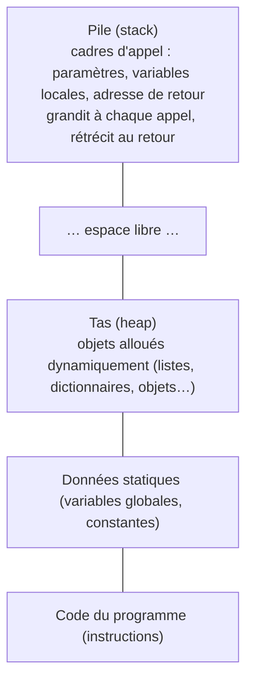

Une liste Python, un dictionnaire, une image, le code du programme lui-même : tout finit rangé dans la **mémoire vive**, une
gigantesque suite d'octets. Savoir **comment** les données y sont disposées explique beaucoup de choses vues dans les autres
leçons : pourquoi l'accès à `t[i]` est instantané mais l'insertion en tête coûteuse, pourquoi deux variables Python peuvent
désigner le même objet, pourquoi une récursion trop profonde provoque un « débordement de pile ». C'est la ligne
« représentation en mémoire des données » du programme.

## 1. Une suite d'octets adressés

La mémoire centrale est une suite de **cases d'un octet**, numérotées à partir de 0 : le numéro d'une case est son **adresse**.
Le processeur lit et écrit en donnant une adresse (voir le module architecture). Il travaille le plus souvent sur des **mots**
de 4 ou 8 octets (processeurs 32 ou 64 bits).

Avec des adresses de $n$ bits, on peut désigner $2^n$ cases : $2^{32}$ octets = 4 Gio pour une machine 32 bits (d'où la
limite historique de 4 Go de mémoire), $2^{64}$ octets (16 Eio, bien au-delà des besoins actuels) pour une machine 64 bits.

| Donnée                        | Taille typique           |
|-------------------------------|--------------------------|
| booléen, caractère ASCII      | 1 octet                  |
| entier court / normal / long  | 2 / 4 / 8 octets         |
| flottant simple / double      | 4 / 8 octets             |
| adresse (référence, pointeur) | 8 octets sur une machine 64 bits |

## 2. Une donnée sur plusieurs octets : le boutisme

Un entier de 4 octets occupe 4 adresses consécutives. Mais dans quel ordre ranger ses octets ? Pour `0x12345678` :

| adresse        | a    | a + 1 | a + 2 | a + 3 |
|----------------|------|-------|-------|-------|
| gros-boutiste  | 12   | 34    | 56    | 78    |
| petit-boutiste | 78   | 56    | 34    | 12    |

Les processeurs x86 (PC) et la plupart des ARM sont **petit-boutistes** (*little-endian* : le petit bout d'abord) ; les protocoles
réseau transmettent les entiers en **gros-boutiste** (on parle d'« ordre réseau »). Il faut donc parfois convertir.

```python exec
n = 0x12345678
print(n.to_bytes(4, "big").hex(" "), "|", n.to_bytes(4, "little").hex(" "))
print(int.from_bytes(bytes([0x78, 0x56, 0x34, 0x12]), "little") == n)
import sys
print("cette machine est", sys.byteorder + "-endian")
```

## 3. Les tableaux : des cases contiguës

Un tableau d'éléments de même taille $k$ est rangé dans des cases **contiguës**. Si le premier élément est à l'adresse $a$,
l'élément d'indice $i$ est à l'adresse

$$ \text{adresse}(t[i]) = a + i \times k. $$

C'est un simple calcul : l'accès à n'importe quel élément est en **temps constant**, quelle que soit sa position. En revanche,
insérer un élément au début oblige à **déplacer** tous les autres d'une case : temps linéaire.

<div class="cases"><span>t[0]<small>1000</small></span><span>t[1]<small>1004</small></span><span>t[2]<small>1008</small></span><span>t[3]<small>1012</small></span><span>t[4]<small>1016</small></span></div>

Une **matrice** de $L$ lignes et $C$ colonnes est rangée **ligne par ligne** (en C, en NumPy) : la ligne 0, puis la ligne 1, etc.

$$ \text{adresse}(m[i][j]) = a + (i \times C + j) \times k. $$

Parcourir une matrice ligne par ligne lit donc la mémoire **dans l'ordre**, ce qui est plus rapide (grâce aux mémoires cache)
que de la parcourir colonne par colonne.

Les **chaînes de caractères** sont aussi des tableaux d'octets ; il faut en connaître la longueur : soit elle est stockée à côté,
soit la chaîne se termine par un octet nul (convention du langage C).

## 4. Les références

Une **référence** (ou **pointeur**) est une donnée qui contient l'**adresse** d'une autre donnée. C'est ce qui permet de
construire des structures qui ne sont pas contiguës : une cellule de liste chaînée contient sa valeur **et l'adresse** de la
cellule suivante ; un nœud d'arbre contient les adresses de ses enfants.

En Python, **toutes** les valeurs sont des objets rangés quelque part en mémoire, et les variables sont des références vers ces
objets. Une liste Python est un tableau contigu de **références** : `t[i]` est trouvé en temps constant (calcul d'adresse dans
le tableau des références), puis on suit la référence vers l'objet.

```mermaid legende="En Python, une liste est un tableau de références vers des objets rangés ailleurs en mémoire"
graph LR
  T(["t"]) --> L["liste : [ • | • | • ]"]
  L --> A["int 12"]
  L --> B["str 'NSI'"]
  L --> C["list [3, 4]"]
  U(["u"]) --> C
```

```python exec
t = [12, "NSI", [3, 4]]
u = t[2]
print(id(t[2]) == id(u), u is t[2])        # même objet, même adresse
import sys
print(sys.getsizeof(0), sys.getsizeof([]), sys.getsizeof([0] * 100))   # tailles en octets (selon la version)
```

Chaque objet Python porte des informations supplémentaires (son type, un compteur de références) : un simple entier occupe
une trentaine d'octets, contre 4 ou 8 en C. C'est le prix de la souplesse de Python ; les modules `array` ou NumPy stockent
des nombres « bruts » quand on manipule de très gros volumes.

## 5. Comment un programme organise sa mémoire

Quand un programme s'exécute, le système lui attribue un espace mémoire découpé en zones :



- La **pile** contient un **cadre** par appel de fonction en cours. Elle grandit à chaque appel et rétrécit à chaque retour :
  c'est la « pile d'appels » de la leçon sur la récursivité. Une récursion trop profonde la fait **déborder** (*stack overflow*).
- Le **tas** contient les données créées dynamiquement, dont la durée de vie ne suit pas les appels de fonctions. En C, le
  programmeur les crée (`malloc`) et doit les libérer (`free`), sinon c'est une **fuite mémoire**. En Python, Java ou
  JavaScript, un **ramasse-miettes** (*garbage collector*) libère automatiquement les objets qui ne sont plus référencés (Python
  compte les références vers chaque objet).

:::prof
Au lycée, la mémoire est surtout abordée à travers les types construits (pourquoi la copie d'une liste ne copie pas ses
éléments) et l'architecture de von Neumann. Le schéma « noms → objets » et le calcul d'adresse `a + i × k` suffisent à expliquer
la plupart des phénomènes observés en TP ; le vocabulaire pile / tas est utile pour expliquer `RecursionError`.
:::

## Exemple guidé

**Problème (type écrit 2).** Une image en niveaux de gris de 640 × 480 pixels est stockée ligne par ligne, un octet par pixel, à
partir de l'adresse `0x1000`. 1. Quelle est l'adresse du pixel de la ligne 2, colonne 5 ? 2. Quelle place occupe l'image ?
3. Une image couleur stocke 4 octets par pixel (rouge, vert, bleu, transparence) : adresse du pixel (2, 5) ? 4. On lit un pixel
couleur comme un entier de 4 octets sur une machine petit-boutiste : que vaut cet entier pour R = `0x11`, V = `0x22`,
B = `0x33`, A = `0xFF` stockés dans cet ordre ?

**1.** $\text{0x1000} + (2 \times 640 + 5) \times 1 = 4096 + 1285 = 5381 = \text{0x1505}$.

**2.** $640 \times 480 = 307\,200$ octets (300 Kio).

**3.** $\text{0x1000} + (2 \times 640 + 5) \times 4 = 4096 + 5140 = 9236 = \text{0x2414}$.

**4.** En petit-boutiste, l'octet de la plus petite adresse est le **poids faible** : l'entier vaut `0xFF332211`.

```python exec
base = 0x1000
print(hex(base + (2 * 640 + 5) * 1), 640 * 480, hex(base + (2 * 640 + 5) * 4))
print(hex(int.from_bytes(bytes([0x11, 0x22, 0x33, 0xFF]), "little")))
```

## L'essentiel

- Mémoire = suite d'octets adressés ; $n$ bits d'adresse → $2^n$ octets adressables (32 bits → 4 Gio).
- Boutisme : petit-boutiste (poids faible à la plus petite adresse, x86/ARM) ou gros-boutiste (ordre réseau).
- Tableau contigu : `adresse(t[i]) = a + i·k` → accès en temps constant ; matrice ligne par ligne : `a + (i·C + j)·k`.
- Référence (pointeur) = adresse d'une donnée ; listes chaînées, arbres ; en Python, toute variable est une référence et une liste est un tableau de références.
- Pile (cadres d'appel, débordement en cas de récursion trop profonde) et tas (objets dynamiques, ramasse-miettes en Python).

## Exercices

::::exercice[Adresse d'un élément]{niveau=1}
Un tableau d'entiers de 4 octets commence à l'adresse 1000. Quelle est l'adresse de `t[5]` ?

- [ ] 1005
- [x] 1020
- [ ] 1024
- [ ] 1016

:::corrige
$1000 + 5 \times 4 = 1020$ (l'élément d'indice 0 est à 1000, celui d'indice 1 à 1004…).
:::
::::

::::exercice[Boutisme]{niveau=1}
Sur une machine petit-boutiste, dans quel ordre sont rangés (de la plus petite à la plus grande adresse) les octets de l'entier
de 32 bits `0xCAFE0001` ?

- [ ] `CA FE 00 01`
- [x] `01 00 FE CA`
- [ ] `00 01 CA FE`
- [ ] `FE CA 01 00`

:::corrige
Petit-boutiste : l'octet de poids faible (`01`) à la plus petite adresse, puis `00`, `FE`, `CA`.
:::
::::

::::exercice[Adresse dans une matrice]{niveau=2}
Écris `adresse(base, i, j, colonnes, taille)` qui renvoie l'adresse de l'élément de la ligne `i`, colonne `j` d'une matrice
rangée ligne par ligne à partir de `base`, avec `colonnes` colonnes et des éléments de `taille` octets.

```python depart
def adresse(base, i, j, colonnes, taille):
    ...
```

```python tests
assert adresse(0x1000, 2, 5, 640, 1) == 0x1505, "image en niveaux de gris"
assert adresse(0x1000, 2, 5, 640, 4) == 0x2414, "image couleur"
assert adresse(100, 0, 0, 10, 8) == 100, "premier élément"
assert adresse(0, 3, 9, 10, 8) == 312, "dernier élément d'une matrice 4 x 10 de doubles"
```

:::corrige
```python solution
def adresse(base, i, j, colonnes, taille):
    return base + (i * colonnes + j) * taille
```
Avant la ligne `i`, il y a `i` lignes complètes de `colonnes` éléments ; dans la ligne, `j` éléments précèdent.
:::
::::

::::exercice[Écrire un entier en petit-boutiste]{niveau=2}
Écris `octets_petit_boutiste(n, k)` qui renvoie la liste des `k` octets de l'entier naturel `n` (qui tient sur `k` octets), de
la plus petite à la plus grande adresse en petit-boutiste, **sans** `to_bytes` : utilise `%`, `//` (ou `&`, `>>`).

```python depart
def octets_petit_boutiste(n, k):
    ...
```

```python tests
assert octets_petit_boutiste(0x12345678, 4) == [0x78, 0x56, 0x34, 0x12], "exemple du cours"
assert octets_petit_boutiste(1, 2) == [1, 0], "un"
assert octets_petit_boutiste(0, 3) == [0, 0, 0], "zéro"
assert octets_petit_boutiste(2**32 - 1, 4) == [255, 255, 255, 255], "maximum sur 4 octets"
```

:::corrige
```python solution
def octets_petit_boutiste(n, k):
    resultat = []
    for _ in range(k):
        resultat.append(n & 0xFF)     # l'octet de poids faible
        n >>= 8                       # on passe à l'octet suivant
    return resultat
```
L'ordre gros-boutiste est simplement la liste renversée.
:::
::::

::::exercice[Pile et tas]{niveau=3}
On exécute le programme suivant.

```python
def somme(t, i):
    if i == len(t):
        return 0
    return t[i] + somme(t, i + 1)

donnees = list(range(5000))
print(somme(donnees, 0))
```

1. Où sont rangés la liste `donnees` et ses éléments ? Où sont rangés les paramètres `t` et `i` de chaque appel ?
2. Combien de cadres d'appel sont empilés au maximum ? Que va-t-il se passer en Python, et pourquoi ?
3. Combien de copies de la liste sont faites pendant les appels ?
4. Propose une version qui n'a pas ce problème.

:::criteres
- La liste et ses éléments (objets entiers) sont dans le tas ; chaque appel a un cadre dans la pile contenant ses paramètres `t` (une référence vers la liste) et `i`.
- 5001 cadres empilés au maximum ; Python limite la profondeur (environ 1000) : `RecursionError`.
- Aucune copie : chaque cadre contient seulement une référence vers la même liste.
- Version itérative (boucle) ou `sum(donnees)`, qui utilisent une mémoire de pile constante.
:::

:::corrige
1. La liste (un tableau de références) et les 5000 objets entiers sont dans le **tas**. Chaque appel de `somme` crée un **cadre**
   dans la **pile**, qui contient ses paramètres : `t`, une **référence** vers la liste (pas une copie), et `i`.
2. Les appels s'empilent de `i = 0` à `i = 5000` avant le premier retour : **5001 cadres**. Python limite la profondeur de la
   pile (environ 1000 par défaut) : le programme s'arrête avec `RecursionError: maximum recursion depth exceeded`. Dans un
   langage sans cette limite logicielle, on finirait par un débordement de la pile réelle (*stack overflow*).
3. **Aucune** copie de la liste : tous les cadres partagent la même liste via leurs références `t`.
4. Une version itérative n'utilise qu'un cadre :
   ```python
   def somme(t):
       s = 0
       for x in t:
           s += x
       return s
   ```
   (ou simplement `sum(donnees)`).
:::
::::

::::exercice[Coût mémoire des listes Python]{niveau=4 duree=20}
On veut stocker un million d'entiers compris entre 0 et 1000.

1. Combien d'octets faudrait-il au minimum, en stockant chaque entier sur le plus petit nombre entier d'octets possible ?
2. Dans une liste Python, chaque élément est une référence de 8 octets vers un objet entier. Les entiers de −5 à 256 sont des
   objets partagés pré-créés par Python, les autres occupent environ 28 octets chacun. Estime la mémoire occupée par la liste
   (en supposant les valeurs réparties uniformément entre 0 et 1000).
3. Le module `array` stocke des nombres « bruts » contigus (`array("H", ...)` : entiers non signés de 2 octets). Quelle place
   occupent les données ? Quels avantages et inconvénients par rapport à une liste ?
4. Explique pourquoi l'accès à `t[i]` est en temps constant dans les deux cas, mais pourquoi l'`array` peut être plus rapide à
   parcourir.

:::criteres
- Q1 : 1000 < 2^16, 2 octets par entier (1 octet ne suffit pas, 1000 > 255) : 2 millions d'octets (2 Mo).
- Q2 : références : 8 Mo ; environ 3/4 des valeurs (257 à 1000) sont des objets distincts de ~28 octets : environ 0,74 × 28 Mo ≈ 21 Mo ; total environ 29 Mo (ordre de grandeur, au moins 10 fois plus que le minimum).
- Q3 : array("H") : 2 octets par élément, 2 Mo de données ; avantages : compacité, lecture séquentielle efficace ; inconvénients : un seul type, valeurs bornées, moins souple qu'une liste.
- Q4 : dans les deux cas, adresse = début + i × taille d'un élément (référence ou valeur) ; l'array lit des valeurs contiguës (bonne utilisation du cache), la liste doit suivre une référence vers un objet ailleurs en mémoire pour chaque élément.
:::

:::corrige
1. $1000 > 255$ mais $1000 < 2^{16} = 65\,536$ : il faut **2 octets** par entier, soit $2 \times 10^6$ octets = 2 Mo.
2. Les références : $10^6 \times 8 = 8$ Mo. Parmi les valeurs de 0 à 1000, celles de 0 à 256 (environ 26 %) sont des objets
   partagés, les autres (environ 74 %) sont des objets distincts d'environ 28 octets : $0{,}74 \times 10^6 \times 28 \approx 21$ Mo.
   Total : **environ 29 Mo**, soit une quinzaine de fois le minimum. (Les valeurs exactes dépendent de la version de Python ;
   `sys.getsizeof` permet de les mesurer.)
3. `array("H", ...)` stocke chaque nombre sur 2 octets, à la suite : **2 Mo** de données (plus un en-tête fixe). Avantages :
   compacité, parcours rapide. Inconvénients : un seul type d'élément, valeurs bornées (0 à 65 535 pour `H`), moins de méthodes,
   et chaque lecture crée un objet Python temporaire.
4. Dans les deux cas, l'élément d'indice $i$ est à l'adresse « début + $i$ × taille d'une case » (case = référence de 8 octets,
   ou valeur de 2 octets) : temps constant. Mais la liste doit ensuite **suivre la référence** vers un objet rangé ailleurs dans le
   tas, alors que l'`array` lit des valeurs **contiguës** : un parcours séquentiel profite mieux des mémoires cache du processeur.
:::
::::
