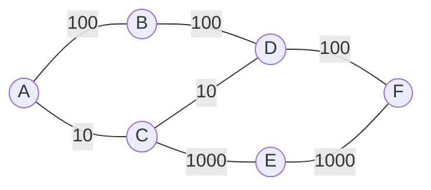

Les adresses MAC suffisent pour parler à une machine **du même réseau local**. Pour atteindre une machine à l'autre bout d'Internet, il faut
un adressage **hiérarchique** — qui dit dans quel réseau se trouve la machine — et des **routeurs** qui se transmettent les paquets de proche
en proche. C'est le rôle de la couche réseau et du protocole **IP**.

## 1. Les adresses IPv4

Une adresse IPv4 est un nombre de **32 bits**, écrit en quatre octets décimaux : `192.168.10.37`. Elle se compose d'une partie **réseau**
(les premiers bits) et d'une partie **machine**. La notation **CIDR** `192.168.10.37/24` indique que les 24 premiers bits désignent le réseau ;
le **masque** correspondant a 24 bits à 1 : `255.255.255.0`.

```python exec
import ipaddress

interface = ipaddress.ip_interface("192.168.10.37/24")
reseau = interface.network
print("adresse     :", interface.ip, "  masque :", reseau.netmask)
print("réseau      :", reseau.network_address)
print("diffusion   :", reseau.broadcast_address)
print("machines    :", reseau.num_addresses - 2)
print("en binaire  :", format(int(interface.ip), "032b"))
print("masque      :", format(int(reseau.netmask), "032b"))
```

:::methode[Calculer à la main]
- **Adresse du réseau** = adresse **ET** masque (bit à bit) : on garde les bits réseau, on met les bits machine à 0.
- **Adresse de diffusion** (*broadcast*) : bits machine tous à 1.
- **Nombre de machines** : $2^{32-n} - 2$ pour un préfixe /n (ni l'adresse du réseau ni celle de diffusion).

Exemple : `172.16.45.200/20`. Le masque a 20 bits à 1 : `255.255.240.0`. Le troisième octet 45 = `0010 1101` ; avec le masque `1111 0000`, il
devient `0010 0000` = 32. Réseau `172.16.32.0/20`, diffusion `172.16.47.255`, $2^{12} - 2 = 4\,094$ machines.
:::

Deux machines sont sur le **même réseau** si elles ont la même adresse de réseau (avec le même masque) : elles se parlent directement
(couche liaison) ; sinon, la machine envoie le paquet à sa **passerelle** (le routeur du réseau local).

Certaines plages sont **privées** (réservées aux réseaux locaux, non routées sur Internet) : `10.0.0.0/8`, `172.16.0.0/12`, `192.168.0.0/16`.
La box traduit les adresses privées en son adresse publique (**NAT**). Les 4,3 milliards d'adresses IPv4 étant épuisées, **IPv6** utilise
**128 bits** (`2001:db8:85a3::8a2e:370:7334`), soit environ $3{,}4 \times 10^{38}$ adresses.

:::remarque[Les protocoles autour d'IP]
**DHCP** : à la connexion, la machine demande et reçoit automatiquement adresse, masque, passerelle et serveur DNS. **ARP** : pour envoyer un
paquet à une IP du réseau local, la machine diffuse « qui a 192.168.10.1 ? » et apprend l'adresse MAC correspondante. **DNS** (couche
application) : traduit `www.exemple.fr` en adresse IP. La commande `ping` (protocole ICMP) teste si une machine répond ; `traceroute`
affiche la suite des routeurs traversés.
:::

## 2. Le routage

Chaque routeur a une **table de routage** : pour chaque réseau de destination, l'interface de sortie et le prochain routeur (passerelle).

| Destination | Passerelle | Interface |
|---|---|---|
| 192.168.10.0/24 | (directe) | eth0 |
| 10.1.0.0/16 | 172.16.0.2 | eth1 |
| 10.1.5.0/24 | 172.16.0.3 | eth1 |
| 0.0.0.0/0 | 82.64.1.1 | eth2 |

Pour une destination, le routeur garde les lignes dont le réseau **contient** l'adresse, et choisit celle au **préfixe le plus long** (la plus
précise). Pour `10.1.5.9`, les lignes `/16`, `/24` et `/0` conviennent : on prend `10.1.5.0/24`. La **route par défaut** `0.0.0.0/0` contient
toutes les adresses : elle ne sert que si rien de plus précis n'existe.

Les tables peuvent être écrites à la main (**routage statique**) ou construites automatiquement par des **protocoles de routage**.

## 3. RIP : le nombre de sauts

Avec **RIP** (*Routing Information Protocol*), chaque routeur envoie régulièrement (toutes les 30 s) sa table — la liste de ses **distances**
vers chaque réseau — à ses voisins. Quand un routeur reçoit d'un voisin « je suis à $d$ sauts du réseau N », il sait qu'il peut l'atteindre en
$d + 1$ sauts via ce voisin, et met à jour sa table si c'est mieux. Après quelques échanges, chaque routeur connaît le plus court chemin **en
nombre de sauts**. C'est l'algorithme de **Bellman-Ford**, réparti entre les routeurs. Une distance de 16 signifie « inaccessible », ce qui
limite RIP aux petits réseaux.



## 4. OSPF : l'état des liens

Avec **OSPF** (*Open Shortest Path First*), chaque routeur diffuse à **tous** les autres l'état de ses liens (voisins et coûts). Chacun connaît
donc la **carte complète** du réseau et calcule lui-même les plus courts chemins avec l'**algorithme de Dijkstra**. Le **coût** d'un lien
dépend de son **débit** : une formule courante (celle des sujets de terminale) est $\text{coût} = \frac{10^8}{\text{débit en bit/s}}$, soit 1 pour
100 Mbit/s, 10 pour 10 Mbit/s, 0,1 pour 1 Gbit/s.

```python exec
import heapq

debits = {("A", "B"): 100, ("A", "C"): 10, ("B", "D"): 100, ("C", "D"): 10,
          ("C", "E"): 1000, ("D", "F"): 100, ("E", "F"): 1000}          # Mbit/s
graphe = {}
for (u, v), d in debits.items():
    cout = 1e8 / (d * 1e6)
    graphe.setdefault(u, []).append((v, cout))
    graphe.setdefault(v, []).append((u, cout))

def dijkstra(depart):
    dist, pred, tas = {depart: 0}, {}, [(0, depart)]
    while tas:
        d, u = heapq.heappop(tas)
        if d > dist[u]:
            continue
        for v, c in graphe[u]:
            if d + c < dist.get(v, float("inf")):
                dist[v], pred[v] = d + c, u
                heapq.heappush(tas, (d + c, v))
    return dist, pred

dist, pred = dijkstra("A")
chemin, x = ["F"], "F"
while x != "A":
    x = pred[x]
    chemin.append(x)
print("OSPF A → F :", " → ".join(reversed(chemin)), "coût", round(dist["F"], 2))
print("RIP  A → F : 3 sauts, par exemple A → B → D → F")
```

Les deux protocoles ne choisissent pas la même route : RIP compte les sauts (A → B → D → F ou A → C → E → F, 3 sauts), OSPF préfère les liens
rapides (A → B → D → F coûte 1 + 1 + 1 = 3, A → C → E → F coûte 10 + 0,1 + 0,1 = 10,2).

:::prof
En terminale NSI : « identifier, suivant le protocole de routage utilisé, la route empruntée par un paquet » (RIP et OSPF). Les sujets de bac
donnent souvent un réseau de routeurs avec des débits et demandent les tables de routage selon chacun des protocoles : il faut savoir le faire
à la main, rapidement. Le lien avec les algorithmes de graphes (Bellman-Ford, Dijkstra) est un bon argument d'unité de la discipline.
:::

## Exemple guidé

**Problème.** Une machine a l'adresse `192.168.1.130/26`. Peut-elle communiquer directement avec `192.168.1.100` ? Avec `192.168.1.190` ?

**1. Le masque /26** : 26 bits à 1, soit `255.255.255.192` (le dernier octet `1100 0000` = 192). Il reste 6 bits machine : des blocs de
$2^6 = 64$ adresses.

**2. Le réseau de la machine** : 130 = `1000 0010`, ET `1100 0000` = `1000 0000` = 128. Réseau `192.168.1.128/26`, diffusion `192.168.1.191`.

**3. Comparer.** 100 = `0110 0100` → réseau 64 : **autre réseau**, il faut passer par la passerelle. 190 → réseau 128 : **même réseau**.

```python exec
import ipaddress
reseau = ipaddress.ip_interface("192.168.1.130/26").network
for autre in ("192.168.1.100", "192.168.1.190"):
    print(autre, "même réseau" if ipaddress.ip_address(autre) in reseau else "autre réseau", "| réseau :", reseau)
```

**4. Vérifier le nombre de machines** : $2^6 - 2 = 62$ adresses utilisables (de .129 à .190).

## L'essentiel

- IPv4 : 32 bits, `a.b.c.d/n` ; partie réseau (n bits) et machine ; masque ; réseau = adresse ET masque ; diffusion = bits machine à 1 ; $2^{32-n} - 2$ machines.
- Plages privées (10/8, 172.16/12, 192.168/16) et NAT ; IPv6 : 128 bits.
- DHCP (attribution d'adresse), ARP (IP → MAC), DNS (nom → IP), ICMP (`ping`, `traceroute`).
- Table de routage : destination, passerelle, interface ; **préfixe le plus long** ; route par défaut 0.0.0.0/0.
- **RIP** : vecteurs de distances échangés entre voisins, métrique = nombre de sauts (≤ 15), Bellman-Ford.
- **OSPF** : état des liens diffusé, carte complète, **Dijkstra**, coût = $10^8$ / débit (bit/s).

## Exercices

::::exercice[Nombre de machines]{niveau=1}
Combien de machines peut-on adresser dans le réseau `10.20.0.0/22` ?

- [ ] 512
- [x] 1 022
- [ ] 1 024
- [ ] 4 094

:::corrige
$32 - 22 = 10$ bits machine : $2^{10} = 1\,024$ adresses, moins l'adresse du réseau et celle de diffusion : 1 022.
:::
::::

::::exercice[Quelle route ?]{niveau=1}
Avec la table de routage de la section 2, par quelle passerelle part un paquet destiné à `10.1.200.3` ?

- [ ] 172.16.0.3
- [x] 172.16.0.2
- [ ] 82.64.1.1
- [ ] Il est envoyé directement sur eth0

:::corrige
`10.1.200.3` est dans `10.1.0.0/16` (et dans `0.0.0.0/0`), mais **pas** dans `10.1.5.0/24`. Le préfixe le plus long qui convient est le /16 :
passerelle 172.16.0.2.
:::
::::

::::exercice[Réseau et diffusion]{niveau=2}
Sans utiliser le module `ipaddress`, écris `reseau_diffusion(adresse, n)` qui renvoie le couple (adresse du réseau, adresse de diffusion),
sous forme de chaînes, pour une adresse IPv4 (chaîne) et un préfixe `n`.

```python depart
def reseau_diffusion(adresse, n):
    ...
```

```python tests
assert reseau_diffusion("192.168.10.37", 24) == ("192.168.10.0", "192.168.10.255"), "/24"
assert reseau_diffusion("172.16.45.200", 20) == ("172.16.32.0", "172.16.47.255"), "/20"
assert reseau_diffusion("192.168.1.130", 26) == ("192.168.1.128", "192.168.1.191"), "/26"
assert reseau_diffusion("10.0.0.1", 8) == ("10.0.0.0", "10.255.255.255"), "/8"
assert reseau_diffusion("8.8.8.8", 32) == ("8.8.8.8", "8.8.8.8"), "/32 : une seule adresse"
```

:::corrige
```python solution
def reseau_diffusion(adresse, n):
    octets = [int(x) for x in adresse.split(".")]
    valeur = (octets[0] << 24) | (octets[1] << 16) | (octets[2] << 8) | octets[3]
    masque = ((1 << n) - 1) << (32 - n)              # n bits à 1 puis 32 - n bits à 0
    reseau = valeur & masque
    diffusion = reseau | (~masque & 0xFFFFFFFF)       # bits machine à 1
    def texte(v):
        return ".".join(str((v >> d) & 255) for d in (24, 16, 8, 0))
    return texte(reseau), texte(diffusion)
```
On transforme l'adresse en un entier de 32 bits, on applique le masque avec `&` (ET bit à bit) et son complément avec `|` (OU), puis on
redécoupe en octets. `~masque & 0xFFFFFFFF` limite le complément à 32 bits (les entiers Python n'ont pas de taille fixe).
:::
::::

::::exercice[Le préfixe le plus long]{niveau=2}
Écris `route(table, destination)` : `table` est une liste de couples `(réseau CIDR, passerelle)`, par exemple `("10.1.0.0/16", "172.16.0.2")`.
Renvoie la passerelle de la ligne au préfixe le plus long qui contient `destination`, ou `None` si aucune ne convient. Tu peux utiliser
`ipaddress`.

```python depart
import ipaddress

def route(table, destination):
    ...
```

```python tests
t = [("192.168.10.0/24", "direct"), ("10.1.0.0/16", "172.16.0.2"), ("10.1.5.0/24", "172.16.0.3"), ("0.0.0.0/0", "82.64.1.1")]
assert route(t, "10.1.5.9") == "172.16.0.3", "préfixe le plus long"
assert route(t, "10.1.200.3") == "172.16.0.2", "le /16"
assert route(t, "192.168.10.4") == "direct", "réseau local"
assert route(t, "8.8.8.8") == "82.64.1.1", "route par défaut"
assert route(t[:3], "8.8.8.8") is None, "aucune route"
```

:::corrige
```python solution
import ipaddress

def route(table, destination):
    adresse = ipaddress.ip_address(destination)
    meilleure, longueur = None, -1
    for cidr, passerelle in table:
        reseau = ipaddress.ip_network(cidr)
        if adresse in reseau and reseau.prefixlen > longueur:
            meilleure, longueur = passerelle, reseau.prefixlen
    return meilleure
```
Les routeurs réels font cette recherche des millions de fois par seconde : ils rangent la table dans un **arbre préfixe** (trie binaire) où l'on
descend bit par bit, en retenant la dernière route rencontrée.
:::
::::

::::exercice[Simuler RIP]{niveau=3}
Le réseau est donné par un dictionnaire de voisins (graphe non orienté). Chaque routeur connaît au départ la distance 0 vers lui-même. À chaque
**tour**, tous les routeurs envoient simultanément leur table à leurs voisins, qui la mettent à jour (distance reçue + 1 si c'est mieux).
Écris `rip(voisins)` qui répète les tours jusqu'à ce que plus rien ne change, et renvoie le couple (tables finales `{routeur: {destination:
distance}}`, nombre de tours **qui ont modifié** au moins une table).

```python depart
def rip(voisins):
    ...
```

```python tests
ligne = {"A": ["B"], "B": ["A", "C"], "C": ["B", "D"], "D": ["C"]}
tables, tours = rip(ligne)
assert tables["A"] == {"A": 0, "B": 1, "C": 2, "D": 3}, "distances depuis A"
assert tours == 3, "il faut autant de tours que le diamètre"
reseau = {"A": ["B", "C"], "B": ["A", "D"], "C": ["A", "D", "E"], "D": ["B", "C", "F"], "E": ["C", "F"], "F": ["D", "E"]}
tables, tours = rip(reseau)
assert tables["A"]["F"] == 3 and tables["E"]["B"] == 3, "réseau de la leçon"
assert tours == 3, "diamètre 3"
```

:::corrige
```python solution
def rip(voisins):
    tables = {r: {r: 0} for r in voisins}
    tours = 0
    while True:
        anciennes = {r: dict(t) for r, t in tables.items()}      # envois simultanés
        change = False
        for r in voisins:
            for v in voisins[r]:
                for dest, d in anciennes[v].items():
                    if d + 1 < tables[r].get(dest, float("inf")):
                        tables[r][dest] = d + 1
                        change = True
        if not change:
            return tables, tours
        tours += 1
```
On copie les tables avant chaque tour pour simuler des envois **simultanés** : une information progresse d'un saut par tour. Il faut donc
autant de tours que le **diamètre** du réseau pour converger. C'est Bellman-Ford : $d(r, x) = \min_{v \text{ voisin}} (1 + d(v, x))$.
:::
::::

::::exercice[Comparer RIP et OSPF]{niveau=4 duree=25}
On reprend le réseau de 6 routeurs de la section 3 (débits sur les liens).

1. Donnez la route choisie de A vers F avec RIP, puis avec OSPF (coût = $10^8$ / débit), en justifiant.
2. Le lien B – D tombe en panne. Quelles sont les nouvelles routes avec chaque protocole ?
3. Pourquoi OSPF converge-t-il en général plus vite que RIP après une panne ? Quel est son inconvénient ?
4. Proposez une activité pour faire comprendre aux élèves la différence entre les deux protocoles.

:::criteres
- RIP : 3 sauts, A → B → D → F ou A → C → E → F (égalité, départage par l'ordre d'arrivée des annonces) ; OSPF : coûts A → B → D → F = 3 contre A → C → E → F = 10,2 et A → C → D → F = 21, donc A → B → D → F.
- Après panne de B – D : RIP → A → C → E → F ou A → C → D → F (3 sauts) ; OSPF → A → C → E → F (10,2) contre A → C → D → F (21).
- Convergence : OSPF diffuse immédiatement l'état des liens et chaque routeur recalcule ; RIP propage les distances voisin par voisin, toutes les 30 s, avec le problème du comptage à l'infini ; inconvénient d'OSPF : mémoire et calcul (carte complète, Dijkstra), complexité de configuration.
- Activité : élèves-routeurs qui échangent des tableaux (RIP) contre une carte complète et Dijkstra (OSPF), avec panne simulée.
:::

:::corrige
1. **RIP** compte les sauts : A → B → D → F et A → C → E → F font 3 sauts ; A → C → D → F aussi. Plusieurs routes à égalité : le routeur garde la
   première apprise. **OSPF** : coûts $10^8 / (100 \times 10^6) = 1$ pour 100 Mbit/s, 10 pour 10 Mbit/s, 0,1 pour 1 Gbit/s. A → B → D → F :
   $1 + 1 + 1 = 3$ ; A → C → E → F : $10 + 0{,}1 + 0{,}1 = 10{,}2$ ; A → C → D → F : $10 + 10 + 1 = 21$. OSPF choisit **A → B → D → F**.
2. Sans B – D : **RIP** passe par C (A → C → E → F ou A → C → D → F, 3 sauts ; B n'est plus utile pour aller vers F). **OSPF** : A → C → E → F
   (10,2), bien meilleur que A → C → D → F (21) ou que A → B (impasse).
3. Avec OSPF, la panne est **annoncée immédiatement** à tous les routeurs, qui recalculent chacun leurs chemins : convergence en quelques
   secondes. Avec RIP, l'information se propage voisin par voisin, au rythme des annonces (30 s), et des boucles peuvent apparaître
   transitoirement (« comptage à l'infini » : deux routeurs se renvoient une distance qui augmente jusqu'à 16). Inconvénients d'OSPF : chaque
   routeur stocke la **carte complète** et exécute Dijkstra (mémoire et calcul), et la configuration (zones) est plus complexe — d'où RIP encore
   utilisé dans de petits réseaux.
4. Activité : six élèves-routeurs. Version RIP : chacun ne connaît que ses voisins, et à chaque « top » recopie le tableau de distances de ses
   voisins en ajoutant 1 ; on compte les tops nécessaires. Version OSPF : chacun reçoit la carte complète affichée au tableau et applique Dijkstra.
   Puis on « coupe » un lien : les élèves constatent la différence de vitesse de réaction et le risque de boucle en RIP. Bilan : les deux
   algorithmes de plus courts chemins (Bellman-Ford, Dijkstra) appliqués à un vrai problème.
:::
::::
