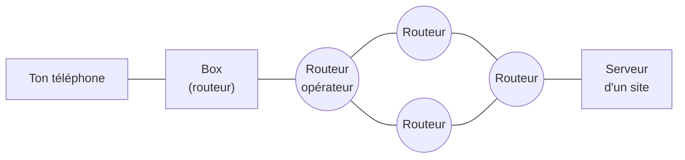

Internet est le premier thème de SNT, et celui qui sert de base aux autres (le Web, les réseaux sociaux, le cloud reposent tous sur Internet). Les
élèves l'utilisent tous les jours sans savoir comment ça marche. L'enjeu du cours est qu'ils comprennent **trois idées** : les données voyagent en
**paquets**, chaque machine a une **adresse**, et des **protocoles** organisent l'échange.

## Ce que dit le programme

Les **capacités attendues** du thème Internet en SNT sont notamment : distinguer le rôle des protocoles **IP** et **TCP** ; caractériser les principes
du **routage** et ses limites ; distinguer la fiabilité de transmission et l'absence de garantie temporelle ; retrouver une adresse IP à partir d'une
adresse symbolique (**DNS**) ; décrire l'intérêt des réseaux **pair-à-pair** et leurs usages illicites ; caractériser quelques types de **réseaux
physiques** (filaires ou non, rapides ou lents) ; avoir un ordre de grandeur du **trafic** et de son évolution.

Ce qui **n'est pas** attendu en seconde : le modèle en couches détaillé, le calcul des masques de sous-réseau, les algorithmes de routage (vus en
terminale NSI).

## 1. Un réseau de réseaux

Internet relie des **milliards de machines** (ordinateurs, téléphones, serveurs, objets connectés) à travers des millions de réseaux : celui de ta
box à la maison, celui du lycée, ceux des opérateurs, ceux des grandes entreprises… Ces réseaux sont reliés entre eux par des **routeurs**.



:::attention[Internet n'est pas le Web]
Le **Web** (les pages qu'on consulte dans un navigateur) n'est qu'**un service** qui utilise Internet, comme le courriel, les jeux en ligne, la
visioconférence ou les applications. Cette confusion est très fréquente chez les élèves (et chez les adultes).
:::

## 2. Les données voyagent en paquets

Quand tu envoies une photo, elle n'est pas envoyée d'un seul bloc : elle est **découpée en paquets** (de l'ordre de 1 500 octets chacun). Chaque
paquet voyage **indépendamment**, parfois par des chemins différents, puis le destinataire **réassemble** le tout.

Avantages : si un lien est en panne, les paquets passent ailleurs ; plusieurs communications partagent les mêmes câbles ; un paquet perdu peut être
renvoyé seul, sans tout recommencer.

## 3. Les adresses IP

Pour qu'un paquet arrive, chaque machine connectée possède une **adresse IP**. En **IPv4**, c'est une suite de **4 nombres de 0 à 255** séparés par
des points :

```text
192.168.1.12      (une adresse sur un réseau local)
93.184.216.34     (l'adresse d'un serveur sur Internet)
```

Chaque nombre tient sur 8 bits, l'adresse sur **32 bits** : cela fait environ 4,3 milliards d'adresses, ce qui ne suffit plus. Le nouveau format,
**IPv6**, utilise 128 bits (par exemple `2001:db8::1`) et offre un nombre d'adresses quasi illimité.

## 4. Les protocoles IP et TCP

Un **protocole** est un ensemble de **règles** que les machines respectent pour se comprendre (comme les règles d'une conversation au téléphone :
« Allô ? », on attend la réponse, on dit au revoir…).

| Protocole | Son rôle | Analogie |
|---|---|---|
| **IP** (*Internet Protocol*) | **adresser** et **acheminer** chaque paquet vers la bonne machine | l'adresse sur une enveloppe et le travail de la Poste |
| **TCP** (*Transmission Control Protocol*) | **fiabiliser** : numéroter les paquets, vérifier leur arrivée, renvoyer les perdus, les remettre dans l'ordre | un accusé de réception pour chaque lettre |

IP seul ne garantit rien : un paquet peut se perdre, arriver en double ou dans le désordre. TCP corrige cela, au prix d'un peu de lenteur. Ni l'un
ni l'autre ne garantit **le délai** : un paquet peut arriver en retard (d'où les vidéos qui « saccadent »).

## 5. Le routage

Un **routeur** reçoit des paquets et choisit, pour chacun, vers quel routeur voisin l'envoyer pour qu'il se rapproche de sa destination. Il utilise
pour cela une **table de routage**. Personne ne connaît le chemin complet : chaque routeur fait seulement le « prochain pas ». Si un lien tombe en
panne, les routeurs trouvent un autre chemin.

:::remarque[Limites du routage]
Le chemin n'est pas forcément le plus court ; une panne importante ou un routeur saturé ralentissent tout ; et le routage repose sur la confiance
entre opérateurs (une erreur de configuration peut détourner du trafic).
:::

## 6. Le DNS : des noms plutôt que des numéros

Retenir `93.184.216.34` est difficile ; on retient plutôt `www.exemple.fr`. Le **DNS** (*Domain Name System*) est l'**annuaire d'Internet** : il
traduit un **nom de domaine** en **adresse IP**. Quand tu tapes une adresse dans le navigateur, une requête DNS a lieu avant tout le reste.

On peut le constater avec la commande `nslookup lemonde.fr` (ou `ping`) qui affiche l'adresse IP correspondante : c'est une activité classique en
classe.

## 7. Le pair-à-pair

Dans le modèle **client-serveur**, un serveur central fournit les données à tous. Dans un réseau **pair-à-pair** (*peer-to-peer*, P2P), chaque
machine est **à la fois client et serveur** : elle télécharge des morceaux de fichiers et en partage avec les autres.

- **Intérêts** : pas de serveur central qui sature, chaque nouvel utilisateur ajoute de la capacité, mises à jour de jeux ou de logiciels, partage
  de gros fichiers libres.
- **Usages illicites** : partage d'œuvres protégées sans autorisation (le droit d'auteur s'applique).

## 8. Les réseaux physiques et le trafic

Les données passent par des **câbles en cuivre** (ADSL, en voie de disparition), la **fibre optique** (lumière, très haut débit), les **câbles
sous-marins** (l'essentiel du trafic intercontinental), le **Wi-Fi**, la **4G/5G**, et parfois les satellites. Le trafic mondial ne cesse
d'augmenter, porté surtout par la **vidéo**, avec un coût énergétique et environnemental (centres de données, réseaux, fabrication des appareils).

## Les erreurs classiques des élèves

:::attention[Ce que tu verras en classe]
- **« Internet = le Web »**, ou « Internet = Google ».
- **Croire que les données passent par un satellite** : l'essentiel passe par des câbles, y compris sous les océans.
- **Croire qu'un fichier part d'un seul bloc** et par un seul chemin.
- **Confondre adresse IP et nom de domaine**, ou croire qu'une adresse IP identifie forcément une personne.
- **Croire que le Wi-Fi, c'est Internet** : le Wi-Fi n'est qu'un moyen de se connecter à la box.
:::

## En classe

:::methode[Activités qui marchent]
1. **Débranché** : simuler le routage en classe : chaque élève est un routeur qui ne connaît que ses voisins ; un message découpé en « paquets »
   (papiers numérotés) doit traverser la salle ; un élève « en panne » oblige à trouver un autre chemin ; on réassemble à l'arrivée.
2. **Commandes** : `ping`, `nslookup`, `tracert` (Windows) ou `traceroute` pour voir les routeurs traversés jusqu'à un site.
3. **Débat** : pair-à-pair, droit d'auteur et usages légaux.
4. **Ordres de grandeur** : carte des câbles sous-marins, consommation d'une vidéo en streaming.
:::

## L'essentiel

- Internet est un **réseau de réseaux** reliés par des **routeurs** ; le Web n'est qu'un de ses services.
- Les données sont découpées en **paquets** qui voyagent indépendamment.
- **IP** adresse et achemine (adresses IPv4 : 4 nombres de 0 à 255) ; **TCP** fiabilise (numérotation, accusés de réception, renvoi).
- Le **routage** se fait pas à pas ; aucune garantie de délai.
- Le **DNS** traduit un nom de domaine en adresse IP ; le **pair-à-pair** partage sans serveur central.

## Exercices

::::exercice[Grand QCM : Internet]{niveau=1 type=quiz}
Douze questions sur le thème Internet, au niveau de la seconde.

1. Qu'est-ce qu'Internet ?

   - [ ] un site web géant
   - [x] un réseau mondial de réseaux interconnectés
   - [ ] un logiciel installé sur les ordinateurs
   - [ ] un satellite

   > Internet relie des millions de réseaux grâce à des protocoles communs.

1. Le Web est…

   - [ ] un autre nom d'Internet
   - [x] un service qui utilise Internet, parmi d'autres (courriel, jeux, visio…)
   - [ ] le réseau des câbles sous-marins
   - [ ] le protocole qui découpe les paquets

   > Le Web (pages consultées dans un navigateur) n'est qu'une application d'Internet.

1. Laquelle est une adresse IPv4 valide ?

   - [ ] 192.168.1
   - [ ] 300.12.5.1
   - [x] 172.16.0.254
   - [ ] www.lycee.fr

   > Quatre nombres de 0 à 255. 300 est trop grand, et www.lycee.fr est un **nom de domaine**.

1. Quel est le rôle principal du protocole IP ?

   - [ ] vérifier que tous les paquets sont arrivés
   - [x] adresser et acheminer les paquets jusqu'à la bonne machine
   - [ ] afficher les pages web
   - [ ] chiffrer les données

   > IP s'occupe des adresses et du trajet ; la vérification, c'est TCP.

1. Quel est le rôle principal du protocole TCP ?

   - [ ] traduire un nom de domaine en adresse IP
   - [ ] choisir le chemin des paquets
   - [x] rendre la transmission fiable (numérotation, accusés de réception, renvoi des paquets perdus)
   - [ ] fabriquer les adresses IP

   > TCP garantit que tout arrive, dans l'ordre, mais pas en un temps donné.

1. Pourquoi découpe-t-on les données en paquets ?

   - [ ] pour qu'elles prennent moins de place sur le disque
   - [x] pour qu'elles circulent indépendamment, partagent les lignes et soient renvoyées seulement en cas de perte
   - [ ] parce que les câbles sont trop courts
   - [ ] pour les chiffrer

   > Les paquets passent par des chemins variés et un paquet perdu est renvoyé seul.

1. À quoi sert le DNS ?

   - [x] à traduire un nom de domaine en adresse IP
   - [ ] à accélérer le Wi-Fi
   - [ ] à stocker les pages web
   - [ ] à bloquer les virus

   > C'est l'annuaire d'Internet : lemonde.fr → une adresse IP.

1. Que fait un routeur ?

   - [ ] il stocke tous les sites web
   - [x] il transmet chaque paquet vers un voisin qui le rapproche de sa destination
   - [ ] il donne un nom aux machines
   - [ ] il affiche les pages

   > Le routage se fait pas à pas : chaque routeur choisit seulement le prochain saut.

1. Par où passe l'essentiel du trafic Internet entre les continents ?

   - [ ] par des satellites
   - [x] par des câbles sous-marins en fibre optique
   - [ ] par les antennes 5G
   - [ ] par ondes radio

   > Les câbles sous-marins transportent l'immense majorité du trafic intercontinental.

1. Dans un réseau pair-à-pair…

   - [ ] un serveur central distribue les fichiers à tous
   - [x] chaque machine est à la fois client et serveur
   - [ ] les machines ne peuvent pas échanger de fichiers
   - [ ] il faut une adresse IPv6

   > Les utilisateurs partagent directement entre eux.

1. Pourquoi a-t-on créé IPv6 ?

   - [ ] pour aller plus vite
   - [x] parce qu'il n'y a plus assez d'adresses IPv4 (environ 4,3 milliards)
   - [ ] pour remplacer le DNS
   - [ ] pour le Wi-Fi

   > IPv4 utilise 32 bits ; IPv6 en utilise 128.

1. Une vidéo en ligne « saccade » alors que la connexion fonctionne. Quelle explication est la plus juste ?

   - [ ] TCP a perdu définitivement des images
   - [x] Internet garantit l'arrivée des données, mais pas le délai : certains paquets arrivent en retard
   - [ ] le DNS est en panne
   - [ ] l'adresse IP a changé

   > Pas de garantie temporelle : les paquets peuvent être retardés par des routeurs encombrés.
::::

::::exercice[Adresse IPv4 valide ?]{niveau=1}
Écris `ipv4_valide(adresse)` qui renvoie `True` si le texte `adresse` est une adresse IPv4 valide : exactement 4 nombres entiers de 0 à 255 séparés par
des points. On suppose que chaque morceau ne contient que des chiffres.

```python depart
def ipv4_valide(adresse):
    morceaux = adresse.split(".")   # "192.168.1.12" donne ["192", "168", "1", "12"]
    ...
```

```python tests
assert ipv4_valide("192.168.1.12") is True, "adresse valide"
assert ipv4_valide("300.1.1.1") is False, "300 est trop grand"
assert ipv4_valide("10.0.0") is False, "seulement trois nombres"
assert ipv4_valide("0.0.0.0") is True, "0 est autorisé"
```

:::corrige
```python solution
def ipv4_valide(adresse):
    morceaux = adresse.split(".")
    if len(morceaux) != 4:
        return False
    for m in morceaux:
        if int(m) < 0 or int(m) > 255:
            return False
    return True
```

`split(".")` découpe le texte à chaque point. On vérifie d'abord qu'il y a 4 morceaux, puis que chacun est entre 0 et 255.
:::
::::

::::exercice[Remettre les paquets dans l'ordre]{niveau=2}
Un message a été découpé en paquets numérotés, arrivés dans le désordre. Chaque paquet est un couple `(numéro, texte)`. Écris `reassembler(paquets)`
qui renvoie le message complet, paquets remis dans l'ordre des numéros (comme le fait TCP).

```python depart
def reassembler(paquets):
    ...
```

```python tests
assert reassembler([(2, "lo"), (1, "Bonjour "), (3, "ut")]) == "Bonjour lout", "trois paquets désordonnés"
assert reassembler([(1, "Salut")]) == "Salut", "un seul paquet"
assert reassembler([(3, "!"), (2, "c"), (1, "ok")]) == "okc!", "ordre inverse"
```

:::indice
`sorted(paquets)` trie les couples selon leur premier élément, le numéro. Il reste à coller les textes dans l'ordre.
:::

:::corrige
```python solution
def reassembler(paquets):
    message = ""
    for numero, texte in sorted(paquets):
        message = message + texte
    return message
```

C'est exactement le travail de TCP à l'arrivée : grâce aux numéros, l'ordre d'arrivée n'a pas d'importance.
:::
::::

::::exercice[Expliquer Internet à un élève]{niveau=2}
Un élève affirme : « Quand j'envoie une photo à ma copine, elle passe par un satellite directement jusqu'à son téléphone. » Rédige ta réponse en
quelques phrases, en corrigeant ses idées sans le décourager.

:::criteres
- La photo est découpée en paquets.
- Les paquets passent par des réseaux et des routeurs, surtout par des câbles (fibre, câbles sous-marins), via les antennes de l'opérateur.
- Le rôle des adresses IP (et éventuellement de TCP) est évoqué simplement.
- Le ton valorise la question de l'élève.
:::

:::corrige
« Bonne question, et c'est une idée très répandue ! En réalité, ta photo est **découpée en petits paquets**. Ton téléphone les envoie à l'antenne de
ton opérateur, puis ils traversent des **routeurs** et des **câbles**, souvent en fibre optique, parfois sous la mer, jusqu'à l'antenne près de ta
copine. Chaque paquet porte l'**adresse IP** de destination, un peu comme une enveloppe ; et le protocole **TCP** vérifie que tous les paquets sont
arrivés pour reconstituer la photo. Les satellites existent, mais ils transportent une toute petite part des données. »
:::
::::
