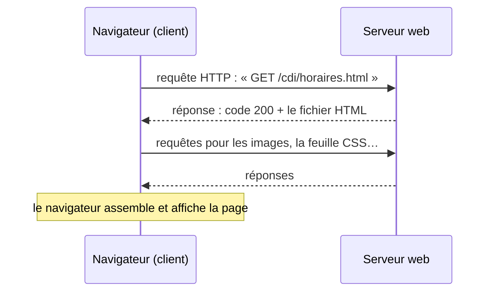

Le **Web** est le service d'Internet que les élèves connaissent le mieux… sans savoir comment il marche. Le cours part de ce qu'ils font tous les jours
(taper une adresse, cliquer sur un lien, accepter des cookies) pour faire apparaître les notions : **URL**, **client-serveur**, **HTTP**, **HTML/CSS**,
**moteurs de recherche**.

## Ce que dit le programme

Capacités attendues du thème Web en SNT : connaître les **étapes du développement du Web** ; connaître certaines notions juridiques (**licences**,
**droit d'auteur**) ; **décomposer l'URL** d'une page ; reconnaître les pages **sécurisées** ; **décomposer le contenu** d'une page et repérer les
principaux éléments **HTML** et **CSS** ; distinguer **contenu** et **style** ; **étudier et modifier une page HTML simple** ; mener une **analyse
critique** des résultats d'un moteur de recherche ; comprendre les enjeux de la **publication** d'informations ; maîtriser les réglages des
**cookies** et de la **confidentialité** du navigateur.

Ce qui **n'est pas** attendu : JavaScript, les formulaires et les requêtes GET/POST détaillées (vus en première NSI), la programmation côté serveur.

## 1. Un peu d'histoire

- **1989-1991** : au CERN (Genève), **Tim Berners-Lee** invente le Web pour partager des documents entre chercheurs. Il crée les trois briques :
  **URL** (l'adresse), **HTTP** (le protocole d'échange) et **HTML** (le langage des pages).
- **1993** : le CERN met le Web dans le domaine public ; premiers navigateurs grand public.
- Années 2000 : moteurs de recherche, Web participatif (blogs, wikis, réseaux sociaux), puis Web sur mobile.

## 2. L'URL : l'adresse d'une page

```text
https://www.lycee-exemple.fr/cdi/horaires.html
└─┬─┘   └────────┬─────────┘└────────┬───────┘
protocole   nom de domaine         chemin
```

- Le **protocole** dit comment communiquer (`http` ou `https`).
- Le **nom de domaine** désigne le serveur (traduit en adresse IP par le DNS, voir le cours sur Internet).
- Le **chemin** désigne la ressource sur ce serveur.

## 3. Client, serveur et HTTP



- Le **client** est le navigateur (Firefox, Chrome…) ; le **serveur** est un ordinateur qui stocke le site et répond aux demandes.
- **HTTP** est le protocole de ce dialogue. Une réponse porte un **code** : `200` (tout va bien), `404` (page introuvable), `500` (erreur du serveur).
- **HTTPS** chiffre l'échange : personne entre le client et le serveur ne peut lire ou modifier les données (mots de passe, paiements). Le cadenas
  indique que la connexion est chiffrée, **pas** que le site est honnête.

## 4. HTML et CSS : contenu et style

Une page web est un fichier texte écrit en **HTML**, fait de **balises** :

```html
<h1>Le CDI</h1>
<p>Ouvert du lundi au vendredi, de <strong>8 h à 17 h</strong>.</p>
<p>Voir aussi le <a href="https://www.education.gouv.fr">site du ministère</a>.</p>

```

| Balise | Rôle |
|---|---|
| `<h1>` … `<h6>` | titres |
| `<p>` | paragraphe |
| `<a href="…">` | **lien hypertexte** vers une autre page |
| `` | image (avec un texte de remplacement) |
| `<ul>`, `<li>` | liste à puces |

Le **CSS** donne la mise en forme, séparément :

```css
h1 { color: darkblue; }
p  { font-size: 18px; }
```

Séparer **contenu** (HTML) et **style** (CSS) permet de changer l'apparence de tout un site sans toucher aux textes, et d'adapter l'affichage à
l'écran (téléphone, ordinateur). L'**hypertexte**, c'est-à-dire les liens entre pages, est ce qui fait du Web une « toile ».

## 5. Les moteurs de recherche

Un moteur de recherche fonctionne en trois temps :

1. **Explorer** : des robots (*crawlers*) parcourent le Web en suivant les liens.
2. **Indexer** : les mots de chaque page sont rangés dans un gigantesque index (comme l'index d'un livre).
3. **Classer** : pour une recherche, le moteur trie les pages selon leur pertinence et leur **popularité** (une page vers laquelle beaucoup de pages
   pointent est jugée importante : c'est l'idée du *PageRank* de Google).

:::attention[Esprit critique]
Les premiers résultats ne sont pas « la vérité » : certains sont **sponsorisés** (publicité), le classement dépend de critères commerciaux et de ton
profil, et les sites optimisent leur référencement. Vérifier la source, la date, l'auteur, croiser les informations.
:::

## 6. Cookies, confidentialité et droit

- Un **cookie** est un petit fichier déposé par un site dans le navigateur : utile (rester connecté, garder un panier) ou de **suivi** (publicité
  ciblée, souvent déposé par d'autres sites : cookies tiers). Le RGPD impose de demander le consentement ; on peut les refuser et les effacer.
- La **navigation privée** n'enregistre pas l'historique sur l'appareil, mais ne rend **pas** anonyme sur Internet.
- **Droit d'auteur** : un contenu publié en ligne n'est pas libre de droits ; certaines licences (Creative Commons) précisent ce qu'on peut faire.

## Les erreurs classiques des élèves

:::attention[Ce que tu verras en classe]
- **Confondre Web et Internet**, ou navigateur et moteur de recherche (« Google, c'est Internet »).
- **Croire que le cadenas HTTPS garantit qu'un site est fiable** : il garantit seulement le chiffrement.
- **Confondre l'URL et la recherche** : taper une adresse dans la barre de recherche du moteur.
- **Mélanger contenu et mise en forme** (vouloir mettre des couleurs « dans le texte » HTML).
- **Croire que la navigation privée rend anonyme.**
:::

## En classe

:::methode[Activités qui marchent]
1. **Décortiquer des URL** réelles (site du lycée, ENT, sites d'actualité).
2. **« Afficher le code source »** d'une page (Ctrl + U), repérer les balises ; ouvrir les outils de développement (F12) et modifier un texte en direct
   (sans effet sur le vrai site : ça montre que la page est chez le client).
3. **Écrire sa propre page** HTML simple dans un éditeur, puis lui ajouter une feuille CSS.
4. **Moteurs de recherche** : comparer les résultats d'une même requête sur deux moteurs, repérer les liens sponsorisés.
5. **Cookies** : ouvrir les réglages du navigateur, voir les cookies d'un site, les supprimer.
:::

## L'essentiel

- Le Web (Berners-Lee, CERN, 1989) repose sur **URL**, **HTTP** et **HTML**.
- URL = **protocole** + **nom de domaine** + **chemin**.
- Le navigateur (**client**) envoie une **requête HTTP**, le **serveur** répond (code 200, 404…) ; **HTTPS** chiffre l'échange.
- **HTML** : le contenu et la structure (balises) ; **CSS** : la mise en forme. Les **liens** relient les pages.
- Moteur de recherche : explorer, indexer, classer ; rester critique. Cookies : utiles ou de suivi, à maîtriser.

## Exercices

::::exercice[Grand QCM : le Web]{niveau=1 type=quiz}
Douze questions sur le thème du Web.

1. Dans l'URL `https://www.cinema.fr/films/semaine.html`, quel est le nom de domaine ?

   - [ ] `https`
   - [x] `www.cinema.fr`
   - [ ] `/films/semaine.html`
   - [ ] `semaine.html`

   > Le nom de domaine est entre `://` et la première barre `/`.

1. Qui a inventé le Web ?

   - [ ] Bill Gates
   - [x] Tim Berners-Lee
   - [ ] Alan Turing
   - [ ] les fondateurs de Google

   > Au CERN, entre 1989 et 1991.

1. Quel est le rôle du navigateur ?

   - [x] c'est le client : il envoie les requêtes et affiche les pages reçues
   - [ ] c'est le serveur qui stocke les sites
   - [ ] c'est un moteur de recherche
   - [ ] c'est l'annuaire DNS

   > Firefox, Chrome, Safari… sont des clients web.

1. Que signifie le code de réponse HTTP 404 ?

   - [ ] tout s'est bien passé
   - [x] la page demandée est introuvable
   - [ ] le serveur est en panne
   - [ ] la connexion est sécurisée

   > 200 = succès, 404 = ressource introuvable, 500 = erreur du serveur.

1. Que garantit le cadenas HTTPS ?

   - [ ] que le site est honnête et fiable
   - [x] que les échanges entre ton navigateur et le serveur sont chiffrés
   - [ ] que le site n'utilise pas de cookies
   - [ ] que la page est gratuite

   > Un site frauduleux peut avoir un cadenas : HTTPS protège la connexion, pas le contenu.

1. Quelle balise HTML crée un lien vers une autre page ?

   - [ ] `<p>`
   - [ ] ``
   - [x] `<a href="...">`
   - [ ] `<h1>`

   > `a` comme *anchor* (ancre) ; `href` contient l'adresse de destination.

1. À quoi sert le CSS ?

   - [ ] à écrire le contenu de la page
   - [x] à définir la mise en forme (couleurs, tailles, disposition)
   - [ ] à envoyer la page au serveur
   - [ ] à chiffrer la page

   > HTML pour le contenu, CSS pour le style.

1. Quelle est la bonne suite d'étapes pour un moteur de recherche ?

   - [ ] classer, explorer, indexer
   - [x] explorer, indexer, classer
   - [ ] indexer, classer, explorer
   - [ ] explorer, classer, indexer

   > Les robots explorent le Web, le contenu est indexé, puis classé pour chaque recherche.

1. Pourquoi les premiers résultats d'un moteur ne sont-ils pas forcément les plus fiables ?

   - [ ] parce que le moteur les choisit au hasard
   - [x] parce que certains sont sponsorisés et que le classement suit aussi la popularité et des critères commerciaux
   - [ ] parce qu'ils sont trop récents
   - [ ] parce qu'ils sont en anglais

   > La popularité n'est pas la fiabilité : il faut vérifier les sources.

1. Qu'est-ce qu'un cookie ?

   - [ ] un virus
   - [x] un petit fichier déposé par un site dans le navigateur pour retenir des informations
   - [ ] un type de page web
   - [ ] un moteur de recherche

   > Il peut servir à rester connecté… ou à suivre ta navigation pour la publicité.

1. La navigation privée…

   - [ ] rend totalement anonyme sur Internet
   - [x] n'enregistre pas l'historique sur l'appareil, mais les sites et le fournisseur d'accès voient toujours la connexion
   - [ ] bloque tous les virus
   - [ ] chiffre les échanges

   > Elle protège surtout des autres utilisateurs du même appareil.

1. Une image trouvée sur le Web est-elle libre d'utilisation ?

   - [ ] oui, tout ce qui est en ligne est libre
   - [x] non, elle est protégée par le droit d'auteur sauf licence qui l'autorise (par exemple Creative Commons)
   - [ ] oui, si on cite le site
   - [ ] seulement si elle est en HTTPS

   > Être accessible ne veut pas dire être libre de droits.
::::

::::exercice[Décomposer une URL]{niveau=1}
Écris `domaine(url)` qui renvoie le nom de domaine d'une URL de la forme `protocole://domaine/chemin` (le chemin peut être absent).

```python depart
def domaine(url):
    ...
```

```python tests
assert domaine("https://www.lycee.fr/cdi/horaires.html") == "www.lycee.fr", "avec un chemin"
assert domaine("http://exemple.org") == "exemple.org", "sans chemin"
assert domaine("https://fr.wikipedia.org/wiki/Web") == "fr.wikipedia.org", "Wikipédia"
```

:::indice
Découpe d'abord au niveau de `"://"` avec `split("://")`, puis découpe la deuxième partie au niveau de `"/"` et garde le premier morceau.
:::

:::corrige
```python solution
def domaine(url):
    reste = url.split("://")[1]
    return reste.split("/")[0]
```
:::
::::

::::exercice[Contenu ou style ?]{niveau=1}
Pour chacune des modifications suivantes, dis s'il faut toucher au fichier **HTML** ou au fichier **CSS**, et justifie en une phrase :
(a) mettre tous les titres en rouge ; (b) ajouter un paragraphe sur les horaires ; (c) ajouter un lien vers le site du lycée ; (d) agrandir la police
de tous les paragraphes.

:::criteres
- (a) et (d) : CSS, car c'est de la mise en forme qui s'applique à tous les éléments d'un type.
- (b) et (c) : HTML, car c'est du contenu (un paragraphe, un lien).
- La justification s'appuie sur la séparation contenu / style.
:::

:::corrige
(a) **CSS** : la couleur des titres est du style (`h1 { color: red; }`). (b) **HTML** : on ajoute du contenu (`<p>…</p>`). (c) **HTML** : un lien
fait partie du contenu (`<a href="…">`). (d) **CSS** : la taille de police est du style (`p { font-size: 20px; }`). Séparer les deux permet de
changer l'apparence de tout le site en ne modifiant qu'un seul fichier.
:::
::::

::::exercice[Que se passe-t-il quand je tape une adresse ?]{niveau=2}
Explique, comme à une classe de seconde et en cinq étapes au plus, tout ce qui se passe entre le moment où on tape `https://www.lycee.fr` dans le
navigateur et l'affichage de la page.

:::criteres
- Le DNS traduit le nom de domaine en adresse IP.
- Le navigateur envoie une requête HTTP(S) au serveur.
- Le serveur répond avec le fichier HTML (code 200).
- Le navigateur demande les autres ressources (images, CSS) puis affiche la page.
- HTTPS : l'échange est chiffré.
:::

:::corrige
1. Le navigateur demande au **DNS** l'adresse IP de `www.lycee.fr`.
2. Il envoie au serveur une **requête HTTPS** (chiffrée) : « donne-moi la page d'accueil ».
3. Le serveur répond avec le code **200** et le fichier **HTML** de la page.
4. En lisant le HTML, le navigateur voit qu'il faut aussi des **images** et une feuille **CSS** : il les demande à leur tour.
5. Il **assemble** le tout et **affiche** la page. Tout cela prend en général moins d'une seconde.
:::
::::
