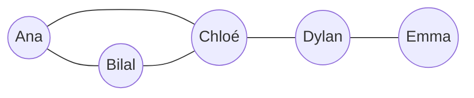

Les réseaux sociaux occupent une grande partie du temps des élèves : c'est le thème où ils ont le plus à dire, et où l'on peut le plus les aider à
**comprendre** ce qu'ils utilisent. Le cours combine trois dimensions : un **outil mathématique** (les graphes), un **modèle économique** (les
données et la publicité), et des **enjeux** (identité numérique, cyberharcèlement).

## Ce que dit le programme

Capacités attendues du thème : **distinguer** plusieurs réseaux sociaux selon leurs caractéristiques (y compris un ordre de grandeur de leurs
nombres d'abonnés) ; **paramétrer** des abonnements pour assurer la confidentialité de données personnelles ; **identifier** les sources de revenus
des réseaux sociaux ; **déterminer** ces caractéristiques sur des graphes simples (**diamètre, rayon, centre**, distance) ; **décrire** comment
l'information présentée par les réseaux sociaux est conditionnée par le choix préalable de ses amis ; connaître les dispositions contre le
**cyberharcèlement**.

Ce qui **n'est pas** attendu : les algorithmes de parcours de graphe (programme de terminale NSI), la théorie des graphes.

## 1. Des réseaux sociaux très différents

Tous les réseaux ne fonctionnent pas pareil : certains reposent sur des relations **réciproques** (amis), d'autres sur des **abonnements** à sens
unique (on suit quelqu'un qui ne nous suit pas) ; certains privilégient la **vidéo courte**, d'autres le **texte** ou la **messagerie**. Les plus
grands comptent des **milliards** d'utilisateurs actifs. On peut les comparer selon : le type de contenu, la relation (réciproque ou non), l'âge
minimum, la durée de vie des publications, le mode de financement.

## 2. Le modèle économique : les données

La plupart des réseaux sociaux sont **gratuits** pour l'utilisateur. Ils gagnent de l'argent grâce à la **publicité ciblée** : ils collectent un
maximum de **données** (ce que tu aimes, regardes, partages, où tu es, qui sont tes amis) pour proposer aux annonceurs des publics très précis.
D'où l'expression : *« si c'est gratuit, c'est toi le produit »*.

Conséquences :
- les plateformes ont intérêt à te garder le plus longtemps possible (notifications, défilement infini, recommandations) ;
- les **algorithmes de recommandation** te montrent ce qui ressemble à ce que tu as déjà aimé et ce que partagent tes amis : on parle de **bulle de
  filtre**. L'information que tu vois dépend de tes choix d'amis et d'abonnements.

## 3. Identité numérique et e-réputation

Ton **identité numérique** est l'ensemble des traces que tu laisses en ligne : profil, photos, publications, commentaires, mentions « j'aime », mais
aussi ce que **les autres** publient sur toi. L'**e-réputation** est l'image qui en ressort (pour un futur employeur, par exemple).

:::retenir[Bons réflexes]
- **Paramétrer** la confidentialité : qui voit mes publications (amis, public) ? qui peut me contacter ?
- **Réfléchir avant de publier** : une publication peut être copiée et rester en ligne même après suppression.
- **Respecter le droit à l'image** des autres : on ne publie pas la photo de quelqu'un sans son accord.
:::

## 4. Modéliser un réseau social par un graphe

Un réseau social se représente par un **graphe** : les **sommets** sont les personnes, les **arêtes** relient deux personnes amies.



- Le **degré** d'un sommet est son nombre d'arêtes (son nombre d'amis) : Chloé a un degré 3, Emma un degré 1.
- La **distance** entre deux sommets est le **plus petit nombre d'arêtes** pour aller de l'un à l'autre : d(Ana, Emma) = 3 (Ana → Chloé → Dylan →
  Emma).
- L'**excentricité** d'un sommet est sa **plus grande distance** aux autres sommets.

| Sommet | Ana | Bilal | Chloé | Dylan | Emma |
|---|---|---|---|---|---|
| Excentricité | 3 | 3 | 2 | 2 | 3 |

- Le **diamètre** est la **plus grande** excentricité : ici 3 (la distance maximale entre deux personnes).
- Le **rayon** est la **plus petite** excentricité : ici 2.
- Les **centres** sont les sommets d'excentricité minimale : ici **Chloé** et **Dylan**.

**L'effet « petit monde »** : en 1967, le psychologue **Stanley Milgram** a montré qu'en moyenne environ 6 intermédiaires suffisent pour relier deux
Américains par des connaissances (« six degrés de séparation »). Dans les grands réseaux sociaux en ligne, ce nombre est encore plus faible (moins de
4 intermédiaires en moyenne sur Facebook, selon une étude de 2016).

## 5. Le cyberharcèlement

Le **cyberharcèlement** est un harcèlement (propos ou actes répétés qui dégradent la vie de quelqu'un) par des moyens numériques : moqueries,
rumeurs, insultes, diffusion de photos, exclusion de groupes. Il est **puni par la loi**, y compris pour les mineurs, et le fait de **partager** ou de
« liker » un contenu de harcèlement peut engager la responsabilité.

:::retenir[Que faire ?]
Ne pas répondre ; **garder des preuves** (captures d'écran) ; **signaler** le contenu sur la plateforme ; **bloquer** ; **en parler** à un adulte de
confiance ; appeler le **3018**, numéro national gratuit et anonyme contre les violences numériques.
:::

## Les erreurs classiques des élèves

:::attention[Ce que tu verras en classe]
- **« Je n'ai rien à cacher »** : sous-estimer la valeur des données et l'usage qui en est fait.
- **« Si je supprime, ça disparaît »** : captures d'écran, partages, archives.
- **Confondre degré et distance** dans les graphes, ou oublier de prendre le **plus court** chemin pour la distance.
- **Diamètre** compris comme « le nombre de sommets » ou « le plus grand degré ».
- **Penser que le fil d'actualité est neutre** alors qu'il est choisi par un algorithme.
:::

## En classe

:::methode[Activités qui marchent]
1. **Graphe de la classe** (avec des prénoms fictifs) : tracer le graphe, calculer degrés, distances, diamètre ; trouver le centre.
2. **Comparer deux réseaux sociaux** dans un tableau (contenu, relation, âge minimum, modèle économique).
3. **Paramétrer un compte fictif** : confidentialité, visibilité des publications.
4. **Étude de cas** sur le cyberharcèlement (supports du ministère, dispositif pHARe), avec le CPE ou l'infirmière.
5. **Python** : représenter un graphe par un dictionnaire d'amis et calculer des degrés.
:::

## L'essentiel

- Les réseaux sociaux gratuits vivent de la **publicité ciblée** grâce aux **données** des utilisateurs ; leurs algorithmes choisissent ce qu'on voit.
- **Identité numérique** : toutes les traces en ligne ; on la protège en paramétrant la confidentialité et en réfléchissant avant de publier.
- Un réseau social se modélise par un **graphe** : **degré** (nombre d'amis), **distance** (plus court chemin), **excentricité**, **diamètre**
  (la plus grande), **rayon** (la plus petite), **centre**.
- Effet **petit monde** : des chaînes très courtes relient les gens.
- **Cyberharcèlement** : puni par la loi ; garder des preuves, signaler, en parler, **3018**.

## Exercices

::::exercice[Grand QCM : les réseaux sociaux]{niveau=1 type=quiz}
Douze questions sur le thème des réseaux sociaux. Les questions 6 à 10 portent sur le graphe du cours (Ana, Bilal, Chloé, Dylan, Emma).

1. Comment la plupart des réseaux sociaux gratuits gagnent-ils de l'argent ?

   - [ ] grâce aux impôts
   - [x] grâce à la publicité ciblée, rendue possible par les données des utilisateurs
   - [ ] en vendant des téléphones
   - [ ] grâce aux dons

   > Leurs clients sont les annonceurs ; les données des utilisateurs permettent de cibler.

1. Qu'est-ce que l'identité numérique ?

   - [ ] le numéro de la carte d'identité
   - [ ] le mot de passe d'un compte
   - [x] l'ensemble des traces laissées en ligne par une personne et à son sujet
   - [ ] l'adresse IP d'un téléphone

   > Publications, photos, commentaires, mais aussi ce que les autres publient sur toi.

1. Qu'est-ce qu'une bulle de filtre ?

   - [ ] un filtre photo
   - [x] le fait que les algorithmes montrent surtout des contenus proches de ce qu'on aime déjà
   - [ ] un logiciel antivirus
   - [ ] un groupe privé

   > On voit de moins en moins d'avis différents du sien.

1. Dans un graphe représentant un réseau social, que représentent les arêtes ?

   - [ ] les personnes
   - [x] les relations entre deux personnes
   - [ ] les publications
   - [ ] les messages privés

   > Les sommets sont les personnes, les arêtes les liens d'amitié.

1. Que mesure le degré d'un sommet ?

   - [x] le nombre de relations de la personne
   - [ ] sa distance au centre
   - [ ] le nombre de publications
   - [ ] son âge

   > Le degré compte les arêtes qui partent du sommet.

1. Quel est le degré de Chloé ?

   - [ ] 1
   - [ ] 2
   - [x] 3
   - [ ] 4

   > Chloé est reliée à Ana, Bilal et Dylan.

1. Quelle est la distance entre Bilal et Emma ?

   - [ ] 2
   - [x] 3
   - [ ] 4
   - [ ] 5

   > Bilal → Chloé → Dylan → Emma : trois arêtes, c'est le plus court chemin.

1. Quel est le diamètre du graphe ?

   - [ ] 2
   - [x] 3
   - [ ] 4
   - [ ] 5

   > C'est la plus grande distance entre deux sommets (par exemple Ana et Emma).

1. Quel est le rayon du graphe ?

   - [ ] 1
   - [x] 2
   - [ ] 3
   - [ ] 5

   > La plus petite excentricité est 2 (celle de Chloé et de Dylan).

1. Quels sont les centres du graphe ?

   - [ ] Ana et Emma
   - [x] Chloé et Dylan
   - [ ] Bilal seulement
   - [ ] tous les sommets

   > Ce sont les sommets d'excentricité minimale (2).

1. Que dit l'effet « petit monde » ?

   - [ ] les réseaux sociaux ont peu d'utilisateurs
   - [x] deux personnes sont en général reliées par une courte chaîne de relations
   - [ ] il faut avoir peu d'amis
   - [ ] les petits réseaux sont plus sûrs

   > Milgram (1967) : environ six intermédiaires ; encore moins dans les réseaux en ligne.

1. Un élève est victime de moqueries répétées dans un groupe de discussion. Quel conseil est le plus adapté ?

   - [ ] répondre aux insultes pour se défendre
   - [ ] supprimer son compte et ne rien dire
   - [x] garder des preuves, signaler, en parler à un adulte, appeler le 3018
   - [ ] partager les messages pour prévenir les autres

   > Ne pas répondre, conserver des preuves et se faire aider.
::::

::::exercice[Degré d'une personne]{niveau=1}
Un réseau est représenté par un dictionnaire : à chaque prénom est associée la liste de ses amis. Écris `degre(reseau, nom)` qui renvoie le nombre
d'amis de `nom`.

```python depart
reseau = {
    "Ana": ["Bilal", "Chloé"],
    "Bilal": ["Ana", "Chloé"],
    "Chloé": ["Ana", "Bilal", "Dylan"],
    "Dylan": ["Chloé", "Emma"],
    "Emma": ["Dylan"],
}

def degre(reseau, nom):
    ...
```

```python tests
assert degre(reseau, "Chloé") == 3, "Chloé a trois amis"
assert degre(reseau, "Emma") == 1, "Emma a une amie"
assert degre({"Zoé": []}, "Zoé") == 0, "personne isolée"
```

:::corrige
```python solution
reseau = {
    "Ana": ["Bilal", "Chloé"],
    "Bilal": ["Ana", "Chloé"],
    "Chloé": ["Ana", "Bilal", "Dylan"],
    "Dylan": ["Chloé", "Emma"],
    "Emma": ["Dylan"],
}

def degre(reseau, nom):
    return len(reseau[nom])
```
:::
::::

::::exercice[Le plus populaire et les amis communs]{niveau=2}
Avec le même type de dictionnaire, écris `plus_populaire(reseau)` qui renvoie le prénom qui a le plus d'amis (s'il y a égalité, le premier
rencontré), et `amis_communs(reseau, a, b)` qui renvoie la liste des amis communs à `a` et `b`.

```python depart
def plus_populaire(reseau):
    ...

def amis_communs(reseau, a, b):
    ...
```

```python tests
r = {"Ana": ["Bilal", "Chloé"], "Bilal": ["Ana", "Chloé"], "Chloé": ["Ana", "Bilal", "Dylan"], "Dylan": ["Chloé", "Emma"], "Emma": ["Dylan"]}
assert plus_populaire(r) == "Chloé", "Chloé a 3 amis"
assert amis_communs(r, "Ana", "Bilal") == ["Chloé"], "Ana et Bilal ont Chloé en commun"
assert amis_communs(r, "Ana", "Emma") == [], "aucun ami commun"
```

:::corrige
```python solution
def plus_populaire(reseau):
    meilleur = None
    for nom in reseau:
        if meilleur is None or len(reseau[nom]) > len(reseau[meilleur]):
            meilleur = nom
    return meilleur

def amis_communs(reseau, a, b):
    communs = []
    for ami in reseau[a]:
        if ami in reseau[b]:
            communs.append(ami)
    return communs
```

C'est le principe des suggestions « personnes que vous pourriez connaître » : les réseaux sociaux proposent les amis de tes amis.
:::
::::

::::exercice[Diamètre, rayon, centre]{niveau=2}
Voici un graphe d'amitiés : A–B, B–C, C–D, B–E, E–F. Calcule l'excentricité de chaque sommet, puis donne le diamètre, le rayon et le ou les
centres. Présente ta démarche comme tu l'attendrais d'un élève.

:::criteres
- Les distances sont calculées comme des plus courts chemins.
- Les excentricités sont justes : A = 3, B = 2, C = 3, D = 4, E = 3, F = 4.
- Diamètre = 4, rayon = 2, centre = B.
- La démarche est présentée clairement (tableau des distances ou des excentricités).
:::

:::corrige
Distances depuis B : A = 1, C = 1, E = 1, D = 2, F = 2, donc excentricité de B = 2. De même : A → D ou F à 3, donc 3 ; C → F à 3 (C-B-E-F), donc 3 ;
D → F à 4 (D-C-B-E-F), donc 4 ; E → D à 3, donc 3 ; F → D à 4, donc 4.

| Sommet | A | B | C | D | E | F |
|---|---|---|---|---|---|---|
| Excentricité | 3 | 2 | 3 | 4 | 3 | 4 |

**Diamètre** = 4 (la plus grande, entre D et F), **rayon** = 2 (la plus petite), **centre** : B.
:::
::::
