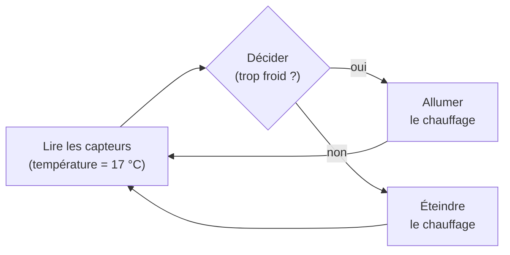

Les élèves sont entourés de systèmes embarqués sans le savoir : la voiture, le lave-linge, la montre, la console, l'ascenseur. Ce thème est celui
où la programmation devient **concrète** : un programme lit un capteur et allume une LED. C'est souvent le thème le plus motivant… à condition
d'avoir le matériel (cartes micro:bit, Arduino, ou simulateurs en ligne).

## Ce que dit le programme

Capacités attendues : **identifier** des algorithmes de contrôle des comportements physiques à travers les **données des capteurs**, l'**IHM** et
les actions des **actionneurs** dans des systèmes courants ; **réaliser une IHM** simple d'un objet connecté ; **écrire des programmes simples
d'acquisition de données ou de commande d'un actionneur** pour identifier ou réaliser les entrées-sorties d'un système embarqué.

Ce qui **n'est pas** attendu : l'électronique (schémas, résistances), les protocoles de communication détaillés, la programmation temps réel.

## 1. Qu'est-ce qu'un système embarqué ?

Un **système embarqué** est un système informatique **intégré** dans un objet pour le piloter. Il comprend :

- un **microcontrôleur** : un petit ordinateur sur une seule puce (processeur, mémoire, entrées-sorties), qui exécute **un seul programme** ;
- des **capteurs** qui mesurent le monde ;
- des **actionneurs** qui agissent sur le monde ;
- souvent une **IHM** (interface homme-machine) : boutons, écran, voyants.

Une voiture moderne contient plusieurs dizaines de systèmes embarqués (freinage ABS, airbags, injection, climatisation…).

## 2. Capteurs et actionneurs

| Capteurs (entrées) | Actionneurs (sorties) |
|---|---|
| thermomètre (température) | chauffage, ventilateur |
| capteur de luminosité | LED, lampe |
| accéléromètre (mouvement, chute) | moteur, vibreur |
| bouton, écran tactile | écran, haut-parleur |
| capteur de distance (ultrasons) | servomoteur, électroaimant |

Un **capteur** transforme une grandeur physique en **nombre** que le programme peut lire. Un **actionneur** transforme une commande du programme en
**action** physique.

## 3. La boucle de contrôle

Un système embarqué exécute en permanence la même boucle :



En Python (sur une carte comme la micro:bit, avec MicroPython), cela ressemble à :

```python
while True:                          # boucle sans fin : le système tourne en permanence
    t = temperature()                # lire le capteur
    if t < 19:                       # décider
        allumer_chauffage()          # commander l'actionneur
    else:
        eteindre_chauffage()
    sleep(1000)                      # attendre une seconde
```

C'est l'un des rares cas où une **boucle infinie** est voulue : un thermostat ne s'arrête jamais. On peut simuler ce comportement sans matériel :

```python exec
def thermostat(temperature, consigne):
    if temperature < consigne:
        return "chauffage allumé"
    return "chauffage éteint"

for t in [16, 18.5, 19, 21]:
    print(t, "°C :", thermostat(t, 19))
```

## 4. Les objets connectés

Un **objet connecté** est un système embarqué relié à un **réseau** (Wi-Fi, Bluetooth, réseau mobile) : montre qui envoie les pas au téléphone,
thermostat réglable à distance, enceinte à commande vocale, compteur électrique communicant. On parle d'**Internet des objets** (*IoT*). On peut
réaliser une **IHM** simple : une page web ou une application avec des boutons qui envoient des commandes à l'objet.

:::attention[Les enjeux]
- **Sécurité** : beaucoup d'objets sont livrés avec des mots de passe par défaut et peu mis à jour ; des objets piratés ont servi à des attaques massives.
- **Vie privée** : une enceinte ou une caméra connectée collecte des données en permanence.
- **Environnement** : fabrication, consommation, durée de vie courte, déchets électroniques.
- **Utilité réelle** : santé (pacemakers, capteurs médicaux), économies d'énergie, agriculture.
:::

## Les erreurs classiques des élèves

:::attention[Ce que tu verras en classe]
- **Confondre capteur et actionneur** (« la LED capte la lumière »).
- **Croire que l'objet « décide » seul** : c'est un programme écrit par quelqu'un qui décide.
- **Oublier la boucle** : le programme ne lit le capteur qu'une fois.
- **Comparer à une valeur exacte** (`if t == 19`) alors que la mesure varie : utiliser des seuils (`<`, `>`).
:::

## En classe

:::methode[Activités qui marchent]
1. **Analyser un objet du quotidien** (lave-linge, porte automatique, éclairage public) : lister capteurs, actionneurs, IHM, et écrire l'algorithme en
   langage naturel.
2. **Micro:bit** (ou simulateur en ligne) : afficher la température, allumer des LED selon la luminosité, compter les pas avec l'accéléromètre.
3. **Simulation en Python** sans matériel : fonctions qui renvoient des mesures, boucle de contrôle sur une liste de mesures.
4. **Débat** : objets connectés et vie privée.
:::

## L'essentiel

- **Système embarqué** : un microcontrôleur intégré dans un objet, avec **capteurs** (mesurer), **actionneurs** (agir) et souvent une **IHM**.
- **Boucle de contrôle** : lire les capteurs, décider, commander les actionneurs, recommencer sans fin.
- **Objet connecté** : système embarqué relié à un réseau ; utile, mais enjeux de sécurité, vie privée et environnement.
- Les décisions sont des **conditions sur des seuils** écrites dans un programme.

## Exercices

::::exercice[Grand QCM : objets connectés]{niveau=1 type=quiz}
Dix questions sur l'informatique embarquée et les objets connectés.

1. Lequel est un capteur ?

   - [ ] un moteur
   - [ ] une LED
   - [x] un thermomètre électronique
   - [ ] un haut-parleur

   > Un capteur mesure une grandeur physique (ici la température).

1. Lequel est un actionneur ?

   - [x] un servomoteur
   - [ ] un accéléromètre
   - [ ] un capteur de luminosité
   - [ ] un bouton

   > Un actionneur agit sur le monde : il bouge, éclaire, chauffe, fait du bruit.

1. Qu'est-ce qu'un microcontrôleur ?

   - [ ] un très gros ordinateur
   - [x] un petit ordinateur sur une seule puce, qui pilote un objet
   - [ ] un capteur de mouvement
   - [ ] une télécommande

   > Processeur, mémoire et entrées-sorties réunis sur une puce.

1. Dans quel ordre fonctionne la boucle de contrôle ?

   - [ ] agir, décider, lire
   - [x] lire les capteurs, décider, agir sur les actionneurs
   - [ ] décider, agir, puis lire une seule fois
   - [ ] lire, agir, puis s'arrêter

   > Et on recommence sans fin.

1. Qu'est-ce qu'une IHM ?

   - [ ] un type de capteur
   - [x] une interface homme-machine : boutons, écran, voyants…
   - [ ] un réseau sans fil
   - [ ] un langage de programmation

   > Elle permet à l'utilisateur d'interagir avec le système.

1. Qu'est-ce qui fait d'un système embarqué un objet connecté ?

   - [ ] il a un écran
   - [x] il est relié à un réseau pour échanger des données ou être commandé à distance
   - [ ] il a une batterie
   - [ ] il contient un capteur

   > Wi-Fi, Bluetooth, réseau mobile…

1. Pourquoi un thermostat utilise-t-il une boucle `while True` ?

   - [ ] c'est une erreur de programmation
   - [x] il doit surveiller et agir en permanence, sans jamais s'arrêter
   - [ ] pour aller plus vite
   - [ ] pour économiser de l'énergie

   > Une boucle infinie est ici voulue.

1. Pourquoi tester `if t < 19:` plutôt que `if t == 19:` ?

   - [ ] parce que `==` n'existe pas en MicroPython
   - [x] parce que la mesure varie et ne tombe presque jamais exactement sur 19
   - [ ] parce que c'est plus court
   - [ ] il n'y a aucune différence

   > On compare à des seuils.

1. Quel est un risque de sécurité typique des objets connectés ?

   - [ ] ils sont trop lourds
   - [x] des mots de passe par défaut jamais changés, qui permettent de les pirater
   - [ ] ils n'ont pas de capteurs
   - [ ] ils ne consomment pas d'énergie

   > Des objets piratés ont déjà servi à des attaques massives.

1. Dans une porte automatique de magasin, quel est l'actionneur ?

   - [ ] le détecteur de présence
   - [x] le moteur qui ouvre la porte
   - [ ] le programme
   - [ ] la personne qui entre

   > Le détecteur est le capteur ; le moteur agit.
::::

::::exercice[Simuler un éclairage automatique]{niveau=1}
Un lampadaire s'allume quand la luminosité mesurée (de 0 à 100) est **strictement inférieure** à 30. Écris `commande(luminosite)` qui renvoie `"allumé"`
ou `"éteint"`.

```python depart
def commande(luminosite):
    ...
```

```python tests
assert commande(10) == "allumé", "il fait nuit"
assert commande(80) == "éteint", "il fait jour"
assert commande(30) == "éteint", "30 n'est pas strictement inférieur à 30"
```

:::corrige
```python solution
def commande(luminosite):
    if luminosite < 30:
        return "allumé"
    return "éteint"
```
:::
::::

::::exercice[Analyser des mesures de capteur]{niveau=2}
Une station météo a enregistré une liste de températures. Écris `analyse(mesures, seuil)` qui renvoie un couple : la **moyenne** des mesures, et le
**nombre** de mesures qui dépassent strictement le seuil (une alerte canicule, par exemple).

```python depart
def analyse(mesures, seuil):
    ...
```

```python tests
assert analyse([30, 34, 36, 31, 39], 35) == (34, 2), "moyenne 34, deux mesures au-dessus de 35"
assert analyse([20, 22], 25) == (21, 0), "aucune alerte"
```

:::corrige
```python solution
def analyse(mesures, seuil):
    total = 0
    alertes = 0
    for m in mesures:
        total = total + m
        if m > seuil:
            alertes = alertes + 1
    return (total / len(mesures), alertes)
```

C'est le travail typique d'un programme d'**acquisition** : parcourir les données du capteur, calculer et déclencher des alertes.
:::
::::

::::exercice[Décrire un système embarqué]{niveau=2}
Choisis un objet du quotidien (lave-linge, porte de garage, robot aspirateur, montre connectée…). Indique ses capteurs, ses actionneurs, son IHM, et
écris en langage naturel l'algorithme de sa boucle de contrôle (au moins une condition).

:::criteres
- Au moins deux capteurs et deux actionneurs corrects.
- L'IHM est identifiée.
- L'algorithme a la forme « répéter : lire, décider, agir » avec au moins une condition sur un capteur.
- Le vocabulaire (capteur, actionneur, IHM) est bien employé.
:::

:::corrige
**Robot aspirateur.** Capteurs : capteurs de chocs, capteurs de vide (escaliers), niveau de batterie, capteur de poussière. Actionneurs : moteurs des
roues, moteur d'aspiration, brosses, haut-parleur. IHM : bouton marche, voyants, application sur le téléphone.

Algorithme : *répéter sans fin* : lire les capteurs ; **si** la batterie est faible, retourner à la base ; **sinon si** un obstacle est détecté,
reculer et tourner ; **sinon si** un vide est détecté, faire demi-tour ; **sinon** avancer en aspirant.
:::
::::
