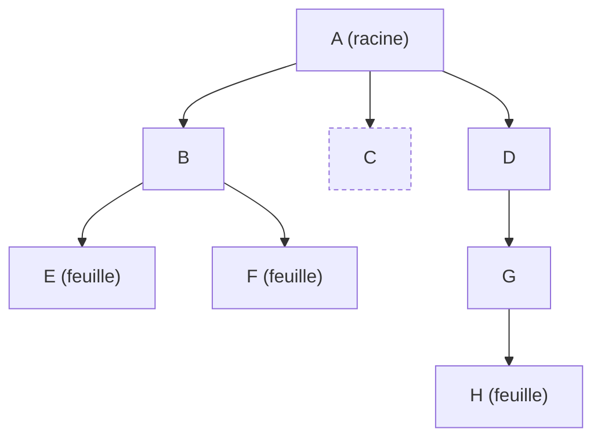
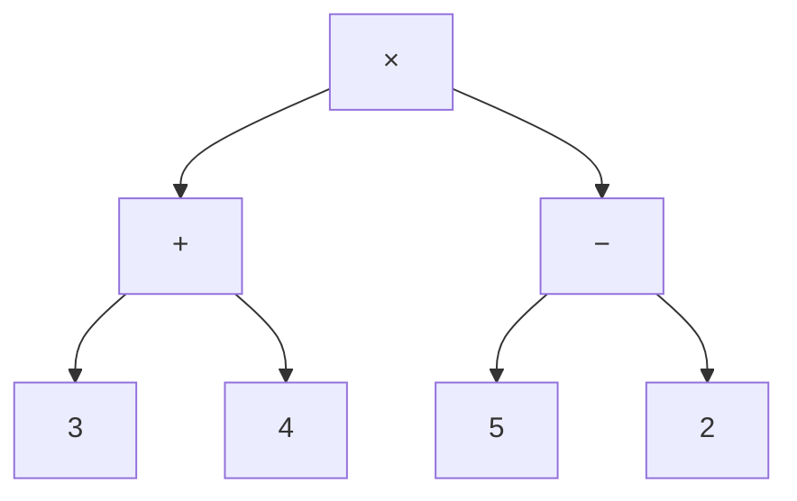

Un système de fichiers (dossiers contenant des dossiers), l'arbre généalogique, la structure d'une page HTML, une
expression arithmétique, un tournoi à élimination directe, l'organigramme d'une entreprise : toutes ces données sont
**hiérarchiques**. On les représente par des **arbres**. Les **arbres binaires**, où chaque nœud a au plus deux enfants,
sont les plus étudiés : leur définition récursive mène à des algorithmes et à des preuves très naturels. Ils sont au cœur
du programme (« structures arborescentes : arbres, arbres binaires, arbres binaires de recherche ») et de la seconde
partie du sujet zéro de l'écrit 1.

## 1. Vocabulaire



- Un arbre est formé de **nœuds** reliés par des **arêtes** ; un nœud particulier est la **racine**.
- Chaque nœud autre que la racine a un unique **parent** ; les nœuds dont il est le parent sont ses **enfants**.
- Un nœud sans enfant est une **feuille** ; les autres sont des **nœuds internes**.
- Chaque nœud est la racine d'un **sous-arbre** (lui et tous ses descendants).
- La **profondeur** d'un nœud est le nombre d'arêtes entre la racine et lui (la racine a la profondeur 0).
- La **hauteur** de l'arbre est la plus grande profondeur d'une feuille ; la **taille** est son nombre de nœuds.

Ici : taille 8, hauteur 3 (chemin A → D → G → H), feuilles E, F, C, H.

:::attention[Conventions]
Les définitions de la hauteur varient : on prend ici la hauteur d'un arbre réduit à sa racine égale à **0** (et −1 pour
l'arbre vide), comme dans beaucoup de cours du supérieur. Les manuels de terminale NSI comptent souvent les **nœuds** du
plus long chemin (racine seule : hauteur 1, arbre vide : 0). Les deux sont acceptés tant qu'on **annonce** sa convention ;
un sujet d'épreuve précise toujours la sienne.
:::

## 2. Arbres binaires

:::definition
Un **arbre binaire** est soit **vide**, soit formé d'un **nœud** (la racine, qui porte une valeur) et de deux arbres
binaires : le **sous-arbre gauche** et le **sous-arbre droit**.
:::

Cette définition est **récursive** : presque toutes les fonctions sur les arbres binaires le sont aussi. Attention, la
gauche et la droite sont distinguées : un nœud avec un seul enfant à gauche n'est pas le même arbre qu'avec un seul enfant
à droite.

Vocabulaire (lui aussi variable selon les sources, à préciser) :
- arbre binaire **strict** (ou localement complet) : chaque nœud a **0 ou 2** enfants ;
- arbre binaire **parfait** : toutes les feuilles sont à la même profondeur (tous les niveaux sont pleins) ;
- arbre binaire **presque complet** : tous les niveaux sont pleins sauf le dernier, rempli de gauche à droite (c'est la forme d'un tas).

### Implémentation en Python

```python exec
class Noeud:
    def __init__(self, valeur, gauche=None, droit=None):
        self.valeur = valeur
        self.gauche = gauche      # None représente l'arbre vide
        self.droit = droit

def taille(a):
    if a is None:
        return 0
    return 1 + taille(a.gauche) + taille(a.droit)

def hauteur(a):
    if a is None:
        return -1                 # convention : l'arbre vide a la hauteur -1
    return 1 + max(hauteur(a.gauche), hauteur(a.droit))

def nb_feuilles(a):
    if a is None:
        return 0
    if a.gauche is None and a.droit is None:
        return 1
    return nb_feuilles(a.gauche) + nb_feuilles(a.droit)

#        8
#      /   \
#     3     10
#    / \      \
#   1   6      14
#      / \
#     4   7
arbre = Noeud(8, Noeud(3, Noeud(1), Noeud(6, Noeud(4), Noeud(7))), Noeud(10, None, Noeud(14)))
print(taille(arbre), hauteur(arbre), nb_feuilles(arbre))
```

Chaque fonction suit le même schéma : **cas de base** (arbre vide), puis **combinaison** des résultats sur les deux
sous-arbres. Chaque nœud est visité une fois : coût $\Theta(n)$.

### Taille et hauteur

Un arbre binaire de hauteur $h$ a au moins $h + 1$ nœuds (un « peigne », une seule branche) et au plus
$1 + 2 + 4 + \dots + 2^h = 2^{h+1} - 1$ nœuds (arbre parfait) :

$$ h + 1 \le n \le 2^{h+1} - 1 \quad\text{donc}\quad \lfloor \log_2 n \rfloor \le h \le n - 1. $$

Un arbre de $n$ nœuds a donc une hauteur **au moins logarithmique** : c'est ce qui rend les arbres équilibrés si efficaces
(recherche en $O(\log n)$ dans un arbre binaire de recherche équilibré), et les arbres « filiformes » si décevants.

## 3. Parcours en profondeur

Un **parcours** visite tous les nœuds. En profondeur, on explore entièrement un sous-arbre avant l'autre ; trois ordres
selon le moment où l'on traite la racine :

```python exec
class Noeud:
    def __init__(self, valeur, gauche=None, droit=None):
        self.valeur, self.gauche, self.droit = valeur, gauche, droit

def prefixe(a, res):
    if a is not None:
        res.append(a.valeur)        # racine d'abord
        prefixe(a.gauche, res)
        prefixe(a.droit, res)
    return res

def infixe(a, res):
    if a is not None:
        infixe(a.gauche, res)
        res.append(a.valeur)        # racine au milieu
        infixe(a.droit, res)
    return res

def suffixe(a, res):
    if a is not None:
        suffixe(a.gauche, res)
        suffixe(a.droit, res)
        res.append(a.valeur)        # racine à la fin
    return res

arbre = Noeud(8, Noeud(3, Noeud(1), Noeud(6, Noeud(4), Noeud(7))), Noeud(10, None, Noeud(14)))
print("préfixe :", prefixe(arbre, []))
print("infixe  :", infixe(arbre, []))
print("suffixe :", suffixe(arbre, []))
```

| Parcours | Ordre                    | Résultat sur l'exemple            |
|----------|--------------------------|-----------------------------------|
| préfixe  | racine, gauche, droit    | 8, 3, 1, 6, 4, 7, 10, 14          |
| infixe   | gauche, racine, droit    | 1, 3, 4, 6, 7, 8, 10, 14          |
| suffixe  | gauche, droit, racine    | 1, 4, 7, 6, 3, 14, 10, 8          |

(Le parcours infixe de cet arbre est trié : c'est un **arbre binaire de recherche**, leçon suivante.)

## 4. Parcours en largeur

Le parcours en **largeur** visite les nœuds **niveau par niveau**, de gauche à droite. On utilise une **file** :

```python exec
from collections import deque

class Noeud:
    def __init__(self, valeur, gauche=None, droit=None):
        self.valeur, self.gauche, self.droit = valeur, gauche, droit

def largeur(a):
    res = []
    file = deque([a] if a is not None else [])
    while file:
        n = file.popleft()
        res.append(n.valeur)
        if n.gauche is not None:
            file.append(n.gauche)
        if n.droit is not None:
            file.append(n.droit)
    return res

arbre = Noeud(8, Noeud(3, Noeud(1), Noeud(6, Noeud(4), Noeud(7))), Noeud(10, None, Noeud(14)))
print(largeur(arbre))
```

Résultat : 8, 3, 10, 1, 6, 14, 4, 7. (Avec une **pile** à la place de la file, on obtiendrait un parcours en profondeur.)

## 5. Arbres d'expressions

Une expression arithmétique se représente par un arbre binaire strict : les feuilles sont les nombres, les nœuds internes
les opérateurs. `(3 + 4) * (5 - 2)` :



Le parcours **suffixe** donne `3 4 + 5 2 - *`, la notation postfixée (NPI) ; le parcours infixe (avec parenthèses) redonne
l'écriture usuelle. **Évaluer** l'arbre, c'est un parcours suffixe : on évalue les deux sous-arbres, puis on applique
l'opérateur.

:::prof
Les arbres sont au programme de terminale NSI : vocabulaire, implémentation, parcours, et algorithmes (taille, hauteur,
recherche dans un ABR). La définition de la hauteur varie entre les manuels : il faut harmoniser avec la convention des
sujets du baccalauréat (souvent 1 pour la racine seule). Les arbres généalogiques, les tournois et les arborescences de
fichiers motivent bien la notion ; la construction d'arbres d'expressions relie le cours aux mathématiques.
:::

## Exemple guidé

**Problème (type écrit 1).** On appelle arbre binaire **strict** un arbre binaire non vide dont chaque nœud a 0 ou 2 enfants.
Montrer que, dans un tel arbre, le nombre de feuilles $f$ est égal au nombre de nœuds internes $i$ plus un.

**1. Méthode : l'induction structurelle.** Pour montrer une propriété $P$ de tous les arbres binaires stricts, on montre :
- $P$ est vraie pour l'arbre réduit à une feuille (cas de base) ;
- si $P$ est vraie pour deux arbres stricts $G$ et $D$, elle est vraie pour l'arbre dont la racine a $G$ et $D$ pour
  sous-arbres (hérédité). C'est une récurrence sur la construction (ou sur la taille).

**2. Cas de base.** Une feuille seule : $f = 1$, $i = 0$, donc $f = i + 1$. ✓

**3. Hérédité.** Soit $A$ formé d'une racine et de deux sous-arbres stricts $G$ (avec $f_G$ feuilles, $i_G$ nœuds internes)
et $D$ ($f_D$, $i_D$). Par hypothèse, $f_G = i_G + 1$ et $f_D = i_D + 1$. Les feuilles de $A$ sont celles de $G$ et de $D$ :
$f = f_G + f_D$. Ses nœuds internes sont la racine et ceux de $G$ et $D$ : $i = 1 + i_G + i_D$. Donc
$f = (i_G + 1) + (i_D + 1) = (1 + i_G + i_D) + 1 = i + 1$. ✓

**4. Conséquences.** Un arbre binaire strict a toujours un nombre **impair** de nœuds ($n = f + i = 2i + 1$). Une
expression arithmétique avec $k$ opérateurs binaires contient exactement $k + 1$ nombres. Un tournoi à élimination directe
entre $f$ équipes comporte $f - 1$ matchs.

```python exec
class Noeud:
    def __init__(self, g=None, d=None):
        self.gauche, self.droit = g, d

def compter(a):
    """(feuilles, internes) d'un arbre binaire strict."""
    if a.gauche is None:
        return 1, 0
    fg, ig = compter(a.gauche)
    fd, id_ = compter(a.droit)
    return fg + fd, 1 + ig + id_

a = Noeud(Noeud(Noeud(), Noeud(Noeud(), Noeud())), Noeud())
print(compter(a))
```

## L'essentiel

- Vocabulaire : racine, parent, enfant, feuille, nœud interne, sous-arbre, profondeur, hauteur, taille. **Annoncer la convention de hauteur.**
- Arbre binaire = vide, ou (valeur, sous-arbre gauche, sous-arbre droit) ; en Python : classe `Noeud`, `None` pour le vide.
- Fonctions récursives : cas vide, puis combinaison des deux sous-arbres ; coût $\Theta(n)$.
- $h + 1 \le n \le 2^{h+1} - 1$ (racine seule : $h = 0$), donc $h \ge \lfloor \log_2 n \rfloor$.
- Parcours : préfixe (R G D), infixe (G R D), suffixe (G D R) ; largeur avec une **file**.
- Induction structurelle : cas de base (feuille ou vide) + hérédité sur les deux sous-arbres. Arbre strict : $f = i + 1$.

## Exercices

::::exercice[Taille et hauteur]{niveau=1}
Un arbre binaire a une racine dont le sous-arbre gauche est une feuille et le sous-arbre droit est un nœud qui a lui-même
deux feuilles. Avec la convention « racine seule = hauteur 0 », quelles sont sa taille et sa hauteur ?

- [ ] taille 4, hauteur 2
- [x] taille 5, hauteur 2
- [ ] taille 5, hauteur 3
- [ ] taille 3, hauteur 1

:::corrige
Nœuds : la racine, la feuille gauche, le nœud droit et ses deux feuilles : **5**. Le plus long chemin racine → feuille
contient 2 arêtes : hauteur **2** (ou 3 avec la convention qui compte les nœuds).
:::
::::

::::exercice[Parcours infixe]{niveau=1}
Quel est le parcours infixe de l'arbre d'expression de `(3 + 4) * (5 - 2)` (sans parenthèses) ?

- [ ] `* + 3 4 - 5 2`
- [x] `3 + 4 * 5 - 2`
- [ ] `3 4 + 5 2 - *`
- [ ] `* + - 3 4 5 2`

:::corrige
Infixe : gauche, racine, droit. On obtient `3 + 4 * 5 - 2` : sans parenthèses, l'écriture infixe est ambiguë, d'où l'intérêt
des notations préfixe (`* + 3 4 - 5 2`) et postfixe (`3 4 + 5 2 - *`), qui n'en ont pas besoin.
:::
::::

::::exercice[Fonctions récursives sur un arbre]{niveau=2}
Avec la classe `Noeud` fournie, écris `taille(a)`, `hauteur(a)` (vide : −1, racine seule : 0) et `somme(a)` (somme des
valeurs).

```python depart
class Noeud:
    def __init__(self, valeur, gauche=None, droit=None):
        self.valeur = valeur
        self.gauche = gauche
        self.droit = droit

def taille(a):
    ...

def hauteur(a):
    ...

def somme(a):
    ...
```

```python tests
a = Noeud(8, Noeud(3, Noeud(1), Noeud(6, Noeud(4), Noeud(7))), Noeud(10, None, Noeud(14)))
assert taille(a) == 8, "taille"
assert hauteur(a) == 3, "hauteur"
assert somme(a) == 53, "somme"
assert taille(None) == 0 and hauteur(None) == -1 and somme(None) == 0, "arbre vide"
assert hauteur(Noeud(5)) == 0, "racine seule"
```

:::corrige
```python solution
class Noeud:
    def __init__(self, valeur, gauche=None, droit=None):
        self.valeur = valeur
        self.gauche = gauche
        self.droit = droit

def taille(a):
    if a is None:
        return 0
    return 1 + taille(a.gauche) + taille(a.droit)

def hauteur(a):
    if a is None:
        return -1
    return 1 + max(hauteur(a.gauche), hauteur(a.droit))

def somme(a):
    if a is None:
        return 0
    return a.valeur + somme(a.gauche) + somme(a.droit)
```
La convention « vide = −1 » rend la formule `1 + max(...)` correcte pour une feuille ($1 + \max(-1, -1) = 0$).
:::
::::

::::exercice[Les trois parcours]{niveau=2}
Écris `parcours(a, ordre)` qui renvoie la liste des valeurs dans l'ordre `"prefixe"`, `"infixe"` ou `"suffixe"`.

```python depart
class Noeud:
    def __init__(self, valeur, gauche=None, droit=None):
        self.valeur = valeur
        self.gauche = gauche
        self.droit = droit

def parcours(a, ordre):
    ...
```

```python tests
a = Noeud(8, Noeud(3, Noeud(1), Noeud(6, Noeud(4), Noeud(7))), Noeud(10, None, Noeud(14)))
assert parcours(a, "prefixe") == [8, 3, 1, 6, 4, 7, 10, 14], "préfixe"
assert parcours(a, "infixe") == [1, 3, 4, 6, 7, 8, 10, 14], "infixe"
assert parcours(a, "suffixe") == [1, 4, 7, 6, 3, 14, 10, 8], "suffixe"
assert parcours(None, "infixe") == [], "arbre vide"
```

:::corrige
```python solution
class Noeud:
    def __init__(self, valeur, gauche=None, droit=None):
        self.valeur = valeur
        self.gauche = gauche
        self.droit = droit

def parcours(a, ordre):
    if a is None:
        return []
    g = parcours(a.gauche, ordre)
    d = parcours(a.droit, ordre)
    if ordre == "prefixe":
        return [a.valeur] + g + d
    if ordre == "infixe":
        return g + [a.valeur] + d
    return g + d + [a.valeur]
```
Cette version concatène des listes (coût caché) ; pour un arbre très grand, on préfère passer une liste résultat qu'on
complète avec `append`, comme dans le cours.
:::
::::

::::exercice[Parcours en largeur]{niveau=3}
Écris `niveaux(a)` qui renvoie la liste des niveaux de l'arbre : une liste de listes, le niveau 0 (la racine), puis le
niveau 1, etc., chaque niveau de gauche à droite.

```python depart
from collections import deque

class Noeud:
    def __init__(self, valeur, gauche=None, droit=None):
        self.valeur = valeur
        self.gauche = gauche
        self.droit = droit

def niveaux(a):
    ...
```

```python tests
a = Noeud(8, Noeud(3, Noeud(1), Noeud(6, Noeud(4), Noeud(7))), Noeud(10, None, Noeud(14)))
assert niveaux(a) == [[8], [3, 10], [1, 6, 14], [4, 7]], "quatre niveaux"
assert niveaux(None) == [], "arbre vide"
assert niveaux(Noeud(1)) == [[1]], "racine seule"
```

:::corrige
```python solution
from collections import deque

class Noeud:
    def __init__(self, valeur, gauche=None, droit=None):
        self.valeur = valeur
        self.gauche = gauche
        self.droit = droit

def niveaux(a):
    if a is None:
        return []
    resultat = []
    file = deque([a])
    while file:
        niveau = []
        for _ in range(len(file)):      # exactement les nœuds du niveau courant
            n = file.popleft()
            niveau.append(n.valeur)
            if n.gauche:
                file.append(n.gauche)
            if n.droit:
                file.append(n.droit)
        resultat.append(niveau)
    return resultat
```
Au début de chaque tour du `while`, la file contient exactement les nœuds d'un niveau : on en traite `len(file)`.
:::
::::

::::exercice[Évaluer un arbre d'expression]{niveau=3}
Un arbre d'expression a des feuilles qui portent des nombres et des nœuds internes qui portent `"+"`, `"-"`, `"*"` ou `"/"`.
Écris `evaluer(a)`.

```python depart
class Noeud:
    def __init__(self, valeur, gauche=None, droit=None):
        self.valeur = valeur
        self.gauche = gauche
        self.droit = droit

def evaluer(a):
    ...
```

```python tests
e = Noeud("*", Noeud("+", Noeud(3), Noeud(4)), Noeud("-", Noeud(5), Noeud(2)))
assert evaluer(e) == 21, "(3 + 4) * (5 - 2)"
assert evaluer(Noeud(7)) == 7, "un nombre seul"
assert evaluer(Noeud("/", Noeud(1), Noeud(4))) == 0.25, "division"
assert evaluer(Noeud("-", Noeud(10), Noeud("-", Noeud(4), Noeud(1)))) == 7, "10 - (4 - 1)"
```

:::corrige
```python solution
class Noeud:
    def __init__(self, valeur, gauche=None, droit=None):
        self.valeur = valeur
        self.gauche = gauche
        self.droit = droit

def evaluer(a):
    if a.gauche is None and a.droit is None:
        return a.valeur
    g = evaluer(a.gauche)
    d = evaluer(a.droit)
    if a.valeur == "+":
        return g + d
    if a.valeur == "-":
        return g - d
    if a.valeur == "*":
        return g * d
    return g / d
```
C'est un parcours **suffixe** : on évalue les deux sous-arbres avant d'appliquer l'opérateur de la racine.
:::
::::

::::exercice[Propriétés par induction]{niveau=4 duree=30}
On considère des arbres binaires (convention : arbre vide de hauteur −1, racine seule de hauteur 0).

1. Démontre par induction structurelle que tout arbre binaire de hauteur $h$ a au plus $2^{h+1} - 1$ nœuds.
2. On note $v(A)$ le nombre de **sous-arbres vides** d'un arbre binaire $A$ (les `None` dans l'implémentation : 2 pour une
   feuille). Démontre que $v(A) = n(A) + 1$, où $n(A)$ est la taille de $A$.
3. On code un arbre binaire par son parcours préfixe dans lequel chaque sous-arbre vide est noté `.` : l'arbre réduit à
   une feuille `x` donne `x . .`. Donne le codage de l'arbre `8(3(1, .), 10)` (racine 8, à gauche 3 qui a un enfant
   gauche 1, à droite la feuille 10). Montre, à l'aide de la question 2, que ce codage contient exactement une marque `.`
   de plus que de valeurs.
4. Écris une fonction qui reconstruit l'arbre à partir de ce codage (liste de jetons), et justifie qu'il n'y a qu'un arbre
   possible.

:::criteres
- Q1 : cas de base (vide : 0 ≤ 2⁰ − 1 = 0) ; hérédité : les sous-arbres ont une hauteur ≤ h − 1, donc au plus $2^h - 1$ nœuds chacun, total ≤ $1 + 2(2^h - 1) = 2^{h+1} - 1$.
- Q2 : cas de base vide : $v = 1$, $n = 0$ ; hérédité : $v(A) = v(G) + v(D) = (n(G) + 1) + (n(D) + 1) = n(A) + 1$.
- Q3 : codage `8 3 1 . . . 10 . .` ; nombre de `.` = nombre de sous-arbres vides = $n + 1$ par Q2, nombre de valeurs = $n$.
- Q4 : fonction récursive qui lit le jeton courant : `.` → vide, sinon nœud dont on construit récursivement le gauche puis le droit ; unicité : la lecture est déterminée jeton par jeton (le premier jeton est la racine, puis le codage du sous-arbre gauche est un préfixe uniquement délimité).
:::

:::corrige
1. *Cas de base* : l'arbre vide ($h = -1$) a $0 \le 2^0 - 1 = 0$ nœud. *Hérédité* : un arbre non vide de hauteur $h$ a deux
   sous-arbres de hauteur au plus $h - 1$, donc (hypothèse) d'au plus $2^h - 1$ nœuds chacun : au total au plus
   $1 + 2(2^h - 1) = 2^{h+1} - 1$ nœuds.
2. *Cas de base* : l'arbre vide est lui-même un sous-arbre vide : $v = 1 = 0 + 1$. *Hérédité* : pour $A$ = (racine, $G$, $D$),
   les sous-arbres vides de $A$ sont ceux de $G$ et ceux de $D$ : $v(A) = v(G) + v(D) = n(G) + 1 + n(D) + 1 = n(A) + 1$
   car $n(A) = 1 + n(G) + n(D)$.
3. Préfixe avec marques : 8, puis le codage de `3(1, .)` = `3 1 . . .`, puis celui de `10` = `10 . .` :
   **`8 3 1 . . . 10 . .`** (4 valeurs, 5 marques). En général, le codage écrit chaque nœud une fois ($n$ valeurs) et chaque
   sous-arbre vide une fois ($n + 1$ marques d'après la question 2) : une marque de plus que de valeurs.
4. ```python
   def reconstruire(jetons):
       position = 0
       def lire():
           nonlocal position
           j = jetons[position]
           position += 1
           if j == ".":
               return None
           gauche = lire()
           droit = lire()
           return Noeud(j, gauche, droit)
       return lire()
   ```
   **Unicité** (par récurrence sur la longueur) : le premier jeton dit si l'arbre est vide (`.`) ou donne la valeur de la
   racine. Dans le second cas, `lire()` consomme exactement le codage du sous-arbre gauche (qui est un mot « bien formé »,
   et aucun préfixe strict d'un mot bien formé ne l'est — conséquence de la question 2, car un préfixe strict contient au
   plus autant de marques que de valeurs), puis celui du sous-arbre droit. À chaque étape il n'y a qu'un choix : un seul arbre
   correspond à un codage donné.
:::
::::
