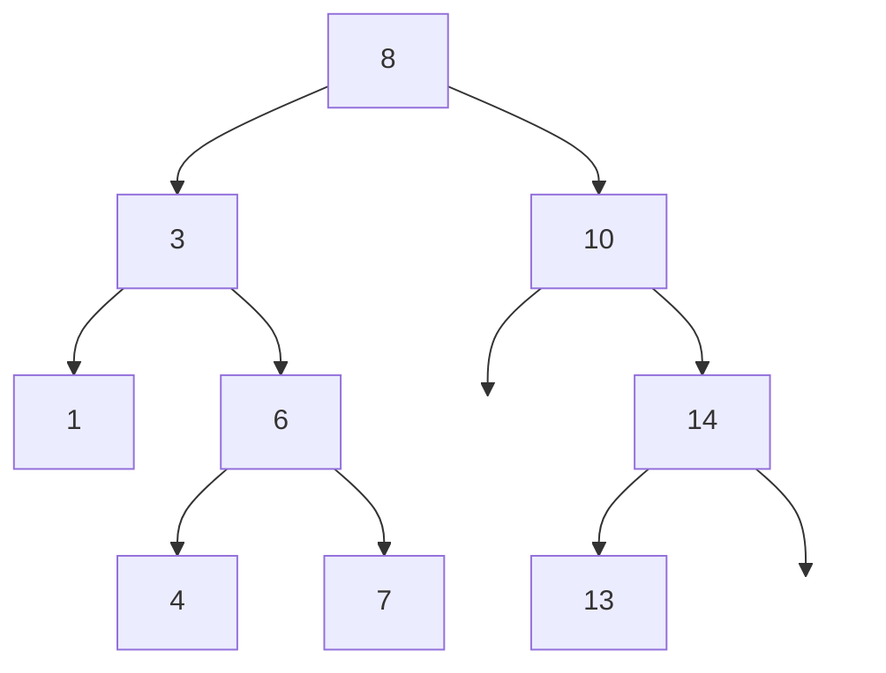

Dans une liste triée, la recherche dichotomique trouve une clé en $O(\log n)$, mais insérer une nouvelle clé coûte
$\Theta(n)$ (décalage). Dans une table de hachage, tout est rapide en moyenne, mais l'ordre des clés est perdu (impossible
de parcourir les clés triées ou de trouver « la plus petite clé supérieure à x » efficacement). L'**arbre binaire de
recherche** combine les avantages : il garde les clés **ordonnées**, et recherche, insertion et suppression coûtent un temps
proportionnel à sa **hauteur** — logarithmique s'il est équilibré. C'est la structure derrière de nombreux index de bases de
données et les dictionnaires ordonnés de nombreux langages.

## 1. Définition

:::definition
Un **arbre binaire de recherche** (ABR) est un arbre binaire dont les nœuds portent des **clés** comparables, tel que pour
**chaque** nœud de clé $k$ : toutes les clés du sous-arbre **gauche** sont **inférieures** à $k$, et toutes celles du
sous-arbre **droit** sont **supérieures** à $k$. (On suppose ici les clés distinctes.)
:::



:::retenir
Le parcours **infixe** d'un ABR donne les clés dans l'**ordre croissant** : 1, 3, 4, 6, 7, 8, 10, 13, 14.
:::

:::attention
La condition porte sur **tout le sous-arbre**, pas seulement sur les enfants directs. L'arbre de racine 8, d'enfant gauche
3, lui-même d'enfant droit 9, respecte « gauche < parent < droit » localement, mais 9 est dans le sous-arbre gauche de 8 :
ce n'est **pas** un ABR.
:::

## 2. Rechercher

On compare la clé cherchée à celle de la racine : égale, on a trouvé ; plus petite, on continue **à gauche** ; plus grande,
**à droite**. C'est une dichotomie le long d'une branche.

```python exec
class Noeud:
    def __init__(self, cle, gauche=None, droit=None):
        self.cle, self.gauche, self.droit = cle, gauche, droit

def rechercher(a, x):
    while a is not None:
        if x == a.cle:
            return True
        a = a.gauche if x < a.cle else a.droit
    return False

def inserer(a, x):
    """Renvoie l'ABR a dans lequel x a été inséré (comme nouvelle feuille)."""
    if a is None:
        return Noeud(x)
    if x < a.cle:
        a.gauche = inserer(a.gauche, x)
    elif x > a.cle:
        a.droit = inserer(a.droit, x)
    return a                      # x déjà présent : rien à faire

def infixe(a, res):
    if a:
        infixe(a.gauche, res); res.append(a.cle); infixe(a.droit, res)
    return res

abr = None
for x in [8, 3, 10, 1, 6, 14, 4, 7, 13]:
    abr = inserer(abr, x)
print(infixe(abr, []), rechercher(abr, 7), rechercher(abr, 5))
```

Recherche de 7 : 8 (7 < 8, à gauche) → 3 (7 > 3, à droite) → 6 (à droite) → 7 : trouvé en 4 comparaisons. Recherche de 5 :
8 → 3 → 6 → 4 → sous-arbre droit de 4 vide : absent.

## 3. Insérer

On cherche la clé ; si elle est absente, on arrive sur un sous-arbre vide : c'est là qu'on accroche une **nouvelle feuille**
(code ci-dessus). Le résultat reste un ABR, car la nouvelle clé est placée exactement là où une recherche la chercherait.

## 4. Minimum, maximum, suppression

Le **minimum** est au bout de la branche la plus à gauche ; le maximum, à droite.

La **suppression** d'une clé distingue trois cas :
1. le nœud est une **feuille** : on le retire ;
2. il a **un seul enfant** : on le remplace par cet enfant ;
3. il a **deux enfants** : on remplace sa clé par celle de son **successeur** (le minimum de son sous-arbre droit, qui est
   la plus petite clé plus grande que lui), puis on supprime ce successeur du sous-arbre droit (il n'a pas d'enfant gauche,
   donc on est dans le cas 1 ou 2).

```python exec
class Noeud:
    def __init__(self, cle, gauche=None, droit=None):
        self.cle, self.gauche, self.droit = cle, gauche, droit

def inserer(a, x):
    if a is None:
        return Noeud(x)
    if x < a.cle:
        a.gauche = inserer(a.gauche, x)
    elif x > a.cle:
        a.droit = inserer(a.droit, x)
    return a

def minimum(a):
    while a.gauche is not None:
        a = a.gauche
    return a.cle

def supprimer(a, x):
    if a is None:
        return None
    if x < a.cle:
        a.gauche = supprimer(a.gauche, x)
    elif x > a.cle:
        a.droit = supprimer(a.droit, x)
    else:
        if a.gauche is None:           # cas 1 et 2 : au plus un enfant
            return a.droit
        if a.droit is None:
            return a.gauche
        s = minimum(a.droit)           # cas 3 : le successeur
        a.cle = s
        a.droit = supprimer(a.droit, s)
    return a

def infixe(a, res):
    if a:
        infixe(a.gauche, res); res.append(a.cle); infixe(a.droit, res)
    return res

abr = None
for x in [8, 3, 10, 1, 6, 14, 4, 7, 13]:
    abr = inserer(abr, x)
abr = supprimer(abr, 3)       # deux enfants : remplacé par 4
print(abr.gauche.cle, infixe(abr, []))
```

## 5. Le coût dépend de la hauteur

Recherche, insertion, minimum et suppression descendent le long d'**une seule branche** : leur coût est $O(h)$, où $h$ est
la hauteur de l'arbre. Or, pour $n$ clés, $\lfloor \log_2 n \rfloor \le h \le n - 1$ :

- si les clés arrivent dans un ordre « mélangé », l'arbre est à peu près équilibré : on montre qu'en moyenne (sur les ordres
  d'insertion aléatoires) la hauteur est en $O(\log n)$ ;
- si elles arrivent **triées** (1, 2, 3, …), chaque clé devient l'enfant droit de la précédente : l'arbre est un **peigne**
  de hauteur $n - 1$ et toutes les opérations deviennent **linéaires**, comme dans une liste.

```python exec
import random

class Noeud:
    def __init__(self, cle):
        self.cle, self.gauche, self.droit = cle, None, None

def inserer_iteratif(a, x):
    n = Noeud(x)
    if a is None:
        return n
    c = a
    while True:
        if x < c.cle:
            if c.gauche is None:
                c.gauche = n; return a
            c = c.gauche
        else:
            if c.droit is None:
                c.droit = n; return a
            c = c.droit

def hauteur(a):
    h, niveau = -1, [a] if a else []
    while niveau:                      # parcours en largeur, niveau par niveau
        h += 1
        niveau = [e for n in niveau for e in (n.gauche, n.droit) if e]
    return h

for ordre in ["trié", "aléatoire"]:
    cles = list(range(1000))
    if ordre == "aléatoire":
        random.seed(1)
        random.shuffle(cles)
    a = None
    for x in cles:
        a = inserer_iteratif(a, x)
    print(ordre, "-> hauteur", hauteur(a))
```

Les arbres **équilibrés** (AVL, arbres rouge-noir…) réorganisent l'arbre par des **rotations** après chaque insertion ou
suppression pour garantir $h = O(\log n)$, donc toutes les opérations en $O(\log n)$ dans le pire cas (hors programme du
lycée, mais à connaître de nom).

:::prof
En terminale NSI, on demande de « rechercher une clé dans un arbre de recherche, insérer une clé ». La suppression est hors
programme du lycée mais classique au concours. Le lien avec la dichotomie (une comparaison élimine un sous-arbre entier)
et l'expérience « insertion dans l'ordre trié » (le peigne) sont deux moments forts de la séquence.
:::

## Exemple guidé

**Problème.** Construire un ABR **de hauteur minimale** contenant les clés d'une liste **triée**, en $\Theta(n)$, et
justifier sa hauteur.

**1. Idée (diviser pour régner).** La racine doit être l'élément du **milieu** : il y a alors autant de clés à gauche qu'à
droite. On construit récursivement le sous-arbre gauche avec la moitié gauche, le droit avec la moitié droite.

```python exec
class Noeud:
    def __init__(self, cle, gauche=None, droit=None):
        self.cle, self.gauche, self.droit = cle, gauche, droit

def construire(t, g=0, d=None):
    """ABR équilibré des clés triées t[g..d]."""
    if d is None:
        d = len(t) - 1
    if g > d:
        return None
    m = (g + d) // 2
    return Noeud(t[m], construire(t, g, m - 1), construire(t, m + 1, d))

def hauteur(a):
    return -1 if a is None else 1 + max(hauteur(a.gauche), hauteur(a.droit))

for n in [1, 7, 8, 1000, 1023, 1024]:
    print(n, hauteur(construire(list(range(n)))))
```

**2. Correction.** Par récurrence forte sur la taille : `t[m]` est supérieur à toutes les clés de `t[g..m-1]` et inférieur à
celles de `t[m+1..d]` (la liste est triée), et les deux sous-arbres sont des ABR par hypothèse : l'arbre est un ABR.

**3. Hauteur.** Une zone de taille $n$ donne deux zones de tailles au plus $\lfloor n/2 \rfloor$. On montre par récurrence
que la hauteur obtenue pour $n$ clés est $\lfloor \log_2 n \rfloor$, la plus petite possible (puisque $n \le 2^{h+1} - 1$
impose $h \ge \lfloor \log_2 n \rfloor$). Pour 1023 clés, hauteur 9 ; pour 1024, hauteur 10.

**4. Coût.** Chaque clé crée un nœud en temps constant (on passe des indices, pas des tranches) : $\Theta(n)$. Insérer les
clés une à une dans l'ordre trié aurait donné un peigne en $\Theta(n^2)$.

## L'essentiel

- ABR : pour **chaque** nœud, clés du sous-arbre gauche < clé < clés du sous-arbre droit ; parcours infixe trié.
- Recherche et insertion : on descend à gauche ou à droite selon la comparaison ; nouvelle clé = nouvelle feuille.
- Minimum : tout à gauche ; suppression : feuille, un enfant (on le remonte), deux enfants (successeur = min du sous-arbre droit).
- Coût $O(h)$ ; $\lfloor \log_2 n \rfloor \le h \le n - 1$ ; insertions triées → peigne → linéaire ; aléatoires → $O(\log n)$ en moyenne.
- Arbres équilibrés (AVL, rouge-noir) : $O(\log n)$ garanti. Liste triée → ABR équilibré par le milieu, en $\Theta(n)$.

## Exercices

::::exercice[Est-ce un ABR ?]{niveau=1}
On considère l'arbre de racine 10, dont l'enfant gauche est 5 (avec pour enfants 2 et 12) et l'enfant droit est 15.
Est-ce un arbre binaire de recherche ?

- [ ] oui, car chaque enfant gauche est plus petit que son parent et chaque enfant droit plus grand
- [x] non, car 12 est dans le sous-arbre gauche de 10 alors que 12 > 10
- [ ] non, car 15 devrait être à gauche
- [ ] oui, car le parcours préfixe est 10, 5, 2, 12, 15

:::corrige
La condition locale (5 < 10, 2 < 5 < 12, 15 > 10) est respectée, mais 12 se trouve dans le sous-arbre **gauche** de 10 :
toutes les clés de ce sous-arbre doivent être inférieures à 10. Le parcours infixe 2, 5, 12, 10, 15 n'est d'ailleurs pas trié.
:::
::::

::::exercice[Forme de l'arbre]{niveau=1}
On insère dans un ABR vide les clés 5, 4, 3, 2, 1, dans cet ordre. Quelle est la hauteur obtenue (racine seule : 0) ?

- [ ] 2
- [x] 4
- [ ] 5
- [ ] 1

:::corrige
Chaque clé est plus petite que la précédente et devient son enfant gauche : on obtient un « peigne » à gauche de 5 nœuds,
de hauteur 4. Une recherche de 1 demande 5 comparaisons, comme dans une liste.
:::
::::

::::exercice[Insérer et rechercher]{niveau=2}
Avec la classe `Noeud` fournie, écris `inserer(a, x)` (renvoie la racine ; ne fait rien si `x` est déjà présent) et
`rechercher(a, x)` (itérative).

```python depart
class Noeud:
    def __init__(self, cle, gauche=None, droit=None):
        self.cle = cle
        self.gauche = gauche
        self.droit = droit

def inserer(a, x):
    ...

def rechercher(a, x):
    ...
```

```python tests
a = None
for x in [8, 3, 10, 1, 6, 14, 4, 7, 13, 6]:
    a = inserer(a, x)
assert a.cle == 8 and a.gauche.cle == 3 and a.droit.droit.gauche.cle == 13, "forme de l'arbre"
assert all(rechercher(a, x) for x in [8, 3, 10, 1, 6, 14, 4, 7, 13]), "toutes les clés présentes"
assert not rechercher(a, 5) and not rechercher(a, 20) and not rechercher(a, 0), "clés absentes"
assert not rechercher(None, 1), "arbre vide"
```

:::corrige
```python solution
class Noeud:
    def __init__(self, cle, gauche=None, droit=None):
        self.cle = cle
        self.gauche = gauche
        self.droit = droit

def inserer(a, x):
    if a is None:
        return Noeud(x)
    if x < a.cle:
        a.gauche = inserer(a.gauche, x)
    elif x > a.cle:
        a.droit = inserer(a.droit, x)
    return a

def rechercher(a, x):
    while a is not None:
        if x == a.cle:
            return True
        a = a.gauche if x < a.cle else a.droit
    return False
```
L'insertion renvoie la racine : c'est ce qui permet d'écrire `a.gauche = inserer(a.gauche, x)` et de traiter l'arbre vide.
:::
::::

::::exercice[Vérifier un ABR]{niveau=3}
Écris `est_abr(a)` qui vérifie qu'un arbre binaire est un ABR (clés distinctes), en $\Theta(n)$. Attention : il faut comparer
chaque nœud à **tous** ses ancêtres, pas seulement à ses enfants.

```python depart
class Noeud:
    def __init__(self, cle, gauche=None, droit=None):
        self.cle = cle
        self.gauche = gauche
        self.droit = droit

def est_abr(a):
    ...
```

```python tests
bon = Noeud(8, Noeud(3, Noeud(1), Noeud(6)), Noeud(10, None, Noeud(14)))
assert est_abr(bon) == True, "ABR valide"
piege = Noeud(10, Noeud(5, Noeud(2), Noeud(12)), Noeud(15))
assert est_abr(piege) == False, "12 dans le sous-arbre gauche de 10"
assert est_abr(None) == True, "arbre vide"
assert est_abr(Noeud(2, Noeud(2))) == False, "clé égale à gauche"
```

:::corrige
```python solution
class Noeud:
    def __init__(self, cle, gauche=None, droit=None):
        self.cle = cle
        self.gauche = gauche
        self.droit = droit

def est_abr(a, mini=None, maxi=None):
    if a is None:
        return True
    if (mini is not None and a.cle <= mini) or (maxi is not None and a.cle >= maxi):
        return False
    return est_abr(a.gauche, mini, a.cle) and est_abr(a.droit, a.cle, maxi)
```
Chaque appel reçoit l'intervalle ouvert `(mini, maxi)` dans lequel doivent se trouver toutes les clés du sous-arbre. Autre
méthode : vérifier que le parcours infixe est strictement croissant.
:::
::::

::::exercice[Supprimer une clé]{niveau=3}
Écris `supprimer(a, x)` qui supprime la clé `x` de l'ABR `a` (si elle est présente) et renvoie la nouvelle racine, en
traitant les trois cas (feuille, un enfant, deux enfants avec le successeur).

```python depart
class Noeud:
    def __init__(self, cle, gauche=None, droit=None):
        self.cle = cle
        self.gauche = gauche
        self.droit = droit

def supprimer(a, x):
    ...
```

```python tests
def construire(cles):
    a = None
    def ins(a, x):
        if a is None: return Noeud(x)
        if x < a.cle: a.gauche = ins(a.gauche, x)
        else: a.droit = ins(a.droit, x)
        return a
    for x in cles:
        a = ins(a, x)
    return a
def infixe(a):
    return infixe(a.gauche) + [a.cle] + infixe(a.droit) if a else []
a = construire([8, 3, 10, 1, 6, 14, 4, 7, 13])
a = supprimer(a, 1)
assert infixe(a) == [3, 4, 6, 7, 8, 10, 13, 14], "suppression d'une feuille"
a = supprimer(a, 14)
assert infixe(a) == [3, 4, 6, 7, 8, 10, 13], "suppression d'un nœud à un enfant"
a = supprimer(a, 8)
assert infixe(a) == [3, 4, 6, 7, 10, 13] and a.cle == 10, "suppression de la racine (deux enfants)"
assert infixe(supprimer(a, 99)) == [3, 4, 6, 7, 10, 13], "clé absente"
assert supprimer(Noeud(5), 5) is None, "dernier nœud"
```

:::corrige
```python solution
class Noeud:
    def __init__(self, cle, gauche=None, droit=None):
        self.cle = cle
        self.gauche = gauche
        self.droit = droit

def supprimer(a, x):
    if a is None:
        return None
    if x < a.cle:
        a.gauche = supprimer(a.gauche, x)
    elif x > a.cle:
        a.droit = supprimer(a.droit, x)
    else:
        if a.gauche is None:
            return a.droit
        if a.droit is None:
            return a.gauche
        s = a.droit
        while s.gauche is not None:
            s = s.gauche
        a.cle = s.cle
        a.droit = supprimer(a.droit, s.cle)
    return a
```
Pour la racine 8 (deux enfants), le successeur est le minimum du sous-arbre droit, 10 : il prend la place de 8.
:::
::::

::::exercice[Hauteur et ordre d'insertion]{niveau=4 duree=25}
1. Montre que si l'on insère dans un ABR vide les clés $1, 2, \dots, n$ dans cet ordre, l'arbre obtenu a une hauteur $n - 1$,
   et calcule le nombre total de comparaisons effectuées par les $n$ insertions.
2. Donne un ordre d'insertion des clés 1 à 7 qui produit un arbre de hauteur 2 (le plus petit possible). Généralise : décris
   un ordre d'insertion des clés $1$ à $2^k - 1$ qui donne un arbre parfait.
3. On veut une structure qui permette de trouver rapidement, pour une clé $x$, la plus petite clé présente supérieure ou égale
   à $x$. Explique comment le faire dans un ABR en $O(h)$, et pourquoi c'est difficile avec une table de hachage.
4. Compare, pour $n$ clés, une liste triée, une table de hachage et un ABR équilibré pour : recherche, insertion, parcours
   dans l'ordre, recherche du successeur.

:::criteres
- Q1 : chaque nouvelle clé est supérieure à toutes les précédentes et devient l'enfant droit du dernier nœud : peigne de hauteur $n - 1$ ; l'insertion de la clé $k$ fait $k - 1$ comparaisons ; total $\frac{n(n-1)}{2}$.
- Q2 : ordre 4, 2, 6, 1, 3, 5, 7 (milieu d'abord, puis milieux des moitiés, niveau par niveau) ; généralisation : insérer les clés dans l'ordre d'un parcours en largeur (ou préfixe) de l'arbre parfait, c'est-à-dire le milieu puis récursivement les milieux.
- Q3 : on descend depuis la racine en mémorisant le dernier nœud dont la clé est ≥ x quand on part à gauche ; coût $O(h)$ ; une table de hachage disperse les clés sans ordre, il faudrait tout parcourir.
- Q4 : tableau comparatif correct (liste triée : recherche $\log n$, insertion $n$, parcours $n$, successeur $\log n$ ; hachage : $O(1)$, $O(1)$, $n \log n$ pour l'ordre, $n$ ; ABR équilibré : $\log n$ partout, parcours $n$).
:::

:::corrige
1. Par récurrence : après l'insertion de $1, \dots, k$, l'arbre est le peigne $1 \to 2 \to \dots \to k$ (chaque nœud n'a qu'un
   enfant droit). La clé $k + 1$ est plus grande que toutes : on descend à droite jusqu'au bout et elle devient l'enfant droit
   de $k$. La hauteur finale est $n - 1$. L'insertion de la clé $k$ compare $k$ aux $k - 1$ clés du peigne :
   $\sum_{k=1}^{n} (k - 1) = \frac{n(n-1)}{2}$ comparaisons, $\Theta(n^2)$.
2. Ordre 4, 2, 6, 1, 3, 5, 7 : 4 à la racine, 2 et 6 au niveau 1, puis 1, 3, 5, 7 au niveau 2 : hauteur 2 = $\lfloor \log_2 7 \rfloor$.
   En général, on insère d'abord la clé du milieu $2^{k-1}$, puis les milieux des deux moitiés, puis ceux des quarts… :
   c'est l'ordre d'un parcours en largeur de l'arbre parfait. Tout ordre où chaque clé est insérée après ses ancêtres dans
   l'arbre parfait convient (par exemple l'ordre préfixe).
3. On descend comme pour une recherche, en gardant un candidat : si `x <= a.cle`, la clé de `a` est un candidat (on le
   mémorise) et on cherche plus petit à gauche ; si `x > a.cle`, on va à droite. À la fin, le dernier candidat mémorisé est la
   réponse. Une seule branche est parcourue : $O(h)$. Une table de hachage range les clés selon leur hachage, sans relation
   avec leur ordre : il faudrait examiner toutes les clés ($\Theta(n)$).
4. | Opération            | liste triée          | table de hachage        | ABR équilibré |
   |----------------------|----------------------|-------------------------|---------------|
   | recherche            | $O(\log n)$          | $O(1)$ en moyenne       | $O(\log n)$   |
   | insertion            | $O(n)$ (décalage)    | $O(1)$ en moyenne       | $O(\log n)$   |
   | parcours trié        | $O(n)$               | $O(n \log n)$ (tri)     | $O(n)$ (infixe) |
   | successeur de $x$    | $O(\log n)$          | $O(n)$                  | $O(\log n)$   |

   L'ABR équilibré est le bon compromis dès qu'on a besoin à la fois de mises à jour fréquentes **et** de l'ordre des clés.
:::
::::
