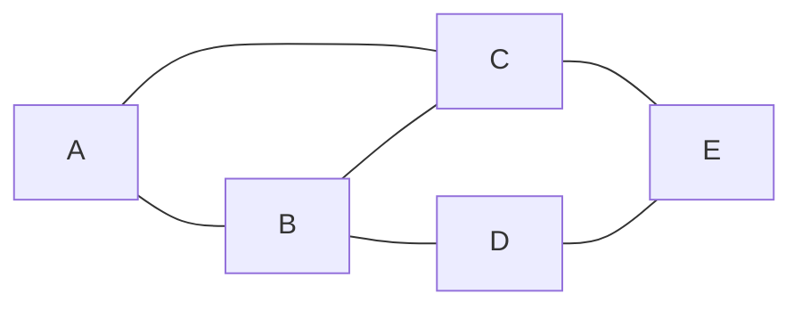
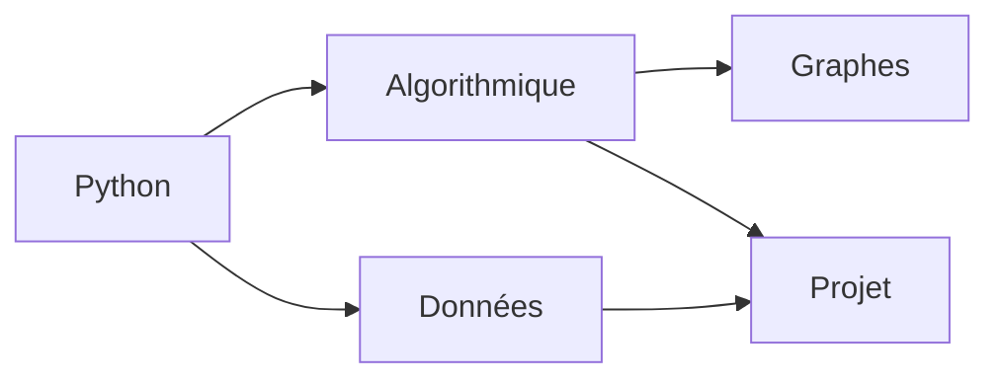

Un réseau social (qui est ami avec qui), un plan de métro (quelles stations sont reliées), Internet (quels routeurs sont
connectés, avec quel débit), les prérequis d'un cursus (quel cours doit précéder quel autre), un labyrinthe : toutes ces
situations parlent d'**objets** et de **relations** entre eux. Un **graphe** est le modèle mathématique de ce genre de
situation. Cette leçon pose le vocabulaire et les deux grandes façons de représenter un graphe en mémoire ; les suivantes
présentent les algorithmes (parcours, plus courts chemins). La théorie (propriétés, preuves) est dans le module
mathématiques.

## 1. Vocabulaire

:::definition
Un **graphe non orienté** $G = (S, A)$ est formé d'un ensemble $S$ de **sommets** et d'un ensemble $A$ d'**arêtes**, chaque
arête reliant deux sommets $\{u, v\}$. Deux sommets reliés sont **voisins** (adjacents). Le **degré** d'un sommet est son
nombre de voisins.

Dans un **graphe orienté**, les relations sont des **arcs** $(u, v)$, qui vont de $u$ vers $v$ ; on distingue **degré
sortant** et **degré entrant**. Dans un graphe **pondéré**, chaque arête ou arc porte un **poids** (distance, durée, coût, débit).
:::



```mermaid legende="Un graphe orienté pondéré (temps de trajet en minutes)"
graph LR
  P((Paris)) -- 60 --> L((Lille))
  P -- 120 --> R((Rennes))
  L -- 90 --> R
  R -- 45 --> N((Nantes))
  N -- 130 --> P
```

Un **chemin** est une suite de sommets dont deux consécutifs sont reliés ; sa **longueur** est son nombre d'arêtes (ou la
somme des poids). Un **cycle** est un chemin qui revient à son point de départ. Un graphe non orienté est **connexe** si
deux sommets quelconques sont reliés par un chemin.

:::retenir
Dans un graphe non orienté, la somme des degrés est égale à **deux fois le nombre d'arêtes** (chaque arête est comptée par
ses deux extrémités). Pour le premier graphe : degrés 2, 3, 3, 2, 2, somme 12 = 2 × 6.
:::

## 2. Représentation par matrice d'adjacence

On numérote les sommets de $0$ à $n - 1$. La **matrice d'adjacence** $M$ est un tableau $n \times n$ avec $M[i][j] = 1$ s'il
y a une arête (ou un arc) de $i$ vers $j$, et $0$ sinon (ou le poids, pour un graphe pondéré, et une valeur spéciale en
l'absence d'arête). Pour un graphe non orienté, elle est **symétrique**.

```python exec
# Sommets : A=0, B=1, C=2, D=3, E=4
M = [
    [0, 1, 1, 0, 0],   # A
    [1, 0, 1, 1, 0],   # B
    [1, 1, 0, 0, 1],   # C
    [0, 1, 0, 0, 1],   # D
    [0, 0, 1, 1, 0],   # E
]
print("B et D voisins ?", M[1][3] == 1)                 # O(1)
print("voisins de C :", [j for j in range(5) if M[2][j]])  # O(n)
print("degrés :", [sum(ligne) for ligne in M])
```

## 3. Représentation par listes d'adjacence

Pour chaque sommet, on garde la **liste de ses voisins**. En Python, un dictionnaire sommet → liste est très pratique (les
sommets peuvent alors être des noms) :

```python exec
G = {
    "A": ["B", "C"],
    "B": ["A", "C", "D"],
    "C": ["A", "B", "E"],
    "D": ["B", "E"],
    "E": ["C", "D"],
}
print("voisins de C :", G["C"])                        # O(1) pour obtenir la liste
print("B et D voisins ?", "D" in G["B"])               # O(deg(B))
print("nombre d'arêtes :", sum(len(v) for v in G.values()) // 2)

# Graphe orienté pondéré : sommet -> liste de (voisin, poids)
trajets = {"Paris": [("Lille", 60), ("Rennes", 120)], "Lille": [("Rennes", 90)],
           "Rennes": [("Nantes", 45)], "Nantes": [("Paris", 130)]}
print(trajets["Paris"])
```

## 4. Comparer les deux représentations

Avec $n$ sommets et $m$ arêtes :

| Critère                          | Matrice d'adjacence | Listes d'adjacence     |
|----------------------------------|---------------------|------------------------|
| mémoire                          | $\Theta(n^2)$       | $\Theta(n + m)$        |
| « u et v sont-ils voisins ? »    | $O(1)$              | $O(\deg u)$            |
| parcourir les voisins de u       | $\Theta(n)$         | $\Theta(\deg u)$       |
| parcourir tout le graphe         | $\Theta(n^2)$       | $\Theta(n + m)$        |
| ajouter un sommet                | $\Theta(n^2)$ (recopie) | $O(1)$             |

Un graphe a au plus $\frac{n(n-1)}{2}$ arêtes (non orienté). La plupart des graphes réels sont **peu denses** : un réseau
routier, un réseau social (chacun a quelques centaines d'amis parmi des millions d'inscrits). Les **listes d'adjacence**
sont alors bien plus économes. La matrice convient aux petits graphes ou aux graphes **denses**, et aux algorithmes qui font
beaucoup de tests d'adjacence (ou des calculs matriciels).

## 5. Une interface Graphe

On retrouve la distinction **interface / implémentation** : un algorithme de parcours n'a besoin que de « la liste des
sommets » et de « les voisins de u ». On peut l'écrire une fois, quelle que soit la représentation.

```python exec
class Graphe:
    """Graphe non orienté, implémenté par listes d'adjacence."""
    def __init__(self):
        self._adj = {}

    def ajouter_sommet(self, s):
        self._adj.setdefault(s, [])

    def ajouter_arete(self, u, v):
        self.ajouter_sommet(u)
        self.ajouter_sommet(v)
        if v not in self._adj[u]:
            self._adj[u].append(v)
            self._adj[v].append(u)

    def sommets(self):
        return list(self._adj)

    def voisins(self, s):
        return list(self._adj[s])

    def degre(self, s):
        return len(self._adj[s])

g = Graphe()
for u, v in [("A", "B"), ("A", "C"), ("B", "C"), ("B", "D"), ("C", "E"), ("D", "E")]:
    g.ajouter_arete(u, v)
print(g.sommets(), g.voisins("B"), g.degre("B"))
```

:::prof
En terminale NSI, on demande de « modéliser des situations sous forme de graphes » et de « passer d'une représentation à
une autre » (matrice d'adjacence, listes de successeurs). En SNT, le thème « réseaux sociaux » utilise les graphes (degré,
distance, « petit monde »). Les élèves confondent souvent orienté et non orienté dans la matrice (oubli de la symétrie) :
faire dessiner le graphe à partir de la matrice, et inversement, est un bon exercice de base.
:::

## Exemple guidé

**Problème.** Un lycée propose des modules dont certains en exigent d'autres : « Python » avant « Algorithmique » et
« Données » ; « Algorithmique » avant « Graphes » ; « Données » et « Algorithmique » avant « Projet ». Modéliser par un
graphe, donner les deux représentations, et trouver les modules sans prérequis.

**1. Modéliser.** Un sommet par module, un **arc** $u \to v$ si $u$ doit être suivi avant $v$ : le graphe est **orienté**.



**2. Représentations.** Avec l'ordre Python (0), Algorithmique (1), Données (2), Graphes (3), Projet (4) :

```python exec
noms = ["Python", "Algorithmique", "Données", "Graphes", "Projet"]
arcs = [(0, 1), (0, 2), (1, 3), (1, 4), (2, 4)]
n = len(noms)
M = [[0] * n for _ in range(n)]
for u, v in arcs:
    M[u][v] = 1                     # orienté : pas de symétrie
succ = {noms[u]: [noms[v] for v in range(n) if M[u][v]] for u in range(n)}
for ligne in M:
    print(ligne)
print(succ)
entrants = [sum(M[u][v] for u in range(n)) for v in range(n)]
print("sans prérequis :", [noms[v] for v in range(n) if entrants[v] == 0])
```

**3. Lire les degrés.** Le **degré entrant** d'un sommet (somme de sa **colonne**) est son nombre de prérequis ; un module
sans prérequis a un degré entrant nul : ici seulement « Python ». Le degré sortant (somme de la **ligne**) compte les
modules qu'il débloque.

**4. Et ensuite ?** Trouver un ordre de suivi des modules compatible avec tous les prérequis, c'est calculer un **tri
topologique** : un parcours du graphe orienté (leçon suivante). Il n'existe que si le graphe n'a pas de cycle.

## L'essentiel

- Graphe = sommets + arêtes (non orienté) ou arcs (orienté), éventuellement **pondérés**. Voisin, degré, chemin, cycle, connexité.
- Somme des degrés = 2 × nombre d'arêtes (non orienté).
- **Matrice d'adjacence** $n \times n$ : mémoire $\Theta(n^2)$, test d'adjacence $O(1)$, voisins en $\Theta(n)$ ; symétrique si non orienté.
- **Listes d'adjacence** (dict sommet → voisins) : mémoire $\Theta(n + m)$, voisins en $\Theta(\deg)$ ; idéales pour les graphes peu denses.
- Un algorithme sur les graphes s'écrit avec l'interface (sommets, voisins), indépendamment de la représentation.

## Exercices

::::exercice[Somme des degrés]{niveau=1}
Un graphe non orienté a 7 sommets de degrés 3, 3, 2, 2, 2, 1, 1. Combien a-t-il d'arêtes ?

- [ ] 14
- [x] 7
- [ ] 6
- [ ] on ne peut pas savoir

:::corrige
La somme des degrés vaut $3 + 3 + 2 + 2 + 2 + 1 + 1 = 14 = 2m$, donc $m = 7$ arêtes.
:::
::::

::::exercice[Choisir la représentation]{niveau=1}
Un réseau social compte un million d'utilisateurs ; chacun a en moyenne 200 amis. Combien de cases contiendrait sa matrice
d'adjacence, et quelle proportion vaudrait 1 ?

- [ ] $10^6$ cases, 20 %
- [x] $10^{12}$ cases, 0,02 %
- [ ] $2 \times 10^8$ cases, 50 %
- [ ] $10^{12}$ cases, 20 %

:::corrige
$n^2 = (10^6)^2 = 10^{12}$ cases (des téraoctets). Il y a $10^6 \times 200 = 2 \times 10^8$ cases à 1 (chaque amitié compte
deux fois), soit $2 \times 10^8 / 10^{12} = 0{,}02\,\%$. Les listes d'adjacence ne stockent que ces $2 \times 10^8$ entrées.
:::
::::

::::exercice[De la matrice aux listes]{niveau=2}
Écris `vers_listes(M)` qui convertit une matrice d'adjacence (sommets numérotés de 0 à n − 1) en dictionnaire sommet → liste
des voisins (dans l'ordre croissant).

```python depart
def vers_listes(M):
    ...
```

```python tests
M = [[0, 1, 1, 0], [1, 0, 0, 1], [1, 0, 0, 0], [0, 1, 0, 0]]
assert vers_listes(M) == {0: [1, 2], 1: [0, 3], 2: [0], 3: [1]}, "graphe non orienté"
assert vers_listes([[0, 1], [0, 0]]) == {0: [1], 1: []}, "graphe orienté"
assert vers_listes([]) == {}, "graphe vide"
```

:::corrige
```python solution
def vers_listes(M):
    n = len(M)
    return {i: [j for j in range(n) if M[i][j]] for i in range(n)}
```
Coût $\Theta(n^2)$ : il faut lire toute la matrice.
:::
::::

::::exercice[Des listes à la matrice]{niveau=2}
Écris `vers_matrice(G, ordre)` qui construit la matrice d'adjacence du graphe `G` (dictionnaire sommet → liste de voisins),
les sommets étant numérotés selon leur position dans la liste `ordre`.

```python depart
def vers_matrice(G, ordre):
    ...
```

```python tests
G = {"A": ["B", "C"], "B": ["A"], "C": ["A"]}
assert vers_matrice(G, ["A", "B", "C"]) == [[0, 1, 1], [1, 0, 0], [1, 0, 0]], "non orienté"
assert vers_matrice(G, ["C", "B", "A"]) == [[0, 0, 1], [0, 0, 1], [1, 1, 0]], "autre numérotation"
assert vers_matrice({"x": ["y"], "y": []}, ["x", "y"]) == [[0, 1], [0, 0]], "orienté"
```

:::corrige
```python solution
def vers_matrice(G, ordre):
    indice = {s: i for i, s in enumerate(ordre)}
    n = len(ordre)
    M = [[0] * n for _ in range(n)]
    for u in G:
        for v in G[u]:
            M[indice[u]][indice[v]] = 1
    return M
```
Le dictionnaire `indice` évite d'appeler `ordre.index(s)` (linéaire) pour chaque arête.
:::
::::

::::exercice[Degrés entrants et sortants]{niveau=2}
Pour un graphe **orienté** donné par listes de successeurs, écris `degres(G)` qui renvoie un dictionnaire
sommet → `(degré entrant, degré sortant)`, en $\Theta(n + m)$.

```python depart
def degres(G):
    ...
```

```python tests
G = {"Py": ["Al", "Do"], "Al": ["Gr", "Pr"], "Do": ["Pr"], "Gr": [], "Pr": []}
assert degres(G) == {"Py": (0, 2), "Al": (1, 2), "Do": (1, 1), "Gr": (1, 0), "Pr": (2, 0)}, "prérequis"
assert degres({"a": ["a"]}) == {"a": (1, 1)}, "boucle sur un sommet"
```

:::corrige
```python solution
def degres(G):
    entrant = {s: 0 for s in G}
    for u in G:
        for v in G[u]:
            entrant[v] += 1
    return {s: (entrant[s], len(G[s])) for s in G}
```
Une seule passe sur tous les arcs ($m$) et sur les sommets ($n$) : $\Theta(n + m)$. Avec une matrice, il faudrait sommer
les colonnes : $\Theta(n^2)$.
:::
::::

::::exercice[Un graphe pondéré]{niveau=3}
Écris une classe `GraphePondere` (non orienté) avec `ajouter_arete(u, v, poids)`, `voisins(u)` (liste de couples
`(voisin, poids)`), `poids(u, v)` (renvoie `None` s'il n'y a pas d'arête) et `poids_total()` (somme des poids des arêtes,
chaque arête comptée une fois). Utilise un dictionnaire de dictionnaires : `self._adj[u][v] = poids`.

```python depart
class GraphePondere:
    def __init__(self):
        self._adj = {}

    def ajouter_arete(self, u, v, poids):
        ...

    def voisins(self, u):
        ...

    def poids(self, u, v):
        ...

    def poids_total(self):
        ...
```

```python tests
g = GraphePondere()
g.ajouter_arete("Paris", "Lille", 225)
g.ajouter_arete("Paris", "Rennes", 350)
g.ajouter_arete("Lille", "Rennes", 570)
assert g.poids("Rennes", "Paris") == 350, "symétrie"
assert g.poids("Lille", "Nantes") is None, "pas d'arête"
assert sorted(g.voisins("Paris")) == [("Lille", 225), ("Rennes", 350)], "voisins pondérés"
assert g.poids_total() == 1145, "chaque arête comptée une fois"
```

:::corrige
```python solution
class GraphePondere:
    def __init__(self):
        self._adj = {}

    def ajouter_arete(self, u, v, poids):
        self._adj.setdefault(u, {})[v] = poids
        self._adj.setdefault(v, {})[u] = poids

    def voisins(self, u):
        return list(self._adj.get(u, {}).items())

    def poids(self, u, v):
        return self._adj.get(u, {}).get(v)

    def poids_total(self):
        return sum(p for u in self._adj for p in self._adj[u].values()) // 2
```
Le dictionnaire de dictionnaires donne le test d'adjacence et le poids en $O(1)$ en moyenne, tout en restant économe en
mémoire. Chaque arête apparaît deux fois (dans les deux sens), d'où la division par 2 (les poids sont entiers ici).
:::
::::

::::exercice[Modéliser et justifier]{niveau=4 duree=20}
Pour chacune des situations suivantes, propose une modélisation par un graphe (sommets, arêtes ou arcs, poids éventuels,
orienté ou non), choisis une représentation en mémoire et justifie ton choix par les opérations à réaliser et la taille
des données.

1. Les 304 stations du métro parisien et les liaisons directes entre stations, pour calculer des itinéraires.
2. Un tournoi de 16 équipes où chaque équipe rencontre toutes les autres, et où l'on doit souvent vérifier si une équipe a
   battu une autre.
3. Le Web : des milliards de pages, et les liens hypertextes d'une page vers d'autres.
4. Pour la situation 1, combien de cases aurait la matrice d'adjacence, et combien d'entrées les listes d'adjacence (en
   supposant environ 370 liaisons) ?

:::criteres
- Métro : sommets = stations, arêtes = liaisons directes, non orienté (sauf rares sens uniques), pondéré par le temps de trajet ; listes d'adjacence (graphe peu dense, opération principale : parcourir les voisins).
- Tournoi : sommets = équipes, arc u → v si u a battu v (orienté) ; graphe complet (dense, 120 matchs) et tests fréquents : matrice d'adjacence 16 × 16.
- Web : sommets = pages, arcs = liens (orienté) ; immense et très peu dense : listes d'adjacence (de successeurs), stockées de façon distribuée.
- Calcul : matrice $304^2 = 92\,416$ cases ; listes : $2 \times 370 = 740$ entrées (plus 304 listes).
:::

:::corrige
1. **Métro** : un sommet par station, une arête entre deux stations consécutives sur une ligne, pondérée par la durée du
   trajet (ou la distance) ; non orienté (quelques sections à sens unique demanderaient des arcs). Graphe **peu dense**
   (chaque station a 2 à 8 voisines) et l'opération clé des algorithmes d'itinéraire est « parcourir les voisins » :
   **listes d'adjacence** pondérées.
2. **Tournoi** : un sommet par équipe, un **arc** $u \to v$ si $u$ a battu $v$ (orienté) ; c'est un graphe **complet** (une
   arête entre chaque paire, $\binom{16}{2} = 120$ matchs) : dense, et petit. Comme on teste souvent « u a-t-elle battu v ? »,
   une **matrice d'adjacence** 16 × 16 donne la réponse en $O(1)$ pour 256 cases seulement.
3. **Web** : un sommet par page, un arc par lien (orienté). Des milliards de sommets, chacun avec quelques dizaines de liens :
   extrêmement peu dense ; une matrice est inimaginable ($10^{18}$ cases et plus). **Listes de successeurs**, réparties sur de
   nombreuses machines (c'est la donnée de base de l'algorithme PageRank).
4. Matrice : $304 \times 304 = 92\,416$ cases, dont environ 740 non nulles. Listes d'adjacence : 304 listes contenant en tout
   $2 \times 370 = 740$ entrées (chaque liaison apparaît dans les listes de ses deux stations).
:::
::::
