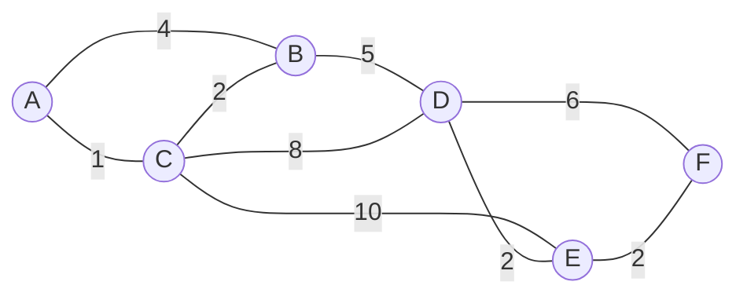

Un GPS cherche le trajet le plus **rapide**, pas celui qui traverse le moins de carrefours ; un routeur cherche la route
de plus faible **coût**, pas celle qui a le moins de sauts. Dès que les liaisons ont des **poids** (durée, distance, coût),
le parcours en largeur ne suffit plus. L'algorithme d'Edsger **Dijkstra** (1956) calcule les plus courts chemins depuis un
sommet dans un graphe à poids **positifs**. C'est un algorithme **glouton** optimal, qu'on retrouve au programme de
terminale (algorithmes sur les graphes, protocole de routage OSPF) et dans les sujets d'écrit.

## 1. Le problème

Dans un graphe pondéré à poids **positifs ou nuls**, le **poids** (ou longueur) d'un chemin est la somme des poids de ses
arêtes ; la **distance** $\delta(s, v)$ est le plus petit poids d'un chemin de $s$ à $v$ (∞ s'il n'y en a pas). On veut
toutes les distances depuis une **source** $s$, et un plus court chemin vers chaque sommet.



## 2. L'idée : un glouton sur les distances

On maintient pour chaque sommet une **distance provisoire** `dist[v]` (au départ 0 pour $s$, ∞ pour les autres), et un
ensemble de sommets **définitifs**. À chaque étape :

1. on choisit, parmi les sommets non définitifs, celui de plus petite distance provisoire, $u$ ; il devient **définitif** ;
2. on **relâche** chaque arc $(u, v)$ : si `dist[u] + w(u, v) < dist[v]`, on améliore `dist[v]` et on note `parent[v] = u`.

L'intuition : comme les poids sont positifs, aucun chemin passant par un sommet encore plus loin ne pourra faire mieux pour
$u$ que sa distance actuelle.

### Déroulé à la main

On note les distances provisoires à chaque étape ; le sommet rendu définitif est encadré (en gras).

| étape | définitif choisi | A   | B     | C     | D      | E      | F      |
|-------|------------------|-----|-------|-------|--------|--------|--------|
| 0     | —                | 0   | ∞     | ∞     | ∞      | ∞      | ∞      |
| 1     | A (0)            | **0** | 4 (A) | 1 (A) | ∞    | ∞      | ∞      |
| 2     | C (1)            |     | 3 (C) | **1** | 9 (C)  | 11 (C) | ∞      |
| 3     | B (3)            |     | **3** |       | 8 (B)  | 11 (C) | ∞      |
| 4     | D (8)            |     |       |       | **8**  | 10 (D) | 14 (D) |
| 5     | E (10)           |     |       |       |        | **10** | 12 (E) |
| 6     | F (12)           |     |       |       |        |        | **12** |

(Entre parenthèses : le parent.) Distances finales : A 0, C 1, B 3, D 8, E 10, F 12. Plus court chemin vers F, en remontant
les parents : F ← E ← D ← B ← C ← A, soit **A → C → B → D → E → F**, de poids 1 + 2 + 5 + 2 + 2 = 12.

## 3. Programmer Dijkstra avec un tas

Pour trouver rapidement le sommet de plus petite distance, on utilise une **file de priorité** (un tas, module `heapq`)
contenant des couples `(distance, sommet)`. Quand une distance est améliorée, on ajoute simplement un nouveau couple ; les
anciens couples devenus obsolètes sont ignorés quand on les extrait.

```python exec
import heapq

G = {"A": [("B", 4), ("C", 1)], "B": [("A", 4), ("C", 2), ("D", 5)],
     "C": [("A", 1), ("B", 2), ("D", 8), ("E", 10)], "D": [("B", 5), ("C", 8), ("E", 2), ("F", 6)],
     "E": [("C", 10), ("D", 2), ("F", 2)], "F": [("D", 6), ("E", 2)]}

def dijkstra(G, source):
    dist = {s: float("inf") for s in G}
    parent = {s: None for s in G}
    dist[source] = 0
    tas = [(0, source)]
    definitifs = set()
    while tas:
        d, u = heapq.heappop(tas)
        if u in definitifs:
            continue                       # couple obsolète
        definitifs.add(u)
        for v, w in G[u]:
            if d + w < dist[v]:            # relâchement
                dist[v] = d + w
                parent[v] = u
                heapq.heappush(tas, (dist[v], v))
    return dist, parent

def chemin(parent, cible):
    c = []
    while cible is not None:
        c.append(cible)
        cible = parent[cible]
    return c[::-1]

dist, parent = dijkstra(G, "A")
print(dist)
print(chemin(parent, "F"))
```

**Coût.** Chaque arc peut provoquer un ajout dans le tas : au plus $m$ ajouts (un graphe non orienté compte chaque arête
deux fois), et autant d'extractions, chacune en $O(\log m) = O(\log n)$. Total : $O((n + m) \log n)$. Avec un simple tableau
des distances et une recherche linéaire du minimum à chaque étape, on obtient $O(n^2)$, préférable si le graphe est **dense**
($m$ proche de $n^2$).

## 4. Pourquoi c'est juste (et quand ça ne l'est plus)

:::retenir[Idée de la preuve]
Invariant : pour tout sommet **définitif** $u$, `dist[u]` est la vraie distance $\delta(s, u)$. Supposons qu'au moment où $u$
est choisi, un chemin plus court $P$ existe vers $u$. $P$ part de $s$ (définitif) et finit en $u$ (pas encore définitif) :
il sort de l'ensemble des définitifs par un premier arc $(x, y)$, avec $x$ définitif et $y$ non. Comme $x$ a été relâché,
`dist[y]` ≤ poids de $P$ jusqu'à $y$ ≤ poids de $P$ (les poids sont **positifs**) < `dist[u]`. Alors $y$ aurait dû être choisi
avant $u$ : contradiction.
:::

L'argument utilise que les poids sont **positifs** : le morceau de $P$ après $y$ ne peut pas faire baisser le total. Avec un
arc **négatif**, Dijkstra peut se tromper :

```mermaid legende="Contre-exemple avec un poids négatif : Dijkstra fige B à 2 alors que A → C → B coûte 1"
graph LR
  A((A)) -- 2 --> B((B))
  A -- 4 --> C((C))
  C -- "-3" --> B
```

Dijkstra rend B définitif avec la distance 2 (le minimum au moment du choix), alors que A → C → B coûte $4 - 3 = 1$. Pour
des poids négatifs (sans cycle de poids négatif), on utilise l'algorithme de **Bellman-Ford** ($O(nm)$).

| Situation                              | Algorithme            | Coût            |
|----------------------------------------|-----------------------|-----------------|
| graphe non pondéré (ou poids tous égaux) | parcours en largeur | $O(n + m)$      |
| poids positifs ou nuls                 | Dijkstra (avec tas)   | $O((n + m)\log n)$ |
| poids quelconques, sans cycle négatif  | Bellman-Ford          | $O(nm)$         |

:::prof
Le programme de terminale aborde Dijkstra à travers le **routage** : le protocole **OSPF** (à état de liens) fait calculer à
chaque routeur ses plus courts chemins, avec des coûts liés au débit des liaisons, alors que **RIP** compte simplement le
nombre de sauts. Le déroulé à la main dans un tableau est un exercice classique de bac ; insister sur le choix du **minimum
parmi les non définitifs**, et sur le fait qu'un sommet définitif ne change plus.
:::

## Exemple guidé

**Problème (type écrit 2).** Dans un réseau, les coûts OSPF des liaisons sont : R1–R2 : 10, R1–R3 : 1, R3–R2 : 1, R2–R4 : 1,
R3–R4 : 10, R4–R5 : 1. Calculer la table de routage de R1 (pour chaque destination, le **premier routeur** à qui transmettre).

**1. Dijkstra depuis R1.**

| étape | définitif | R1 | R2      | R3     | R4      | R5      |
|-------|-----------|----|---------|--------|---------|---------|
| 1     | R1 (0)    | 0  | 10 (R1) | 1 (R1) | ∞       | ∞       |
| 2     | R3 (1)    |    | 2 (R3)  | **1**  | 11 (R3) | ∞       |
| 3     | R2 (2)    |    | **2**   |        | 3 (R2)  | ∞       |
| 4     | R4 (3)    |    |         |        | **3**   | 4 (R4)  |
| 5     | R5 (4)    |    |         |        |         | **4**   |

**2. Table de routage.** Le prochain saut vers une destination est le **premier sommet après R1** sur le plus court chemin :
on remonte les parents jusqu'à l'enfant de R1.

```python exec
import heapq

G = {"R1": [("R2", 10), ("R3", 1)], "R2": [("R1", 10), ("R3", 1), ("R4", 1)],
     "R3": [("R1", 1), ("R2", 1), ("R4", 10)], "R4": [("R2", 1), ("R3", 10), ("R5", 1)], "R5": [("R4", 1)]}

def dijkstra(G, s):
    dist = {v: float("inf") for v in G}
    parent = {v: None for v in G}
    dist[s] = 0
    tas, fini = [(0, s)], set()
    while tas:
        d, u = heapq.heappop(tas)
        if u in fini:
            continue
        fini.add(u)
        for v, w in G[u]:
            if d + w < dist[v]:
                dist[v], parent[v] = d + w, u
                heapq.heappush(tas, (dist[v], v))
    return dist, parent

dist, parent = dijkstra(G, "R1")
for dest in ["R2", "R3", "R4", "R5"]:
    v = dest
    while parent[v] != "R1":
        v = parent[v]
    print(f"vers {dest} : coût {dist[dest]}, transmettre à {v}")
```

**3. Lecture.** Tout passe par R3 : même vers R2, la liaison directe R1–R2 (coût 10, par exemple une liaison lente) est
moins bonne que R1 → R3 → R2 (coût 2). Avec RIP (nombre de sauts), R1 enverrait vers R2 directement (1 saut).

## L'essentiel

- Dijkstra : plus courts chemins depuis une source, **poids positifs ou nuls**.
- À chaque étape : le non-définitif de plus petite distance devient définitif, puis on relâche ses arcs ; `parent` permet de reconstruire les chemins.
- Avec un tas : $O((n + m) \log n)$ ; avec un tableau : $O(n^2)$.
- Correction : les poids positifs garantissent qu'un sommet définitif ne peut plus être amélioré ; avec un poids négatif, contre-exemple.
- Non pondéré → BFS ; positifs → Dijkstra ; négatifs → Bellman-Ford. OSPF utilise Dijkstra.

## Exercices

::::exercice[Choisir l'algorithme]{niveau=1}
Pour trouver le trajet le plus rapide entre deux villes sur une carte routière (durées positives), quel algorithme utiliser ?

- [ ] le parcours en largeur
- [x] l'algorithme de Dijkstra
- [ ] le parcours en profondeur
- [ ] un tri topologique

:::corrige
Les liaisons ont des poids (durées) différents : le BFS minimiserait le nombre de routes empruntées, pas la durée. Les
durées étant positives, Dijkstra convient.
:::
::::

::::exercice[Premier sommet définitif]{niveau=1}
Depuis A, avec les arcs A → B (7), A → C (3), C → B (2), B → D (1), C → D (6), quels sommets sont rendus définitifs
dans l'ordre par Dijkstra ?

- [ ] A, B, C, D
- [x] A, C, B, D
- [ ] A, C, D, B
- [ ] A, B, D, C

:::corrige
A (0). Relâchement : B = 7, C = 3. Minimum : C (3) ; relâche B = min(7, 3 + 2) = 5, D = 9. Minimum : B (5) ; relâche
D = min(9, 6) = 6. Puis D (6). Ordre : A, C, B, D.
:::
::::

::::exercice[Programmer Dijkstra]{niveau=2}
Écris `dijkstra(G, source)` qui renvoie le dictionnaire des distances depuis `source` (∞ pour les sommets inaccessibles).
`G` est un dictionnaire sommet → liste de couples `(voisin, poids)`. Utilise `heapq`.

```python depart
import heapq

def dijkstra(G, source):
    ...
```

```python tests
G = {"A": [("B", 7), ("C", 3)], "B": [("D", 1)], "C": [("B", 2), ("D", 6)], "D": []}
assert dijkstra(G, "A") == {"A": 0, "B": 5, "C": 3, "D": 6}, "graphe orienté"
assert dijkstra(G, "D") == {"A": float("inf"), "B": float("inf"), "C": float("inf"), "D": 0}, "rien n'est accessible depuis D"
H = {1: [(2, 1), (3, 4)], 2: [(1, 1), (3, 1)], 3: [(1, 4), (2, 1)]}
assert dijkstra(H, 1) == {1: 0, 2: 1, 3: 2}, "non orienté : 1 -> 2 -> 3"
```

:::corrige
```python solution
import heapq

def dijkstra(G, source):
    dist = {s: float("inf") for s in G}
    dist[source] = 0
    tas = [(0, source)]
    definitifs = set()
    while tas:
        d, u = heapq.heappop(tas)
        if u in definitifs:
            continue
        definitifs.add(u)
        for v, w in G[u]:
            if d + w < dist[v]:
                dist[v] = d + w
                heapq.heappush(tas, (dist[v], v))
    return dist
```
Le test `if u in definitifs: continue` ignore les couples obsolètes (une distance améliorée ajoute un nouveau couple sans
retirer l'ancien).
:::
::::

::::exercice[Reconstruire le chemin]{niveau=2}
Écris `plus_court_chemin(G, source, cible)` qui renvoie le couple `(distance, chemin)` où `chemin` est la liste des sommets
d'un plus court chemin, ou `(inf, None)` si la cible est inaccessible.

```python depart
import heapq

def plus_court_chemin(G, source, cible):
    ...
```

```python tests
G = {"A": [("B", 4), ("C", 1)], "B": [("A", 4), ("C", 2), ("D", 5)],
     "C": [("A", 1), ("B", 2), ("D", 8), ("E", 10)], "D": [("B", 5), ("C", 8), ("E", 2), ("F", 6)],
     "E": [("C", 10), ("D", 2), ("F", 2)], "F": [("D", 6), ("E", 2)]}
assert plus_court_chemin(G, "A", "F") == (12, ["A", "C", "B", "D", "E", "F"]), "exemple du cours"
assert plus_court_chemin(G, "A", "A") == (0, ["A"]), "source = cible"
assert plus_court_chemin({"x": [], "y": []}, "x", "y") == (float("inf"), None), "inaccessible"
```

:::corrige
```python solution
import heapq

def plus_court_chemin(G, source, cible):
    dist = {s: float("inf") for s in G}
    parent = {s: None for s in G}
    dist[source] = 0
    tas, definitifs = [(0, source)], set()
    while tas:
        d, u = heapq.heappop(tas)
        if u in definitifs:
            continue
        definitifs.add(u)
        if u == cible:
            break                         # la cible est définitive : on peut s'arrêter
        for v, w in G[u]:
            if d + w < dist[v]:
                dist[v], parent[v] = d + w, u
                heapq.heappush(tas, (dist[v], v))
    if dist[cible] == float("inf"):
        return float("inf"), None
    chemin, v = [], cible
    while v is not None:
        chemin.append(v)
        v = parent[v]
    return dist[cible], chemin[::-1]
```
On peut arrêter l'algorithme dès que la cible devient définitive : sa distance ne changera plus.
:::
::::

::::exercice[Dijkstra sur une matrice]{niveau=3}
Écris `dijkstra_matrice(M, s)` pour un graphe donné par une matrice des poids `M` (`None` en l'absence d'arête, sommets
numérotés de 0 à n − 1), **sans tas** : à chaque étape, on cherche le minimum par un parcours. Le coût doit être $O(n^2)$.

```python depart
def dijkstra_matrice(M, s):
    ...
```

```python tests
INF = float("inf")
M = [[None, 7, 3, None], [None, None, None, 1], [None, 2, None, 6], [None, None, None, None]]
assert dijkstra_matrice(M, 0) == [0, 5, 3, 6], "graphe orienté"
assert dijkstra_matrice(M, 3) == [INF, INF, INF, 0], "rien d'accessible"
assert dijkstra_matrice([[None]], 0) == [0], "un seul sommet"
```

:::corrige
```python solution
def dijkstra_matrice(M, s):
    n = len(M)
    INF = float("inf")
    dist = [INF] * n
    dist[s] = 0
    definitif = [False] * n
    for _ in range(n):
        u, du = -1, INF
        for v in range(n):                     # recherche linéaire du minimum
            if not definitif[v] and dist[v] < du:
                u, du = v, dist[v]
        if u == -1:
            break                              # le reste est inaccessible
        definitif[u] = True
        for v in range(n):
            if M[u][v] is not None and du + M[u][v] < dist[v]:
                dist[v] = du + M[u][v]
    return dist
```
$n$ étapes, chacune en $O(n)$ (recherche du minimum et relâchement d'une ligne) : $O(n^2)$, sans structure auxiliaire.
:::
::::

::::exercice[Correction et poids négatifs]{niveau=4 duree=25}
1. Déroule Dijkstra depuis A sur le graphe orienté A → B (2), A → C (4), C → B (−3), B → D (1). Quelle distance
   obtient-on pour B et pour D ? Quelles sont les vraies distances ?
2. Explique précisément à quel endroit la preuve de correction de Dijkstra utilise l'hypothèse « poids positifs ».
3. On ajoute la même constante $k$ (par exemple 3) à **tous** les poids pour les rendre positifs, puis on applique Dijkstra.
   Montre sur l'exemple que cela ne donne pas les bons plus courts chemins, et explique pourquoi en général.
4. Pourquoi un graphe avec un cycle de poids total négatif n'a-t-il pas de « plus court chemin » ?

:::criteres
- Q1 : Dijkstra rend B définitif à 2 (avant de traiter C), puis D à 3 ; vraies distances : B = 1 (A → C → B), D = 2.
- Q2 : l'argument « le reste du chemin après y ne peut pas faire baisser le total » (donc dist[y] ≤ poids du chemin < dist[u]) suppose des poids ≥ 0.
- Q3 : avec +3 : A → B coûte 5, A → C → B coûte 7 + 0 = 7 ; Dijkstra choisit A → B. Ajouter k pénalise les chemins à proportion de leur nombre d'arêtes (+k par arête), ce qui change l'ordre des chemins de longueurs différentes.
- Q4 : en parcourant le cycle de plus en plus de fois, on obtient des chemins (marches) de poids arbitrairement petit : pas de minimum.
:::

:::corrige
1. Initialisation : A = 0. A définitif : B = 2, C = 4. Minimum : **B (2)** devient définitif ; relâchement de B → D : D = 3.
   Minimum : D (3), puis C (4) ; le relâchement de C → B donnerait $4 - 3 = 1 < 2$, mais B est **déjà définitif**.
   Résultat : B = 2, D = 3. Vraies distances : B = 1 (A → C → B), D = 2 (A → C → B → D).
2. Dans la preuve, on considère un plus court chemin $P$ vers $u$ qui sort des sommets définitifs par un arc $(x, y)$, et on
   affirme que `dist[y]` est au plus le poids de $P$ jusqu'à $y$, **lui-même au plus le poids total de $P$** : cette dernière
   inégalité exige que la fin du chemin (de $y$ à $u$) ait un poids **positif ou nul**. Avec un arc négatif, la fin du chemin
   peut faire baisser le total, et $u$ peut être choisi trop tôt.
3. En ajoutant 3 : A → B (5), A → C (7), C → B (0), B → D (4). Dijkstra donne B = 5 par A → B, alors que A → C → B vaut 7 :
   il choisit A → B, qui est un **mauvais** chemin pour les poids d'origine (2 contre 1). En général, ajouter $k$ à chaque arête
   ajoute $k \times (\text{nombre d'arêtes})$ au poids d'un chemin : les chemins longs sont plus pénalisés que les courts, et
   l'ordre entre chemins de longueurs différentes change.
4. Si un cycle a un poids total $c < 0$, en le parcourant $t$ fois on obtient un trajet de poids $p + t\,c$, aussi petit qu'on
   veut quand $t$ augmente : il n'existe pas de plus petit poids, la distance n'est pas définie (on dit qu'elle vaut $-\infty$).
   Bellman-Ford détecte précisément ces cycles.
:::
::::
