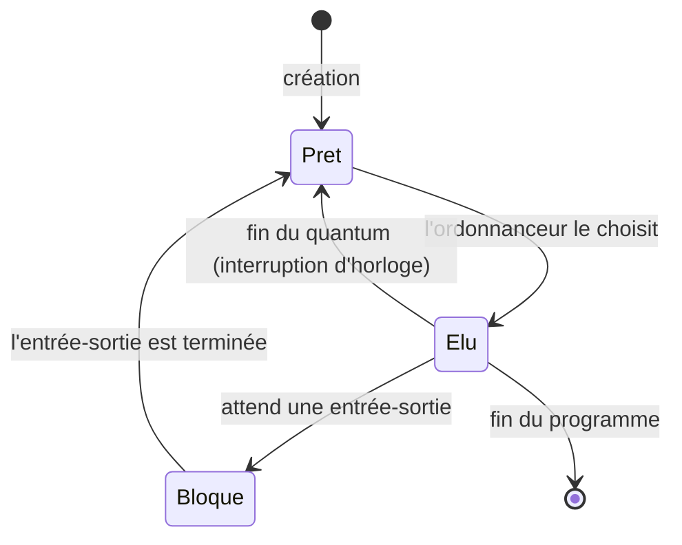
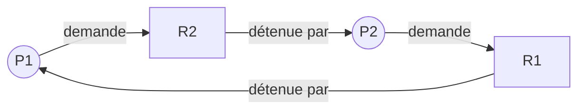

Sur ton ordinateur, des centaines de **processus** existent en même temps : le navigateur, le lecteur de musique, l'antivirus, les
services du système… alors que le processeur n'a que quelques cœurs. Le système d'exploitation leur donne la main à tour de rôle, si vite
(toutes les quelques millisecondes) que tout semble simultané. Comment choisit-il ? Et que se passe-t-il quand deux processus se disputent
les mêmes ressources ?

## 1. Programme et processus

:::definition
Un **processus** est un programme **en cours d'exécution**. Le noyau lui associe un **identifiant** (PID), un espace mémoire, l'état de ses
registres (dont le compteur ordinal), ses fichiers ouverts, son propriétaire, sa priorité : c'est le **contexte**, rangé dans le
**descripteur de processus** (PCB). Lancer deux fois le même programme crée deux processus.
:::

Sous Unix, un processus en crée un autre par l'appel système `fork` (copie du processus parent), puis l'enfant charge souvent un autre
programme avec `exec`. Les processus forment ainsi un **arbre** dont la racine (PID 1) est lancée au démarrage. Les commandes `ps -ef` ou
`pstree` l'affichent ; sous Windows, le gestionnaire des tâches.



Passer d'un processus à un autre est une **commutation de contexte** : le noyau sauvegarde les registres du processus sortant dans son
PCB et restaure ceux de l'entrant. Elle a un coût (quelques microsecondes), d'où l'intérêt de ne pas commuter trop souvent.

## 2. L'ordonnancement

L'**ordonnanceur** choisit, parmi les processus **prêts**, celui qui s'exécute. Plusieurs politiques, avec des objectifs contradictoires
(débit, équité, temps de réponse) :

| Politique | Principe | Points forts / faibles |
|---|---|---|
| premier arrivé, premier servi (FIFO) | dans l'ordre d'arrivée, chacun jusqu'au bout | simple ; une tâche longue fait attendre toutes les autres |
| plus court d'abord (SJF) | la tâche la plus courte parmi les prêtes | attente moyenne **minimale** ; il faut connaître les durées ; famine des longues |
| tourniquet (*round robin*) | chacun un **quantum**, puis retour en fin de file | équitable, bon temps de réponse (interactif) ; plus de commutations |
| priorités | la priorité la plus haute d'abord | adaptable (temps réel) ; famine si les priorités ne vieillissent pas |

Les systèmes réels combinent ces idées (Linux : files à priorités dynamiques, équité du temps processeur reçu).

:::methode[Diagramme de Gantt et temps d'attente]
On trace sur un axe du temps qui occupe le processeur. Pour chaque processus : **temps de séjour** = instant de fin − instant d'arrivée ;
**temps d'attente** = temps de séjour − durée d'exécution. On compare les politiques par la moyenne des temps d'attente.
:::

```python exec
def tourniquet(processus, quantum):
    """processus : liste de (nom, durée), tous arrivés à l'instant 0. Renvoie (gantt, fins)."""
    from collections import deque
    file = deque(processus)
    t, gantt, fins = 0, [], {}
    while file:
        nom, reste = file.popleft()
        tranche = min(quantum, reste)
        gantt.append((t, t + tranche, nom))
        t += tranche
        if reste > tranche:
            file.append((nom, reste - tranche))     # retour en fin de file
        else:
            fins[nom] = t
    return gantt, fins

gantt, fins = tourniquet([("A", 5), ("B", 2), ("C", 4)], quantum=2)
print(" ".join(f"[{d}-{f} {n}]" for d, f, n in gantt))
print("fins :", fins)
durees = {"A": 5, "B": 2, "C": 4}
print("attentes :", {n: fins[n] - durees[n] for n in fins})
```

## 3. Concurrence : quand l'ordre change le résultat

Deux processus (ou deux fils d'exécution) qui partagent une variable peuvent se gêner. `x = x + 1` se décompose en trois instructions
machine : **lire** x dans un registre, **ajouter** 1, **écrire** le registre dans x. Si l'ordonnanceur interrompt le premier entre la
lecture et l'écriture, le second lit l'**ancienne** valeur : une incrémentation est perdue.

```python exec
from itertools import permutations

# Chaque processus exécute : lire x dans son registre, ajouter 1, écrire.
def resultats_possibles():
    finaux = set()
    etapes = ["P1"] * 3 + ["P2"] * 3
    for ordre in set(permutations(etapes)):           # tous les entrelacements
        x, registre, pas = 0, {"P1": 0, "P2": 0}, {"P1": 0, "P2": 0}
        for p in ordre:
            if pas[p] == 0:   registre[p] = x          # lire
            elif pas[p] == 1: registre[p] += 1         # ajouter
            else:             x = registre[p]          # écrire
            pas[p] += 1
        finaux.add(x)
    return finaux

print("valeurs finales possibles de x :", resultats_possibles())
```

C'est une **situation de compétition** (*race condition*). La portion de code qui manipule la ressource partagée est une **section
critique** : on la protège par un **verrou** (*mutex*) que les processus prennent avant et rendent après ; un seul peut le détenir à la
fois (**exclusion mutuelle**).

## 4. L'interblocage

Les verrous créent un nouveau risque. P1 détient la ressource R1 et demande R2 ; P2 détient R2 et demande R1 : chacun attend l'autre,
**indéfiniment**. C'est un **interblocage** (*deadlock*).



:::retenir[Conditions de Coffman (1971)]
Un interblocage ne peut se produire que si les **quatre** conditions sont réunies : **exclusion mutuelle** (ressource non partageable),
**détention et attente** (on garde ce qu'on a en demandant plus), **pas de réquisition** (on ne peut pas retirer une ressource à un
processus), **attente circulaire**. Prévenir = casser l'une d'elles ; la plus pratique : imposer un **ordre global** de prise des
ressources (toujours R1 avant R2), ce qui rend tout cycle impossible.
:::

Avec des ressources à un seul exemplaire, il y a interblocage si et seulement si le **graphe d'attente** (P → Q quand P attend une
ressource détenue par Q) contient un **cycle** : c'est un problème de graphes (parcours en profondeur).

:::prof
En terminale NSI : « décrire la création d'un processus, l'ordonnancement de plusieurs processus par le système », « mettre en évidence le
risque de l'interblocage ». Une manipulation simple : lancer `ps` et `top` (ou le gestionnaire des tâches) ; puis une activité débranchée où
les élèves jouent les processus et l'ordonnanceur avec un « jeton processeur ». Le dîner des philosophes (Dijkstra, 1965) est l'exemple
classique d'interblocage à faire jouer, avant d'en chercher les solutions.
:::

## Exemple guidé

**Problème.** Trois processus arrivent : A (arrivée 0, durée 8), B (arrivée 1, durée 4), C (arrivée 2, durée 2). Comparer les temps d'attente
moyens en FIFO et en « plus court d'abord » **non préemptif** (une tâche commencée va jusqu'au bout).

**1. FIFO.** A de 0 à 8, B de 8 à 12, C de 12 à 14. Attentes : A 0, B $8 - 1 = 7$, C $12 - 2 = 10$. Moyenne $17/3 \approx 5{,}67$.

**2. Plus court d'abord.** À l'instant 0, seul A est là : il s'exécute jusqu'à 8. À 8, B et C sont prêts : C (plus court) de 8 à 10, puis B
de 10 à 14. Attentes : A 0, C $8 - 2 = 6$, B $10 - 1 = 9$. Moyenne $15/3 = 5$.

```python exec
def non_preemptif(processus, choisir):
    """processus : liste de (nom, arrivée, durée). choisir : fonction qui choisit parmi les prêts."""
    t, restants, attentes = 0, list(processus), {}
    while restants:
        prets = [p for p in restants if p[1] <= t]
        if not prets:                                  # processeur inactif jusqu'à la prochaine arrivée
            t = min(p[1] for p in restants)
            continue
        nom, arrivee, duree = choisir(prets)
        attentes[nom] = t - arrivee
        t += duree
        restants.remove((nom, arrivee, duree))
    return attentes

procs = [("A", 0, 8), ("B", 1, 4), ("C", 2, 2)]
fifo = non_preemptif(procs, lambda prets: min(prets, key=lambda p: p[1]))
sjf = non_preemptif(procs, lambda prets: min(prets, key=lambda p: p[2]))
print("FIFO :", fifo, sum(fifo.values()) / 3)
print("SJF  :", sjf, sum(sjf.values()) / 3)
```

**3. Analyser.** SJF gagne, mais A, arrivé seul, monopolise le processeur 8 unités. Une version **préemptive** (le plus court **temps restant**
d'abord) interromprait A à l'arrivée de B : attente moyenne encore plus faible, au prix de commutations — et en pratique, on ne connaît pas
les durées à l'avance : on les **estime** d'après le passé du processus.

## L'essentiel

- Processus = programme en exécution (PID, mémoire, registres, fichiers) ; `fork` / `exec` ; arbre des processus.
- États : prêt, élu, bloqué ; commutation de contexte ; l'ordonnanceur reprend la main à chaque interruption d'horloge.
- Politiques : FIFO, plus court d'abord (attente moyenne minimale, famine), tourniquet (quantum, équité), priorités ; diagramme de Gantt ; attente = fin − arrivée − durée.
- Concurrence : `x = x + 1` n'est pas atomique → situation de compétition ; section critique protégée par un verrou.
- Interblocage : 4 conditions de Coffman ; détection = cycle dans le graphe d'attente ; prévention = ordre global des ressources.

## Exercices

::::exercice[États d'un processus]{niveau=1}
Un processus en cours d'exécution demande à lire un fichier sur le disque. Dans quel état passe-t-il ?

- [ ] Prêt
- [x] Bloqué
- [ ] Terminé
- [ ] Il reste élu pendant la lecture

:::corrige
Il attend la fin d'une entrée-sortie : il passe à l'état **bloqué**, et le processeur est donné à un autre processus prêt. Quand la lecture
est terminée (interruption du disque), il redevient **prêt**.
:::
::::

::::exercice[Interblocage ou non ?]{niveau=1}
P1 détient R1 et attend R2 ; P2 détient R2 et attend R3 ; P3 détient R3 et n'attend rien. Y a-t-il interblocage ?

- [ ] Oui, car deux processus attendent
- [x] Non : P3 finira et libérera R3, puis P2, puis P1 pourront avancer
- [ ] Oui, car il y a trois ressources
- [ ] On ne peut pas savoir

:::corrige
Graphe d'attente : P1 → P2 → P3, sans cycle. P3 n'attend rien : il se termine, libère R3, ce qui débloque P2, qui libère R2, ce qui débloque
P1. Il faudrait un cycle (par exemple que P3 attende R1) pour un interblocage.
:::
::::

::::exercice[Simuler le tourniquet]{niveau=2}
Écris `fins_tourniquet(processus, quantum)` : `processus` est une liste de couples `(nom, durée)` tous arrivés à l'instant 0, servis dans
l'ordre de la liste ; un processus qui n'a pas fini à la fin de son quantum repasse en **fin** de file. Renvoie le dictionnaire
`{nom: instant de fin}`.

```python depart
from collections import deque

def fins_tourniquet(processus, quantum):
    ...
```

```python tests
assert fins_tourniquet([("A", 5), ("B", 2), ("C", 4)], 2) == {"B": 4, "C": 10, "A": 11}, "quantum 2"
assert fins_tourniquet([("A", 5), ("B", 2), ("C", 4)], 10) == {"A": 5, "B": 7, "C": 11}, "grand quantum = FIFO"
assert fins_tourniquet([("A", 3), ("B", 3)], 1) == {"A": 5, "B": 6}, "quantum 1"
assert fins_tourniquet([], 3) == {}, "aucun processus"
```

:::corrige
```python solution
from collections import deque

def fins_tourniquet(processus, quantum):
    file = deque(processus)
    t, fins = 0, {}
    while file:
        nom, reste = file.popleft()
        tranche = min(quantum, reste)
        t += tranche
        if reste > tranche:
            file.append((nom, reste - tranche))
        else:
            fins[nom] = t
    return fins
```
Avec un quantum plus grand que toutes les durées, le tourniquet se comporte comme FIFO ; avec un quantum très petit, il se rapproche d'un
partage « simultané » du processeur, mais le coût des commutations (ignoré ici) devient prohibitif.
:::
::::

::::exercice[Détecter un interblocage]{niveau=2}
Écris `interblocage(attend)` : `attend` est un dictionnaire qui associe à chaque processus la liste des processus dont il attend une
ressource. Renvoie `True` si le graphe d'attente contient un cycle.

```python depart
def interblocage(attend):
    ...
```

```python tests
assert interblocage({"P1": ["P2"], "P2": ["P1"]}), "cycle de longueur 2"
assert not interblocage({"P1": ["P2"], "P2": ["P3"], "P3": []}), "chaîne sans cycle"
assert interblocage({"P1": ["P2"], "P2": ["P3"], "P3": ["P4"], "P4": ["P2"]}), "cycle qui ne passe pas par P1"
assert not interblocage({"P1": ["P2", "P3"], "P2": ["P4"], "P3": ["P4"], "P4": []}), "losange sans cycle"
assert interblocage({"P1": ["P1"]}), "boucle sur soi"
```

:::corrige
```python solution
def interblocage(attend):
    BLANC, GRIS, NOIR = 0, 1, 2
    couleur = {p: BLANC for p in attend}

    def explorer(p):
        couleur[p] = GRIS                       # en cours d'exploration
        for q in attend.get(p, []):
            c = couleur.get(q, BLANC)
            if c == GRIS:                       # on retombe sur un ancêtre : cycle
                return True
            if c == BLANC and explorer(q):
                return True
        couleur[p] = NOIR                       # entièrement exploré, sans cycle
        return False

    return any(couleur[p] == BLANC and explorer(p) for p in attend)
```
Parcours en profondeur à trois couleurs : un arc vers un sommet **gris** (sur la pile d'appels en cours) ferme un cycle. Le losange
P1 → P2 → P4 et P1 → P3 → P4 rencontre P4 déjà **noir** : ce n'est pas un cycle. Coût linéaire en nombre de processus et d'arcs.
:::
::::

::::exercice[Plus court temps restant d'abord]{niveau=3}
Écris `srtf(processus)` qui simule l'ordonnancement **préemptif** « plus court temps restant d'abord », unité de temps par unité de temps :
à chaque instant, parmi les processus arrivés et non terminés, on exécute celui qui a le plus petit temps restant (en cas d'égalité,
celui qui est arrivé le premier, puis le premier dans la liste). `processus` : liste de `(nom, arrivée, durée)`. Renvoie
`{nom: temps d'attente}` (fin − arrivée − durée).

```python depart
def srtf(processus):
    ...
```

```python tests
assert srtf([("A", 0, 8), ("B", 1, 4), ("C", 2, 2)]) == {"A": 6, "B": 2, "C": 0}, "préemption de A"
assert srtf([("A", 0, 3), ("B", 5, 2)]) == {"A": 0, "B": 0}, "processeur inactif entre les deux"
assert srtf([("A", 0, 2), ("B", 0, 2)]) == {"A": 0, "B": 2}, "égalité : ordre de la liste"
```

:::corrige
```python solution
def srtf(processus):
    reste = {nom: duree for nom, _, duree in processus}
    arrivee = {nom: a for nom, a, _ in processus}
    ordre = {nom: i for i, (nom, _, _) in enumerate(processus)}
    t, fins = 0, {}
    while len(fins) < len(processus):
        prets = [n for n in reste if arrivee[n] <= t and n not in fins]
        if not prets:
            t += 1
            continue
        n = min(prets, key=lambda n: (reste[n], arrivee[n], ordre[n]))
        reste[n] -= 1
        t += 1
        if reste[n] == 0:
            fins[n] = t
    return {n: fins[n] - arrivee[n] - d for n, _, d in processus}
```
Sur l'exemple : A de 0 à 1 ; à 1, B (4) < A (7 restants) : B s'exécute ; à 2, C (2) < B (3) : C de 2 à 4 ; puis B de 4 à 7 ; puis A de 7 à 14.
Attentes : A $14-0-8 = 6$, B $7-1-4 = 2$, C 0 ; moyenne $8/3 \approx 2{,}67$, contre 5 sans préemption. C'est l'optimum pour l'attente
moyenne, à condition de connaître les durées.
:::
::::

::::exercice[Le dîner des philosophes]{niveau=4 duree=25}
Cinq philosophes sont assis autour d'une table ; entre deux philosophes voisins se trouve une fourchette (cinq en tout). Pour manger, un
philosophe prend la fourchette à sa gauche, puis celle à sa droite ; il les repose après avoir mangé.

1. Montrez qu'un interblocage est possible. Quelles conditions de Coffman sont réunies ?
2. Proposez deux solutions qui empêchent l'interblocage, en précisant quelle condition chacune supprime.
3. Une solution sans interblocage peut-elle quand même laisser un philosophe affamé ? Expliquez.
4. Comment feriez-vous jouer cette situation en classe, et que doivent en retenir les élèves ?

:::criteres
- Scénario d'interblocage : chacun prend sa fourchette gauche au même moment, tous attendent la droite ; graphe d'attente circulaire ; les quatre conditions sont réunies (exclusion, détention et attente, pas de réquisition, attente circulaire).
- Solutions argumentées : ordre global sur les fourchettes (un philosophe prend la droite en premier, ou toujours la fourchette de plus petit numéro d'abord) qui casse l'attente circulaire ; prendre les deux fourchettes d'un coup ou reposer la gauche si la droite est prise (casse détention et attente) ; un « serveur » qui limite à quatre philosophes attablés.
- Famine : possible si un philosophe perd toujours la course (voisins qui alternent), distinction interblocage / famine.
- Mise en scène pédagogique concrète (élèves, objets, règles, minuteur) et trace écrite des notions (ressource, exclusion mutuelle, interblocage, famine).
:::

:::corrige
1. Si les cinq philosophes prennent **en même temps** leur fourchette gauche, toutes les fourchettes sont prises et chacun attend sa droite,
   détenue par son voisin : P1 attend P2, qui attend P3… qui attend P1. Attente **circulaire** ; les autres conditions sont réunies aussi :
   une fourchette ne sert qu'à un philosophe à la fois (exclusion mutuelle), chacun garde sa fourchette en attendant l'autre (détention et
   attente), personne ne peut arracher une fourchette à son voisin (pas de réquisition).
2. **Ordre global** : on numérote les fourchettes et chacun prend d'abord celle de plus petit numéro (le dernier philosophe prend donc sa
   droite en premier). Un cycle d'attente supposerait de « remonter » les numéros : l'**attente circulaire** devient impossible.
   **Tout ou rien** : un philosophe prend les deux fourchettes d'un seul coup (sous la protection d'un verrou global), ou repose sa gauche
   si la droite est occupée : on supprime **détention et attente**. Autre solution : un **serveur** n'autorise que quatre philosophes à
   tenter de manger en même temps — avec cinq fourchettes, l'un d'eux en obtient forcément deux.
3. Oui : l'absence d'interblocage garantit que **quelqu'un** progresse, pas que **chacun** progresse. Si les deux voisins d'un philosophe
   mangent en alternance, ses fourchettes ne sont jamais libres en même temps : il peut attendre indéfiniment. C'est une **famine** ; on
   la combat par l'équité (file d'attente, priorité croissante avec l'attente).
4. Cinq élèves autour d'une table, cinq crayons ; règles affichées ; au signal, chacun applique l'algorithme « gauche puis droite » : la
   classe observe le blocage. On fait ensuite inventer des règles qui l'évitent, on les teste, et on nomme les notions : ressource,
   exclusion mutuelle, interblocage, famine, graphe d'attente. Trace écrite avec le schéma du cycle et les quatre conditions.
:::
::::
